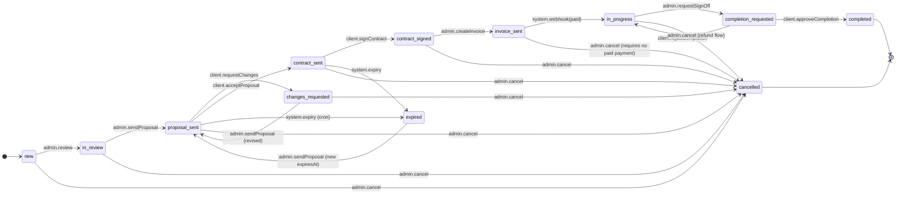
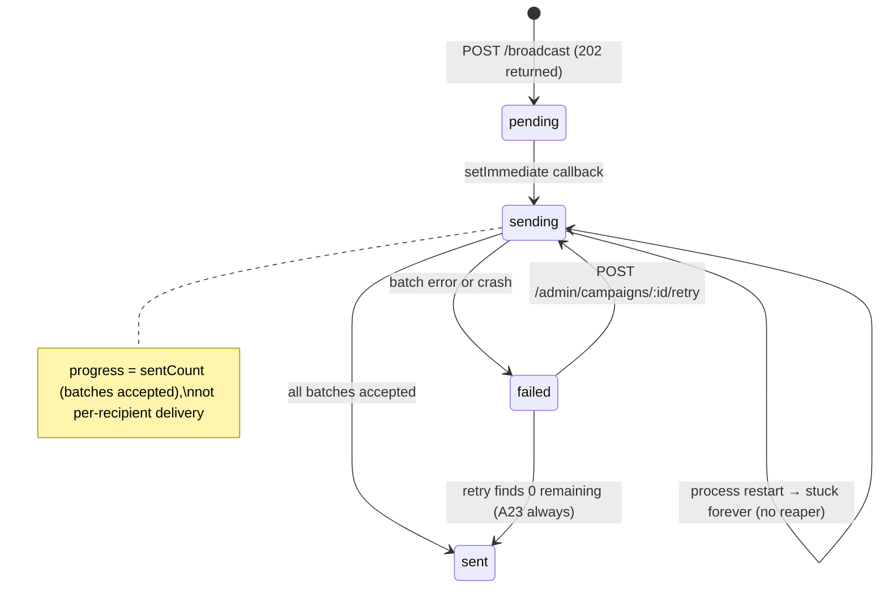
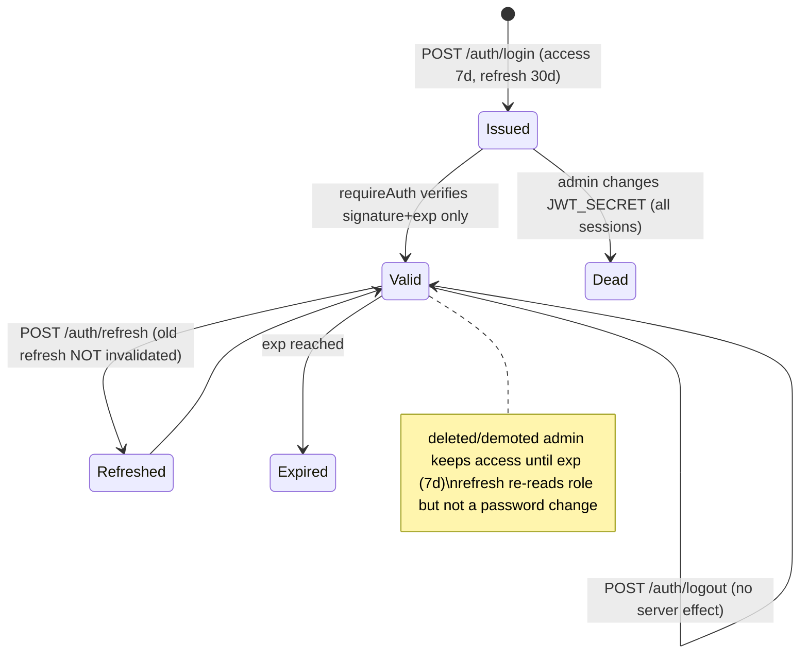
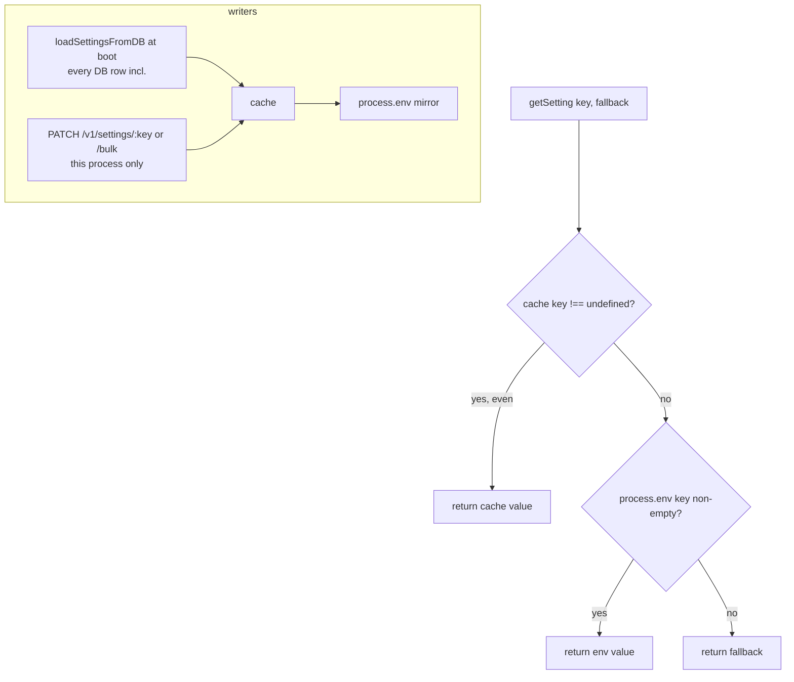

# SunTriX AI — Production Readiness Plan

_Prepared 2026-10-29 against `main` @ `02ae8d1`. Planning only: no application code was changed. Only this file and factual notes in `CLAUDE.md` were written._

**How this was verified**
- Every audit item (A1–A25, M1–M43) was re-checked against the code by reading it, with `path:line` evidence. Five area reviews ran in parallel: backend routes/AuthZ, frontend, lifecycle and payments, settings/auth/email/jobs, and build/ops. The main session then cross-checked their results and resolved the open points.
- With your approval, dependencies were installed in both packages. Build, lint, type-check, tests, `npm audit` and a `docker build` were run.
- Database tests only ran against a throwaway `mongo:7` container on `127.0.0.1:27117`, which has since been deleted. No `.env` exists in the repo, so nothing could reach a shared database.
- Stripe's webhook check with an empty secret was run directly against the installed `stripe@22.1.1`.
- Things that can't be proven from code (DNS, hosting, backups, business rules) are marked **Could not verify** and listed under Open Questions.

---

## 1. Summary

### 1.1 Verdict

**Not release-ready. Do not take real payments on the current `main`.**

- **The backend can't be built as a container.** `docker build` fails with `TS2307: Cannot find module 'vitest'` ×12. It only compiles locally because `vitest` happens to resolve from the frontend's `node_modules`.
- **There is no way to create the first admin**, and **there is no CI**.
- **The revenue flow is broken at every step** (proposal → contract → invoice → payment → tracker), because of path, method, field and unit mismatches between the frontend and backend.
- **Payment security fails open.** If `STRIPE_WEBHOOK_SECRET` is empty, anyone can forge a "payment succeeded" event (proven against the installed Stripe SDK). Any logged-in user, including a `viewer`, can read and overwrite secrets through `/v1/settings`.

**The architecture is fundamentally sound:**
- layered services
- a status state machine
- integer-cent money
- token-scoped client pages using 128–256-bit random tokens
- Zod validation on public forms
- Stripe signature verification wired correctly before `express.json`
- no SSRF sinks, no regex built from user input, no cookies (so CSRF doesn't apply)
- no real secrets in git history

The fixes below are mostly about making things consistent, adding guards and building operational basics. No rewrite is needed.

### 1.2 Counts

| | Critical | High | Medium | Low | Total |
|---|---|---|---|---|---|
| Audit items, after re-grading | 9 (A1–A8, M27 raised to Critical) | 17 | 19 | 23 | 68 |
| New findings (duplicates removed) | 1 (N-RUN-7, same issue as M27) | 10 | 31 | 26 | 68 |
| **Combined (M27/N-RUN-7 counted once)** | **9** | **27** | **50** | **49** | **135** |

How the audit items verified:

| Confirmed | Partly confirmed | Not reproduced | Could not verify |
|---|---|---|---|
| 63 | 5 (A9, M1, M9, M11, M21) | 0 | 0 |

- One sub-claim was not reproduced: M11's "`USER node` before `WORKDIR` causes EACCES". On Docker 29 / BuildKit, `/app` is created owned by `node`.
- Three new findings are duplicates and are not counted: N-FE-1 = N-RUN-1, N-FE-5 = N-OPA-1, and N-RUN-3 is folded into A7.

### 1.3 Verified run results

| Check | Result |
|---|---|
| Backend `tsc --noEmit` / `npm run build` (local) | Pass, but only because `vitest` resolves from the root `node_modules`. The build also emits `dist/test/*.test.js` into the production output. |
| **Backend `docker build`** | **FAIL**: `TS2307 Cannot find module 'vitest'` ×12, plus `TS7006` in `aiWorkflowRuntimeTruth.test.ts:11` |
| Backend tests (throwaway Mongo) | **31 passed, 5 failed**, all in `phase1_critical_verification.test.ts`: wrong accept route → 404; missing `agreed:true` → 400; `vi.spyOn(Stripe.prototype.webhooks…)` throws. `fullLifecycle` passes only because it calls services directly. Tests make real Resend and Groq network calls. |
| Frontend `npm run lint` | **FAIL**: 384 errors and 19 warnings. Of the errors, 242 are `no-explicit-any` and 134 are `no-empty-object-type`, mostly in shadcn `ui/`. |
| Frontend `tsc -p tsconfig.app.json` | **FAIL**: 8 errors. Two of them are runtime crashes: `ENDPOINTS.PORTFOLIO` is undefined, and `handleOpen` is undefined in AdminBlog. |
| Frontend `npm run build` | Pass. One JS chunk of **2,416 kB** (583 kB gzipped), plus a 672 kB PNG. |
| Frontend tests | Pass. One placeholder test only. |
| `npm audit --omit=dev` | Backend: 1 critical (`proxy-addr` IP spoofing) and 6 high. Frontend: 11 high. `zod` <4.6.6 is a direct dependency, and fixing it needs a major upgrade. |

### 1.4 Top 10 risks

| # | Risk | Refs | Phase that closes it |
|---|---|---|---|
| 1 | **Forged payments.** An empty `STRIPE_WEBHOOK_SECRET` is accepted by stripe-node, so self-signed `checkout.session.completed` events mark invoices paid and start projects. Any logged-in user can blank the secret through `/v1/settings`. | N-RUN-7/M27, A9 | 2 (T-RUN-3 first) |
| 2 | **Secrets and the login-signing key can be read and written by any logged-in user**, including `viewer`. They can read or replace `JWT_SECRET` (and then forge admin tokens forever), Stripe and Resend keys, or `JWT_EXPIRY` (which locks everyone out). Secrets are also copied in clear into audit diffs. | A9, A13, N-OPA-4, N-OPA-5 | 2 |
| 3 | **The revenue flow is broken end to end.** Admins can't create proposals or invoices, clients can't open proposals or pay, the success page always reports failure, the tracker UI isn't mounted, and the admin status vocabulary doesn't match the backend. | A1–A6, M8, N-FE-3, N-FE-9 | 3 |
| 4 | **It can't be shipped or operated.** The Docker build fails, there's no first admin, no CI, and tests delete data in whatever `MONGODB_URI` points at. | A7, A8, N-OPB-1, A25 | 1 |
| 5 | **Money integrity.** A payment can be marked paid while the project's status stays stuck, with no retry; two tabs cause a double charge; milestone payments are never recorded; cancelling doesn't cascade, so cancelled work stays payable; invoices are allowed at any status; and only one webhook event type is handled. | A5, A16, A17, N-LC-2, N-LC-3, N-LC-4 | 4 |
| 6 | **Account takeover through the browser.** Blog HTML is rendered without sanitising (stored XSS). Access and refresh tokens are in localStorage and last 7 and 30 days with no revocation. Logout leaves the refresh token behind. | A11, A14, N-FE-15 | 2 |
| 7 | **Abuse of the brand's email domain.** Unescaped HTML goes into emails, which allows phishing. `/contact/reply` is an open relay for any logged-in user. The newsletter opt-in can be bypassed. | A12, N-BR-4, M25 | 2 |
| 8 | **Brute force and IP spoofing.** The login limiter is bypassed by `/login/` or `/LOGIN`. `proxy-addr` has a critical advisory. `trust proxy=1` with no proxy lets clients spoof their IP. The contract signer's IP comes from `X-Forwarded-For[0]`. | A10, N-RUN-4, M26 | 2 |
| 9 | **Newsletter compliance and data handling.** The confirmation link goes to a frontend route that doesn't exist. There's no unsubscribe at all. In test mode, campaigns are re-sent to a hard-coded personal Gmail address. The privacy and cookie text doesn't match reality. | N-OPA-1, N-OPA-2, N-OPB-11 | 2 / 6 |
| 10 | **Running blind.** Production errors aren't logged and their internal messages go to clients. `/health` doesn't check the database. There's no graceful shutdown. Settings changes only reach one instance. Campaigns get stuck in `sending` after a deploy. Logs contain client capability tokens. | A21, A22, A24, N-OPB-6 | 5 |

**Immediate mitigation, before any code changes:**
1. Make sure `STRIPE_WEBHOOK_SECRET` is set in every deployed environment.
2. Check the `systemsettings` collection for rows holding secrets (`JWT_SECRET`, `STRIPE_*`, `RESEND_API_KEY`, `CLOUDINARY_API_SECRET`). If any exist, treat those secrets as exposed and rotate them.
3. Don't create `viewer` accounts.
4. Never run `npm test` in `backend/` with a `.env` that points at a shared database.

### 1.5 Release gate: what "release-ready" means

The platform is release-ready when **all** of the following are true:

1. **There are no open Critical or High findings.** Each of the 36 is either closed by a merged task, or explicitly accepted in writing with a reason and an owner.
2. **CI is green on `main` for every commit**, and branch protection requires it:
   - Backend: `npm ci && npm run build && npm run typecheck && npm test` on a clean checkout of `backend/` only (no root `node_modules`).
   - Frontend: `npm ci && npm run lint` (0 errors), `tsc -p tsconfig.app.json` (0 errors), `npm run build` and `npm test`.
   - `docker build backend/` succeeds.
   - `npm audit --omit=dev --audit-level=high` reports 0 in both packages.
3. **The HTTP end-to-end suite (T-LC-8) passes** against a disposable Mongo (mongodb-memory-server), with Stripe, Resend and Groq mocked. It must cover:
   - the full lifecycle over HTTP
   - webhook replay
   - two-tab checkout
   - a milestone payment
   - paying before the contract is signed
   - cancelling mid-flow
   - expired proposals and contracts
4. **The route-matrix AuthZ test (T-BR-15) passes.** Anonymous users, client tokens, `viewer` and `admin` are each checked against every route. `viewer` gets 403 on every write. Anonymous users never see drafts.
5. **The backend refuses to start with unsafe configuration.** Startup env validation requires `MONGODB_URI`, a `JWT_SECRET` of at least 32 bytes, `STRIPE_SECRET_KEY`, a non-empty `STRIPE_WEBHOOK_SECRET`, `RESEND_API_KEY` and `FRONTEND_URL`. Secret settings can't be read back through the API.
6. **The basics of running it are in place:**
   - `/ready` checks the database.
   - SIGTERM shuts down gracefully.
   - Logs are structured and redact tokens.
   - Error tracking is wired up and has been tested by triggering an error.
   - An uptime check runs on `/ready`.
7. **Data safety.** Automated database backups are on, and one restore has been tested. A runbook exists covering deploy, rollback, admin recovery and rotating secrets.
8. **A staging run is signed off.** A person goes through the whole client flow on staging, using Stripe test mode with a real webhook endpoint and Resend on the production sending domain. SPF, DKIM and DMARC must pass, and every email in the flow must arrive with working links.
9. **Compliance.** Every campaign has a working one-click unsubscribe, double opt-in works end to end, and the privacy and cookie pages describe what the site actually does.

Medium and Low findings (Phase 6) don't block release. They should be tracked with owners.

---

## 2. Verification table

### 2.1 Every audit item

**How to read this table**
- **Sev** is the re-graded severity: C = Critical, H = High, M = Medium, L = Low.
- **Detail** names the area section in §2.2 where the full evidence is: BR = backend routes, FE = frontend, LC = lifecycle and payments, OPA = settings, auth, email and jobs, OPB = build and ops, RUN = command runs.
- Some lines in the original audit were truncated. They were rebuilt from the code, and the corrections are in the Correction column.

| ID | Sev | Status | Key evidence | Correction / note | Detail |
|---|---|---|---|---|---|
| A1 | C | Confirmed | FE `src/lib/api.ts:212` posts `/proposals/admin/create`; BE `backend/src/routes/proposal.routes.ts:20` is `POST /`. `ProposalCreateSchema` in `backend/src/middleware/validate.ts:124-149` has no `totalAmount`, `currency` or `expiresInDays`, and `validate()` replaces `req.body`. | Milestones are checked as dollars ("≥ $1") but stored and shown as cents. The proposal hooks in `src/features/proposals` are never imported, so the UI has no create-and-send path at all. | FE, LC |
| A2 | C | Confirmed | `src/lib/api.ts:214-216` vs `proposal.routes.ts:42,52,66` (`/view/:token`, `/accept/:token`, `/request-changes/:token`) | Also: the request-changes note is read from `req.body.notes`, but the schema field is `clientNote` (M38). | FE |
| A3 | C | Confirmed | `api.ts:206` `/payments/admin/create-invoice` vs `payment.routes.ts:30` `/admin/invoice`. `InvoiceCreateSchema` (`validate.ts:152-158`) requires `amountUSD`, but `payment.service.ts` reads `dto.amountCents`. | The frontend already sends `amountCents`. Fixing only the schema is enough on the units side. | FE, LC |
| A4 | C | Confirmed | `src/pages/ClientInvoice.tsx:70-74,227-254` waits for `checkoutUrl`, which the Payment model doesn't have. `PaymentSuccess.tsx:84` calls `/payments/verify/:id`, which doesn't exist. `AdminPayments.tsx:59,62,120` calls list, stats and refund routes that don't exist. | A paid invoice also never shows as paid (`alreadyPaid` isn't in the model; N-FE-9). | FE |
| A5 | C | Confirmed | `tracker.routes.ts:371-425, 544-577` create Checkout sessions with `metadata.type="tracker_milestone"` and no Payment document. The webhook only handles invoice Payments (`payment.service.ts:108-124`). | — | LC |
| A6 | C | Confirmed | `AdminProjectHub.tsx` is not imported anywhere. `EngagementCommandCenter.tsx:83,87` call by-task routes that don't exist. It sends `PATCH /task-requests/:id/status` while the backend only has `PUT`. The tracker list is treated as an array, but the backend returns `{trackers}`. | Also: the admin UI uses a different status vocabulary (`submitted`, `reviewing`, …) from the backend (N-FE-3). | FE |
| A7 | C | Confirmed (run) | `backend/tsconfig.json:19` `include: src/**/*`. vitest isn't in `backend/package.json` or the lockfile. **`docker build` fails with TS2307 ×12.** | It builds locally only because vitest resolves from the repo-root `node_modules`. Compiled tests also end up in `dist/test`. | OPB, RUN |
| A8 | C | Confirmed | `backend/package.json:10` seed script points at `src/seed.ts`, which was deleted in `585402d`. There's no `Admin.create` anywhere, and `ADMIN_SEED_*` is never read. | — | OPB |
| A9 | H | Partly confirmed | Masking works for rows flagged `isSecret` (`settings.routes.ts:58-61`), but only `GROQ_API_KEY` is flagged (`configLoader.ts:20`). PATCH `/bulk` and PATCH `/:key` (`settings.routes.ts:77-199`) upsert any key with `requireAuth` only and skip validators. | The exposure claim is right for every secret entered through the UI, and those secrets are also copied into AuditLog diffs. Combined with N-RUN-7, this is a payment-forgery chain. | BR, OPA |
| A10 | H | Confirmed | `app.ts:75-82` skips the limiter when `!req.path.endsWith("/login")`, and Express routing is case-insensitive and non-strict. `Admin.ts:16` sets a minimum password length of 6. | — | OPA |
| A11 | H | Confirmed | `src/pages/BlogDetail.tsx:233` `dangerouslySetInnerHTML`. Lines `:44-46` pass HTML through unchanged, `:55` builds links with no protocol check, and DOMPurify isn't installed. | — | FE |
| A12 | H | Confirmed | `backend/src/services/email.ts:42-49, 84-96, 538-543, 823` interpolate user input with no escaping anywhere in the backend. | — | OPA |
| A13 | H | Confirmed | `requireRole` is on exactly 7 routes (`taskRequest.routes.ts:56,68,79,91`; `newsletter.routes.ts:214-216`). The other 90 authenticated routes use bare `requireAuth`. | — | BR |
| A14 | H | Confirmed | Expiry is 7d (`auth.routes.ts:33`) and refresh is 30d (`:34,86`). The refresh secret is derived as `secret+"_refresh_token_salt"`. There's no revocation and no password change or reset route. | Logout also leaves the refresh token in localStorage (N-FE-15). | OPA |
| A15 | H | Confirmed | `team/pricing/portfolio/client/department.routes.ts:12-13` set `showAll` for `?all=true` or any `Bearer` prefix. Posts with `?all=true` list drafts. | Case studies have no status filter at all, and by-id and by-slug routes return drafts (N-BR-5). | BR |
| A16 | H | Confirmed | `payment.repository.ts:33-37` claims the payment first. Side effects run afterwards (`payment.service.ts`). `contract_sent → in_progress` by `system` is forbidden (`taskStatusMachine.ts`). | — | LC |
| A17 | H | Confirmed | `payment.service.ts:55,77-78` only blocks `paid`, makes a new session on every call, and has no idempotency key or `expires_at`. | — | LC |
| A18 | H | Confirmed | `proposal.repository.ts:17-21` claims without checking expiry or task status. `signContract` skips the expiry check. `requestChanges` has no guard. The catch block leaves orphan contracts. | Also: re-sending an accepted proposal makes a second contract possible (N-LC-1). | LC |
| A19 | H | Confirmed | `taskRequest.routes.ts:68-70` → `task-request.service.ts:94` passes the raw body to `findOneAndUpdate`. Completion approval sets `completed` directly. Transitions read then write without a status filter. | — | LC |
| A20 | H | Confirmed | `AdminLogin.tsx:28` sets `auth_token`. `api.ts:288` reads `suntrix_auth_token` through `authManager`, which is never populated. | So every admin call costs 3 requests (401 → refresh → retry; N-FE-7). | FE |
| A21 | H | Confirmed | `errorHandler.ts:18` logs only in development, and `:14-30` always returns `err.message`. CastError, ValidationError, E11000 and CORS errors all become 500. | — | OPB |
| A22 | H | Confirmed | `configLoader.ts:111-115` lets the cache win when a value is `""`. `:138-144` copies database rows into `process.env`. The cache is per process. | — | OPA |
| A23 | H | Confirmed | `newsletter.routes.ts:234,237` query `status` and `interests.name`, but the model (`Newsletter.ts:17-19`) has `subscribed` and `interest`. | — | OPA |
| A24 | H | Confirmed | `app.ts:158-160` `/health` is static. There are 0 SIGTERM or unhandledRejection handlers. Broadcasts run in `setImmediate` (`newsletter.routes.ts:163-209`). | — | OPA, OPB |
| A25 | H | Confirmed (run) | 5 of 6 cases fail in `phase1_critical_verification.test.ts`. Its `beforeAll` (`:21-35`) drops an index and deletes documents. | The Stripe spy targets `Stripe.prototype.webhooks`, which doesn't exist, so it throws. | LC, OPB, RUN |
| M1 | M | Partly confirmed | `chat.routes.ts:31-39` hard-codes the prompt and ignores `CHATBOT_ENABLED` and `AI_ENABLED`. Groq calls have no timeout. A new client is built per call. | `llama3-8b-8192` is only used as a string in a plan-eligibility heuristic. It's never sent as a model, so that sub-claim is wrong. | OPA |
| M2 | M | Confirmed | `resend.adapter.ts:5-8` falls back to `"re_dummy_key"`. Every sender in `email.ts` swallows errors. | — | OPA |
| M3 | M | Confirmed | `scheduler.ts:22-25` never clears `publishAt`, and there are no expiry jobs. | — | OPA |
| M4 | M | Confirmed | `admin.routes.ts:55-69`; unbounded `limit` in audit, posts and task-requests; no paging in tracker, upload, newsletter, contact, testimonial, case-study or portfolio lists. | `days=1e7` parses to 1, so use `days=10000000` to trigger the bucket loop. | BR, OPB |
| M5 | M | Confirmed | `src/hooks/use-media.ts:2,45-49` reads the localStorage `mediaStore`. | — | FE |
| M6 | M | Confirmed (run) | `App.tsx:9-50` imports everything eagerly with no `lazy(`. The build is one 2,416 kB chunk. | — | FE, RUN |
| M7 | L | Confirmed | `Footer.tsx:167-168` links to `/legal`, which isn't a route. | — | FE |
| M8 | M | Confirmed | `ClientContract.tsx:61-69` reads `trackingToken`, but the backend returns `trackerToken` and `checkoutUrl` (`contract.routes.ts:30-35`). | `checkoutUrl` points at a `/checkout` page that doesn't exist (N-FE-8). | FE, LC |
| M9 | L | Partly confirmed | `settings.routes.ts:105-126,171-191` read `oldValue` from the already-updated document. | The "500 after save" only happens on `PATCH /:key`. `/bulk` catches the error per key. | OPA |
| M10 | L | Confirmed | Committed `vite.config.ts.timestamp-*.mjs` (contains a Windows path), 3 lockfiles, `brain/` scratch script, and the dead code listed. | — | FE, OPB |
| M11 | L | Partly confirmed (run) | `Dockerfile:12,36` uses `npm install`. Healthcheck start period is 40s vs a 70s worst-case Mongo retry. | **`USER` before `WORKDIR` was not reproduced.** A Docker 29 probe created `/app` owned by `node:node` and writable. | OPB, RUN |
| M12 | L | Confirmed | `@stripe/stripe-js` and `docx` have no imports. `@types/*` are in `dependencies`. `@types/uuid@10` is paired with `uuid@14`. | — | OPB |
| M13 | L | Confirmed | Two `AppError` definitions. Responses come in 5 different shapes. `api.ts:350-353` reads only `message`. | — | FE, OPB |
| M14 | L | Confirmed | `app.ts:120,165,167` | — | OPB |
| M15 | L | Confirmed | `vite.config.ts:10-11` uses port 8080 and `allowedHosts:"all"`. Installed Vite 5.4.19 types it as `string[] \| true`. | Not allowed by CORS unless `FRONTEND_URL` is set (N-RUN-8). | FE, RUN |
| M16 | L | Confirmed | `post.routes.ts:86,103` register `/:id` before `/bulk` at `:113,124`. | — | BR |
| M17 | M | Confirmed | 6 places use raw `fetch` with `auth_token` (`AdminMedia.tsx:84`, …). | — | FE |
| M18 | L | Confirmed | `AdminLayout.tsx:32-38` checks only that the token exists. `:34` calls `JSON.parse` with no try. `:196` reads `user.name[0]`. | — | FE |
| M19 | L | Confirmed | `useSettings.ts:15,27-29` sends `PUT {settings}`, but the backend expects `PATCH {updates}`. | — | FE |
| M20 | L | Confirmed | `api.ts:1-73` stale Grok/x.ai block, plus the unused keys listed in FE §1c. | — | FE |
| M21 | L | Partly confirmed | `api.ts:197` `btoa(publicId)` vs `upload.routes.ts:297-299` | It only breaks when the base64 string contains `/`, which depends on the actual IDs. | FE |
| M22 | L | Confirmed | `BlogDetail.tsx:81-98` and `PortfolioDetail.tsx:73-83` don't abort stale fetches. `ClientProjectHub.tsx:42-47` polls every 8s. | — | FE |
| M23 | L | Confirmed | `Footer.tsx:90`, `SocialBranding.tsx:48`, `About.tsx:191-194`, `SocialProofBar.tsx:61`, `PortfolioDetail.tsx:133` | More places than the audit listed. | FE |
| M24 | L | Confirmed | `src/assets` is 2,752 KB. `ceo-portrait.png` is 672 KB. No WebP. | — | FE |
| M25 | M | Confirmed | `newsletter.routes.ts:18-25` | It also tells anyone whether an email is already subscribed. | OPA |
| M26 | M | Confirmed | `app.ts:41` `trust proxy` 1. `contract.routes.ts:20` uses `XFF.split(",")[0]`. | The signer IP can be spoofed even behind a correctly configured proxy. Use `req.ip`. Made worse by `proxy-addr` CVE N-RUN-4. | BR |
| M27 | **C** | Confirmed (run) | `stripe.adapter.ts:12` uses `\|\| ""`. **stripe@22.1.1 accepted a forged event signed with an empty secret.** | Raised from "unverified" to Critical. See N-RUN-7. | LC, RUN |
| M28 | M | Confirmed | `proposal.repository.ts:9` and `contract.repository.ts` populate the whole TaskRequest. Tracker client POSTs return `auditLog`. | The raw Payment document also leaks Stripe IDs and `trackingToken`. | BR |
| M29 | L | Confirmed | `auth.routes.ts:17-24` | — | OPA |
| M30 | L | Confirmed | `backend/src/services/cloudinary.ts:34-43` has a multer `fileFilter` that accepts every type ("Allow all file types per platform requirement"). `upload.routes.ts:10-15` treats `.svg` as an image. `/upload/document` accepts anything. Everything is behind `requireAuth`, and `UPLOAD_MAX_SIZE_MB` defaults to 50. | `req.body.folder` is chosen by the client (`upload.routes.ts:258`). See N-BR-3. | main |
| M31 | L | Confirmed | `post.routes.ts:9-20` allows `style` without `allowedStyles`. | — | OPB |
| M32 | M | Confirmed | `.env.example:9,29`. `JWT_SECRET` is only checked for being truthy. | `.env.example` documents `JWT_EXPIRES_IN`, but the code reads `JWT_EXPIRY` (N-OPA-7). | OPA |
| M33 | L | Confirmed | `app.ts:47-51`. The CORS rejection becomes a 500. | — | BR |
| M34 | M | Confirmed | `proposal.service.ts:134-137` writes `contractToken`, which the schema drops. | — | LC |
| M35 | M | Confirmed | `proposal.service.ts:65` sets `sent`, then `:68` throws for a `new` task. | — | LC |
| M36 | M | Confirmed | `contract.service.ts:48-67` builds a tracker shape that doesn't match the schema. | — | LC |
| M37 | L | Confirmed | `contract.service.ts:32-40` | — | LC |
| M38 | M | Confirmed | `proposal.routes.ts:68`, `proposal.service.ts:190` | — | LC |
| M39 | L | Confirmed | `payment.service.ts:115` | — | LC |
| M40 | L | Confirmed | `configLoader.ts:125-148` uses one shared try for seeding and loading. `db.ts:40-83` dumps schemas to the console (seen in the run). `:93` uses a regex. Post has a duplicate index. | — | OPA, OPB |
| M41 | M | Confirmed (run) | There's no backend vitest config. The tests make real Resend and Groq calls. The `Stripe.prototype` spy throws. Several tests just restate the code. | — | OPB, RUN |
| M42 | M | Confirmed | `app.ts:67-95` uses in-memory stores and hard-coded windows. CORS reads `process.env` once. | — | BR |
| M43 | M | Confirmed | `app.ts:91-95` limits chat to 10/min/IP, with no budget. Input can be up to 50 × 5,000 characters. | — | OPA |

### 2.2 Detailed verification evidence by area

These are the full verification tables from each area review, unedited. Where they differ from §2.1, §2.1 is authoritative because it includes the command runs.

#### 2.2.1 Backend routes & AuthZ

| Audit ID | Status | Evidence | Note |
|---|---|---|---|
| A9 (write/role part) | Confirmed | `backend/src/routes/settings.routes.ts:77-143` (PATCH /bulk) and `:146-199` (PATCH /:key) use `requireAuth` only, `findOneAndUpdate({key}, …, {upsert:true})` on any key; `:58-61` masks only when `isSecret`; `backend/src/models/SystemSetting.ts:53` `isSecret` default false; `backend/src/lib/configLoader.ts:12-20` only `GROQ_API_KEY` is secret; `configLoader.ts:118-121` `updateSettingCache` writes `process.env[key]` | Audit correct. Extra: upsert via `findOneAndUpdate` never runs schema validators, so ad-hoc keys (e.g. `JWT_SECRET`) are stored without the required `section/label/type` (`SystemSetting.ts:40-51`) and are grouped under `undefined` by `GET /` (`settings.routes.ts:64-68`). A `viewer` JWT can do all of this. |
| A13 | Confirmed | `requireRole("admin")` appears on exactly 7 routes: `backend/src/routes/taskRequest.routes.ts:56,68,79,91` and `backend/src/routes/newsletter.routes.ts:214,215,216`. All other 90 authenticated routes use bare `requireAuth` (`backend/src/middleware/auth.ts:10-30`), which accepts any `role` claim. | Audit correct. Most damaging viewer-reachable writes: `POST /v1/proposals` (`proposal.routes.ts:20`), `POST /v1/proposals/:id/send` (`:31`), `POST /v1/payments/admin/invoice` (`payment.routes.ts:30`), `POST /v1/tracker/admin/:id/milestone/:mId/mark-paid-manually` (`tracker.routes.ts:430`), `PATCH /v1/settings/*`, `POST /v1/newsletter/admin/campaigns/:id/retry` (`newsletter.routes.ts:222`, re-sends a campaign without role check although broadcast has one), `DELETE /v1/upload/bulk` (`upload.routes.ts:280`). `requireRole` also trusts the JWT `role` claim; it is never re-read from `Admin` (`auth.ts:21-22`). |
| A15 | Confirmed | `?all=true` OR any `Authorization: Bearer` prefix (no verification): `backend/src/routes/team.routes.ts:12`, `pricing.routes.ts:12`, `portfolio.routes.ts:13`, `client.routes.ts:12`, `department.routes.ts:12`; Bearer-only sniff: `testimonial.routes.ts:11`; `?all=true` only: `post.routes.ts:27-28` (drafts, scheduled). | Audit correct. Additional leak paths the audit missed: `GET /v1/case-studies` has no status filter at all (`caseStudy.routes.ts:11`, model default status `draft` at `models/CaseStudy.ts:40`), and `GET /v1/case-studies/:id`, `/slug/:slug`, `GET /v1/portfolio/:id`, `/slug/:slug` return drafts (`caseStudy.routes.ts:21,32`, `portfolio.routes.ts:23,87`). Frontend admin pages rely on `?all=true` (`src/pages/admin/AdminPortfolio.tsx:91` etc.), so the fix must keep an authenticated "all" path. |
| M4 (limit/days params) | Confirmed | `backend/src/routes/admin.routes.ts:55` `days = parseInt(req.query.days) \|\| 30` with no cap, bucket loop `:60-69`; `audit.routes.ts:10,17` `limit` unbounded; `post.routes.ts:27,35` unbounded; `taskRequest.routes.ts:36,38` default 100, unbounded. No pagination: `tracker.routes.ts:30`, `contact.routes.ts:42`, `newsletter.routes.ts:96`, `testimonial.routes.ts:13`, `caseStudy.routes.ts:11`, `portfolio.routes.ts:15`, `team.routes.ts:14`, `client.routes.ts:14`, `cms.routes.ts:152`. | Audit correct in substance. Nit: `?days=1e7` parses to `1` (`parseInt` stops at `e`); `?days=10000000` triggers the 10M-iteration loop and three unbounded `find()`s. `limit=0` means "no limit" in Mongoose; `skip=abc` yields `NaN`. All these are `requireAuth` (viewer-reachable), not public. |
| M16 | Confirmed | `backend/src/routes/post.routes.ts:103` `DELETE /:id` registered before `:113` `DELETE /bulk`; `:86` `PUT /:id` before `:124` `PUT /bulk`. `"bulk"` hits `findByIdAndDelete("bulk")`/`findByIdAndUpdate("bulk")` → Mongoose CastError → `errorHandler` 500 (`middleware/errorHandler.ts:53`, no statusCode). `:129` `Post.updateMany({_id:{$in:ids}}, update)` passes the raw `update` object. | Audit correct; both bulk routes are unreachable. Same raw `updateMany` pattern in `portfolio.routes.ts:60` (reachable, ordered correctly). All other routers register `/bulk` before `/:id` (`client.routes.ts:54/65`, `department.routes.ts:37/92`, `team.routes.ts:35/86`, `pricing.routes.ts:35/77`, `upload.routes.ts:280/297`, `taskRequest.routes.ts:79/91`, `settings.routes.ts:77/146`, `tracker.routes.ts:28/38`). |
| M26 | Confirmed | `backend/src/app.ts:41` `app.set("trust proxy", 1)`; `backend/src/routes/contract.routes.ts:20` takes `x-forwarded-for.split(",")[0]`. Deployment target is a bare Docker container (`backend/Dockerfile`), no proxy config in repo. | Audit correct for the limiter. Correction for the signer IP: `split(",")[0]` is the *first* XFF hop, which is client-supplied even behind a correctly configured single proxy (proxies append), so the recorded contract signer IP is always spoofable, not only when exposed directly. Should use `req.ip`. |
| M28 | Confirmed | `backend/src/modules/proposals/proposal.repository.ts:9` `.populate("taskRequestId")` (whole TaskRequest: `phone`, `notes`, `statusHistory[].note`, `trackingToken`, `contractToken`, `deletedBy`, `proposalId` — `models/TaskRequest.ts:52-88`), returned as-is by `GET /v1/proposals/view/:token` (`proposal.routes.ts:44-45`); `contract.repository.ts:9` `.populate("taskRequestId proposalId")` returned by `GET /v1/contracts/:token` (`contract.routes.ts:10-11`); tracker client POSTs return the full document incl. `auditLog`: `tracker.routes.ts:221,250,270,292,534,552` while the GET strips it at `:182-184`. No model has a `toJSON` transform or `select:false` (grep over the five models: none). | Audit correct. Additional: `GET /v1/payments/invoice/:token` returns the raw `Payment` (`payment.routes.ts:12-13`) incl. `stripeSessionId`, `stripeCustomerId`, `stripePaymentIntentId`, refund fields and the task `trackingToken` (`models/Payment.ts:33-59`). Proposal-token holder therefore learns `contractToken` and `trackingToken` (token-scope bleed between the client-facing links). |
| M33 | Confirmed | `backend/src/app.ts:47-51` `allowedOrigins = [FRONTEND_URL \|\| "http://localhost:5173", "http://localhost:5173", "http://localhost:3000"]` unconditionally; `:58` rejects via `callback(new Error(...))` which lands in `errorHandler` as a 500. | Audit correct. If `FRONTEND_URL` is unset in production the only non-localhost origin is also localhost (silent misconfiguration). Credentials are not cookies (JWT in header), so practical impact is limited to a dev-machine-pivot scenario, but still remove. |
| M42 | Confirmed | `backend/src/app.ts:67-95` three `rateLimit({...})` without a `store` option (express-rate-limit ^7.4, `backend/package.json:25`; default store is in-memory per the library docs — node_modules absent, not executed); `windowMs` literals at `:68,76,85,92`; `authLimiter.max: 5` hardcoded `:77`; CORS origin list built once from `process.env.FRONTEND_URL` at `:48` while email/portal links use `getSetting("FRONTEND_URL")` (`tracker.routes.ts:17`, `proposal.service.ts` etc.). | Audit correct. Additional (see N-BR-1): `formLimiter` is mounted on whole routers so admin POSTs share the 5/hour public budget. |

#### 2.2.2 Frontend

| Audit ID | Status | Evidence | Note |
|---|---|---|---|
| A1 (frontend side) | Confirmed | `src/lib/api.ts:212` `PROPOSAL_ADMIN_CREATE = /proposals/admin/create` vs `backend/src/routes/proposal.routes.ts:20` `POST /`; `backend/src/middleware/validate.ts:124-149` `ProposalCreateSchema` has no `totalAmount`/`currency`/`expiresInDays` while `validate.ts:23` replaces `req.body` and `backend/src/models/Proposal.ts:77` has `totalAmount required`; milestone `amount: z.number().min(1, "...at least $1")` (`validate.ts:133`) but `src/pages/ClientProposal.tsx:55-56,287` divides by 100 (cents). | Worse than audited: no admin UI ever calls `PROPOSAL_ADMIN_CREATE`/`PROPOSAL_ADMIN_AI_DRAFT` — `src/features/proposals/hooks/useProposals.ts` has zero consumers (grep), and `EngagementCommandCenter.tsx:314` "Generate AI Proposal" only PATCHes task status. There is also no ENDPOINT for backend `POST /proposals/:id/send` (`proposal.routes.ts:31`). |
| A2 | Confirmed | `src/lib/api.ts:214-216` → `/proposals/:token`, `/proposals/:token/accept`, `/proposals/:token/request-changes`; backend `proposal.routes.ts:42,52,66` → `/view/:token`, `/accept/:token`, `/request-changes/:token`. `ClientProposal.tsx:74,94-97,110-113`. | GET `/proposals/<token>` hits no route → 404 `{error:"Route not found"}` (`app.ts:194-196`) → page shows "Error 404" (see M13). Frontend sends `{clientNote}` (`ClientProposal.tsx:112`) which matches the Zod schema (`validate.ts:77-79`); the route then reads `req.body.notes` (`proposal.routes.ts:68`) — backend-side bug (M38), not a frontend field-name error. |
| A3 (frontend side) | Confirmed | `src/lib/api.ts:206` `/payments/admin/create-invoice` vs `backend/src/routes/payment.routes.ts:30` `POST /admin/invoice`; `src/pages/admin/AdminPayments.tsx:93-105` sends `{clientEmail, clientName, amountCents, description, taskRequestId}`; `validate.ts:152-158` requires `amountUSD` (so request is rejected 400 even on the right path); `backend/src/modules/payments/payment.service.ts:25` reads `dto.amountCents`. | Frontend reads `data.checkoutUrl` (`AdminPayments.tsx:93`) but backend returns `{message, payment, invoiceUrl}` (`payment.routes.ts:109-113`) — a third mismatch. |
| A4 | Confirmed | `src/pages/ClientInvoice.tsx:70-74,227-254`: Pay button only if `invoice.checkoutUrl`, else permanent "Preparing secure checkout…" spinner; `payment.routes.ts:10-18` returns raw Payment whose schema (`backend/src/models/Payment.ts:33-59`) has no `checkoutUrl`/`alreadyPaid`; `POST /payments/invoice/:token/checkout` (`payment.routes.ts:20`) is never called from `src/`. `PaymentSuccess.tsx:84` → `PAYMENT_VERIFY` (`api.ts:202`) → no backend route (`payment.routes.ts` has only 4 routes). `AdminPayments.tsx:59,62,120` → `PAYMENT_ADMIN_LIST/STATS/REFUND` (`api.ts:204-208`) → no backend routes. | Additionally the paid state can never render: `invoice.alreadyPaid` (`ClientInvoice.tsx:130,210`) does not exist on the model; status is `"paid"` (`Payment.ts:38`). PaymentSuccess could verify without a new route: Stripe success URL already carries `invoiceToken` (`payment.service.ts:73`) and `GET /payments/invoice/:token` exists. |
| A6 | Confirmed | `src/components/AdminProjectHub.tsx` has no importer (grep across `src/`; `App.tsx:9-50` lists all pages). `EngagementCommandCenter.tsx:83,87` → `/proposals/admin/by-task/:id`, `/contracts/admin/by-task/:id` (`api.ts:213,221`) — absent from `proposal.routes.ts`/`contract.routes.ts`. `EngagementCommandCenter.tsx:90-91` `Array.isArray(tracker)` vs backend `{trackers}` (`backend/src/routes/tracker.routes.ts:28-36`) → never matches. `EngagementCommandCenter.tsx:101-104` `method: "PATCH"` vs `taskRequest.routes.ts:56` `PUT /:id/status`. | Even with PUT, the status values sent (`"reviewing"`, `EngagementCommandCenter.tsx:137`) are not in the machine (`backend/src/services/taskStatusMachine.ts:8-15`: `new, in_review, ...`). See N-FE-3. |
| A11 | Confirmed | `src/pages/BlogDetail.tsx:233` `dangerouslySetInnerHTML={{ __html: renderMarkdown(post.content) }}`; `BlogDetail.tsx:44-46` returns content untouched if it contains any tag; `BlogDetail.tsx:55` builds `<a href="$2">` with no protocol check; no `dompurify`/`sanitize` in `package.json` or `src/` (grep). Tokens in localStorage: `AdminLogin.tsx:28-30`, `api.ts:312-313`. | Only other `dangerouslySetInnerHTML` is shadcn `src/components/ui/chart.tsx:70` (CSS from config, admin-only). Whether backend `sanitize-html` on Post (M31) fully mitigates cannot be judged from the frontend; frontend must not rely on it. |
| A20 | Confirmed | `src/lib/api.ts:288` `authManager.getToken()` reads `suntrix_auth_token` (`src/lib/auth.ts:16,21,41-43`); nothing in `src/` ever calls `authManager.login` (grep: only `AdminSettings.tsx:311` imports `useAuth`, reads `user`, never sets). `AdminLogin.tsx:28` writes `auth_token`. So every admin request → 401 → `POST /auth/refresh` (`api.ts:299-324`) → retry with fresh token; the refreshed `auth_token` is written to localStorage (`api.ts:312`) but `authManager` stays null, so the dance repeats on the next call. | Amplification (not in audit): `AdminContent.tsx:105-109` fires 5 parallel calls → 5 parallel refreshes, each rotating `refresh_token`; `useNotifications.ts:44` polls every 60s; global limiter (`app.ts:67-73`) is consumed 3x. See N-FE-7. Raw-`fetch` uploads read `auth_token` directly so they work (M17). |
| M5 | Confirmed | `src/hooks/use-media.ts:2,45-49` resolves from `mediaStore` (`src/lib/cms-store.ts:842-880`, localStorage `getCollection`/`setCollection` lines 179-199) then static import fallbacks (`use-media.ts:5-22`). Consumers: `Navbar.tsx:18`, `Footer.tsx:15`, `HeroSection.tsx:31`, `About.tsx:47-48`, `DynamicFavicon.tsx:5`, `AgencyIntroVideo.tsx:15`. `AdminMedia.tsx` never calls `mediaStore.update` (grep `mediaStore` → only `use-media.ts`). `"agency-intro-video"` is seeded in `cms-store.ts:836` but absent from `FALLBACKS` (`use-media.ts:24-43`) → `""`. | `mediaStore._seed()` writes the registry into every visitor's localStorage on first render (`cms-store.ts:846-854`). |
| M6 | Confirmed | `src/App.tsx:9-50` imports all 17 admin pages + client pages statically; `grep -rn "lazy("` across `src/` → none. `react-quill` (`AdminBlog.tsx`), `recharts` (`AdminDashboard.tsx`, `ui/chart.tsx`), `papaparse` (`admin/CSVImporter.tsx`) ship in the public bundle. | `@stripe/react-stripe-js`, `@stripe/stripe-js` are in `package.json` but imported nowhere (grep) — pure dead weight in `node_modules`, not the bundle. |
| M7 | Confirmed | `src/components/Footer.tsx:167-168` `<Link to="/legal">` ×2; routes are `/legal/privacy|terms|cookies` (`App.tsx:83-85`) → `NotFound` (`App.tsx:116`). | — |
| M8 | Confirmed | `src/pages/ClientContract.tsx:61-64` types response as `{ trackingToken }` and reads `data?.trackingToken` (line 69); backend returns `{message, contract, trackerToken, checkoutUrl}` (`backend/src/routes/contract.routes.ts:162-167`). "Go to Project Hub" link (`ClientContract.tsx:110-117`) is gated on `trackingToken` → never shown after signing. | `checkoutUrl` is `${FRONTEND_URL}/checkout?taskToken=...` (`backend/src/modules/contracts/contract.service.ts:71`) — no `/checkout` route exists in `App.tsx`, so ignoring it is currently harmless (N-FE-8). |
| M10 (frontend items) | Confirmed | `git ls-files` tracks `vite.config.ts.timestamp-1780379091834-be923708e89c38.mjs` (content references `C:\Users\tahir\...`), `bun.lock`, `bun.lockb`, `package-lock.json`. Unused: `src/components/AdminProjectHub.tsx`, `src/components/NavLink.tsx`, `src/components/LoadingSkeleton.tsx` (0 importers), `src/features/*/hooks/*` (0 consumers), `src/lib/store.ts` (empty stub). Duplicate images `src/assets/dept-agents - Copy.png`, `dept-automate - Copy.png` (identical byte sizes to originals). | `.gitignore` has no `*.timestamp-*.mjs` rule. |
| M13 (apiRequest error parsing) | Confirmed | `src/lib/api.ts:350-353` reads `err.message` only. Backend emits `{error: ...}` for: 404 (`app.ts:195`), rate limits (`app.ts:72,80,88,94`), Zod validation (`validate.ts:16-19`), settings (`settings.routes.ts:85,135`), chat/ai (`chat.routes.ts`, `aiExtract.routes.ts:17`), maintenance 503 has both. `errorHandler` emits `{status, message}` (`errorHandler.ts:223-227`). | Client-facing consequence: wrong-path proposal/invoice pages show literal "Error 404"; validation failures on forms show "Error 400" with no field detail. |
| M15 | Partly confirmed | `vite.config.ts:8-15`: `port: 8080`, `allowedHosts: "all"`; backend CORS allowlist `app.ts:47-51` = `FRONTEND_URL || :5173`, `:5173`, `:3000` — `:8080` not allowed unless `FRONTEND_URL` is set. | Whether Vite 5.4.19 accepts the string `"all"` (vs `true`) cannot be verified without `node_modules`; the typed option is `true \| string[]`, so `"all"` would at best be treated as a hostname. → Open question. |
| M17 | Confirmed | Raw `fetch` with `localStorage.getItem("auth_token")`, no 401/refresh handling: `AdminMedia.tsx:84-94`, `AdminPortfolio.tsx:219-231`, `AdminBlog.tsx:83-88`, `admin/MediaUploader.tsx:57-71`, `admin/ImageUpload.tsx:27-33`, `AdminProjectHub.tsx:146-150`. | `AdminMedia.tsx:90-94` ignores the response entirely (no `res.ok` check) → silent upload failures. |
| M18 | Confirmed | `src/pages/admin/AdminLayout.tsx:32-38`: guard is `localStorage.getItem("auth_token")` presence only; `AdminLayout.tsx:34` `JSON.parse(userRaw)` without try/catch; `AdminLayout.tsx:196` `user.name[0]` throws if `name` is missing. `AdminLogin.tsx:13` same presence check. | No `GET /auth/me` call anywhere (`AUTH_ME` unused) → an expired/invalid token still renders the shell until the first API call redirects (`api.ts:330,338,345`). |
| M19 | Confirmed | `src/features/settings/hooks/useSettings.ts:15` expects `SettingItem[]`, backend returns `{settings, grouped}` (`settings.routes.ts:70`); `useSettings.ts:27-29` `PUT /settings/bulk {settings}` vs backend `PATCH /settings/bulk {updates}` (`settings.routes.ts:77-82`). TanStack: `QueryClientProvider` mounted (`App.tsx:125`) but the only `useQuery`/`useMutation` are the three unused hooks; every page fetches in `useEffect` (e.g. `AdminTasks.tsx:88-103`, `AdminBlog.tsx:60-66`). | `AdminSettings.tsx:340-341,388-390` itself uses the correct `{settings}` + `PATCH {updates}`; the hook is dead code, not a live bug. |
| M20 | Confirmed | Stale Grok/x.ai comment block `src/lib/api.ts:1-73` (`GROK_API_URL`, `CLOUDINARY_URL` unused consts lines 18,73). Unused `ENDPOINTS` keys (0 references outside `api.ts`): `AUTH_REGISTER, AUTH_LOGOUT, AUTH_ME, TASK_REQUEST_UPDATE, TASK_REQUEST_BULK_DELETE, CHAT_HISTORY, PORTFOLIO_BY_ID, CASE_STUDY_* (5), TESTIMONIALS_CREATE, NEWSLETTER_GENERATE, CMS_INTRO_VIDEO, CMS_SEO_BY_PAGE, ADMIN_NOTIFICATIONS, ADMIN_TASKS, ADMIN_USERS, CAMPAIGN_CREATE/UPDATE/DELETE/SEND, UPLOAD_BULK_DELETE, PAYMENT_CREATE_CHECKOUT, PAYMENT_ADMIN_CREATE_LINK, SETTINGS_UPDATE` (`AUTH_REFRESH` is used inside `api.ts:303`). | `useNotifications.ts:25-26` rebuilds the notifications URL from `import.meta.env` instead of `ENDPOINTS.ADMIN_NOTIFICATIONS`. |
| M21 | Partly confirmed | `src/lib/api.ts:197` `btoa(publicId)` (standard base64, alphabet includes `/`, `+`, `=`), not URL-encoded; backend `upload.routes.ts:297-299` matches `/:publicId` (single path segment) and decodes with `Buffer.from(..., "base64")`. | A `/` in the base64 output splits the segment → 404 "Route not found" for that asset. Occurrence depends on the publicId bytes (any 6-bit group = 63); so deletion fails intermittently, not always. Node's base64 decoder also accepts the URL-safe alphabet, so a frontend-only switch to base64url fixes it. |
| M22 | Confirmed | `BlogDetail.tsx:81-98` and `PortfolioDetail.tsx:73-83` `useEffect` on `slug` with no AbortController/ignore flag → stale response can overwrite newer; `ClientProjectHub.tsx:42-47` `setInterval(8000)` with no `document.visibilityState` check; `AdminProjectHub.tsx:84-88` same; `useNotifications.ts:44` 60s poll. | `BlogDetail.tsx:94` `navigate("/blog")` on a failed fetch — a transient network error on refresh bounces the reader to the list. |
| M23 | Confirmed | `Footer.tsx:90` `href={link.url}`; `SocialBranding.tsx:48`; `About.tsx:191-194` (`member.linkedin/twitter/github/website`); `SocialProofBar.tsx:61` (`client.websiteUrl`); `PortfolioDetail.tsx:133` (`project.liveUrl`); `ClientProjectHub.tsx:382,432` (`d.attachedUrl`, `f.cloudinaryUrl`); `PaymentSuccess.tsx:174` (`result.receiptUrl`). No scheme check anywhere. | All sources are admin-entered (CMS/team/client/portfolio) or server-generated (Cloudinary/Stripe) — exploitable only by a compromised admin account; keep Low. |
| M24 | Confirmed | `ls -la src/assets`: 2,752 KB total; `ceo-portrait.png` 671,993 B; `hero-banner.png` 249,954 B; `about-hero.png` 218,585 B; `suntrix-logo.png` 151,444 B (used as favicon via `DynamicFavicon.tsx:19` and `index.html:14`); all PNG, no WebP/AVIF; two " - Copy" duplicates. All 18 imported eagerly in `use-media.ts:5-22`. | Images are emitted as hashed assets and only downloaded when rendered, but the 672 KB portrait loads on `/about` and the 151 KB logo on every page (navbar + footer + favicon). |

#### 2.2.3 Lifecycle & payments

| Audit ID | Status | Evidence | Note |
|---|---|---|---|
| A1 (backend side) | Confirmed | Route is `POST /proposals` (`backend/src/routes/proposal.routes.ts:20`) while frontend posts `/proposals/admin/create` (`src/lib/api.ts:212`, `src/features/proposals/hooks/useProposals.ts:22`). `ProposalCreateSchema` (`backend/src/middleware/validate.ts:124-149`) has no `totalAmount`, `currency`, `expiresInDays`; `validate()` replaces `req.body` with the parsed value (`validate.ts:23`); `createProposal` spreads the DTO into `Proposal.create` (`backend/src/modules/proposals/proposal.service.ts:40-45`) whose `totalAmount` is `required` (`backend/src/models/Proposal.ts:77`) → Mongoose ValidationError → `errorHandler` returns 500 (`backend/src/middleware/errorHandler.ts:14`). Milestone `amount: z.number().min(1, "…at least $1")` (`validate.ts:133`) and the AI draft prompt says "USD dollar amount, NOT cents" (`backend/src/services/groq.ts:~212`), but the model comment and every reader treat it as cents (`Proposal.ts:14,58`; `proposal.service.ts:78,114`: `m.amount / 100`). | Even with the route fixed, every create fails on `totalAmount`; and a $1,500 milestone is emailed as "$15.00". `order` is never set (all milestones `order: 0`). |
| A3 (backend side) | Confirmed | Route `POST /payments/admin/invoice` (`backend/src/routes/payment.routes.ts:30`) vs frontend `/payments/admin/create-invoice` (`src/lib/api.ts:206`). `InvoiceCreateSchema` requires `amountUSD` (`validate.ts:156`); frontend sends `amountCents` (`src/pages/admin/AdminPayments.tsx:100`); service reads `dto.amountCents` (`backend/src/modules/payments/payment.service.ts:25`) → `amount` undefined → `Payment.amount` required (`backend/src/models/Payment.ts:40`) → 500. `expiresInDays`/`currency` not in schema → defaults 14d / "usd". | Three independent breakages: path, field name, unit. Service DTO (`payment.types.ts:5-13`) is the right contract (cents); the Zod schema is the odd one out. |
| A5 | Confirmed | Admin mark-payable (`backend/src/routes/tracker.routes.ts:371-425`) and client milestone checkout (`tracker.routes.ts:544-577`) create Checkout Sessions with `metadata.type = "tracker_milestone"` and no `Payment` doc; webhook handles only `checkout.session.completed` and calls `claimPaymentPaid(invoiceToken, sessionId)` (`payment.service.ts:108-116`) which finds nothing → returns 200 silently; `milestone.paidAt`/`stripePaymentIntentId` are only written by `mark-paid-manually` (`tracker.routes.ts:437`). Client checkout returns `{alreadyPaid:true}` only if `paidAt` set (`tracker.routes.ts:550`), so unlimited sessions/charges. | Also: `mark-payable` creates a session that is returned to the *admin* and never stored; client then creates a second live session. |
| A16 | Confirmed | `claimPaymentPaid` sets `status:"paid", paidAt` first (`backend/src/modules/payments/payment.repository.ts:33-37`); then `handlePaymentPaidSideEffects` runs `transitionStatus(..., "in_progress", "system")` when task is `contract_signed` **or `contract_sent`** (`payment.service.ts:89-90`); system actor allows only `contract_sent → contract_signed` (`backend/src/services/taskStatusMachine.ts:25`) so `contract_sent → in_progress` throws → webhook 400 (`payment.routes.ts:51-54`); Stripe retry hits `wasAlreadyPaid` (`payment.repository.ts:25-27`) and skips side effects forever; `sendPaymentConfirmation` (`payment.service.ts:95`) is after the throw so never sent. | Same stuck-state happens if the task is `cancelled`/`in_review`/`proposal_sent` at pay time: no throw, but no transition and no retry either (silently paid, task unchanged). |
| A17 | Confirmed | `processInvoiceCheckout` guards only `status === "paid"` (`payment.service.ts:55`), creates a new session every call and overwrites `stripeSessionId` (`payment.service.ts:77-78`); no `idempotencyKey`, no `expires_at`, no `client_reference_id` in `createCheckoutSession` (`backend/src/integrations/stripe/stripe.adapter.ts:26-43`). Webhook claims by `invoiceToken` metadata first (`payment.repository.ts:22`) so the older session's completion marks the invoice paid and the second (also completed at Stripe) is only skipped in DB; money is taken twice. `cancelled`/`refunded`/`failed` invoices remain checkout-able. | `Payment.stripeSessionId` is `unique sparse` (`Payment.ts:33`), so the *second* overwrite is fine for the DB but the first session stays live at Stripe for 24h. |
| A18 | Confirmed | `atomicClaimForAcceptance` filters only `proposalToken` + `status in [sent, changes_requested]` (`backend/src/modules/proposals/proposal.repository.ts:17-21`), no `expiresAt`, no task-status check; `getByToken` never checks expiry (`proposal.service.ts:51-55`). `signContract` uses `contractRepo.findByToken` directly (`backend/src/modules/contracts/contract.service.ts:28`), bypassing the expiry check in `getByToken` (`contract.service.ts:21-23`); `markSigned` (`:33`) precedes `transitionStatus` (`:45`) so a cancelled task yields a signed contract + 400. `requestChanges` has no status guard (`proposal.service.ts:158-161`) → accepted proposal becomes `changes_requested`, which `atomicClaimForAcceptance` accepts again → second contract. Catch block reverts to `"sent"` unconditionally (`proposal.service.ts:153`) and never deletes the contract created at `:120`. | All five sub-claims reproduce. |
| A19 | Confirmed | `PUT /task-requests/:id` passes `req.body` raw to `updateTask` → `findOneAndUpdate({_id, deletedAt:null}, data)` (`backend/src/routes/taskRequest.routes.ts:68-70`, `backend/src/modules/task-requests/task-request.service.ts:94`) so `{status:"completed"}` or `{trackingToken:"x"}` bypass the machine. Client completion approve writes `status:"completed"` with `findByIdAndUpdate` (`tracker.routes.ts:345-353`), guarded only by in-memory `completionApprovedAt` read at `:336` (two concurrent approvals both pass → two emails `:358-363`). `transitionStatus` is read (`task-request.service.ts:63`) → validate (`:69`) → `updateStatus` whose filter is `{_id, deletedAt:null}` with no `status` (`backend/src/modules/task-requests/task-request.repository.ts:29-31`); `TaskStatusMachine.transition` is the same pattern via `save()` (`taskStatusMachine.ts:72-96`). | Confirmed; the authoritative fix is a conditional update (see Proposed state machine). |
| A25 | Confirmed | `phase1_critical_verification.test.ts:66-67,106` post `/v1/proposals/${token}/accept` (backend route is `/v1/proposals/accept/:token`, `proposal.routes.ts:52`) → 404 → `expect(statuses).toContain(200)` fails. `:164-165` send `{clientSignatureName}` without `agreed:true` → `ContractSignSchema` 400 (`validate.ts:84`). `:247-279` expects `status:"expired"` but the webhook ignores `checkout.session.expired` and `expired` is not in the enum (`Payment.ts:38`). `beforeAll` drops `taskRequestId_1` and `deleteMany`s "duplicate" trackers then `syncIndexes()` (`:21-35`) against whatever `MONGODB_URI` `dotenv/config` (`app.ts:1`) loaded — there is no fallback URI in that file. `fullLifecycle.test.ts:108` calls `paymentService.handlePaymentPaidSideEffects` directly (no HTTP, no webhook, no validate). | Additional reasons the webhook test is fragile: `vi.spyOn(Stripe.prototype.webhooks, …)` (`:214`) against a per-call `new Stripe()` (`stripe.adapter.ts:7`) is library-internal (see Open questions); `.send(JSON.stringify(...))` without `.set("Content-Type","application/json")` is sent as form-encoded by supertest, so `express.raw({type:"application/json"})` (`app.ts:138`) does not run. |
| M27 | Partly confirmed | `getSetting("STRIPE_WEBHOOK_SECRET") || ""` (`stripe.adapter.ts:12`) and `getSetting("STRIPE_SECRET_KEY") || "sk_test_placeholder"` (`:6`). Raw-body gate is exact `req.originalUrl === "/v1/payments/webhook"` (`app.ts:137`); a query string makes it fall through to `express.json` and signature verification fails on the re-serialised body. | Whether stripe-node rejects an empty secret cannot be verified without `node_modules` (Open question). Either way the fallback must be removed: fail closed. |
| M34 | Confirmed | `updateStatus(..., "accepted", { acceptedAt, contractToken })` (`proposal.service.ts:134-137`) — `contractToken` is not in `ProposalSchema` (`Proposal.ts:65-103`), strict mode drops it. Repeat-accept path reads `(existing as any).contractToken` (`:91`) → undefined → fallback `findByToken("contract_" + proposalToken)` (`:93`) can never match a token generated as `contract_<random hex>` (`:102`) → returns `contractToken: ""`. | Confirmed; second click / page refresh after accept loses the contract link. Correct lookup is `Contract.findOne({ proposalId })` (indexed, `Contract.ts:60` is on `taskRequestId`; add `proposalId` index). |
| M35 | Confirmed | `sendProposal` sets proposal `sent` (`proposal.service.ts:65`) **before** `transitionStatus(..., "proposal_sent", "admin")` (`:68`); admin may only go `in_review → proposal_sent` (`taskStatusMachine.ts:9`), `new → proposal_sent` is invalid → throws; proposal stays `sent`, task stays `new`, no email (`:72`). | `createProposal` does not move the task to `in_review` either (`:35-49`). Fix: either auto-transition `new → in_review` on create, or allow `new → proposal_sent` for admin, and do the transition before flipping the proposal. |
| M36 | Confirmed | `signContract` builds `phases` as `{phaseNumber,title,description,status,dueWeek}` (`contract.service.ts:48-54`) and passes `clientName, clientEmail, projectTitle, status:"active"` (`:62-67`); `ProjectTrackerSchema.phases` is `{name enum, enteredAt, completedAt, adminNote}` (`backend/src/models/ProjectTracker.ts:99-104`) and has none of those top-level fields → strict drops them; result is N empty phase subdocs with `enteredAt=now` and `name` undefined, `currentPhase` defaults to `Discovery`, `milestones` empty (never copied from `proposal.milestones`). Tracker is created at sign time, not after payment, contradicting `PaymentFlow.md:63-69`. | Because `milestones` is always empty, the "unpaid milestones" precondition in completion/request (`tracker.routes.ts:306`) is vacuous. |
| M37 | Confirmed | `signContract` runs for any status: when `contract.status !== "pending"` it skips `markSigned` (`contract.service.ts:32-40`) but still calls `transitionStatus` (`:45`, no-op if already `contract_signed`), `findOrCreateTracker` (`:61`), and fires `sendContractSignedNotification` (`:74-80`) → every re-POST of `/contracts/:token/sign` re-sends the admin email; two concurrent signs: one `markSigned` wins (filter `status:"pending"`, `contract.repository.ts:14`), both send the email. | Concurrent-sign DB invariant (one tracker) holds thanks to the unique index + E11000 catch (`project.repository.ts:16-29`); only the side effect duplicates. |
| M38 | Confirmed | Schema validates `clientNote` (`validate.ts:77-79`) and `validate()` replaces the body, but the route reads `req.body.notes` (`proposal.routes.ts:68`) → `undefined`; service does `$set: { status, $push: { clientNotes: … } }` (`proposal.repository.ts:25` + `proposal.service.ts:160-162`) — `$push` nested inside `$set` targets a non-schema path `clientNotes` → dropped (or cast error; either way `clientNote` is never written). No task transition back to `in_review` (`proposal.service.ts:158-174`) even though the machine allows `proposal_sent → in_review` for client (`taskStatusMachine.ts:34`). Admin email receives `clientNote: undefined` (`:169`). | Confirmed. |
| M39 | Confirmed | `stripeReceiptUrl: session.payment_intent?.charges?.data[0]?.receipt_url` (`payment.service.ts:115`): in `checkout.session.completed` the `payment_intent` is a string id unless expanded, so `.charges` is undefined; key `stripeReceiptUrl` is not in `PaymentSchema` (`Payment.ts:52` is `receiptUrl`) so it is dropped; `handlePaymentPaidSideEffects` reads `(payment as any).stripeReceiptUrl` (`:100`) → always `""`. `session.payment_status` is never checked (`:108-116`). | Also: on current Stripe API versions `PaymentIntent.charges` no longer exists (`latest_charge`), so even an expand would not work (library/API fact, not verifiable offline). |
| M8 (backend field names) | Confirmed | Backend sign response is `{ message, contract, trackerToken, checkoutUrl }` (`backend/src/routes/contract.routes.ts:30-35`); frontend reads `data.trackingToken` (`src/pages/ClientContract.tsx:61-69`). `checkoutUrl` is `${FRONTEND_URL}/checkout?taskToken=…&contract=…` (`contract.service.ts:71`) and no `/checkout` route exists in `src/App.tsx` (only `/track/:token`, `/client/project/:token`, `App.tsx:79,94`). | Backend should return `trackerToken` and drop `checkoutUrl` (invoice is admin-created later per `PaymentFlow.md:57-62`), or return the invoice URL once one exists. |

Counts: Confirmed 14, Partly confirmed 1, Not reproduced 0, Could not verify 0.

#### 2.2.4 Settings, auth, email, newsletter, jobs, chatbot, media

| Audit ID | Status | Evidence | Note |
|---|---|---|---|
| A9 (secret exposure / masking) | Partly confirmed | Masking exists: `backend/src/routes/settings.routes.ts:58-61` (`value: s.isSecret && s.value ? MASKED : s.value`). Only `GROQ_API_KEY` has `isSecret:true` (`backend/src/lib/configLoader.ts:20`). PATCH `/bulk` and `/:key` upsert any key with `$set:{value,updatedBy}` only (`settings.routes.ts:105-109`, `171-175`) so upserted rows get schema default `isSecret:false` (`backend/src/models/SystemSetting.ts:53`). No allowlist, only `requireAuth`, no `requireRole` (`settings.routes.ts:77-79`, `146-148`). `updateSettingCache` writes `process.env[key]` (`configLoader.ts:118-121`). | Audit wrong that GET is "unmasked for all secrets": GET masks rows flagged `isSecret`. It is right in effect, because every key an admin adds (JWT_SECRET, STRIPE_*, RESEND_API_KEY, CLOUDINARY_*) is created with `isSecret:false` and is returned in clear to any JWT holder, including role `viewer`. Audit log also stores those values in clear (`settings.routes.ts:123-126`, `188-191`), readable via `GET /v1/audit` (`backend/src/routes/audit.routes.ts:8`). Note: upserted rows lack `section`/`label`/`type` (required in schema) — upsert with `$set` bypasses Mongoose required validation, so rows exist but the Admin UI groups them under `grouped[undefined]`. |
| A10 | Confirmed | `backend/src/app.ts:75-82` `skip: (req) => !req.path.endsWith("/login") \|\| req.method !== "POST"`; limiter mounted at `/v1/auth` (`app.ts:169`). Express default non-strict + case-insensitive routing means `POST /v1/auth/login/` and `/v1/auth/LOGIN` reach the handler with `req.path` = `/login/` / `/LOGIN` → `skip` returns true. Password `minlength: 6` at `backend/src/models/Admin.ts:16`; `LoginSchema` password `min(1)` (`backend/src/middleware/validate.ts:110`). | Correct. Additionally the limiter is in-memory per instance (M42) and keyed by IP behind `trust proxy 1` (`app.ts:41`). |
| A12 | Confirmed | No escaping anywhere in backend (grep `escapeHtml|sanitize` → only `post.routes.ts`). Raw interpolation of user input: contact `name/email/company/subject/message` `backend/src/services/email.ts:42-49`; task request `name/company/projectTitle/service/budget/description/selectedPlan` `:84-95`; change-request `clientName/clientNote` `:537-543`; newsletter confirmation `name` `:820`; welcome `name/interest` `:874-877`; contract-signed `clientName` `:642`; tracker filenames `:165`, `:162` (subject). Double opt-in path sends attacker-controlled `name` to attacker-chosen address `backend/src/routes/newsletter.routes.ts:36-48`. | Correct. Zod caps lengths (`validate.ts:30-34`) but does not strip HTML. Target of most templates is the admin mailbox (phishing/HTML injection against admin), confirmation/welcome go to arbitrary addresses (platform as spam relay with attacker HTML). |
| A14 | Confirmed | Access `JWT_EXPIRY` default `7d` `backend/src/routes/auth.routes.ts:33`; refresh hardcoded `30d` `:34`,`:86`; refresh secret derived `secret + "_refresh_token_salt"` unless `JWT_REFRESH_SECRET` set `:31`,`:72`; refresh only checks signature + `Admin.findById` `:77-83`; logout is a no-op `:100-102`; `requireAuth` never touches DB `backend/src/middleware/auth.ts:10-30`; `Admin` model has no `tokenVersion`/`passwordChangedAt` (`Admin.ts:1-40`). No password change/reset, no register, no admin-user CRUD route exists (grep `register|password|reset` in routes → only login). | Correct. Payload `{id,email,role,name}` (`auth.routes.ts:37`) so role demotion is only picked up on refresh (`:89`), deletion only when refresh runs. Frontend stores tokens in localStorage (`src/pages/admin/AdminLogin.tsx:28-30`). |
| A22 | Confirmed | `getSetting`: `cache[key] !== undefined` wins over env (`configLoader.ts:111-115`); loader copies every DB row incl. `""` into cache + `process.env` (`:138-144`); cache is a module-level object (`:108`), only mutated by this process (`:118-121`). No cross-instance refresh, no TTL, no change stream. | Correct. The env check does skip `""` (`:113`) but the cache check does not — asymmetric. |
| A23 | Confirmed | Retry queries `{ status: "subscribed" }` and `"interests.name"` (`newsletter.routes.ts:234`, `:237`); model has `subscribed: Boolean` and `interest: String` (`backend/src/models/Newsletter.ts:17-19`) → 0 rows → `remainingEmails.length === 0` → marked `sent` (`:242-249`). `emails.slice(campaign.sentCount)` on an unsorted `find` (`:242`; broadcast also unsorted `:141`). | Correct. Also: `recipientCount` is fixed at creation (`:156`), so a resume against the live subscriber list drifts if subscribers change. |
| A24 (setImmediate part) | Confirmed | Broadcast and retry run in `setImmediate` after `res.status(202)` (`newsletter.routes.ts:163-209`, `:255-298`); `Campaign.status` goes `pending → sending` inside the callback (`:174`). No `SIGTERM`/`unhandledRejection`/`uncaughtException` handler in `app.ts` (grep none). `/health` returns static JSON (`app.ts:158-160`). | Correct. A restart during `sending` leaves the row in `sending` forever; nothing scans for it on boot (`scheduler.ts` has only 2 jobs). |
| M1 | Confirmed | Chat route hardcodes the system prompt and never checks `CHATBOT_ENABLED`/`AI_ENABLED` (`backend/src/routes/chat.routes.ts:31-39`); `sendChat`/`buildSystemPrompt` (`backend/src/services/groq.ts:23-54`, `75-98`) are never called by any route (grep `sendChat(` → none outside groq.ts). New `Groq` client per call, `dangerouslyAllowBrowser: true` (`backend/src/integrations/groq/groq.adapter.ts:55-59`; `groq.ts:8-12`); no `timeout`/`maxRetries` passed. `/v1/ai/extract` has no text length cap (`backend/src/routes/aiExtract.routes.ts:14`) under the 10 MB JSON limit (`app.ts:145`). `GROQ_EMAIL_MAX_TOKENS` default `2048` (`groq.ts:18`) vs `4096` (`groq.ts:446`). `CHATBOT_SYSTEM_PROMPT` default is 88 chars (`configLoader.ts:89`) > 50-char threshold (`groq.ts:25`). | Correction: `llama3-8b-8192` appears only in a plan-eligibility heuristic (`groq.adapter.ts:48`), not as a model that is ever sent to Groq; the default model is `llama-3.1-8b-instant` (`configLoader.ts:24`). `CHATBOT_ENABLED` is enforced only in the widget (`src/components/AIChatbot.tsx:143`). |
| M2 | Confirmed | `new Resend(apiKey \|\| "re_dummy_key")` `backend/src/integrations/resend/resend.adapter.ts:5-8`; every `email.ts` sender catches and `console.error`s (e.g. `:55-58`, `:122`, `:273-276`, `:514-517`, `:848-851`) except `sendDirectReply` which rethrows (`:439-446`). Two from-address sources: `EMAIL_FROM` (`resend.adapter.ts:10-12`, used only by the unused `NotificationService`) vs `FROM_EMAIL_NAME`/`FROM_EMAIL_ADDRESS` (`email.ts:17-21`). | Correct. Callers fire-and-forget (`backend/src/routes/contact.routes.ts:24-30`, `backend/src/modules/task-requests/task-request.service.ts:24-34`) so the API always reports success. |
| M3 | Confirmed | Portfolio job filters `{status:"draft", publishAt:{$lte:now}}` and sets only `status` (`backend/src/lib/scheduler.ts:22-25`); `publishAt` is never cleared (no `publishAt` handling in `backend/src/routes/portfolio.routes.ts`, grep) → an item un-published back to `draft` with a past `publishAt` is re-published within 5 min, forever. Posts use a distinct `scheduled` status (`backend/src/models/Post.ts:53-57`, `scheduler.ts:13-16`) so no loop there. Only two jobs exist (`scheduler.ts:9-48`): no proposal/contract/invoice expiry. No lock: every instance runs both crons. | Correct. Both jobs are `updateMany`/`deleteMany` with absolute predicates, so concurrent instances are idempotent (duplicate log lines only). |
| M9 | Confirmed | `findOneAndUpdate(..., { upsert:true, new:true })` then `diff.oldValue: setting.value` (`settings.routes.ts:105-109` + `:123-126`; `:171-175` + `:188-191`) → old == new. `AuditLog.create` is awaited after the save: in `/:key` a failure propagates to `next(err)` → 500 although the setting was saved and hot-loaded (`:181-192`); in `/bulk` the inner `try/catch` turns it into an `errors[]` entry while `saved` already incremented (`:112-127`). Coverage: 14 route files never call `logAudit` (auth, settings*, newsletter, tracker, upload, cms, contract, contact, caseStudy, testimonial, admin, audit, chat, aiExtract; `*settings` uses `AuditLog.create` directly). `logAudit` returns silently without `req.user` (`backend/src/lib/audit.ts:18-19`). Retention is cron-only (`scheduler.ts:35-48`), no TTL index (`backend/src/models/AuditLog.ts:33-35`). | Correct; the "500 after save" applies to `PATCH /:key` only. Audit `entityId` is stored as the `SystemSetting._id` object (Schema type `String` coerces). |
| M25 | Confirmed | `POST /newsletter` on an existing row (including `subscribed:false` awaiting confirmation) sets `subscribed = true` and saves without a token check (`newsletter.routes.ts:18-25`). | Correct. Also an existence oracle: existing → 200 "Subscription updated successfully", new → 201 "Please check your email". |
| M29 | Confirmed | `Admin.findOne` → early `401` without `bcrypt.compare` (`auth.routes.ts:17-24`); compare costs ~250 ms at cost 12 (`Admin.ts:23-27`). | Correct. |
| M32 | Confirmed | `backend/.env.example:9` `JWT_SECRET=your_super_secret_jwt_key_minimum_64_chars`, `:29` `ADMIN_SEED_PASSWORD=admin123`; secret is only truthiness-checked (`auth.routes.ts:27-28`, `middleware/auth.ts:18-19`). | Correct. Extra: `.env.example:10` documents `JWT_EXPIRES_IN` but code reads `JWT_EXPIRY` (`auth.routes.ts:33`, `:85`) — the env value is silently ignored (see N-OPA-7). |
| M40 (configLoader seeding) | Confirmed | Seeding loop (`configLoader.ts:127-135`) and the full load (`:138-144`) share one `try/catch` (`:125-148`): any throw in step 1 (e.g. `E11000` on `key` unique `SystemSetting.ts:38` when two instances boot concurrently; `findOne`+`create` is not atomic) skips step 2 → the process serves with env-only config and merely `console.warn`s. Startup continues (`app.ts:205`). | Correct. Seeded value is `process.env[def.key] \|\| def.value` (`:132`) so on first boot env `GROQ_API_KEY` is copied into Mongo in clear. |
| M43 | Confirmed | `chatLimiter` 10/min/IP via `RATE_LIMIT_CHAT`, in-memory (`app.ts:91-95`, `:176`); no global/daily budget, no per-IP token accounting. Output capped by `GROQ_CHAT_MAX_TOKENS` 1024 (`groq.adapter.ts:138`); input accepted up to 50×5000 chars (`chat.routes.ts:7-8`) then bounded to 10 msgs / 12 000 chars (`groq.ts:63-72`). `usage: {}` is returned, real token usage discarded (`chat.routes.ts:45-48`, `groq.adapter.ts:153`). | Correct. Admin `/v1/ai/extract` has neither a limiter nor an input cap (`aiExtract.routes.ts:10-21`). |

Counts: Confirmed 14, Partly confirmed 1, Not reproduced 0, Could not verify 0.

#### 2.2.5 Build, deploy, models, ops

| Audit ID | Status | Evidence | Note |
|---|---|---|---|
| A7 | Confirmed | `backend/tsconfig.json:19` `include: ["src/**/*"]`, no exclude for `src/test`; 12 files in `backend/src/test/*.ts` import `vitest`; `vitest` absent from `backend/package.json:14-55` and from `backend/package-lock.json` (0 hits for `node_modules/vitest`); `backend/Dockerfile:18` `RUN npm run build` | `tsc` emits TS2307 for every test file → `npm run build`/`typecheck`/Docker build fail. Even once vitest is installed, `dist/test/**` ships in the image (tsconfig has no exclude; `.dockerignore` does not drop `src/test`). |
| A8 | Confirmed | `backend/package.json:10` `"seed": "ts-node src/seed.ts"`; `backend/src/seed.ts` absent (deleted in commit `585402d`, `git log --stat`); grep `Admin.create|new Admin(|ADMIN_SEED` in `backend/src` = 0 hits; `backend/.env.example:28-30` defines `ADMIN_SEED_*` | No code path creates the first admin; login (`backend/src/routes/auth.routes.ts:17`) can never succeed on a fresh DB. |
| A21 | Confirmed | `backend/src/middleware/errorHandler.ts:18` logs only when `NODE_ENV === "development"`; `:14-15,26-30` always returns `err.message` (any status); no mapping for Mongoose `CastError`/`ValidationError`/`11000`, CORS `Error` (`backend/src/app.ts:58`) → `statusCode` undefined → 500 with the raw message | Correction: body-parser malformed-JSON errors already carry `statusCode=400`, so those are not 500. Production 5xx are never logged at all. |
| A24 | Confirmed | `backend/src/app.ts:158-160` `/health` returns static JSON, no DB probe, leaks `env`; grep `SIGTERM|SIGINT|unhandledRejection|uncaughtException|server.close|mongoose.disconnect` in `backend/src` = 0; `backend/src/routes/newsletter.routes.ts:172,261` `setImmediate` broadcasts after `Campaign` set to `sending` (`:174,:258`) | `app.listen` runs only after `connectDB()` (`app.ts:203-207`), so health is 503/connection-refused until Mongo is up, but after that a dropped Mongo connection still reports `ok`. In-flight broadcast dies with the process; campaign stays `sending` forever (no resume on boot). |
| A25 | Confirmed | `backend/src/test/phase1_critical_verification.test.ts:21-35` `dropIndex("taskRequestId_1")`, `deleteMany` duplicate trackers, `syncIndexes()` in `beforeAll`; `:66-67` posts `/v1/proposals/${token}/accept` but route is `/accept/:token` (`backend/src/routes/proposal.routes.ts:52`); `:164-165` omits `agreed: true` required by `ContractSignSchema` (`backend/src/middleware/validate.ts:82-85`); `:278` expects `"expired"`, not in `Payment.status` enum (`backend/src/models/Payment.ts:38`) and webhook handles only `checkout.session.completed` (`backend/src/modules/payments/payment.service.ts:109`); `backend/src/app.ts:1` `import "dotenv/config"` loads `backend/.env` so `MONGODB_URI` is whatever is in the dev `.env`; `backend/src/test/fullLifecycle.test.ts:108` calls `handlePaymentPaidSideEffects` directly | Whole suite A/B fail on 404/400; C-2 fails. The destructive `beforeAll` runs against the configured DB before any assertion. |
| M4 | Confirmed | Routes with `.limit/.skip`: only `post.routes.ts:35-36`, `audit.routes.ts:17-18`, `task-request.repository.ts:19`. No pagination: `tracker.routes.ts:28-35`, `upload.routes.ts:111`, `newsletter.routes.ts:96`, `contact.routes.ts:42`, `testimonial.routes.ts:13`, `caseStudy.routes.ts:11`, `portfolio.routes.ts:15`. `admin.routes.ts:55-70` `days` parsed with no cap → `buildDailyBuckets(days)` loop. `Number(limit)` uncapped at `post.routes.ts:35`, `audit.routes.ts:17`. Embedded unbounded arrays `backend/src/models/ProjectTracker.ts:123-153` (`updates`, `files`, `messages`, `auditLog`) pushed at `tracker.routes.ts:23,72,484`; `statusHistory` pushed at `taskStatusMachine.ts:90` | — |
| M11 | Partly confirmed | `backend/Dockerfile:12,36` `npm install` (not `ci`); `:29-30` `USER node` before `WORKDIR /app`; `:45` `--start-period=40s`; `backend/src/config/db.ts:3-4,101,113` worst case 5×10 s + 4×5 s = 70 s | EACCES depends on the builder: BuildKit ≥0.8 creates `WORKDIR` as the current `USER`; the legacy builder creates it root-owned, so `npm install --omit=dev` at `:36` fails. Could not verify which builder the deploy target uses. Health: `retries=3 × interval=30s` after the 40 s start period gives ~130 s before "unhealthy", so it only bites when Mongo is slow for >130 s; still should be aligned. |
| M12 | Confirmed | `backend/package.json:15` `@stripe/stripe-js`, `:21` `docx` — 0 imports in `backend/src`; `:16-17` `@types/express-mongo-sanitize`, `@types/node-cron` under `dependencies`; `:37` `uuid ^14` vs `:50` `@types/uuid ^10` (uuid ≥9 ships its own types, the stub is redundant); `:26` `groq-sdk ^0.8.0` | Add: `backend/src/integrations/stripe/stripe.adapter.ts:7` pins `apiVersion: "2025-02-24.acacia" as any` against `stripe ^22` — cast hides a type mismatch. Latest groq-sdk line could not be verified offline. |
| M13 | Confirmed | `backend/src/middleware/errorHandler.ts:3-6` interface `AppError` vs class at `backend/src/shared/errors/appError.ts:1`; `createError` `errorHandler.ts:33`; shapes: `{status:"error",message}` (`errorHandler.ts:26`), `{error,details}` (`validate.ts:16-19`), `{error}` (`app.ts:72,80,88,94,195`), `{error,message,maintenanceMode}` (`app.ts:127`), text `Webhook Error: …` (`payment.routes.ts:53`); `src/lib/api.ts:351-352` reads `err.message` only → `"Error 429"`/`"Error 404"`; `backend/src/middleware/auth.ts:19,28` missing `JWT_SECRET` → thrown inside try → 401 "Invalid or expired token"; login `auth.routes.ts:28` throws → 500 | — |
| M14 | Confirmed | `backend/src/app.ts:120` inline `require("jsonwebtoken")` (already imported pattern elsewhere), `:167` `import trackerRoutes` mid-file, `:165` stale comment | Cosmetic; `noUnusedLocals` does not catch it. |
| M31 | Confirmed | `backend/src/routes/post.routes.ts:17-18` `span`/`p` allow `style` with no `allowedStyles` key in `sanitizeOptions` (`:9-20`) | sanitize-html only filters CSS when `allowedStyles` is set; arbitrary inline CSS passes (overlay/clickjack, `url()` beacons). `javascript:` hrefs are blocked by default `allowedSchemes`, so impact is Low. |
| M40 | Confirmed (db.ts + configLoader + Post) | `backend/src/config/db.ts:40-83` prints every schema on each boot; `:46-48,95` hard-coded "MongoDB Atlas"/"Auth DB admin" labels; `:93` regex `/\/([^/?]+)\?/` needs a `?` to extract the DB name; `backend/src/models/Post.ts:45` `unique: true` + `:67` `PostSchema.index({slug:1},{unique:true})` duplicate; `backend/src/lib/configLoader.ts:125-148` one `try` wraps seeding + load — a seed error (non-atomic `findOne`→`create` at `:128-133` on unique `key`, `SystemSetting.ts:38`) skips the load loop | Mongoose will log a "Duplicate schema index" warning for `Post.slug`. |
| M41 | Partly confirmed | vitest absent (see A7); no `backend/vitest.config.*` (ls); `db.ts:88-89` throws immediately if `MONGODB_URI` unset (fast fail, not timeout); unreachable URI → 70 s retry vs vitest 10 s hook timeout → `beforeAll` timeout; `aiModelRuntimeTruth.test.ts:25-36` spies on the function under test then asserts the spy; `aiWorkflowRuntimeTruth.test.ts:22-38` and `settingsEndToEnd.test.ts` set cache then read cache; `aiModelRuntimeTruth.test.ts:9,16` → `groq.adapter.ts:70-72` real `client.models.list()` with a mock key (network call, swallowed at `:88-91`); no test references errorHandler, configLoader load, scheduler, newsletter, tracker routes, upload, maintenance gate | Could not verify: whether `vi.spyOn` on a local module namespace intercepts internal calls (Vitest's Node transform normally allows it), and whether `Stripe.prototype.webhooks` exists in stripe v22 (`phase1_critical_verification.test.ts:214`). Vitest defaults (`**/*.test.ts`, node env) mean a config file is not strictly required — but there is nothing setting `NODE_ENV=test`-specific env, isolation, or a test DB. |

Secrets scan (counts only, never values): `git log -p --all` for `sk_live_`, `sk_test_`, `whsec_`, `gsk_`, `re_…`, `mongodb+srv://`, `AKIA…` — every hit is a placeholder in `backend/.env.example`, `PlatformDocumentation.md`, test mock keys, or the placeholder default at `backend/src/integrations/stripe/stripe.adapter.ts:6`. No real secret found in history or working tree. No `.env` file was ever committed (`git log --diff-filter=A` shows only `backend/.env.example`).

#### 2.2.6 Command runs (main session)


Dependencies were installed (user-approved) in both packages. A throwaway MongoDB (`mongo:7`, 127.0.0.1:27117, Docker container `suntrix-audit-mongo`) was used for DB tests. No application files were modified (`git status`: only untracked CLAUDE.md).

##### Backend (backend/)
| Check | Result | Notes |
|---|---|---|
| `npx tsc --noEmit` (local) | PASS | Passes ONLY because `vitest` resolves from the repo-root `node_modules/` (frontend devDep). `backend/node_modules/vitest` does not exist; `npm ls vitest` in backend → empty; `package-lock.json` has no vitest entry. |
| `npm run build` (local) | PASS (same caveat) | Emits `dist/test/*.test.js` + `.d.ts` — test files are compiled into the production artefact (tsconfig `include: ["src/**/*"]`, no exclude for tests). |
| `docker build backend/` | **FAIL** at `RUN npm run build` | Exact errors: `TS2307: Cannot find module 'vitest'` ×12 test files, plus `TS7006` implicit any in `src/test/aiWorkflowRuntimeTruth.test.ts(11,91)`. Confirms A7: the production image cannot be built. |
| Dockerfile `USER node` before `WORKDIR /app` | NOT a problem on Docker ≥ 23 / BuildKit | Probe image: `/app` is created `drwxr-xr-x node node` and writable. (M11's EACCES claim: Not reproduced.) |
| `npx vitest run` (NODE_ENV=test, MONGODB_URI=throwaway, JWT_SECRET set) | 11 files passed, 1 failed; **31 tests passed, 5 failed** | All 5 failures in `src/test/phase1_critical_verification.test.ts`: (1) accept-race: `expected [404,404] to include 200` — posts to `/v1/proposals/:token/accept`, route is `/accept/:token`; (2) rollback test: 404 vs 500 (same cause); (3) sign race: `[400,400]` — missing `agreed: true`; (4,5) `vi.spyOn(Stripe.prototype.webhooks, …)` → `TypeError: Cannot convert undefined or null to object` (`webhooks` is an instance property, not on prototype). `fullLifecycle.test.ts` PASSES because it calls services directly and bypasses HTTP+Zod. Tests made real outbound network calls: Resend (`Resend … Error: API key is invalid` ×5 on stderr) and Groq model discovery. `config/db.ts` printed the entire schema of every model to stdout on connect. |
| `npm audit --omit=dev` | 15 vulns: 1 critical, 6 high, 4 moderate, 4 low | Critical: `proxy-addr` 1.1.0–2.0.7 "IP spoofing via IPv4-mapped IPv6 trust subnet" (transitive via express) — directly relevant because `app.set("trust proxy", 1)` drives all rate-limiter keys. High: body-parser (DoS), form-data (CRLF), nanoid, postcss, source-map-js, zod <4.6.6 (direct dep; fix is a major upgrade). |

##### Frontend (repo root)
| Check | Result | Notes |
|---|---|---|
| `npm run lint` | **FAIL: 384 errors, 19 warnings** | By rule: `no-explicit-any` 242, `no-empty-object-type` 134 (shadcn `ui/` boilerplate), `react-hooks/exhaustive-deps` 9, `react-refresh/only-export-components` 9, `no-require-imports` 3 (tailwind.config.ts), `no-empty` 3, `prefer-const` 1, `no-unsafe-function-type` 1. No lint gate exists in CI (no CI). |
| `npx tsc --noEmit -p tsconfig.app.json` | **FAIL: 8 errors** | `src/components/ServicePageTemplate.tsx:31` & `src/components/VideoDemoSection.tsx:22` — `ENDPOINTS.PORTFOLIO` does not exist (runtime: `undefined` URL → fetch to `/undefined`); `src/components/admin/MediaUploader.tsx:61-62` endpoint type mismatch; `src/pages/admin/AdminBlog.tsx:223,229` — `handleOpen` is not defined (**runtime ReferenceError when those buttons are clicked**); `src/pages/admin/AdminTasks.tsx:170` statusHistory type mismatch. Vite build does not type-check, so these ship. |
| `npm run build` | PASS (with warning) | Single JS chunk `dist/assets/index-*.js` **2,416 kB (583 kB gzip)**; CSS 165 kB; `ceo-portrait.png` 672 kB, `hero-banner.png` 250 kB, `about-hero.png` 219 kB, `suntrix-logo.png` 151 kB. No code splitting. |
| `npx vitest run` | PASS | 1 file, 1 test (`src/test/example.test.ts`) — placeholder only. |
| `npm audit --omit=dev` | 15 vulns: 11 high, 4 moderate | Same transitive set (proxy-addr listed critical in backend tree is "high" here); zod direct. |


### 2.3 New findings register

Findings that weren't in the audit, using the same evidence standard. Duplicates: **N-FE-1 = N-RUN-1** (N-RUN-1 also covers the `"Published"` casing bug), **N-FE-5 = N-OPA-1**, and **N-RUN-3 is folded into A7**. Each is listed once in the counts.


#### 2.3.1 Backend routes & AuthZ (N-BR-*)

| ID | Severity | Evidence | Description & failure scenario |
|---|---|---|---|
| N-BR-1 | Medium | `backend/src/app.ts:84-89` (`formLimiter`: `RATE_LIMIT_CONTACT` default 5 per hour per IP, skips non-POST only) mounted router-wide at `:174` (`/v1/contact`) and `:175` (`/v1/newsletter`) | Admin POSTs `POST /v1/contact/reply` (`contact.routes.ts:61`), `POST /v1/newsletter/broadcast`, `/campaigns`, `/campaigns/:id/send` (`newsletter.routes.ts:214-216`), `/generate-template` (`:110`), `/admin/campaigns/:id/retry` (`:222`) all count against the public-form budget. Scenario: an admin replies to 5 contact messages in an hour → every further reply, broadcast and AI template call returns 429 for the rest of the hour; conversely 5 public newsletter sign-ups from the office NAT IP lock the admin out of broadcasting. |
| N-BR-2 | Medium | `backend/src/routes/cms.routes.ts:117-131` `GET /cms/seo/:page` (public) calls `getOrCreate(\`seo_${page}\`)` which inserts a `CmsContent` document when missing (`:9-15`) | Unauthenticated, unbounded DB writes: a crawler or attacker requesting `/v1/cms/seo/<random>` creates one document per distinct value. `GET /v1/cms/content` (`:149-156`, admin) and the collection grow without limit; a few hundred thousand requests under the 500/15min global limit over days fills the collection and the admin CMS listing. |
| N-BR-3 | Medium | `backend/src/routes/upload.routes.ts:280-294` `DELETE /upload/bulk` passes any `publicIds[]` to `cloudinary.api.delete_resources`; `:297-305` `DELETE /:publicId` likewise; project files are stored under `projects/<taskId>/files` (`tracker.routes.ts:474`) | Any JWT holder (incl. `viewer`) can delete any asset in the Cloudinary account, including client deliverables and the tracker's `files[].cloudinaryUrl` targets (the tracker doc keeps dangling references). No `logAudit` call on either route. The folder written to by uploads is also caller-chosen (`upload.routes.ts:138,199,258` `req.body.folder`). |
| N-BR-4 | Medium | `backend/src/routes/contact.routes.ts:61-79` `POST /contact/reply` — `requireAuth` only, raw `{toEmail, subject, body}`, `sendDirectReply` with no sanitization, no `logAudit` | An insider with a viewer account, or anyone holding a leaked 7-day access token, can send arbitrary HTML email to arbitrary recipients from the agency's verified sender (phishing from a trusted domain). No audit trail exists for it. |
| N-BR-5 | Medium | `backend/src/routes/caseStudy.routes.ts:11,21,32`; `backend/src/routes/portfolio.routes.ts:23,87`; `models/CaseStudy.ts:40` status default `draft` | Draft case studies are listed publicly with no status filter at all, and draft portfolio items/case studies are retrievable by `:id` or `:slug` without `?all=true`. Unreleased client work / NDA material leaks as soon as it is saved as a draft. (Extends A15, which only covered list "show all".) |
| N-BR-6 | Low | `backend/src/routes/tracker.routes.ts:205-206,234-235,262,528-529,546-547` client token actions have no state guard; each sends an email to admin (`:214,243,533,551`) ; only the global limiter applies (`app.ts:97`) | A tracker-token holder (or anyone who obtains a shared link) can flip a deliverable Approved↔Rejected indefinitely, re-acknowledge updates, and generate hundreds of admin emails per 15 min (Resend quota / inbox flooding); audit log entries pile up on the embedded `auditLog` array (unbounded, M4). |
| N-BR-7 | Low | `backend/src/routes/tracker.routes.ts:121-130` `POST /admin/:id/update` is validated by `TrackerUpdateSchema` (`middleware/validate.ts:132-135`) which strips `nextUpdateDue` (Zod `z.object` strips unknown keys; `validate.ts:62` replaces `req.body`), and maps `title` → `updates.type`, a Mongoose enum (`models/ProjectTracker.ts:124`) | Any title other than `ProgressUpdate\|Blocker\|MilestoneReached\|ActionRequired` fails at `tracker.save()` → ValidationError → 500 via `errorHandler`; `nextUpdateDue` can never be set. Admin "post update" is effectively broken unless the UI sends an exact enum value as the title. |
| N-BR-8 | Low | `backend/src/middleware/validate.ts:140-144` `NewsletterBroadcastSchema` is defined but unused; `newsletter.routes.ts:128-136` reads `subject`, `body\|htmlContent\|content` raw; `app.ts:145` body limit 10 MB | Broadcast body has no length/type validation; campaign `htmlBody` (`newsletter.routes.ts:152-160`) can store 10 MB per campaign and gets sent to every subscriber. Also the footer injection `:146-149` concatenates `NEWSLETTER_FOOTER_TEXT` unescaped. |
| N-BR-9 | Low | `backend/src/routes/settings.routes.ts:105-109,171-175` upsert without `runValidators`; `models/SystemSetting.ts:40-51` `section`, `label`, `type` are `required` | Settings created via the API (every key not in `DEFAULT_SYSTEM_SETTINGS`, i.e. `JWT_SECRET`, Stripe/Resend keys) persist without section/label/type; `GET /v1/settings` groups them under `"undefined"` (`:64-68`), so the admin UI may not render them and secrets become invisible yet active. Mongoose behaviour taken from docs, not executed (node_modules absent). |
| N-BR-10 | Low | `backend/src/app.ts:97` `globalLimiter` applied before all routes, including `POST /v1/payments/webhook` (`:187`, `payment.routes.ts:45`) | Stripe retries come from a small fixed IP set; a burst of events (>500 in 15 min, e.g. after an outage) gets 429 from the limiter, and because the webhook responds 4xx Stripe keeps retrying with backoff, delaying `paid` processing. Low likelihood at current volume. |

#### 2.3.2 Frontend (N-FE-*)

| ID | Severity | Evidence | Description & failure scenario |
|---|---|---|---|
| N-FE-1 | Medium | `src/components/ServicePageTemplate.tsx:31` and `src/components/VideoDemoSection.tsx:22` call `apiRequest(ENDPOINTS.PORTFOLIO)`; `ENDPOINTS` (`src/lib/api.ts:76-250`) has `PORTFOLIO_LIST` but no `PORTFOLIO` key. `tsconfig.app.json:48` `strict: false` and Vite/SWC build never type-checks. | `fetch(undefined)` requests the current page URL, `res.json()` throws → `{data:null}`; the home-page "Video Demos" section and every service page's "related projects" are permanently empty, with a wasted HTML fetch per render. Also `ServicePageTemplate.tsx:33` filters `status === "Published"` (capital P) vs backend `"published"` (`portfolio.routes.ts:16`) so it would stay empty even after the key is fixed. |
| N-FE-2 | Medium | `backend/src/routes/cms.routes.ts:82-96` returns `doc.data` (flat `{name, tagline, email, ...}`); but `Footer.tsx:25-26`, `Navbar.tsx:30-31`, `AIChatbot.tsx:82-83`, `Contact.tsx:32-33`, `About.tsx:33-34`, `ClientProposal.tsx:84-85`, `ClientContract.tsx:51-52`, `ClientInvoice.tsx:57-58` all read `data.data.*`. `AdminContent.tsx:107,111`, `HeroSection.tsx:38`, `AgencyIntroVideo.tsx:18-19` read it flat (correct). | Company name/tagline/email/phone/address edited in Admin → Site Copy never reach the public navbar, footer, contact page, chatbot fallback email, or the proposal/contract/invoice headers; hard-coded "SunTriX AI Solutions" is always shown. Silent — no error. |
| N-FE-3 | High | `src/pages/admin/AdminTasks.tsx:42-58,122-125,158-161,274-275` and `src/components/admin/EngagementCommandCenter.tsx:38-58,137` use statuses `submitted, reviewing, accepted, signed, rejected`; backend enum/machine is `new, in_review, proposal_sent, contract_sent, contract_signed, in_progress, completed, cancelled` (`backend/src/services/taskStatusMachine.ts:8-15`). `AdminStatusBadge.tsx:30-32` does know `in_review`. | "New Requests" and "In Review" tabs and board columns are always empty, "Payment / Signed" never populates (no `accepted` status), `contract_signed` tasks fall into stage 0 via the `getStageIndex` default. The only lifecycle action button ("Mark In Review") sends `reviewing` → would be rejected by the machine even after A6's PATCH→PUT fix. Admin cannot see or drive the pipeline. |
| N-FE-4 | Low | `src/pages/TrackRequest.tsx:20-24,269-292` renders `task.statusHistory[].note/updatedAt`; backend DTO returns `statusTimeline: [{status, updatedAt}]` and no `statusHistory`/notes (`backend/src/modules/task-requests/task-request.service.ts:43-54`). | The client "Updates" timeline on `/track/:token` never renders. (Backend side is intentionally stripping internal notes; frontend just reads the wrong key.) |
| N-FE-5 | Medium | Backend double-opt-in email links to `${FRONTEND_URL}/newsletter/confirm/${token}` (`backend/src/routes/newsletter.routes.ts:50-51`); `src/App.tsx:68-116` has no `/newsletter/*` route; grep `newsletter/confirm|unsubscribe` in `src/` → none. No unsubscribe route on either side. | With `NEWSLETTER_DOUBLE_OPTIN=true` every confirmation click lands on the 404 page (`App.tsx:116`) and the subscriber is never confirmed. Marketing email without an unsubscribe path is also a CAN-SPAM/GDPR exposure. |
| N-FE-6 | Low (latent) | `src/components/AdminProjectHub.tsx:119-121` posts `newUpdate = {type, body, nextUpdateDue}`; `TrackerUpdateSchema` requires `{title, content}` (`backend/src/middleware/validate.ts:93-96`; route maps `title→type`, `content→body` at `tracker.routes.ts:123-125`). | Once AdminProjectHub is wired (A6 fix), "Post update" returns 400 "Validation failed" every time. |
| N-FE-7 | High | `src/lib/api.ts:288-324`: because `authManager` is never populated (A20), each admin request is 3 HTTP calls (401 → `/auth/refresh` → retry). Parallel fan-outs: `AdminContent.tsx:105-109` (5), `AdminPayments.tsx:59-65` (3), `AdminNewsletter.tsx:56-59` (2), `useNotifications.ts:44` polls every 60 s from every admin tab. Refresh rotates `refresh_token` each time (`auth.routes.ts:263-266`). | Concurrent refreshes race on `localStorage.refresh_token`; a slower refresh response overwrites a newer rotated token with a stale pair. With server-side revocation (planned fix for A14) this would log admins out randomly. Global limiter `RATE_LIMIT_MAX=500/15min` (`app.ts:67-73`) is consumed ~3x faster; auth limiter does not cover `/refresh` (`app.ts:81`). |
| N-FE-8 | Low | `backend/src/modules/contracts/contract.service.ts:71` builds `checkoutUrl = ${FRONTEND_URL}/checkout?taskToken=...&contract=...`; `src/App.tsx` has no `/checkout` route. | Any future consumer of `checkoutUrl` (email or UI) lands on 404. Decide: drop the field or add the route (see Open questions). |
| N-FE-9 | Medium | `src/pages/ClientInvoice.tsx:130,210,227-254` branches on `invoice.alreadyPaid` / `invoice.checkoutUrl`; Payment model (`backend/src/models/Payment.ts:38`) exposes `status: pending|paid|failed|refunded|cancelled` and no such flags. | A paid, refunded, cancelled or failed invoice all render as "Awaiting Payment" + infinite "Preparing secure checkout…" spinner. The "Track My Project" button (`ClientInvoice.tsx:214`) relies on `trackingToken` which the invoice route never populates. |
| N-FE-10 | Medium (post-A20) | `src/lib/api.ts:288-294` attaches `Authorization: Bearer` to every request including public pages; backend public list routes treat any Bearer header as "show all" (`team.routes.ts:12`, `pricing.routes.ts:12`, `client.routes.ts:12`, `portfolio.routes.ts:13`, `department.routes.ts:12`, `testimonial.routes.ts:11`). | Currently masked by A20 (token never attached). The moment the auth store is unified, an admin browsing the marketing site sees hidden pricing plans, hidden team members, draft portfolio items and draft testimonials; `Pricing.tsx:64` filters `isVisible` client-side but `About.tsx:28`, `Portfolio.tsx:27`, `TestimonialsSection.tsx:15` do not. Fix on the frontend: only send the bearer for `/admin/*` pages or admin-only endpoints (and backend should drop the header-based `showAll` — A15). |
| N-FE-11 | Low | `src/components/Footer.tsx:52-53` maps every subscribe error to toast "Already subscribed"; backend 429 (`app.ts:84-89` formLimiter), 400 validation, 503 maintenance all collapse into that message. `src/pages/ClientProjectHub.tsx:389-396` approve/reject deliverable and `:438-439` file approve/reject buttons have no in-flight guard (double POST). `RequestTask.tsx:340` and `ClientContract.tsx:221` do guard. | Misleading UX on rate limit; duplicate client actions create duplicate admin notification emails (`tracker.routes.ts:197-250`). |
| N-FE-12 | Low | `src/pages/BlogDetail.tsx:94` `navigate("/blog", {replace:true})` whenever `data._id` is falsy — including network/429/503 errors (apiRequest returns `{data:null}` for all). | A reader hitting the rate limit or a backend blip is silently redirected away from the article; no error state exists. |
| N-FE-13 | Medium | `src/pages/admin/AdminBlog.tsx:62` lists posts via `GET /posts?all=true`, which `.select("-content")` (`backend/src/routes/post.routes.ts:33-38`); `AdminBlog.tsx:132-136` `openEdit` populates the editor from that list item (`content: p.content` → `undefined`); `GET /posts/:id` (`post.routes.ts:58`) is never called (`BLOG_BY_ID` does not exist in `ENDPOINTS`). | Editing any existing post opens an empty editor; saving (`AdminBlog.tsx:144`) PUTs `content: undefined`/`""` and wipes the article body. Data-loss on every edit. |
| N-FE-14 | Low | `src/pages/ClientProjectHub.tsx:10` and `src/components/AdminProjectHub.tsx:4` import `toast` from `react-hot-toast`; no `<Toaster/>` from that package is mounted anywhere (`grep -rn react-hot-toast src/` → only the two `import { toast }` lines; `App.tsx:128-129` mounts shadcn `Toaster` and `Sonner` only). | Every success/error toast on the client project hub ("Deliverable approved", "Failed to send message", "Payment confirmed") is invisible; the client gets no feedback for approve/reject/chat/pay actions. |
| N-FE-15 | Medium | `src/pages/admin/AdminLayout.tsx:40-44` `handleLogout` removes `auth_token` and `suntrix_admin_session` only; `refresh_token` stays in localStorage; `src/lib/api.ts:299-313` mints a new access token from it on any 401 and writes `auth_token` back. `/auth/logout` (`auth.routes.ts:100`) is never called. | On a shared machine, after "Sign Out" the next visit to `/admin` redirects to login (no `auth_token`), but any admin fetch path reached with a stale link (e.g. opening `/admin/tasks` directly, then the layout guard fails → login; however `useNotifications` or any page that fires before redirect) can re-authenticate silently; combined with A14 (30-day refresh, no revocation) a logged-out session remains resumable for 30 days from the browser profile. |

#### 2.3.3 Lifecycle & payments (N-LC-*)

| ID | Severity | Evidence | Description & failure scenario |
|---|---|---|---|
| N-LC-1 | High | `proposal.service.ts:63-68`; `proposal.repository.ts:17-21` | `sendProposal` has no status guard. Re-sending an `accepted` proposal flips it to `sent` (line 65) before `transitionStatus(contract_sent → proposal_sent)` throws (admin may only go `contract_sent → contract_signed/cancelled`, `taskStatusMachine.ts:11`). Proposal is now `sent` while a `Contract` exists; `atomicClaimForAcceptance` accepts `sent` → client accept creates a **second contract** for the same proposal (no unique index on `Contract.proposalId`, `Contract.ts:60-61`). |
| N-LC-2 | High | `taskRequest.routes.ts:56-65`; `proposal.repository.ts:17-21`; `payment.service.ts:53-60,84-93`; `contract.repository.ts:13-14` | Admin cancel (`PUT /:id/status {status:"cancelled"}`) does not cascade. Proposal stays `sent`, contract `pending`, invoice `pending`. Client can still: accept (contract created, then transition throws → orphan contract, A18), sign the orphan (signed on cancelled task), and **pay the invoice** — checkout only checks `payment.status`/`expiresAt`, webhook marks paid and emails a receipt, task stays `cancelled`. Money is taken for a cancelled engagement with no refund path. |
| N-LC-3 | High | `payment.service.ts:18-30`; no status check anywhere in `createInvoice` or `payment.routes.ts:30` | Invoice creation is allowed at any task status (incl. `new`, `proposal_sent`, `cancelled`, `completed`) and with a `taskRequestId` that may not exist (no lookup). Pay-before-contract-signed: a paid invoice on a `proposal_sent` task never transitions (side effects only handle `contract_signed`/`contract_sent`, `:89`) → paid but stuck, no retry (`wasAlreadyPaid`). |
| N-LC-4 | Medium | `payment.service.ts:108-124`; `Payment.ts:38`; `stripe.adapter.ts:48-55` | Webhook handles exactly one event type. `checkout.session.expired`, `checkout.session.async_payment_succeeded/failed`, `payment_intent.payment_failed`, `charge.refunded`, `charge.dispute.created` are ignored; `Payment.status` values `failed`/`refunded`/`cancelled` are never written by any code path; `createRefund` adapter has no caller and no admin route; `refundId/refundedAt/refundReason` are dead fields. No `event.id` dedupe. Today only card is accepted (`stripe.adapter.ts:27`) so async methods are not reachable, but enabling any delayed method would mark unpaid sessions as paid (`payment_status` unchecked). |
| N-LC-5 | Medium | `tracker.routes.ts:296-328,331-368`; `contract.service.ts:61-68` | Completion preconditions are vacuous: `milestones` is always empty (never copied, M36) and `deliverables` is empty when the proposal has no `scopeItems`, so `completion/request` passes with zero work tracked; `completion/approve` is a public token route that completes the TaskRequest regardless of current status (even `cancelled`/`new`) and is not atomic (double approve → two admin emails). |
| N-LC-6 | Medium | `payment.service.ts:23-30,95-102`; `Payment.ts:51`; `sendPaymentConfirmation` signature `backend/src/services/email.ts:280-290` | `Payment.trackingToken` is never populated by `createInvoice` (DTO has no such field) and `sendPaymentConfirmation` is called without `trackingUrl`, so the receipt email never contains the "Track My Project" link that `PaymentFlow.md:69` promises; the `/payment/success` page has no backend `GET /payments/verify/:sessionId` even though `app.ts:109` whitelists it for maintenance mode and `PaymentFlow.md:80` documents it. |
| N-LC-7 | Medium | `proposal.service.ts:86-156` | `acceptProposal` is "atomic" only on the claim. Between claim and `updateStatus("accepted")` it awaits a Groq call (`:107`, no timeout, M1) — the proposal sits in `processing`; if the process dies there, the proposal is stuck in `processing` forever (no `sent` revert, no cron) and every later accept returns `contractToken: ""` (`:90-96`). |
| N-LC-8 | Medium | `contract.service.ts:42-45,71`; `contract.repository.ts:9` | `signContract` relies on `findByToken` populating `taskRequestId`/`proposalId` (`populate("taskRequestId proposalId")`); if the referenced TaskRequest was hard-deleted or soft-deleted (`deletedAt`), `contract.taskRequestId` is `null` → `TypeError` at `:42` → 500 with raw message. Soft-delete guard (`task-request.service.ts:103-114`) blocks delete only when a Contract exists, so this is reachable for proposals accepted after deletion was attempted and for data edited directly. |
| N-LC-9 | Low | `tracker.routes.ts:121-129`; `ProjectTracker.ts:124` | `POST /tracker/admin/:id/update` uses `title` (free text ≤500 chars) as `updates.type`, which is an enum (`ProgressUpdate|Blocker|MilestoneReached|ActionRequired`) → any other title throws ValidationError on `save()` → 500. |
| N-LC-10 | Low | `backend/src/modules/projects/project.service.ts:31-52`; `TrackerMessage.ts:12-22` | Dead/unusable code: `projectService.addMessage` creates `TrackerMessage` with `sender:"admin"` (enum is `Admin`), `message`/`senderName`/`attachments` (not in schema) and no `text` (required) → would always fail; `listAdminTrackers` duplicates `tracker.routes.ts:28-36`. No caller for either (grep). |
| N-LC-11 | Low | `validate.ts:130-135`; `Proposal.ts:77-79` | No invariant that `sum(milestones.amount) === totalAmount`, and `order` is never set from the array index; contract text and invoice amounts are derived from `totalAmount` while milestone checkout uses per-milestone `amount`, so the two can disagree silently. |

#### 2.3.4 Settings, auth, email, newsletter, jobs, chatbot, media (N-OPA-*)

| ID | Severity | Evidence | Description & failure scenario |
|---|---|---|---|
| N-OPA-1 | High | `newsletter.routes.ts:45-46` builds `${FRONTEND_URL}/newsletter/confirm/${token}`; the confirm handler is `GET /v1/newsletter/confirm/:token` on the API (`:62`); `src/App.tsx` has no `/newsletter/confirm` route (grep `newsletter|confirm` → only `admin/newsletter` at `:110`); no `unsubscribe` anywhere in backend (grep). | With `NEWSLETTER_DOUBLE_OPTIN=true` every confirmation link lands on the SPA 404 → nobody can ever confirm; subscribers stay `subscribed:false` and are excluded from broadcasts. Independently, broadcast HTML (`email.ts:359-364`) carries no unsubscribe link and no unsubscribe endpoint exists → CAN-SPAM/GDPR non-compliant; admins can only delete rows by hand. |
| N-OPA-2 | Medium | `email.ts:371-385`: on Resend "testing email address" validation error the whole batch is re-sent to `ADMIN_NOTIFICATION_EMAIL` default `tahirsundhu8956@gmail.com` and `sentCount += batch.length`. | In an un-verified Resend account a campaign is reported `sent` to N subscribers while zero subscribers received it and a personal Gmail got one copy per batch. Hardcoded personal address committed to source. |
| N-OPA-3 | Medium | Settings PATCH validates `GROQ_CHAT_MODEL`/`GROQ_EXTRACT_MODEL` with a live Groq `models.list` (`settings.routes.ts:96-102`, `:164-170`; `groq.adapter.ts:96-120`); if the key is missing/offline `isValid:false` (`:111-114`). | Admin cannot change the model while Groq is unreachable or before a key is set → chicken-and-egg lockout; an outbound network call inside an admin write request. 5-min cache is per instance (`groq.adapter.ts:18-19`). |
| N-OPA-4 | Medium | Any JWT holder (incl. `viewer`) can `PATCH /v1/settings/JWT_EXPIRY` with `"abc"` (`settings.routes.ts:146-199`); `jwt.sign(..., { expiresIn })` then throws on every login/refresh (`auth.routes.ts:38`, `:90`). Same for `RATE_LIMIT_MAX="0"` (`app.ts:67-73`) or `MAINTENANCE_MODE="true"`. | Self-inflicted lockout: all logins 500 until the DB row is fixed by hand (Settings UI itself needs a login). No value validation per key type. |
| N-OPA-5 | Medium | Secrets stored in clear in `SystemSetting.value` (`SystemSetting.ts:39`), copied there from env on first boot (`configLoader.ts:132`), echoed into AuditLog `diff` when `isSecret:false` (`settings.routes.ts:123-126`), and dumped into `process.env` (`configLoader.ts:120`, `:142`) where any `console.log(process.env)`/crash reporter exposes them. | DB backups/replicas and audit exports contain `STRIPE_SECRET_KEY`, `JWT_SECRET`, `RESEND_API_KEY`. |
| N-OPA-6 | Medium | `GET /cms/seo/:page` is public and `getOrCreate` upserts a doc per unseen `page` (`backend/src/routes/cms.routes.ts:9-15`, `:117-131`); `PUT /cms/*` stores `req.body` verbatim as `Mixed` with no schema or audit (`:38-49`, `:103-114`, `:134-146`). | Unauthenticated write amplification: `GET /v1/cms/seo/<random>` creates unbounded documents (global limiter 500/15 min/IP only). Admin PUT can store arbitrary nested JSON/HTML that the public site renders. |
| N-OPA-7 | Low | `.env.example:10` `JWT_EXPIRES_IN=7d`; code reads `JWT_EXPIRY` (`auth.routes.ts:33`, `:85`). | Operators who set expiry via env get the 7d default silently. |
| N-OPA-8 | Low | `DELETE /upload/bulk` → `cloudinary.api.delete_resources(publicIds)` without `resource_type` (`backend/src/routes/upload.routes.ts:286`) then `MediaAsset.deleteMany` (`:287`). | Videos and raw docs are not deleted in Cloudinary (API defaults to image) but their DB rows are → orphaned storage, cost, and dedup cache no longer knows them. |
| N-OPA-9 | Medium | Dedup by content hash is global across folders/callers (`backend/src/services/cloudinary.ts:55-65`, `:116-126`, `:175-183`); tracker file uploads reuse it (`backend/src/routes/tracker.routes.ts:474-482`); `hash` is a unique index alone (`backend/src/models/MediaAsset.ts:26`) while the lookup is `{hash, resourceType}`. | (a) A client-project file whose bytes equal a public media asset shares the same `publicId`; deleting it from Admin → Media deletes the client's file. (b) Same bytes uploaded as `raw` then `image` → second `MediaAsset.create` fails on the unique `hash` (swallowed `:91-93`) → asset uploaded to Cloudinary but untracked, never deduped, never deletable via the DB path. |
| N-OPA-10 | Low | `GET /upload` makes 3 Cloudinary Admin-API list calls per request, max 200/100/100 with no cursor (`upload.routes.ts:30-35`, `:52-59`, `:76-83`); each has `.catch(() => ({resources:[]}))` so the "fallback to MongoDB" branch (`:109-127`) is unreachable. | Media library silently truncates at 200 images and burns Cloudinary Admin API quota (vendor-documented 500 req/h) on every admin page load; when credentials are missing it returns `[]` with 200. |
| N-OPA-11 | Medium | `NewsletterBroadcastSchema` exists (`validate.ts:101-105`) but is not applied (`newsletter.routes.ts:214-216`); `POST /campaigns/:id/send` ignores `:id` and creates a new campaign (`:216`); retry route lacks `requireRole("admin")` (`:222`) unlike broadcast (`:214`). | `viewer` can trigger mass email via retry; a "send existing campaign" call creates a duplicate campaign row; non-string `body` reaches Resend. |
| N-OPA-12 | Low | `AuditLog.create` in settings routes passes `entityId: setting._id` (ObjectId) into a `String` field (`settings.routes.ts:118`, `AuditLog.ts:24`); `adminName` falls back to `"System"` (`:120`). Scheduler cron callbacks have no run-overlap guard and no instance identity in logs (`scheduler.ts:9-48`). | Audit rows are inconsistent across routes; multi-instance scheduler logs are indistinguishable. Cosmetic/ops-only. |
| N-OPA-13 | Medium | Only 10 keys are seeded (`configLoader.ts:12-105`); 38 other keys are read via `getSetting` (list below) but never seeded, and `AdminSettings.tsx` renders only rows returned by `GET /v1/settings` (`src/pages/admin/AdminSettings.tsx:338-351`). | The documented sections (`PlatformDocumentation.md:634-644`: email, payment, storage, brand, newsletter, security) do not exist in the UI; `JWT_SECRET`, Stripe, Resend, Cloudinary keys can only be set via env or by hand-crafted `PATCH /:key` calls. Documentation and `CLAUDE.md` overstate what Admin → Settings can do. |

#### 2.3.5 Build, deploy, models, ops (N-OPB-*)

| ID | Severity | Evidence | Description & failure scenario |
|---|---|---|---|
| N-OPB-1 | High | No `.github/`, no `*.yml`/`*.yaml` anywhere outside node_modules (find); root `package.json:6-14` has no typecheck script | Zero CI. The A7 build break reached `main` unnoticed; nothing runs lint/typecheck/tests/build on PRs. Any future regression ships silently. |
| N-OPB-2 | Medium | `backend/.env.example` lists 15 keys; backend reads 48 distinct `getSetting("…")` keys (grep) incl. `STRIPE_SECRET_KEY`, `STRIPE_WEBHOOK_SECRET`, `JWT_REFRESH_SECRET`, `EMAIL_FROM`, `RATE_LIMIT_*`, `MAINTENANCE_MODE`; `stripe.adapter.ts:6` falls back to a placeholder key, `:12` to `""` webhook secret | Operator cannot know what to configure; a fresh deploy silently runs Stripe with a placeholder key and an empty webhook secret, Resend with a dummy key (M2). |
| N-OPB-3 | Medium | Only `MONGODB_URI` validated (`backend/src/config/db.ts:88`); no zod/env schema (grep `envSchema|validateEnv` = 0); `JWT_SECRET` absence → 401 on every admin request (`auth.ts:19,28`) / 500 on login (`auth.routes.ts:28`) | Misconfiguration surfaces as confusing runtime errors instead of a startup failure. |
| N-OPB-4 | Medium | `git ls-files`: `bun.lock`, `bun.lockb`, `package-lock.json` (three lockfiles), `vite.config.ts.timestamp-1780379091834-be923708e89c38.mjs` (Windows `file:///C:/Users/tahir/...` paths), `brain/8a03…/scratch/check_cms.ts` (loads `backend/.env`, line 5), `.lovable/plan.md` | Non-deterministic installs (npm vs bun resolution may differ; Vercel's package-manager detection keys off lockfiles — which one wins could not be verified). Scratch script that reads prod `.env` is committed. |
| N-OPB-5 | Medium | `backend/src/modules/proposals/proposal.service.ts` (acceptProposal body lines 43-44) passes `totalAmount`, `currency` to `Contract.create`, fields absent from `backend/src/models/Contract.ts:30-58`; `backend/src/modules/projects/project.service.ts:33-39` writes `message/senderName/attachments` and lowercase `sender` to `TrackerMessage` whose schema requires `text` and enum `"Admin"|"Client"` (`TrackerMessage.ts:14-16`); `ProjectTracker.ts:121` `ref: "Invoice"` — no such model | Mongoose strict mode silently drops the contract amount (legal document without a price). `addMessage` would throw `ValidationError` if wired up. Any `populate("milestones.invoiceId")` throws `MissingSchemaError`. |
| N-OPB-6 | Medium | `backend/src/app.ts:154` morgan `combined` logs full request path; client capability tokens live in the path: `/v1/proposals/view/:token`, `/v1/contracts/:token`, `/v1/tracker/client/:token`, `/v1/payments/invoice/:token`, `/v1/newsletter/confirm/:token` | Bearer-equivalent tokens for proposals, contracts, invoices and project hubs are written to stdout/log aggregator in plaintext; anyone with log access can act as the client. |
| N-OPB-7 | Medium | Index gaps vs query usage: `Newsletter.subscribed` (no index; queried `newsletter.routes.ts:96`, `admin.routes.ts:28,46,118,152`); `TaskRequest.deletedAt` in every repo query (`task-request.repository.ts:10,14,94`) not in any index; `AuditLog` retention `deleteMany({createdAt:{$lt}})` (`scheduler.ts:41`) has no `createdAt`-leading index; `Campaign`, `MediaAsset`, `CaseStudy` sorted by `createdAt` with no index; `TrackerMessage` two single indexes (`trackerId`, `sentAt`) instead of compound; no TTL index anywhere (`grep expires|expireAfterSeconds` in models = 0) | Collection scans grow with data; daily audit cleanup scans the whole collection. |
| N-OPB-8 | Low | `backend/.dockerignore` lacks `src/test`, `.git`, `*.md`, `.env.*`; `backend/tsconfig.json` no `exclude` for tests | Test code and git metadata are copied into the builder; compiled tests ship in `dist/test`. |
| N-OPB-9 | Low | No `engines` in either `package.json`, no `.nvmrc`; Dockerfile `node:20-alpine` (`backend/Dockerfile:4,23`) while root uses `@types/node ^22` (`package.json:80`) and backend `@types/node ^20` | Dev/CI/prod Node versions can drift. |
| N-OPB-10 | Low | `public/` has `favicon.ico`, `placeholder.svg`, `robots.txt` only — no `sitemap.xml`; `public/robots.txt` has no `Sitemap:` line; `index.html:9-11` has no `og:image`/`twitter:*`; `useSEO` (`src/hooks/useSEO.ts`) sets tags client-side only (no SSR/prerender) | Crawlers that do not execute JS see identical meta on every route; no sitemap for blog slugs. |
| N-OPB-11 | Low | `src/pages/Legal.tsx:50` Cookie Policy claims "analytics cookies"; no consent banner (grep `CookieConsent|consent` = 0) and no analytics script; `:24` Privacy claims GDPR-compliant practices but no retention schedule, deletion endpoint or DSAR process exists in code | Policy text does not match the implementation; no mechanism to honour deletion requests for TaskRequest/Contract/Payment PII. |
| N-OPB-12 | Low | `.gitignore:27` ignores `backend/.env` only; root `.env`, `backend/.env.production` etc. are not ignored (`*.local` covers only `.env.local`) | A root-level `.env` (common with Vite `VITE_*` vars) would be committed. |
| N-OPB-13 | Low | `helmet()` default (`backend/src/app.ts:44`) only; `vercel.json` has rewrites and no `headers`; `index.html` has no CSP meta | API gets helmet defaults (HSTS, nosniff, frameguard, default CSP). The SPA on Vercel is served with no CSP, HSTS, `X-Frame-Options`, `Referrer-Policy` or `Permissions-Policy` and no `Cache-Control: immutable` for hashed assets. |
| N-OPB-14 | Low | `backend/src/test/phase1_security_race.test.ts:11-14,27-30` signs JWTs with `process.env.JWT_SECRET || <fallback>` while the server verifies with `getSetting("JWT_SECRET")` from the same `.env`; without a `.env` the fallback never matches → 401 not 403 | Test passes only on a machine with a populated `backend/.env`; it is coupled to local secrets and the in-memory rate limiter (`app.ts:75-82`) which persists across tests in the same worker. |

#### 2.3.6 From command runs (N-RUN-*)

| ID | Severity | Evidence | Description & failure scenario |
|---|---|---|---|
| N-RUN-1 | High | `src/components/ServicePageTemplate.tsx:31`, `src/components/VideoDemoSection.tsx:22`; `src/lib/api.ts:101` defines `PORTFOLIO_LIST`, no `PORTFOLIO` key | Both components call `apiRequest(ENDPOINTS.PORTFOLIO)` → `undefined` URL → request to `/undefined` relative to the page → "Related Portfolio" on every service page and the homepage video-demo section never load. `ServicePageTemplate.tsx:33` additionally filters `p.status === "Published"` while the backend enum is lowercase `published` (`backend/src/models/Portfolio.ts:52`), so even with the URL fixed the list is always empty. |
| N-RUN-2 | High | `src/pages/admin/AdminBlog.tsx:223,229`; no `handleOpen` defined anywhere in the file | "AI Article Drafter" and "New Post" buttons throw `ReferenceError: handleOpen is not defined` on click → admins cannot create blog posts from the page header. |
| N-RUN-3 | High | `backend/tsconfig.json:24` `include:["src/**/*"]`; `backend/package.json` has no vitest; root `node_modules/vitest` present | Backend only compiles on a dev machine that has the frontend installed at the repo root. Any clean checkout of `backend/` alone (CI, Docker) fails. Confirmed by the Docker build failure. |
| N-RUN-4 | High | `npm audit --omit=dev` in backend: `proxy-addr` critical (GHSA IPv4-mapped IPv6 trust-subnet spoofing); `backend/src/app.ts:41` `app.set("trust proxy", 1)` | Rate-limiter keys and the recorded contract-signer IP derive from `req.ip`, which proxy-addr computes; a vulnerable proxy-addr lets a client spoof its IP → limiter bypass. Fix: `npm audit fix` (express patch), plus pin `trust proxy` to the real proxy hop count. |
| N-RUN-5 | Medium | `src/test/example.test.ts` is the only frontend test; backend `fullLifecycle.test.ts` passes while the HTTP flow is broken | The test suite gives a false green: 31/36 backend tests pass although no client can accept a proposal over HTTP. Test runs also hit Resend and Groq over the network with dummy keys (stderr "API key is invalid"). |
| N-RUN-6 | Medium | `npx tsc -p tsconfig.app.json` → 8 errors; `vite build` succeeds anyway | Frontend has no type gate: `vite build` (esbuild/SWC) strips types without checking, so TS errors — including the two runtime-crash ones above — ship to production. |
| N-RUN-7 | Critical (config-dependent) | `backend/src/integrations/stripe/stripe.adapter.ts:12` `getSetting("STRIPE_WEBHOOK_SECRET") \|\| ""`; executed against installed `stripe@22.1.1`: `webhooks.constructEvent(payload, generateTestHeaderString({payload, secret:""}), "")` → **accepted**, returned a forged `checkout.session.completed` event | Whenever `STRIPE_WEBHOOK_SECRET` is unset or empty (fresh deploy, missing env, or a JWT holder blanking it via `PATCH /v1/settings`, A9), anyone can POST a self-signed event to `/v1/payments/webhook` and mark any invoice paid, triggering `in_progress` transitions and receipt emails. Resolves M27 (was "unverified"). Fix: refuse to construct events (500 + alert) when the secret is empty; require it in startup env validation. |
| N-RUN-8 | Low | `vite.config.ts:11` `allowedHosts: "all"`; installed Vite 5.4.19 types `allowedHosts?: string[] \| true` (`node_modules/vite/dist/node/index.d.ts:683`) | `"all"` is not a valid value (Vite-4/webpack idiom); resolves M15's open point. |

---

## 3. System map (Step 0)

### 3.1 Route contract matrix

#### 3.1.1 Backend mount map and middleware chain

_Source: Backend routes & AuthZ review, `1. Mount map and middleware chain (`backend/src/app.ts`)`._

| Order | Middleware | Lines | Notes |
|---|---|---|---|
| 1 | `trust proxy = 1` | 41 | see M26 |
| 2 | helmet (CORP cross-origin) | 44 | |
| 3 | CORS allowlist | 47-64 | `FRONTEND_URL` + 2 localhost origins; non-browser requests (no Origin) always allowed `:56` |
| 4 | `globalLimiter` 500/15 min/IP (`RATE_LIMIT_MAX`) | 67-73, 97 | in-memory; applies to webhook too |
| 5 | Maintenance gate | 100-132 | bypass prefixes `/health`, `/v1/auth`, `/v1/admin`, `/v1/settings`, `/v1/tracker/client`, `/v1/proposals`, `/v1/contracts`, `/v1/payments/invoice`, `/v1/payments/verify` (no such route), `/v1/payments/webhook`, `/v1/newsletter/confirm`; any valid JWT also bypasses |
| 6 | Raw body for `originalUrl === "/v1/payments/webhook"` | 136-142 | |
| 7 | `express.json` / urlencoded 10 MB | 145-146 | |
| 8 | mongo-sanitize (`$`/`.` → `_`) | 150 | |
| 9 | morgan | 153-155 | |
| 10 | `GET /health` | 158-160 | no DB check |
| 11 | Routers | 169-191 | per-router limiters: `authLimiter` on `/v1/auth` (POST `*/login` only, 5/15 min), `formLimiter` on `/v1/task-requests`, `/v1/contact`, `/v1/newsletter` (all POSTs, `RATE_LIMIT_CONTACT` default 5/h), `chatLimiter` on `/v1/chat` (`RATE_LIMIT_CHAT` default 10/min) |
| 12 | 404 `{error}` / `errorHandler` `{status,message}` | 194-199 | two error shapes (M13) |

Auth primitives: `requireAuth` (`backend/src/middleware/auth.ts:10-30`) verifies HS256 JWT with `getSetting("JWT_SECRET")` and copies `{id,email,role,name}` from the token into `req.user`; `requireRole(...roles)` (`:32-39`) compares `req.user.role`. Roles in the model: `"admin" | "viewer"`, default `admin` (`backend/src/models/Admin.ts:15`). No `optionalAuth` exists; the "Bearer sniff" in list routes is a string prefix check only.

Validation: `validate(schema)` (`backend/src/middleware/validate.ts:47-65`) replaces `req.body` with the Zod-parsed value, so unknown keys are dropped and any field a handler reads that is not in the schema is `undefined` (root cause of A1/A3/M38/N-BR-7).
#### 3.1.2 Backend routes (149 routes plus `/health`)

_Source: Backend routes & AuthZ review, `2. Route matrix`._

Legend — Auth: `none` = public; `token` = unguessable URL token (no JWT); `auth` = `requireAuth` (any role incl. viewer); `admin` = `requireAuth + requireRole("admin")`; `stripe` = Stripe signature. Limiter: `G` = global only; `+auth`, `+form`, `+chat` = additional router limiter. Validation: Zod schema name with accepted fields, or `raw req.body` (fields the handler reads in brackets). Response: top-level keys.

##### /v1/auth (`backend/src/routes/auth.routes.ts`, mount `app.ts:169`)

| Method | Path | Handler | Auth | Limiter | Validation / input | Response |
|---|---|---|---|---|---|---|
| POST | /v1/auth/login | auth.routes.ts:12 | none | G +auth (5/15m) | `LoginSchema` {email, password} | {token, refreshToken, user{id,email,name,role}} |
| GET | /v1/auth/me | auth.routes.ts:52 | auth | G | — | Admin doc (password stripped by toJSON) |
| POST | /v1/auth/refresh | auth.routes.ts:63 | none (refresh JWT) | G | `RefreshTokenSchema` {refreshToken} | {token, refreshToken} |
| POST | /v1/auth/logout | auth.routes.ts:100 | auth | G | — | {message} (no-op) |

##### /v1/portfolio (`portfolio.routes.ts`, mount `app.ts:170`)

| Method | Path | Handler | Auth | Limiter | Validation / input | Response |
|---|---|---|---|---|---|---|
| GET | /v1/portfolio | :11 | none (`?all=true` or Bearer prefix → all statuses) | G | query all | Portfolio[] |
| GET | /v1/portfolio/slug/:slug | :21 | none (drafts too) | G | — | Portfolio |
| PUT | /v1/portfolio/reorder | :30 | auth | G | raw [ids[]] | {message} |
| DELETE | /v1/portfolio/bulk | :45 | auth | G | raw [ids[]] | {message} |
| PUT | /v1/portfolio/bulk | :56 | auth | G | raw [ids[], update{}] → `updateMany(update)` | {message} |
| POST | /v1/portfolio/bulk/import | :67 | auth | G | raw [items[]] → `insertMany` | {message, count} |
| GET | /v1/portfolio/:id | :85 | none (drafts too) | G | — | Portfolio |
| POST | /v1/portfolio | :94 | auth | G | raw `{...req.body}` → `create` | Portfolio |
| PUT | /v1/portfolio/:id | :108 | auth | G | raw → `findByIdAndUpdate` (runValidators) | Portfolio |
| DELETE | /v1/portfolio/:id | :118 | auth | G | — | {message} |

##### /v1/case-studies (`caseStudy.routes.ts`, mount `app.ts:171`)

| Method | Path | Handler | Auth | Limiter | Validation / input | Response |
|---|---|---|---|---|---|---|
| GET | /v1/case-studies | :9 | none (no status filter) | G | — | CaseStudy[] |
| GET | /v1/case-studies/slug/:slug | :19 | none | G | — | CaseStudy (+populated projectId) |
| GET | /v1/case-studies/:id | :30 | none | G | — | CaseStudy |
| POST | /v1/case-studies | :41 | auth | G | raw → `create` | CaseStudy |
| PUT | /v1/case-studies/:id | :52 | auth | G | raw → `findByIdAndUpdate` | CaseStudy |
| DELETE | /v1/case-studies/:id | :63 | auth | G | — | {message} |

##### /v1/testimonials (`testimonial.routes.ts`, mount `app.ts:172`)

| Method | Path | Handler | Auth | Limiter | Validation / input | Response |
|---|---|---|---|---|---|---|
| GET | /v1/testimonials | :9 | none (Bearer prefix → all) | G | — | Testimonial[] |
| POST | /v1/testimonials | :21 | auth | G | raw → `create` | Testimonial |
| PUT | /v1/testimonials/:id | :31 | auth | G | raw → `findByIdAndUpdate` | Testimonial |
| DELETE | /v1/testimonials/:id | :42 | auth | G | — | {message} |

##### /v1/task-requests (`taskRequest.routes.ts`, mount `app.ts:173`, `formLimiter` on POST)

| Method | Path | Handler | Auth | Limiter | Validation / input | Response |
|---|---|---|---|---|---|---|
| POST | /v1/task-requests | :10 | none | G +form | `TaskRequestSchema` {name,email,phone,company,role,projectTitle,service,budget,timeline,description,priority,techStack,existingCode,codeDetails,integrations,notes,selectedPlan,planBudget} | {message, id, trackingToken} |
| GET | /v1/task-requests/track/:token | :24 | token (trackingToken) | G | — | DTO {name, projectTitle, service, status, createdAt, updatedAt, statusTimeline[]} (projected, `task-request.service.ts:43-54`) |
| GET | /v1/task-requests | :34 | auth | G | query status, limit (unbounded), skip | {tasks, total} |
| GET | /v1/task-requests/:id | :46 | auth | G | — | TaskRequest |
| PUT | /v1/task-requests/:id/status | :56 | admin | G | raw [status, note] → state machine | TaskRequest |
| PUT | /v1/task-requests/:id | :68 | admin | G | raw → `findOneAndUpdate(data)` (`task-request.service.ts:94`) | TaskRequest |
| DELETE | /v1/task-requests/bulk | :79 | admin | G | raw [ids[]] | {message} |
| DELETE | /v1/task-requests/:id | :91 | admin | G | — | {message} |

##### /v1/contact (`contact.routes.ts`, mount `app.ts:174`, `formLimiter` on POST)

| Method | Path | Handler | Auth | Limiter | Validation / input | Response |
|---|---|---|---|---|---|---|
| POST | /v1/contact | :11 | none | G +form | `ContactSchema` {name,email,company,subject,message} | {message} |
| GET | /v1/contact | :39 | auth | G | query unread | ContactMessage[] (unpaginated) |
| PUT | /v1/contact/:id/read | :50 | auth | G | — | ContactMessage |
| POST | /v1/contact/reply | :61 | auth | G +form (N-BR-1) | raw [toEmail, subject, body, messageId] | {message} |
| DELETE | /v1/contact/:id | :82 | auth | G | — | {message} |

##### /v1/newsletter (`newsletter.routes.ts`, mount `app.ts:175`, `formLimiter` on POST)

| Method | Path | Handler | Auth | Limiter | Validation / input | Response |
|---|---|---|---|---|---|---|
| POST | /v1/newsletter | :14 | none | G +form | `NewsletterSubscribeSchema` {name,email,interest} | {message, requiresConfirmation?} |
| GET | /v1/newsletter/confirm/:token | :62 | token (confirmToken) | G | — | {message} |
| GET | /v1/newsletter | :94 | auth | G | — | Newsletter[] (unpaginated) |
| DELETE | /v1/newsletter/:id | :102 | auth | G | — | {message} |
| POST | /v1/newsletter/generate-template | :110 | auth | G +form | raw [prompt] | {html} |
| GET | /v1/newsletter/campaigns | :121 | auth | G | — | {campaigns} (limit 50) |
| POST | /v1/newsletter/broadcast | :214 | admin | G +form | raw [subject, body\|htmlContent\|content, targetAudience] (`NewsletterBroadcastSchema` unused) | 202 {message, recipientCount, campaignId, campaign, status} |
| POST | /v1/newsletter/campaigns | :215 | admin | G +form | same | same |
| POST | /v1/newsletter/campaigns/:id/send | :216 | admin | G +form | same (`:id` ignored) | same |
| POST | /v1/newsletter/admin/campaigns/:id/retry | :222 | auth (no role) | G +form | — | {message, campaignId, status} |

##### /v1/chat (`chat.routes.ts`, mount `app.ts:176`, `chatLimiter`)

| Method | Path | Handler | Auth | Limiter | Validation / input | Response |
|---|---|---|---|---|---|---|
| POST | /v1/chat | :11 | none | G +chat (10/min) | inline: messages[≤50]{role user\|assistant, content ≤5000} | {choices[{message}], usage{}} |

##### /v1/cms (`cms.routes.ts`, mount `app.ts:177`)

| Method | Path | Handler | Auth | Limiter | Validation / input | Response |
|---|---|---|---|---|---|---|
| GET | /v1/cms/hero | :18 | none | G | — (creates default doc) | data{} |
| PUT | /v1/cms/hero | :38 | auth | G | raw → `{data: req.body}` upsert | data{} |
| GET | /v1/cms/announcement | :52 | none | G | — | data{} |
| PUT | /v1/cms/announcement | :68 | auth | G | raw wrapped | data{} |
| GET | /v1/cms/company | :82 | none | G | — | data{} |
| PUT | /v1/cms/company | :103 | auth | G | raw wrapped | data{} |
| GET | /v1/cms/seo/:page | :117 | none | G | — (creates `seo_<page>` doc for ANY page, N-BR-2) | data{} |
| PUT | /v1/cms/seo/:page | :134 | auth | G | raw wrapped + page | data{} |
| GET | /v1/cms/content | :149 | auth | G | — | CmsContent[] (all) |
| GET | /v1/cms/social-links | :159 | none | G | — | data{links[]} |
| PUT | /v1/cms/social-links | :179 | auth | G | raw wrapped | data{} |
| GET | /v1/cms/intro-video | :193 | none | G | — | data{} |
| PUT | /v1/cms/intro-video | :202 | auth | G | raw wrapped | data{} |

##### /v1/departments (`department.routes.ts`, mount `app.ts:178`)

| Method | Path | Handler | Auth | Limiter | Validation / input | Response |
|---|---|---|---|---|---|---|
| GET | /v1/departments | :10 | none (`?all=true`/Bearer sniff) | G | query all | Department[] |
| PUT | /v1/departments/reorder | :22 | auth | G | raw [ids[]] | {message} |
| DELETE | /v1/departments/bulk | :37 | auth | G | raw [ids[]] | {message} |
| POST | /v1/departments/bulk/import | :48 | auth | G | raw [items[]] → `insertMany` | {message, count} |
| GET | /v1/departments/:id | :60 | none | G | — | Department |
| POST | /v1/departments | :71 | auth | G | raw → `create` (no audit) | Department |
| PUT | /v1/departments/:id | :81 | auth | G | raw → `findByIdAndUpdate` (no audit) | Department |
| DELETE | /v1/departments/:id | :92 | auth | G | — (no 404, no audit) | {message} |

##### /v1/upload (`upload.routes.ts`, mount `app.ts:179`)

| Method | Path | Handler | Auth | Limiter | Validation / input | Response |
|---|---|---|---|---|---|---|
| GET | /v1/upload | :27 | auth | G | — | Asset[] (Cloudinary, 200+100+100) |
| POST | /v1/upload/image | :131 | auth | G | multipart `file` (any type, `UPLOAD_MAX_SIZE_MB` default 50), body folder (any) | Asset |
| POST | /v1/upload/video | :192 | auth | G | same | Asset |
| POST | /v1/upload/document | :251 | auth | G | same | Asset |
| DELETE | /v1/upload/bulk | :280 | auth | G | raw [publicIds[]] (any id, N-BR-3) | {success, count} |
| DELETE | /v1/upload/:publicId | :297 | auth | G | base64 param | {success, message} |

##### /v1/admin (`admin.routes.ts`, mount `app.ts:180`)

| Method | Path | Handler | Auth | Limiter | Validation / input | Response |
|---|---|---|---|---|---|---|
| GET | /v1/admin/stats | :13 | auth | G | — | {totalTasks, pendingTasks, completedTasks, totalContacts, unreadContacts, totalPortfolio, publishedPortfolio, totalTestimonials, totalSubscribers, revenue} |
| GET | /v1/admin/notifications | :40 | auth | G | — | {newTasks, unreadMessages, newSubscribers, total} |
| GET | /v1/admin/activity | :53 | auth | G | query days (unbounded, M4) | {trendChart, taskPipeline, topServices, growth, contentHealth, feed, funnel} |

##### /v1/team (`team.routes.ts`, mount `app.ts:181`)

| Method | Path | Handler | Auth | Limiter | Validation / input | Response |
|---|---|---|---|---|---|---|
| GET | /v1/team | :10 | none (`?all=true`/Bearer sniff) | G | query all | Team[] |
| PUT | /v1/team/reorder | :20 | auth | G | raw [ids[]] | {message} |
| DELETE | /v1/team/bulk | :35 | auth | G | raw [ids[]] | {message} |
| POST | /v1/team/bulk/import | :46 | auth | G | raw [items[]] → `insertMany` | {message, count} |
| GET | /v1/team/:id | :58 | auth | G | — | Team |
| POST | /v1/team | :67 | auth | G | raw → `create` | Team |
| PUT | /v1/team/:id | :76 | auth | G | raw → `findByIdAndUpdate` | Team |
| DELETE | /v1/team/:id | :86 | auth | G | — | {message} |

##### /v1/clients (`client.routes.ts`, mount `app.ts:182`)

| Method | Path | Handler | Auth | Limiter | Validation / input | Response |
|---|---|---|---|---|---|---|
| GET | /v1/clients | :10 | none (`?all=true`/Bearer sniff) | G | query all | {clients} |
| PUT | /v1/clients/reorder | :20 | auth | G | raw [ids[]] | {message} |
| POST | /v1/clients | :35 | auth | G | raw → `create` | Client |
| PUT | /v1/clients/:id | :44 | auth | G | raw → `findByIdAndUpdate` | Client |
| DELETE | /v1/clients/bulk | :54 | auth | G | raw [ids[]] | {message} |
| DELETE | /v1/clients/:id | :65 | auth | G | — | {message} |
| POST | /v1/clients/bulk/import | :75 | auth | G | raw [items[]] → `insertMany` | {message, count} |

##### /v1/pricing (`pricing.routes.ts`, mount `app.ts:183`)

| Method | Path | Handler | Auth | Limiter | Validation / input | Response |
|---|---|---|---|---|---|---|
| GET | /v1/pricing | :10 | none (`?all=true`/Bearer sniff) | G | query all | {plans} |
| PUT | /v1/pricing/reorder | :20 | auth | G | raw [ids[]] | {message} |
| DELETE | /v1/pricing/bulk | :35 | auth | G | raw [ids[]] | {message} |
| POST | /v1/pricing/bulk/import | :46 | auth | G | raw [items[]] → `insertMany` | {message, count} |
| POST | /v1/pricing | :58 | auth | G | raw → `create` | Pricing |
| PUT | /v1/pricing/:id | :67 | auth | G | raw → `findByIdAndUpdate` | Pricing |
| DELETE | /v1/pricing/:id | :77 | auth | G | — | {message} |

##### /v1/posts (`post.routes.ts`, mount `app.ts:184`) — ORDERING BUG (M16)

| Method | Path | Handler | Auth | Limiter | Validation / input | Response |
|---|---|---|---|---|---|---|
| GET | /v1/posts | :25 | none (`?all=true` → drafts) | G | query tag, category, featured, limit (unbounded), skip, all | {posts, total} (content excluded) |
| GET | /v1/posts/slug/:slug | :45 | none (published only; `$inc views`) | G | — | Post |
| GET | /v1/posts/:id | :58 | auth | G | — | Post |
| POST | /v1/posts | :67 | auth | G | raw `{...req.body}` (content sanitized) → `create` | Post |
| PUT | /v1/posts/:id | :86 | auth | G | raw `{...req.body}` → `findByIdAndUpdate` | Post |
| DELETE | /v1/posts/:id | :103 | auth | G | — | {message} — **shadows** `/bulk` |
| DELETE | /v1/posts/bulk | :113 | auth | G | raw [ids[]] | **unreachable** (CastError 500) |
| PUT | /v1/posts/bulk | :124 | auth | G | raw [ids[], update{}] → `updateMany(update)` | **unreachable** (shadowed by `:86`) |
| POST | /v1/posts/bulk/import | :136 | auth | G | raw [items[]] → `insertMany` | {message, count} |

##### /v1/audit (`audit.routes.ts`, mount `app.ts:185`)

| Method | Path | Handler | Auth | Limiter | Validation / input | Response |
|---|---|---|---|---|---|---|
| GET | /v1/audit | :8 | auth | G | query entity, action, limit (unbounded), skip | {logs, total} |

##### /v1/ai (`aiExtract.routes.ts`, mount `app.ts:186`)

| Method | Path | Handler | Auth | Limiter | Validation / input | Response |
|---|---|---|---|---|---|---|
| POST | /v1/ai/extract | :8 | auth | G | raw [module, text\|prompt] (≤10 MB body) | {fields, html} |

##### /v1/payments (`payment.routes.ts`, mount `app.ts:187`)

| Method | Path | Handler | Auth | Limiter | Validation / input | Response |
|---|---|---|---|---|---|---|
| GET | /v1/payments/invoice/:token | :10 | token (invoiceToken) | G | — | raw Payment doc (M28) |
| POST | /v1/payments/invoice/:token/checkout | :20 | token | G | — | {checkoutUrl} |
| POST | /v1/payments/admin/invoice | :30 | auth | G | `InvoiceCreateSchema` {taskRequestId?, clientEmail, clientName, amountUSD, description} | 201 {message, payment, invoiceUrl} |
| POST | /v1/payments/webhook | :45 | stripe signature | G (N-BR-10) | raw Buffer | handler result / 400 text |

##### /v1/settings (`settings.routes.ts`, mount `app.ts:188`)

| Method | Path | Handler | Auth | Limiter | Validation / input | Response |
|---|---|---|---|---|---|---|
| GET | /v1/settings/public | :26 | none | G | — | {CHATBOT_*, BRAND_*, MAINTENANCE_MODE} |
| GET | /v1/settings/ai/models | :39 | auth | G | query refresh | {models, selectedChatModel, selectedExtractModel} |
| GET | /v1/settings | :54 | auth (viewer sees unmasked non-`isSecret` secrets, A9) | G | — | {settings[], grouped{}} |
| PATCH | /v1/settings/bulk | :77 | auth (A9) | G | raw [updates[{key,value}]] → upsert any key | {saved, errors?} |
| PATCH | /v1/settings/:key | :146 | auth (A9) | G | raw [value] → upsert any key | {setting} |

##### /v1/proposals (`proposal.routes.ts`, mount `app.ts:189`)

| Method | Path | Handler | Auth | Limiter | Validation / input | Response |
|---|---|---|---|---|---|---|
| POST | /v1/proposals/admin/ai-draft | :10 | auth | G | `ProposalGenerateSchema` {taskRequestId} | {draft} |
| POST | /v1/proposals | :20 | auth | G | `ProposalCreateSchema` {taskRequestId, title, introduction, scopeItems[], timeline, milestones[{title,description,amount,dueWeek}], terms, executiveSummary, scopeOfWork, deliverables, pricingBreakdown, revisionsPolicy, clientResponsibilities, supportAndWarranty, paymentTerms, nextSteps, clientEmail, clientName, aiDrafted} | 201 Proposal |
| POST | /v1/proposals/:id/send | :31 | auth | G | — | {message, proposal} |
| GET | /v1/proposals/view/:token | :42 | token (proposalToken) | G | — | Proposal + fully populated taskRequestId (M28) |
| POST | /v1/proposals/accept/:token | :52 | token | G | — | {message, contractToken, proposal} |
| POST | /v1/proposals/request-changes/:token | :66 | token | G | `ProposalRequestChangesSchema` {clientNote} — handler reads `req.body.notes` (undefined, M38) | {message, proposal} |

##### /v1/contracts (`contract.routes.ts`, mount `app.ts:190`)

| Method | Path | Handler | Auth | Limiter | Validation / input | Response |
|---|---|---|---|---|---|---|
| GET | /v1/contracts/:token | :8 | token (contractToken) | G | — | Contract + populated taskRequestId, proposalId (M28) |
| POST | /v1/contracts/:token/sign | :18 | token | G | `ContractSignSchema` {clientSignatureName, agreed:true}; records XFF[0] as IP (M26) | {message, contract, trackerToken, checkoutUrl} |

##### /v1/tracker (`tracker.routes.ts`, mount `app.ts:191`)

| Method | Path | Handler | Auth | Limiter | Validation / input | Response |
|---|---|---|---|---|---|---|
| GET | /v1/tracker/admin/list | :28 | auth | G | — | {trackers} (unpaginated, lean, populated) |
| GET | /v1/tracker/admin/:id | :38 | auth | G | — | {tracker} (+messages merged) |
| POST | /v1/tracker/admin/:id/phase/advance | :57 | auth | G | raw [nextPhase (enum only at Mongoose), adminNote] | {message, tracker} |
| POST | /v1/tracker/admin/:id/deliverable/:dId/complete | :92 | auth | G | raw [attachedUrl] | {message, tracker} |
| POST | /v1/tracker/admin/:id/update | :121 | auth | G | `TrackerUpdateSchema` {title→type, content→body}; `nextUpdateDue` stripped (N-BR-7) | {message, tracker} |
| POST | /v1/tracker/admin/:id/chat | :148 | auth | G | `ChatMessageSchema` {text} | {message, tracker} |
| POST | /v1/tracker/admin/:id/completion/request | :297 | auth | G | — | {message, tracker} |
| POST | /v1/tracker/admin/:id/milestone/:mId/mark-payable | :371 | auth | G | — (creates Stripe session) | {checkoutUrl, sessionId} |
| POST | /v1/tracker/admin/:id/milestone/:mId/mark-paid-manually | :430 | auth (viewer can mark paid) | G | raw [paymentMethod, note] | {message, tracker} |
| POST | /v1/tracker/admin/:id/file/upload | :461 | auth | G | multipart `file` (inline multer) | {message, tracker} |
| GET | /v1/tracker/admin/:id/audit | :513 | auth | G | — | {auditLog} |
| GET | /v1/tracker/admin/:id/file/:fId/download-url | :599 | auth | G | — | {url, filename, expiresInSeconds} |
| GET | /v1/tracker/client/:token | :174 | token (trackerToken) | G | — | {tracker} (auditLog removed; taskRequestId projected) |
| POST | /v1/tracker/client/:token/deliverable/:dId/approve | :197 | token | G | — (no state guard) | {message, tracker incl. auditLog} |
| POST | /v1/tracker/client/:token/deliverable/:dId/reject | :225 | token | G | raw [clientRejectionNote] | {message, tracker incl. auditLog} |
| POST | /v1/tracker/client/:token/update/:uId/acknowledge | :254 | token | G | — | {message, tracker incl. auditLog} |
| POST | /v1/tracker/client/:token/chat | :274 | token | G | `ChatMessageSchema` {text} | {message, tracker incl. auditLog} |
| POST | /v1/tracker/client/:token/completion/approve | :332 | token | G | — (sets task `completed` directly, A19) | {message} |
| POST | /v1/tracker/client/:token/file/:fId/approve | :522 | token | G | — | {message, tracker incl. auditLog} |
| POST | /v1/tracker/client/:token/file/:fId/reject | :539 | token | G | raw [clientComment] | {message, tracker incl. auditLog} |
| POST | /v1/tracker/client/:token/milestone/:mId/checkout | :558 | token | G | — (new Stripe session per call, A5) | {checkoutUrl} \| {alreadyPaid} |

##### Non-versioned

| Method | Path | Handler | Auth | Limiter | Validation / input | Response |
|---|---|---|---|---|---|---|
| GET | /health | app.ts:158 | none | G | — | {status, timestamp, env} |

Totals: 149 Express routes (+ `GET /health`). Public (no auth, no token): 33. Token-authenticated: 18. `requireAuth` only (viewer-reachable): 90. `requireAuth + requireRole("admin")`: 7. Stripe-signed: 1. (Counts from `grep -E "router\.(get|post|put|patch|delete)\(" backend/src/routes/*.ts`.) Frontend-referenced routes that do not exist (`/v1/payments/verify/:sessionId`, `/v1/payments/admin/list|stats|refund`, `/v1/proposals/admin/by-task/:id`, `/v1/contracts/admin/by-task/:id`, `PATCH /v1/task-requests/:id/status`) are covered by A4/A6 (other sections).

Route-ordering shadowing: only `post.routes.ts` (M16). `settings.routes.ts:146` `PATCH /:key` also means a setting literally named `bulk` is unreachable (harmless).
#### 3.1.3 Frontend API calls

_Source: Frontend review, `1. Frontend API call matrix`._

Resolved path = `BASE_URL` + path. "✓" in the last column means the backend route exists with matching method/shape; otherwise see the mismatch table. Response fields listed are those actually read.

| Calling file:line | Method | Path (resolved) | Payload fields sent | Response fields read | Backend |
|---|---|---|---|---|---|
| `src/pages/admin/AdminLogin.tsx:22-25` | POST | `/auth/login` | `email, password` | `token, refreshToken, user{id,email,name,role}` | ✓ `auth.routes.ts:12,214-218` |
| `src/lib/api.ts:303-307` (auto on 401) | POST | `/auth/refresh` | `refreshToken` | `token, refreshToken` | ✓ `auth.routes.ts:63,266` |
| `src/pages/Contact.tsx:41-44` | POST | `/contact` | `name,email,company,subject,message` | `error` only | ✓ `contact.routes.ts:11` |
| `src/pages/admin/AdminMessages.tsx:29` | GET | `/contact` | — | array of messages | ✓ `contact.routes.ts:39` (array) |
| `AdminMessages.tsx:36` | PUT | `/contact/:id/read` | — | — | ✓ `:50` |
| `AdminMessages.tsx:41` | DELETE | `/contact/:id` | — | — | ✓ `:82` |
| `AdminMessages.tsx:64-67` | POST | `/contact/reply` | `toEmail,subject,body,messageId` | `error` | ✓ `:61` |
| `src/pages/RequestTask.tsx:56-71` | POST | `/task-requests` | name,email,phone,company,role,projectTitle,service,budget,timeline,description,priority,techStack,existingCode,codeDetails,integrations,notes,selectedPlan,planBudget | `trackingToken` | ✓ `taskRequest.routes.ts:10,214-218`; note priority `"Critical"` offered in UI (`RequestTask.tsx:261`) is rejected by `TaskRequestSchema` enum Low/Medium/High (`validate.ts:59`) |
| `src/pages/TrackRequest.tsx:49` | GET | `/task-requests/track/:token` | — | `name,projectTitle,service,status,statusHistory[],createdAt` | ✓ route; shape: `statusTimeline` not `statusHistory` (N-FE-4) |
| `src/pages/admin/AdminTasks.tsx:90`, `AdminPayments.tsx:65`, `features/tasks/hooks/useTasks.ts:19-20` | GET | `/task-requests[?status=]` | — | `tasks[]` (`total`) | ✓ `:34` |
| `useTasks.ts:32-34` (unused hook) | PUT | `/task-requests/:id/status` | `status,note` | — | ✓ `:56` |
| `EngagementCommandCenter.tsx:101-104` | **PATCH** | `/task-requests/:id/status` | `status` (`"reviewing"`/`"proposal_sent"`) | — | ✗ method + status vocab |
| `useTasks.ts:50-52` (unused) | DELETE | `/task-requests/:id` | — | — | ✓ `:91` |
| `src/components/AIChatbot.tsx:106-116` | POST | `/chat` | `messages[{role,content}]` | `choices[0].message.content` | ✓ `chat.routes.ts:11,45-48` |
| `AIChatbot.tsx:79-80` | GET | `/settings/public` | — | `CHATBOT_*`, `BRAND_*` | ✓ `settings.routes.ts:26` |
| `AIChatbot.tsx:82`, `Footer.tsx:25`, `Navbar.tsx:30`, `Contact.tsx:32`, `About.tsx:33`, `ClientProposal.tsx:84`, `ClientContract.tsx:51`, `ClientInvoice.tsx:57` | GET | `/cms/company` | — | `data.name/email/tagline/description` | ✓ route; ✗ shape (flat) N-FE-2 |
| `AdminContent.tsx:107`, `HeroSection.tsx`—n/a, `AgencyIntroVideo.tsx:18` | GET | `/cms/company` | — | flat `introVideoUrl, introVideoEnabled, name…` | ✓ |
| `AdminContent.tsx:266,124` | PUT | `/cms/company` | whole company object | `error` | ✓ `cms.routes.ts:103` |
| `HeroSection.tsx:38`, `AdminContent.tsx:105` | GET | `/cms/hero` | — | hero object | ✓ `:18` |
| `AdminContent.tsx:201,124` | PUT | `/cms/hero` | hero object | — | ✓ `:38` |
| `AnnouncementBar.tsx:14`, `AdminContent.tsx:106` | GET | `/cms/announcement` | — | announcement obj | ✓ `:52` |
| `AdminContent.tsx:236,124` | PUT | `/cms/announcement` | obj | — | ✓ `:68` |
| `Footer.tsx:21`, `SocialBranding.tsx:21`, `AdminContent.tsx:108` | GET | `/cms/social-links` | — | `links[{platform,url,enabled}]` | ✓ `:159` |
| (AdminContent social save — uses same `save()` with `CMS_SOCIAL_LINKS`; not shown in excerpt) | PUT | `/cms/social-links` | `{links}` | — | ✓ `:179` |
| `Navbar.tsx:21`, `DepartmentsSection.tsx:15`, `ServicePageTemplate.tsx:37`, `services/DynamicService.tsx:31`, `ServicesOverview.tsx:32` | GET | `/departments` | — | array `name,subtitle,href…` | ✓ `department.routes.ts:10` |
| `AdminDepartments.tsx:51` | GET | `/departments?all=true` | — | array | ✓ |
| `AdminDepartments.tsx:68,103` | POST | `/departments` | dept obj | `error` | ✓ `:71` |
| `AdminDepartments.tsx:72,112` | PUT | `/departments/:id` | dept / `{enabled}` | `error` | ✓ `:81` |
| `AdminDepartments.tsx:85` | DELETE | `/departments/:id` | — | — | ✓ `:92` |
| `AdminDepartments.tsx:120` | PUT | `/departments/reorder` | `{ids}` | — | ✓ `:22` |
| `Portfolio.tsx:27`, `PortfolioDetail.tsx:80` | GET | `/portfolio` | — | array | ✓ `portfolio.routes.ts:11` (array) |
| `ServicePageTemplate.tsx:31`, `VideoDemoSection.tsx:22` | GET | **`undefined`** (`ENDPOINTS.PORTFOLIO`) | — | array | ✗ N-FE-1 |
| `PortfolioDetail.tsx:75` | GET | `/portfolio/slug/:slug` | — | project | ✓ `:21` |
| `AdminPortfolio.tsx:91` | GET | `/portfolio?all=true` | — | array | ✓ |
| `AdminPortfolio.tsx:123,186` | POST | `/portfolio` | project (+slug) | `error` | ✓ `:94` |
| `AdminPortfolio.tsx:127,166,195` | PUT | `/portfolio/:id` | project / `{featured}` / status | `error` | ✓ `:108` |
| `AdminPortfolio.tsx:140` | DELETE | `/portfolio/:id` | — | — | ✓ `:118` |
| `AdminPortfolio.tsx:157` | PUT | `/portfolio/reorder` | `{ids}` | — | ✓ `:30` |
| `AdminPortfolio.tsx:80-83` | POST | `/portfolio/bulk/import` | `{items}` | — | ✓ `:67` |
| `TestimonialsSection.tsx:15`, `Testimonials.tsx:22`, `AdminContent.tsx:109` | GET | `/testimonials` | — | array | ✓ `testimonial.routes.ts:9` |
| `AdminContent.tsx:138` | PUT | `/testimonials/:id` | `{status}` | — | ✓ `:31` |
| `AdminContent.tsx:131` | DELETE | `/testimonials/:id` | — | — | ✓ `:42` |
| `Footer.tsx:47-50` | POST | `/newsletter` | `name,email,interest` | `error` | ✓ `newsletter.routes.ts:14` |
| `AdminNewsletter.tsx:56` | GET | `/newsletter` | — | array | ✓ `:94` |
| `AdminNewsletter.tsx:59-63` | GET | `/newsletter/campaigns` | — | `campaigns[]` or array | ✓ `:121` (`{campaigns}`) |
| `AdminNewsletter.tsx:92-95` | POST | `/newsletter/broadcast` | `subject,body,targetAudience` | `error` | ✓ `:214` (admin role) |
| `AdminNewsletter.tsx:74-77`, `admin/AIAssistPanel.tsx:36-41` | POST | `/ai/extract` | `module,text[,prompt]` | `html` / `fields` | ✓ `aiExtract.routes.ts:8,22-25` |
| `AdminDashboard.tsx:78` | GET | `/admin/stats` | — | 10 KPI ints | ✓ `admin.routes.ts:13` |
| `AdminDashboard.tsx:81` | GET | `/admin/activity?days=N` | — | `trendChart,taskPipeline,topServices,growth,contentHealth,feed,funnel` | ✓ `:53` |
| `hooks/useNotifications.ts:24-26` | GET | `/admin/notifications` (URL hand-built) | — | `newTasks,unreadMessages,newSubscribers` | ✓ `:40` |
| `About.tsx:28` | GET | `/team` | — | array | ✓ `team.routes.ts:10` |
| `AdminTeam.tsx:55` | GET | `/team?all=true` | — | array | ✓ |
| `AdminTeam.tsx:92,119` / `:90,150` / `:102,144` / `:131` | POST / PUT / DELETE / PUT | `/team`, `/team/:id`, `/team/:id`, `/team/reorder` | member / member / — / `{ids}` | — | ✓ `:67,76,86,20` |
| `SocialProofBar.tsx:18` | GET | `/clients` | — | `clients[]` | ✓ `client.routes.ts:10` |
| `AdminClients.tsx:38` | GET | `/clients?all=true` | — | `clients[]` | ✓ |
| `AdminClients.tsx:54,81` / `:52` / `:64,106` / `:93` | POST / PUT / DELETE / PUT | `/clients`, `/clients/:id`, `/clients/:id`, `/clients/reorder` | client / client / — / `{ids}` | — | ✓ `:35,44,65,20` |
| `Pricing.tsx:63` | GET | `/pricing` | — | `plans[]` | ✓ `pricing.routes.ts:10` |
| `AdminPricing.tsx:44` | GET | `/pricing?all=true` | — | `plans[]` | ✓ |
| `AdminPricing.tsx:63,89` / `:62` / `:72` / `:101` | POST / PUT / DELETE / PUT | `/pricing`, `/pricing/:id`, `/pricing/:id`, `/pricing/reorder` | plan | — | ✓ `:58,67,77,20` |
| `Blog.tsx:39`, `BlogDetail.tsx:87` | GET | `/posts` | — | `posts[]` (no `content`) | ✓ `post.routes.ts:25-41` |
| `AdminBlog.tsx:62` | GET | `/posts?all=true` | — | `posts[]` | ✓ (list omits `content`; `openEdit` at `AdminBlog.tsx:133` reads `p.content` → editor opens empty for existing posts — **N-FE-13**, Medium: editing a post and saving overwrites `content` with `""`) |
| `BlogDetail.tsx:83` | GET | `/posts/slug/:slug` | — | full post | ✓ `:45` |
| `AdminBlog.tsx:145,175` / `:144` / `:154` | POST / PUT / DELETE | `/posts`, `/posts/:id`, `/posts/:id` | post | — | ✓ `:67,86,103` |
| `AdminBlog.tsx:184` | DELETE | `/posts/bulk` | `{ids}` | — | ✗ shadowed by `DELETE /:id` at `:103` (M16, backend) → CastError |
| `AdminAuditLog.tsx:27` | GET | `/audit` | — | `logs[]` | ✓ `audit.routes.ts:8` |
| `AdminSettings.tsx:340-341` | GET | `/settings` | — | `settings[]` | ✓ `settings.routes.ts:54,70` |
| `AdminSettings.tsx:388-390` | PATCH | `/settings/bulk` | `{updates[{key,value}]}` | `saved, errors` | ✓ `:77` |
| `AdminSettings.tsx:325-326` | GET | `/settings/ai/models[?refresh=true]` | — | `models[]` | ✓ `:39` |
| `features/settings/hooks/useSettings.ts:15` / `:27-29` (unused) | GET / **PUT** | `/settings`, `/settings/bulk` | `{settings}` | array | ✗ shape + method (M19) |
| `AdminMedia.tsx:56` | GET | `/upload` | — | array `publicId,url,secureUrl,resourceType,bytes` | ✓ `upload.routes.ts:27-105` |
| `AdminMedia.tsx:90-94`, `AdminBlog.tsx:84-88`, `AdminPortfolio.tsx:226-230`, `MediaUploader.tsx:67-71`, `ImageUpload.tsx:28-33` (raw fetch, multipart) | POST | `/upload/image|video|document` | `file[, folder]` | `url \| secureUrl, publicId` | ✓ `:131,192,251` |
| `AdminMedia.tsx:105,114` | DELETE | `/upload/<btoa(publicId)>` | — | — | ~ `:297` (M21) |
| `AdminPayments.tsx:59` | GET | `/payments/admin/list` | — | `payments[]` | ✗ missing |
| `AdminPayments.tsx:62` | GET | `/payments/admin/stats` | — | `totalRevenueCents,pendingCount,refundedCents,thisMonthCents` | ✗ missing |
| `AdminPayments.tsx:93-105` | POST | `/payments/admin/create-invoice` | `clientEmail,clientName,amountCents,description,taskRequestId` | `payment, checkoutUrl` | ✗ path (`/admin/invoice`), field (`amountUSD`), response (`invoiceUrl`) |
| `AdminPayments.tsx:120` | POST | `/payments/admin/refund/:id` | — | — | ✗ missing |
| `ClientInvoice.tsx:51` | GET | `/payments/invoice/:token` | — | `amount,currency,description,clientName,clientEmail,status,expiresAt,createdAt,taskRequestId{…},checkoutUrl,alreadyPaid,trackingToken` | ✓ route; ✗ `checkoutUrl/alreadyPaid/trackingToken` not provided (A4, N-FE-9) |
| (none) | POST | `/payments/invoice/:token/checkout` | — | `checkoutUrl` | backend route unused by frontend |
| `PaymentSuccess.tsx:84` | GET | `/payments/verify/:sessionId` | — | `amount,currency,email,description,paidAt,receiptUrl,trackingToken` | ✗ missing |
| `ClientProposal.tsx:74` | GET | `/proposals/:token` | — | proposal fields | ✗ path (`/view/:token`) |
| `ClientProposal.tsx:94-97` | POST | `/proposals/:token/accept` | — | `contractToken` | ✗ path (`/accept/:token`) |
| `ClientProposal.tsx:110-113` | POST | `/proposals/:token/request-changes` | `clientNote` | `error` | ✗ path (`/request-changes/:token`) |
| `features/proposals/hooks/useProposals.ts:7-9` (unused) | POST | `/proposals/admin/ai-draft` | `taskRequestId` | `draft` | ✓ `proposal.routes.ts:10` |
| `useProposals.ts:22-24` (unused) | POST | `/proposals/admin/create` | proposal | — | ✗ path (`POST /proposals`) + schema (A1) |
| `EngagementCommandCenter.tsx:83` | GET | `/proposals/admin/by-task/:taskId` | — | `title,status,executiveSummary,totalAmount,expiresAt` | ✗ missing; also prints `$${totalAmount}` without `/100` (`:305`) |
| `EngagementCommandCenter.tsx:87` | GET | `/contracts/admin/by-task/:taskId` | — | `status,contractToken,signedAt` | ✗ missing |
| `ClientContract.tsx:39` | GET | `/contracts/:token` | — | `projectTitle,clientName,fullContractText,status,expiresAt,clientSignatureName` | ✓ `contract.routes.ts:8` |
| `ClientContract.tsx:61-64` | POST | `/contracts/:token/sign` | `clientSignatureName, agreed:true` | `trackingToken` | ✓ route/payload; ✗ response key is `trackerToken` (M8) |
| `ClientProjectHub.tsx:29` | GET | `/tracker/client/:token` | — | `tracker{currentPhase,deliverables,milestones,files,updates,messages,completionRequestedAt,completionApprovedAt,taskRequestId{projectTitle,name}}` | ✓ `tracker.routes.ts:174-194` |
| `ClientProjectHub.tsx:62` / `:71` / `:78` / `:87` / `:94` | POST | `/tracker/client/:token/deliverable/:dId/approve` / `…/reject` / `file/:fId/approve` / `file/:fId/reject` / `update/:uId/acknowledge` | — / `{clientRejectionNote}` / — / `{clientComment}` / — | `error` | ✓ `:197,225,522,539,254` |
| `ClientProjectHub.tsx:122` | POST | `/tracker/client/:token/chat` | `{text}` | `error` | ✓ `:274` |
| `ClientProjectHub.tsx:102` | POST | `/tracker/client/:token/milestone/:mId/checkout` | — | `checkoutUrl, alreadyPaid` | ✓ `:558-597` |
| `ClientProjectHub.tsx:131` | POST | `/tracker/client/:token/completion/approve` | — | `error` | ✓ `:332` |
| `AdminProjectHub.tsx:55` (unmounted) | GET | `/tracker/admin/list` | — | `trackers[]` | ✓ `:28` |
| `AdminProjectHub.tsx:61` / `:77` | GET | `/tracker/admin/:id`, `/tracker/admin/:id/audit` | — | `tracker`, `auditLog[]` | ✓ `:38,513` |
| `AdminProjectHub.tsx:100-102` / `:109` / `:136` / `:165` / `:175` | POST | `…/phase/advance` `{nextPhase}` / `…/deliverable/:dId/complete` / `…/chat {text}` / `…/milestone/:mId/mark-payable` / `…/completion/request` | | `error` | ✓ `:57,92,148,371,297` |
| `AdminProjectHub.tsx:119-121` | POST | `/tracker/admin/:id/update` | `{type, body, nextUpdateDue}` | `error` | ✗ schema wants `{title, content}` (N-FE-6) |
| `AdminProjectHub.tsx:146-150` (raw fetch) | POST | `/tracker/admin/:id/file/upload` | multipart `file` | `res.ok` | ✓ `:461` |
| `EngagementCommandCenter.tsx:90` | GET | `/tracker/admin/list` | — | treated as array | ✓ route; ✗ shape `{trackers}` (A6) |
#### 3.1.4 Frontend ↔ backend mismatches

_Source: Frontend review, `1b. MISMATCH table`._

| Frontend call | Backend route | Mismatch type | Evidence |
|---|---|---|---|
| `GET /proposals/:token` (`ClientProposal.tsx:74`, `api.ts:214`) | `GET /proposals/view/:token` (`proposal.routes.ts:42`) | wrong path | A2 |
| `POST /proposals/:token/accept` (`api.ts:215`) | `POST /proposals/accept/:token` (`:52`) | wrong path | A2 |
| `POST /proposals/:token/request-changes` (`api.ts:216`) | `POST /proposals/request-changes/:token` (`:66`) | wrong path (+ backend reads `notes` not `clientNote`, M38) | A2 |
| `POST /proposals/admin/create` (`api.ts:212`) | `POST /proposals` (`:20`) | wrong path + Zod strips `totalAmount/currency/expiresInDays` → Mongoose required error | A1 |
| (none) | `POST /proposals/:id/send` (`:31`) | missing frontend call — no "send proposal" capability | A1 |
| `GET /proposals/admin/by-task/:id` (`api.ts:213`) | — | missing route | A6 |
| `GET /contracts/admin/by-task/:id` (`api.ts:221`) | — | missing route | A6 |
| `POST /contracts/:token/sign` response read `trackingToken` (`ClientContract.tsx:61,69`) | returns `trackerToken` (`contract.routes.ts:165`) | response shape | M8 |
| `POST /payments/admin/create-invoice` (`api.ts:206`) | `POST /payments/admin/invoice` (`payment.routes.ts:30`) | wrong path | A3 |
| body `amountCents` (`AdminPayments.tsx:101`) | `InvoiceCreateSchema.amountUSD` (`validate.ts:156`) vs service `dto.amountCents` (`payment.service.ts:25`) | field name + unit (backend internally inconsistent) | A3 |
| reads `checkoutUrl` (`AdminPayments.tsx:93`) | returns `invoiceUrl` (`payment.routes.ts:112`) | response shape | A3 |
| `GET /payments/admin/list`, `/stats`; `POST /payments/admin/refund/:id` (`api.ts:204-208`) | — | missing routes | A4 |
| `GET /payments/verify/:sessionId` (`api.ts:202`) | — | missing route (webhook is source of truth) | A4 |
| `GET /payments/invoice/:token` reads `checkoutUrl, alreadyPaid, trackingToken` (`ClientInvoice.tsx:70,130,214`) | raw Payment (`payment.routes.ts:10-18`, `Payment.ts:33-59`) | response shape (needs `POST …/checkout` call + `status` check) | A4, N-FE-9 |
| `PATCH /task-requests/:id/status` (`EngagementCommandCenter.tsx:102`) | `PUT /:id/status` (`taskRequest.routes.ts:56`) | wrong method | A6 |
| status values `submitted/reviewing/accepted/signed/rejected` (`AdminTasks.tsx:42-58`, `EngagementCommandCenter.tsx:48-58`) | enum `new/in_review/…` (`taskStatusMachine.ts:8-15`) | field value vocabulary | N-FE-3 |
| `GET /tracker/admin/list` treated as array (`EngagementCommandCenter.tsx:91`) | `{trackers}` (`tracker.routes.ts:35`) | response shape | A6 |
| `POST /tracker/admin/:id/update {type,body}` (`AdminProjectHub.tsx:119`) | `{title,content}` (`validate.ts:93-96`) | field name | N-FE-6 |
| `GET /cms/company` read as `data.data.*` (8 files) | returns flat `doc.data` (`cms.routes.ts:96`) | response shape | N-FE-2 |
| `ENDPOINTS.PORTFOLIO` (`ServicePageTemplate.tsx:31`, `VideoDemoSection.tsx:22`) | — | undefined key → `fetch(undefined)` | N-FE-1 |
| `GET /task-requests/track/:token` read `statusHistory[].note` (`TrackRequest.tsx:21-24`) | `statusTimeline[{status,updatedAt}]` (`task-request.service.ts:50-53`) | response shape | N-FE-4 |
| `useSettings` `GET /settings` as array; `PUT /settings/bulk {settings}` (`useSettings.ts:15,27`) | `{settings,grouped}`; `PATCH {updates}` (`settings.routes.ts:70,77`) | shape + method (dead hook) | M19 |
| `DELETE /upload/<btoa(id)>` (`api.ts:197`) | `/:publicId` single segment (`upload.routes.ts:297`) | encoding (`/` in base64) | M21 |
| `DELETE /posts/bulk` (`AdminBlog.tsx:184`) | `DELETE /:id` registered first (`post.routes.ts:103` before `:113`) | route order (backend) | M16 |
| `priority: "Critical"` option (`RequestTask.tsx:261`) | `z.enum(["Low","Medium","High"])` (`validate.ts:59`) | field value | N-FE-11-adjacent (400 on submit if chosen) |
| `apiRequest` reads `err.message` (`api.ts:351-352`) | many routes emit `{error}` | error shape | M13 |
| `${FRONTEND_URL}/newsletter/confirm/:token` (`newsletter.routes.ts:51`) | no SPA route (`App.tsx`) | missing frontend route | N-FE-5 |
| `${FRONTEND_URL}/checkout?…` (`contract.service.ts:71`) | no SPA route | missing frontend route | N-FE-8 |
#### 3.1.5 Backend routes no frontend calls

_Source: Frontend review, `1c. Backend routes with no frontend caller`._

`POST /auth/logout`, `GET /auth/me` (`auth.routes.ts:52,100`); `POST /proposals/:id/send` (`proposal.routes.ts:31`); `POST /payments/invoice/:token/checkout` (`payment.routes.ts:20`); all `/case-studies/*` (`caseStudy.routes.ts`); `GET /cms/seo/:page`, `PUT /cms/seo/:page`, `GET /cms/content`, `GET/PUT /cms/intro-video` (`cms.routes.ts:117,134,149,193,202`); `GET /departments/:id`, `DELETE /departments/bulk`, `POST /departments/bulk/import` (`department.routes.ts:60,37,48`); `DELETE /team/bulk`, `POST /team/bulk/import`, `GET /team/:id`; `DELETE /clients/bulk`, `POST /clients/bulk/import`; `DELETE /pricing/bulk`, `POST /pricing/bulk/import`; `DELETE /portfolio/bulk`, `PUT /portfolio/bulk`, `GET /portfolio/:id`; `GET /posts/:id`, `PUT /posts/bulk`, `POST /posts/bulk/import`; `GET /newsletter/confirm/:token`, `DELETE /newsletter/:id`, `POST /newsletter/generate-template`, `POST /newsletter/campaigns`, `POST /newsletter/campaigns/:id/send`, `POST /newsletter/admin/campaigns/:id/retry`; `DELETE /upload/bulk`; `PATCH /settings/:key`; `POST /testimonials`; `GET /task-requests/:id`, `PUT /task-requests/:id`, `DELETE /task-requests/bulk` (and `DELETE /:id` only via unused hook); `POST /tracker/admin/:id/milestone/:mId/mark-paid-manually`, `GET /tracker/admin/:id/file/:fId/download-url`; `POST /payments/webhook` (Stripe-only, expected). Every `/tracker/admin/*` route is effectively uncalled because `AdminProjectHub` is unmounted.

Unused `ENDPOINTS` entries: see M20 row (28 keys).
### 3.2 Roles and permissions (AuthN/AuthZ matrix)

_Source: Backend routes & AuthZ review, `3. Roles and AuthZ matrix`._

This matrix also serves as the AuthN/AuthZ matrix for Part 3 (§6.2). See §6.0c for the viewer role.

Principals found in code:

| Principal | How established | Evidence |
|---|---|---|
| public | no credentials | — |
| client-token | unguessable token in URL path: `trackingToken` (20 B hex, `task-request.service.ts:16`), `proposalToken`, `contractToken` (`contract_`+16 B hex, `proposal.service.ts:63`), `invoiceToken`, `trackerToken` (uuid v4, `models/ProjectTracker.ts:93`), newsletter `confirmToken` (32 B hex, `newsletter.routes.ts:32`) | all compared by equality in `findOne`; no expiry on tracker/tracking tokens; proposal/contract/invoice expiry checked only in some paths (A18) |
| viewer | JWT `role:"viewer"` | `models/Admin.ts:15`; no code path ever creates one (no `Admin.create` anywhere in `backend/src`, A8) |
| admin | JWT `role:"admin"` (model default) | `models/Admin.ts:15` |

"Intended" column is this reviewer's recommendation (assumption — product owner to confirm, see Open questions). "Actual" is from code. ✓ = allowed, ✗ = denied, (D) = drafts/hidden included, ! = gap.

| Route group | Public intended / actual | Client-token intended / actual | Viewer intended / actual | Admin intended / actual | Gap |
|---|---|---|---|---|---|
| Marketing GET lists (portfolio, team, pricing, clients, departments, testimonials, posts, case studies, cms/*) | ✓ published only / ✓ **but (D) via `?all=true` or fake Bearer; case-studies always (D)** | n/a | ✓ (D) / ✓ (D) | ✓ (D) / ✓ (D) | ! A15, N-BR-5: anonymous sees drafts |
| Marketing GET by id/slug | ✓ published only / ✓ (D) for portfolio, case-studies | n/a | ✓ / ✓ | ✓ / ✓ | ! N-BR-5 |
| Public forms (contact, task-requests, newsletter, chat) | ✓ / ✓ | n/a | ✓ / ✓ | ✓ / ✓ | none (rate limits per A10/M43) |
| `GET /settings/public`, `/health` | ✓ / ✓ | — | ✓ / ✓ | ✓ / ✓ | none |
| Client token pages: proposal view/accept/request-changes, contract view/sign, invoice view/checkout, tracker client/*, task track, newsletter confirm | ✗ / ✗ (needs token) | ✓ holder only / ✓ holder | support-read maybe / ✗ (no JWT path) | support-read maybe / ✗ | over-return (M28); no per-token limiter; no state guards (N-BR-6) |
| Admin read: task-requests list/detail, contact list, newsletter list, campaigns, audit log, admin stats/activity, tracker admin list/detail/audit, cms/content, upload list, posts/:id, team/:id, settings/ai/models | ✗ / ✗ (401) | ✗ / ✗ | ✓ / ✓ | ✓ / ✓ | none |
| Settings read (`GET /settings`) | ✗ / ✗ | ✗ / ✗ | non-secret only / **✓ incl. unmasked `JWT_SECRET`, Stripe, Resend keys (not `isSecret`)** | ✓ masked / ✓ masked only for `isSecret` | ! A9 |
| Settings write (`PATCH /settings/*`) | ✗ / ✗ | ✗ / ✗ | ✗ / **✓** | ✓ allowlisted keys / ✓ any key incl. `JWT_SECRET`, `NODE_ENV` | ! A9 |
| Content CMS writes (cms PUT, portfolio, posts, team, pricing, clients, departments, testimonials, case studies create/update/delete/bulk/import/reorder) | ✗ / ✗ | ✗ / ✗ | ✗ / **✓** | ✓ / ✓ | ! A13 (viewer can edit/delete/import everything); raw-body mass assignment (§5) |
| Uploads (`/upload/*` incl. bulk delete) | ✗ / ✗ | ✗ / ✗ | ✗ / **✓** | ✓ scoped to CMS folder / ✓ any Cloudinary asset | ! A13, N-BR-3 |
| Engagement admin writes: proposals create/send/ai-draft, invoice create, task status/update/delete, tracker admin actions, milestone mark-payable / mark-paid-manually, file upload | ✗ / ✗ | ✗ / ✗ | ✗ / **✓ except the 4 task-request routes** | ✓ / ✓ | ! A13 — viewer can create/send proposals, issue invoices, mark milestones paid |
| Outbound comms: contact reply, newsletter broadcast/campaigns, retry, generate-template, ai/extract | ✗ / ✗ | ✗ / ✗ | ✗ / **✓ for reply, retry, generate-template, ai/extract; ✗ for broadcast** | ✓ / ✓ | ! A13, N-BR-4 |
| Auth: me/logout | ✗ / ✗ | ✗ / ✗ | ✓ / ✓ | ✓ / ✓ | none |
| Stripe webhook | signature only / signature only | — | — | — | subject to global limiter (N-BR-10) |

Net: the `viewer` role is denied on 7 of 97 authenticated routes; `requireAuth` is effectively a single-tier "staff" gate.
### 3.3 Data models

#### 3.3.1 All collections, indexes and unbounded arrays

_Source: Build, deploy, models, ops review, `1. Data model inventory (all 22 models, `backend/src/models/`)`._

Legend: U = unique, I = `index:true`, X = explicit `Schema.index`, TTL = none anywhere. "Gap" = fields used in queries/sorts without a supporting index (query refs in `backend/src/`).

| Model → collection | Key fields | Status enum | Indexes | Refs | Embedded arrays | Gaps / notes |
|---|---|---|---|---|---|---|
| Admin → admins (`Admin.ts`) | email, password (minlength 6, bcrypt 12 pre-save), name, role | role: admin\|viewer | email U | — | — | `findOne({email})` `auth.routes.ts:17` ✓. `toJSON` strips password. |
| AuditLog → auditlogs (`AuditLog.ts`) | action, entity, entityId, entityName, adminId, adminName, diff(Mixed) | action: 11 values | X {entity,createdAt:-1}, X {adminId}, X {action} | — | — | `audit.routes.ts:15-18` filter `{action}` + sort createdAt → in-memory sort; retention `deleteMany({createdAt:{$lt}})` `scheduler.ts:41` unindexed; no TTL (cron only). |
| Campaign → campaigns (`Campaign.ts`) | subject, htmlBody, targetAudience, recipientCount, adminId, adminName, sentCount, errorMessage, sentAt | status: pending\|sending\|sent\|failed | none | — | — | `find().sort(createdAt).limit(50)` `newsletter.routes.ts:123` unindexed; `status` never indexed (resume lookups). |
| CaseStudy → casestudies (`CaseStudy.ts`) | projectId, slug, title, heroImage, challenge/solution/results, videoUrl, testimonial{} | status: published\|draft | slug U, X {projectId} | Portfolio | galleryImages[], toolsUsed[], keyMetrics[] (admin-bounded) | `find().sort(createdAt)` `caseStudy.routes.ts:11` unindexed, no pagination, no status filter index. |
| Client → clients (`Client.ts`) | name, logoUrl, websiteUrl, isVisible, order | — | X {order} | — | — | `isVisible` filter unindexed (small collection). |
| CmsContent → cmscontents (`CmsContent.ts`) | key, data (Mixed) | — | key U | — | — | ✓ `findOne({key})` `cms.routes.ts:10`. |
| ContactMessage → contactmessages (`ContactMessage.ts`) | name, email, company, subject, message, read | — | X {read,createdAt:-1} | — | — | List `contact.routes.ts:42` no pagination. |
| Contract → contracts (`Contract.ts`) | contractToken, taskRequestId, proposalId, clientName/Email, projectTitle, *Text fields, fullContractText, signedAt, clientSignatureName, clientIp, userAgent, expiresAt | status: pending\|signed\|expired | contractToken U+I (one index), X {taskRequestId}, X {clientEmail} | TaskRequest, Proposal | — | `expiresAt` unindexed (no expiry job exists, M3). Service writes `totalAmount`,`currency` → dropped (N-OPB-5). |
| Department → departments (`Department.ts`) | name, subtitle, description, image, href, icon, caseStudy{}, order, enabled | — | X {enabled,order} | — | capabilities[], useCases[], process[], techStack[] (admin-bounded) | ✓ |
| MediaAsset → mediaassets (`MediaAsset.ts`) | hash(md5), publicId, url, resourceType, format, bytes, width, height, folder, originalName | resourceType: image\|video\|raw | hash U+I, publicId U | — | — | `findOne({hash,resourceType})` served by hash U; `find({}).sort(createdAt)` `upload.routes.ts:111` unindexed, no pagination. |
| Newsletter → newsletters (`Newsletter.ts`) | name, email, interest, subscribed, confirmToken, confirmTokenExpiry | — | email U, confirmToken I sparse | — | — | `subscribed` unindexed (`newsletter.routes.ts:96`, `admin.routes.ts:28,46,118,152`); `confirmTokenExpiry` never purged; retry queries `status`/`interests.name` (`newsletter.routes.ts:234-237`) hit nonexistent fields (A23). |
| Payment → payments (`Payment.ts`) | stripeSessionId, stripePaymentIntentId, stripeCustomerId, type, amount(cents), currency, clientEmail/Name, description, planId, taskRequestId, invoiceToken, trackingToken, receiptUrl, expiresAt, refundId/At/Reason, paidAt | type: subscription\|invoice\|retainer; status: pending\|paid\|failed\|refunded\|cancelled (no `expired`) | stripeSessionId U sparse I, invoiceToken U sparse I, X {clientEmail}, X {status,createdAt:-1}, X {taskRequestId} | Pricing, TaskRequest | — | `stripePaymentIntentId` unindexed (refund/receipt lookups); `expiresAt` unindexed/no TTL; service writes `stripeReceiptUrl` not `receiptUrl` (M39). |
| Portfolio → portfolios (`Portfolio.ts`) | title, slug, category, description, shortDescription, metric*, coverImage, thumbnailImage, videoUrl, liveUrl, displayType, clientLogo/Name, industry, featured, order, publishAt | status: published\|draft; displayType: video\|images | slug U, X {status,order}, X {featured,status} | — | images[], tags[], tools[], highlights[] (admin-bounded) | Scheduler `{status:"draft",publishAt<=now}` `scheduler.ts:22` uses {status,order} prefix only; list no pagination. |
| Post → posts (`Post.ts`) | title, slug, excerpt, content(sanitized HTML), coverImage, author, category, readTimeMinutes, featured, views, publishAt, publishedAt | status: draft\|published\|scheduled | slug U **and** X {slug} U (duplicate, M40), X {status,publishedAt:-1}, X {tags}, X {category} | — | tags[], mediaAttachments[] | Sort `{publishedAt,createdAt}` `post.routes.ts:34` partially served; `limit` uncapped. |
| Pricing → pricings (`Pricing.ts`) | name, price, currency, billingPeriod, description, isPopular, isVisible, ctaLabel, ctaLink, order | — | X {order} | — | features[] | ✓ |
| ProjectTracker → projecttrackers (`ProjectTracker.ts`) | taskRequestId, proposalId, trackerToken(uuid), currentPhase, completionRequestedAt/ApprovedAt | currentPhase: Discovery\|Design\|Development\|Testing\|Delivery; deliverable status Pending\|InReview\|Approved\|Rejected; file approval Pending\|Approved\|Rejected | X {taskRequestId} U, X {proposalId}, trackerToken U+I | TaskRequest, Proposal, milestones.invoiceId → **"Invoice" (no such model)** | phases[], deliverables[], milestones[] (bounded by proposal); **updates[], files[], messages[] (legacy), auditLog[] unbounded** (pushed `tracker.routes.ts:23,72,484`) | Admin list `tracker.routes.ts:30` returns full docs incl. arrays, no pagination; 16 MB doc ceiling. Contract service seeds `phases` with `{phaseNumber,title,status}` not matching schema (M36). |
| Proposal → proposals (`Proposal.ts`) | proposalToken, taskRequestId, clientName/Email, title, introduction, scopeItems, timeline, totalAmount(cents), currency, terms, 9 SOW text fields, aiDrafted, expiresAt, acceptedAt, clientNote | status: draft\|sent\|processing\|accepted\|changes_requested\|rejected | proposalToken U+I, X {taskRequestId}, X {clientEmail} | TaskRequest | scopeItems[], milestones[] (MilestoneSchema, `_id:false`) | `expiresAt` unindexed; `contractToken` written by `proposal.service.ts` (acceptProposal lines 49-52) but not in schema → dropped (M34). |
| SystemSetting → systemsettings (`SystemSetting.ts`) | key, value, section, label, description, type, options[], isSecret(default false), updatedBy | section: 8 values; type: 7 values | key U+I | — | options[] | ✓ Seeding race in `configLoader.ts:128-133` (M40). |
| TaskRequest → taskrequests (`TaskRequest.ts`) | name, email, phone, company, role, projectTitle, service, budget, timeline, description, priority, techStack, existingCode, codeDetails, integrations, notes, deletedAt, deletedBy, selectedPlan, planBudget, proposalId, contractToken, contractSignedAt, contractClientName, trackingToken | status: new\|in_review\|proposal_sent\|contract_sent\|contract_signed\|in_progress\|completed\|cancelled | X {status,createdAt:-1}, X {email}, X {contractToken}, trackingToken U sparse | Proposal | statusHistory[] (one entry per transition; small) | `deletedAt: null` in every repo query (`task-request.repository.ts:10,14,19,94`) unindexed → `{status,createdAt}` can't fully serve soft-delete filter. |
| Team → teams (`Team.ts`) | name, role, department, bio, imageUrl, linkedin, twitter, github, website, order, isVisible | — | X {order} | — | — | `isVisible` filter unindexed (small). |
| Testimonial → testimonials (`Testimonial.ts`) | quote, name, role, company, avatar, rating(1-5), featured | status: published\|draft | X {status,featured} | — | — | Sort `createdAt` `testimonial.routes.ts:13` unindexed; no pagination. |
| TrackerMessage → trackermessages (`TrackerMessage.ts`) | trackerId, sender, text, sentAt, readByClient, readByAdmin | sender: Admin\|Client | trackerId I, sentAt I (two singles) | ProjectTracker | — | `find({trackerId}).sort({sentAt:1})` `tracker.routes.ts:47,186` → compound {trackerId,sentAt} preferable; `timestamps:false`. |

Duplicate index definitions: only `Post.slug` (`Post.ts:45` + `:67`). `unique:true` + `index:true` on the same path (Contract, MediaAsset, Proposal, ProjectTracker, SystemSetting, Payment) yields a single index — not a duplicate. TTL indexes: none. Index creation: Mongoose `autoIndex` default (background on boot); no migration step, no `syncIndexes()` in app code (only in the destructive test).
#### 3.3.2 Lifecycle collections: relationships, fields the schema drops, units

_Source: Lifecycle & payments review, `1. Data model`._

##### Collections

| Collection (model) | Key fields | Status enum | Indexes (declared) | Refs it holds |
|---|---|---|---|---|
| `taskrequests` (`TaskRequest`, `backend/src/models/TaskRequest.ts`) | name, email, service, description, budget, timeline, priority, selectedPlan, planBudget, `trackingToken`, `statusHistory[{status,note,updatedAt}]`, `proposalId`, `contractToken`, `contractSignedAt`, `contractClientName`, `deletedAt/deletedBy` | `new, in_review, proposal_sent, contract_sent, contract_signed, in_progress, completed, cancelled` (`:80`) | `trackingToken` unique sparse (`:83`); `{status:1, createdAt:-1}` (`:93`); `{email:1}` (`:94`); `{contractToken:1}` (`:95`) | `proposalId → Proposal` (`:74`, written by `proposal.service.ts:47`); `contractToken/contractSignedAt/contractClientName` are **never written** by any module (grep) — legacy |
| `proposals` (`Proposal`, `backend/src/models/Proposal.ts`) | `proposalToken`, `taskRequestId`, clientName/Email, title, scopeItems[], timeline, `totalAmount` (cents, required), currency ("usd"), `milestones[{title,description,amount(cents),dueWeek,order}]` (`_id:false`), SOW text fields, aiDrafted, `expiresAt` (required), acceptedAt, `clientNote` | `draft, sent, processing, accepted, changes_requested, rejected` (`:94`); `rejected` never written anywhere | `proposalToken` unique+index (`:67`); `{taskRequestId:1}` (`:105`); `{clientEmail:1}` (`:106`) | `taskRequestId → TaskRequest` (required) |
| `contracts` (`Contract`, `backend/src/models/Contract.ts`) | `contractToken`, `taskRequestId`, `proposalId`, clientName/Email, projectTitle, section texts, `fullContractText` (required), signedAt, `clientSignatureName`, clientIp, userAgent, `expiresAt` (required) | `pending, signed, expired` (`:48`); `expired` never written | `contractToken` unique+index (`:32`); `{taskRequestId:1}` (`:60`); `{clientEmail:1}` (`:61`). **No index on `proposalId`**, no uniqueness per task/proposal | `taskRequestId → TaskRequest`, `proposalId → Proposal` (both required) |
| `payments` (`Payment`, `backend/src/models/Payment.ts`) | `stripeSessionId`, `stripePaymentIntentId`, stripeCustomerId, `type` (`subscription|invoice|retainer`), `amount` (cents, required), currency, clientEmail (required), clientName, description, planId, `taskRequestId`, `invoiceToken`, trackingToken, `receiptUrl`, `expiresAt`, refundId/refundedAt/refundReason, `paidAt` | `pending, paid, failed, refunded, cancelled` (`:38`); only `pending` and `paid` are ever written | `stripeSessionId` unique sparse (`:33`); `invoiceToken` unique sparse (`:50`); `{clientEmail:1}` (`:64`); `{status:1,createdAt:-1}` (`:65`); `{taskRequestId:1}` (`:66`) | `taskRequestId → TaskRequest` (optional), `planId → Pricing` |
| `projecttrackers` (`ProjectTracker`, `backend/src/models/ProjectTracker.ts`) | `taskRequestId`, `proposalId`, `trackerToken` (uuid v4 default), `currentPhase`, `phases[{name,enteredAt,completedAt,adminNote}]`, `deliverables[]`, `milestones[{title,amount(cents),linkedPhase,dueDate(required),paymentRequestedAt,paidAt,stripePaymentIntentId,invoiceId}]`, `updates[]`, `files[]`, `messages[]` (legacy), `auditLog[]`, `completionRequestedAt`, `completionApprovedAt` | No document-level status. `currentPhase`: `Discovery, Design, Development, Testing, Delivery` (`:96`); deliverable: `Pending, InReview, Approved, Rejected`; file: `Pending, Approved, Rejected`; update type: `ProgressUpdate, Blocker, MilestoneReached, ActionRequired` | `trackerToken` unique+index (`:93`); **`{taskRequestId:1}` unique** (`:160`); `{proposalId:1}` (`:161`) | `taskRequestId`, `proposalId` (required); `milestones.invoiceId → "Invoice"` — **no `Invoice` model exists** (`ls backend/src/models`), populate would throw |
| `trackermessages` (`TrackerMessage`, `backend/src/models/TrackerMessage.ts`) | `trackerId`, `sender` (`Admin|Client`), `text`, `sentAt`, readByClient, readByAdmin | n/a | `trackerId` index (`:14`); `sentAt` index (`:17`) | `trackerId → ProjectTracker` |

Relationship direction: `TaskRequest.proposalId` (parent→child, only one proposal remembered) and every child holds `taskRequestId`. Proposal → Contract via `Contract.proposalId`; Contract → Tracker only indirectly via `ProjectTracker.proposalId`/`taskRequestId`; Payment → TaskRequest only (no `proposalId`/`contractId`/`milestoneId`); Tracker milestones → Payment never linked (A5).

##### Fields written by code that the schema drops (Mongoose default `strict: true`; no model sets `strict`, grep)

| Write site | Field(s) | Effect |
|---|---|---|
| `proposal.service.ts:136` (`updateStatus` extra) | `Proposal.contractToken` | Dropped → M34 |
| `proposal.service.ts:161` via `proposal.repository.ts:25` | `$set.$push.clientNotes` | Dropped/invalid → note lost (M38); schema field `clientNote` unused |
| `proposal.service.ts:128-129` (`Contract.create`) | `Contract.totalAmount`, `Contract.currency` | Dropped; contract has no amount — invoice amount is re-typed by admin |
| `contract.service.ts:48-54,62-67` (`ProjectTracker.create`) | `clientName, clientEmail, projectTitle, status`; phase subfields `phaseNumber,title,description,status,dueWeek` | Dropped → M36 |
| `payment.service.ts:115` (`claimPaymentPaid` updateData) | `Payment.stripeReceiptUrl` | Dropped → M39 (schema: `receiptUrl`) |
| `payment.service.ts:23-30` (`Payment.create` with spread DTO after `validate`) | `amountUSD` | Dropped; `amount` undefined → ValidationError (A3) |
| `project.service.ts:33-39` (`TrackerMessage.create`) | `senderName, message, attachments` | Dropped + enum/required failures (N-LC-10, dead code) |
| `tracker.routes.ts:129` (`updates.unshift`) | `type` outside enum | ValidationError on save (N-LC-9) |

##### Units

`lib/money.ts` (`toCents/fromCents/formatMoney`, `backend/src/lib/money.ts:10-33`) is **not imported by any lifecycle module** (grep: only its own test). Cents arithmetic is hand-rolled as `/100 .toFixed(2)` in `proposal.service.ts:77-78,114-115,146`, `payment.service.ts:39,99`, `tracker.routes.ts:415,448`. Inputs: AI draft returns dollars (`groq.ts` prompt "USD dollar amount, NOT cents"), Zod accepts any number, model stores "cents" → A1 unit bug.
### 3.4 External integrations

_Source: Settings, auth, email, newsletter, jobs, chatbot, media review, `8. External integrations inventory`._

| Vendor | Config keys | Where read | Failure mode when missing today | Target |
|---|---|---|---|---|
| MongoDB | `MONGODB_URI` (env only) | `backend/src/config/db.ts:87-118` (5×10 s retries, exits via `app.ts:214-218`) | throws → `process.exit(1)`; `/health` never reflects later disconnects (`app.ts:158-160`); startup banner hardcodes "Atlas" | `/health` checks `mongoose.connection.readyState` + ping; `/ready` separate |
| Stripe (keys only; flow covered elsewhere) | `STRIPE_SECRET_KEY`, `STRIPE_WEBHOOK_SECRET` via `getSetting` | `stripe.adapter.ts:6` (`\|\| "sk_test_placeholder"`), `:12` (`\|\| ""`) | checkout creation fails at Stripe with an auth error surfaced as 500; webhook verification with empty secret — behaviour depends on stripe-node (M27, open question) | fail fast at boot if `NODE_ENV=production` and either key is unset; keys env-only |
| Resend | `RESEND_API_KEY`, `FROM_EMAIL_NAME`, `FROM_EMAIL_ADDRESS` (`EMAIL_FROM` dead), `ADMIN_EMAIL`, `NEWSLETTER_BATCH_SIZE`, `ADMIN_NOTIFICATION_EMAIL` | `resend.adapter.ts:5-12`, `email.ts:9-21` | `re_dummy_key` → every send returns `{error}` → logged → callers report success (M2) | boot warning + `/health` degraded flag; EmailLog |
| Groq | `GROQ_API_KEY` (seeded, isSecret), `GROQ_CHAT_MODEL`, `GROQ_EXTRACT_MODEL`, `GROQ_CHAT_TEMPERATURE`, `GROQ_CHAT_MAX_TOKENS`, `GROQ_EMAIL_TEMPERATURE`, `GROQ_EMAIL_MAX_TOKENS`, `AI_ENABLED`, `CHATBOT_*` | `groq.adapter.ts:56,132-138`; `groq.ts:9-18` | `getClient()` throws "GROQ_API_KEY is missing" → chat returns canned 200 text (`chat.routes.ts:40-43`); admin AI routes 500; settings model save blocked (N-OPA-3) | explicit `AI_ENABLED` gate, 503 with code, cached client |
| Cloudinary | `CLOUDINARY_CLOUD_NAME`, `CLOUDINARY_API_KEY`, `CLOUDINARY_API_SECRET`, `UPLOAD_DEFAULT_FOLDER`, `UPLOAD_MAX_SIZE_MB` | `cloudinary.ts:10-31`; `cloudinary.adapter.ts:6-19` (unused) | `cloudinary.config` with `undefined` → upload rejects → 500 via `next(err)`; list returns `[]` with 200 | boot check; typed error `MEDIA_NOT_CONFIGURED` 503 |
| JWT | `JWT_SECRET`, `JWT_REFRESH_SECRET`, `JWT_EXPIRY` | `auth.routes.ts:27-34`, `middleware/auth.ts:18`, `app.ts:121` | `throw new Error("JWT_SECRET not configured…")` inside `requireAuth` try → every request 401 "Invalid or expired token" (misleading, M13); login 500 | env-only, ≥32 bytes, fail fast at boot |
### 3.5 Background work

Scheduled jobs are in §5.8, newsletter sending and retries in §5.4, and settings caching and how changes spread across instances in §5.6. Summary: two node-cron jobs (auto-publish, audit-log pruning) with no locking; newsletter broadcasts run in-process with `setImmediate` and aren't durable; the settings cache is per process and never refreshed from the database; there's no email outbox; no business expiry jobs exist.


---

## 4. Part 1 — User flows

### 4.1 Frontend flows by actor (public visitor, client token pages, admin)

_Source: Frontend review, `2. Frontend flows`._

##### 2a. Public visitor

| Screen → component | API calls | Success / error / loading | Refresh/back, double-click |
|---|---|---|---|
| `/` → `pages/Index.tsx` → `HeroSection`, `SocialProofBar`, `DepartmentsSection`, `AgencyIntroVideo`, `TestimonialsSection`, `SocialBranding`, `VideoDemoSection` (+ `Layout` → `Navbar`, `Footer`, `AnnouncementBar`, `AIChatbot`) | `/cms/hero`, `/clients`, `/departments`×2, `/cms/company`×4 (Navbar, Footer, AgencyIntroVideo, AIChatbot), `/testimonials`, `/cms/social-links`×2, `/cms/announcement`, `/settings/public`, `ENDPOINTS.PORTFOLIO`(undefined) | Each section renders defaults/empty on `data:null`; no error UI anywhere; images from `useMedia` (localStorage legacy store, M5). `AIChatbot` renders nothing until settings+company resolve (`AIChatbot.tsx:138`). | Stateless; ~13 requests per home load, no caching layer (TanStack unused). |
| `/services`, `/services/:slug` → `ServicesOverview.tsx`, `services/DynamicService.tsx`, `ServicePageTemplate.tsx` | `/departments`; `ENDPOINTS.PORTFOLIO` (undefined, N-FE-1) | Related projects always empty. | — |
| `/pricing` → `Pricing.tsx:60-66` | `/pricing` | filters `isVisible` client-side (`:64`); CTA `navigate('/request-task?plan=&budget=')` (`:57`). Hidden plans: backend already filters unless Bearer present (N-FE-10). | — |
| `/about` → `About.tsx` | `/team`, `/cms/company` (shape bug N-FE-2) | `loadingTeam` state; hidden members filtered server-side only (`team.routes.ts:12-13`) → leaks when Bearer present (N-FE-10). | — |
| `/work`, `/work/:slug` → `Portfolio.tsx`, `PortfolioDetail.tsx` | `/portfolio`, `/portfolio/slug/:slug`, `/portfolio` | Skeleton while loading; "Project Not Found" on null (`PortfolioDetail.tsx:88-96`); no cancellation on slug change (M22). | Back/forward re-fetches; stale-response race possible. |
| `/blog`, `/blog/:slug` → `Blog.tsx`, `BlogDetail.tsx` | `/posts`, `/posts/slug/:slug`, `/posts` | Spinner; on any failure `navigate('/blog')` (N-FE-12); content via `dangerouslySetInnerHTML` (A11); related posts filtered client-side. | — |
| `/contact` → `Contact.tsx:39-53` | `/cms/company` (shape bug), `POST /contact` | Toast success/error (`error` string may be "Error 429" per M13); button `disabled={loading}`? — `loading` state exists (`:27`) and is set around the request; form reset on success. | — |
| Newsletter (Footer) → `Footer.tsx:42-63` | `POST /newsletter` | Any error → "Already subscribed" toast (N-FE-11); no `submitting` guard on the Join button (`:151`) → double submit possible (idempotent server-side: `newsletter.routes.ts:18-24` updates existing). Confirm/unsubscribe: **no frontend route** (N-FE-5). | — |
| Chatbot → `AIChatbot.tsx` | `/settings/public`, `/cms/company`, `POST /chat` | History in `localStorage.suntrix_chat` (`:15,31`); typing indicator; graceful canned fallback on error (`:118-127`) — so a 429 from `chatLimiter` looks like a normal reply. | Persisted across refresh. |
| `/legal/privacy|terms|cookies` → `Legal.tsx` | none | Static. Footer links point to `/legal` → 404 (M7). | — |
| `*` → `NotFound.tsx` | none | Plain `<a href="/">` (full reload); logs path to console (`:8`). Not wrapped in `Layout`. | — |
| `/request-task` → `RequestTask.tsx` | `POST /task-requests` | 4-step wizard; `canNext` gating; submit `disabled={!form.consent \|\| submitting}` (`:340`) ✓; success screen shows tracking token + link; failure toast. `priority:"Critical"` option would fail Zod enum. | Form state lost on refresh (no persistence). |
| `/track`, `/track/:token` → `TrackRequest.tsx` | `GET /task-requests/track/:token` | Search form uses `history.pushState` not router (`:74`) so React Router's `token` param does not update → subsequent `useEffect` not triggered (works only because `fetchTask` is called directly); "Project Not Found" error card; `?paid=1` banner; history list never renders (N-FE-4). | Refresh after manual search works (URL was pushed). |

##### 2b. Client token pages

| Screen → file | API calls | Success / error / loading | Double-click, back/refresh |
|---|---|---|---|
| `/proposal/:token` → `ClientProposal.tsx` | `GET /proposals/:token` ✗(A2), `/cms/company`; Accept → `POST /proposals/:token/accept` ✗; Request changes → `POST …/request-changes {clientNote}` ✗ | Today: every load shows "Proposal Unavailable — Error 404". Intended: phase machine `view→accepting→accepted` with contract link from `contractToken`; `changes` form with min-length not enforced client-side (backend requires ≥10 chars, `validate.ts:78`); error from accept resets phase to `view` (`:98-100`). | Accept button is unmounted during `accepting` (`:378,401`) → no double POST; Submit Changes `disabled={submittingChange}` ✓. Refresh after accept: status `accepted` from backend → accepted card, but `contractToken` is only in memory → "Review & Sign Contract" link disappears on refresh (`:152`) — client must use email. |
| `/contract/:token` → `ClientContract.tsx` | `GET /contracts/:token` ✓, `/cms/company`; Sign → `POST /contracts/:token/sign {clientSignatureName, agreed:true}` ✓ | Spinner; error card; signed state. Expiry banner always shown even if already expired (`:148-154`, no date comparison). Post-sign reads `trackingToken` → Project Hub link never shown (M8). | Sign button `disabled={… \|\| signing}` ✓. Refresh after sign → `status==="signed"` → signed card without hub link. |
| `/invoice/:token` → `ClientInvoice.tsx` | `GET /payments/invoice/:token` ✓; **never** `POST …/checkout` | Infinite "Preparing secure checkout…" (A4); paid/refunded/cancelled states unreachable (N-FE-9). Error text is generic regardless of cause (`:52`). | Pay button `disabled={redirecting}` ✓ (once it exists). `?canceled=true` from Stripe cancel URL (`payment.service.ts:74`) is ignored by the page. |
| `/payment/success?session_id=…&invoiceToken=…` → `PaymentSuccess.tsx` | `GET /payments/verify/:sessionId` ✗ | Always "Could not verify payment. Please contact support." (A4). `invoiceToken` query param is ignored though it is the key that would work. "Track My Project" → `/track/:token` (task tracker, not project hub). | Refresh re-verifies (would be fine once implemented). |
| `/payment/cancel` → `PaymentCancel.tsx` | none | Static; links to `/pricing` and `/contact`. Note Stripe invoice cancel URL actually points to `/invoice/:token?canceled=true`, not here (`payment.service.ts:74`); milestone cancel → `/client/project/:token` (`tracker.routes.ts:594`). So this page is unreachable from any Stripe flow. | — |
| `/client/project/:token` → `ClientProjectHub.tsx` | `GET /tracker/client/:token` + 8 s poll; approve/reject deliverable/file, acknowledge, chat, milestone checkout, completion approve (all ✓) | Tabs; toasts via `react-hot-toast` (no `<Toaster/>` from react-hot-toast is mounted in `App.tsx:127-129` — only shadcn `Toaster`/`Sonner` — **toasts in this page and AdminProjectHub may never render**; verify: `grep -rn "react-hot-toast" src/App.tsx src/main.tsx` → none. Flag as **N-FE-14**, Low). Reject uses `window.prompt`; completion uses `window.confirm`. `?paid=1` toast. | Approve/reject buttons have no in-flight guard (N-FE-11); chat is optimistic with rollback-by-refetch (`:117-124`). Polling continues in background tabs (M22). |

##### 2c. Admin UI

| Area → file | API calls | Behaviour & gaps |
|---|---|---|
| Login → `AdminLogin.tsx` | `POST /auth/login` | Writes `auth_token`, `refresh_token`, `suntrix_admin_session`; hard reload to `/admin` (`:31`). Button `disabled={loading}` ✓. Error shown inline. **No password reset / forgot password, no registration, no user management UI** (`ADMIN_USERS` endpoint has no backend route either). |
| Session/guard → `AdminLayout.tsx:32-44` | `/admin/notifications` (60 s) | Presence-only guard; JSON.parse crash risk (M18); logout is client-only (`:40-44`, never calls `/auth/logout`), leaves `refresh_token` in localStorage (`:41-42` remove only two keys) → **N-FE-15 (Medium)**: after "Sign Out", `refresh_token` persists; any later 401 path in `api.ts:300-313` silently mints a new access token and re-logs the user in on a shared machine. Session expiry handled only inside `apiRequest` (redirect on failed refresh). |
| Dashboard → `AdminDashboard.tsx` | `/admin/stats`, `/admin/activity?days` | recharts; `days` selector refetches; no error state. |
| Tasks → `AdminTasks.tsx` + `EngagementCommandCenter.tsx` | `/task-requests`; ECC: by-task ✗, tracker list (shape ✗), PATCH status ✗ | Board/list with wrong status vocabulary (N-FE-3). Drawer tabs: Overview, "AI Proposal" (button only changes status, no draft/create/edit/send form), Contract (read-only), Finance (text only), Project (phase label only). **Missing entirely**: create/edit proposal, AI draft trigger, send proposal, view contract text, create invoice from task, cancel task, add status note, delete task, bulk delete, edit task fields. |
| Proposals | none | No admin proposal screen exists; `useProposals.ts` dead. |
| Contracts | none | Read-only status in ECC only, and only once by-task route exists. |
| Payments/Invoices → `AdminPayments.tsx` | list ✗, stats ✗, create ✗, refund ✗, `/task-requests` ✓ | Entire page non-functional today. Copy-invoice-link uses `window.location.origin/invoice/<invoiceToken>` (`:238-240`) ✓ once data loads. |
| Project hub/tracker → `AdminProjectHub.tsx` | all `/tracker/admin/*` | Unmounted (A6). Update form payload wrong (N-FE-6). No UI for `mark-paid-manually` or signed `download-url`. |
| Settings → `AdminSettings.tsx` | `/settings`, `PATCH /settings/bulk`, `/settings/ai/models` | Section save; masked secrets skipped (`:375-379`); model refresh. `useAuth()` user always null (A20). |
| CMS: Site copy → `AdminContent.tsx` | hero/announcement/company/social PUT, testimonials PUT/DELETE | Toasts; no create-testimonial UI (`TESTIMONIALS_CREATE` unused, backend `POST /testimonials` exists). |
| Blog → `AdminBlog.tsx` | posts CRUD, bulk delete (✗ M16), raw-fetch image upload (M17) | Quill editor; **edit opens with empty content because list omits `content` and `GET /posts/:id` is never called (N-FE-13)**; no scheduling validation; clone uses random slug. |
| Portfolio → `AdminPortfolio.tsx` | CRUD, reorder, bulk import, raw-fetch uploads | OK apart from M17; no `caseStudy` UI (`CASE_STUDY_*` unused). |
| Team / Clients / Pricing / Departments → respective pages | CRUD + reorder + `?all=true` | Bulk delete implemented as N sequential single deletes (`AdminTeam.tsx:144`, `AdminClients.tsx:106`) instead of backend `/bulk`; no error handling on save (`AdminPricing.tsx:62-63`, `AdminTeam.tsx:90-92` ignore `error`). |
| Media → `AdminMedia.tsx` | `/upload` list, raw-fetch uploads (no `res.ok` check), delete via btoa (M21) | Uploads never update `mediaStore`, so site images are not switchable from here (M5). No "set as hero/logo" capability. |
| Newsletter → `AdminNewsletter.tsx` | subscribers, campaigns, `/ai/extract`, `/newsletter/broadcast` | Compose/preview; no campaign retry UI (`/admin/campaigns/:id/retry` exists), no subscriber delete UI (`DELETE /newsletter/:id` exists), no unsubscribe link in body. |
| Chatbot config | via Settings sections | `CHATBOT_*` keys editable; backend ignores them (M1). |
| Audit log → `AdminAuditLog.tsx` | `/audit` (default `limit=50`) | Client-side search over the first 50 rows only; no pagination controls. |
### 4.2 Backend client lifecycle flows: steps, writes, emails, transitions, edge cases

_Source: Lifecycle & payments review, `3. Backend client flows (Part 1)`._

| # | Step | Handler | DB writes | Emails | Task transition | Edge cases (current behaviour) |
|---|---|---|---|---|---|---|
| 1 | Submit request | `POST /v1/task-requests` (`taskRequest.routes.ts:10`, `formLimiter` 5/h/IP `app.ts:84-89,173`) → `submitRequest` (`task-request.service.ts:15-37`) | `TaskRequest.create` with 40-hex `trackingToken` | `sendTaskNotification` (admin, fire-and-forget) | `new` (default) | Double-submit → two tasks (no dedupe). Tampered token on `GET /track/:token` → 404 (`:39-41`). |
| 2 | Admin review | `PUT /v1/task-requests/:id/status` (`taskRequest.routes.ts:56`, `requireRole("admin")`) | `updateStatus` | none | `new → in_review` | Two admins → last write wins; `transitionStatus` 400 on invalid. |
| 3 | AI draft | `POST /v1/proposals/admin/ai-draft` (`proposal.routes.ts:10`) | none | none | none | Returns dollars (A1); Groq failure → 500 with raw message. |
| 4 | Create proposal | `POST /v1/proposals` (`proposal.routes.ts:20`) → `createProposal` (`proposal.service.ts:35-49`) | `Proposal.create` (status `draft`, token `prop_<32hex>`, `expiresAt=+14d`), `TaskRequest.proposalId` | none | none (task stays `new`/`in_review`) | Currently always 500 (A1). Second proposal for same task overwrites `proposalId`; older proposals stay `sent` and acceptable. |
| 5 | Send proposal | `POST /v1/proposals/:id/send` (`proposal.routes.ts:31`) → `sendProposal` (`:63-84`) | Proposal `→ sent` **then** task transition | `sendProposalEmail` (swallows errors, `email.ts:515`) | `in_review → proposal_sent` (admin) | From `new`: throws after flipping proposal (M35). From `accepted`: N-LC-1. Double-click: second call re-sends email (no guard). |
| 6 | View proposal | `GET /v1/proposals/view/:token` (`:42`) → `getByToken` | none | none | none | No expiry check; returns populated full TaskRequest (M28). Tampered token → 404. |
| 7 | Accept | `POST /v1/proposals/accept/:token` (`:52`) → `acceptProposal` (`proposal.service.ts:86-156`) | claim `sent/changes_requested → processing` (atomic); Groq contract; `Contract.create` (`contract_<32hex>`, `expiresAt=+14d`); Proposal `→ accepted` (+dropped `contractToken`); task transition | `sendContractEmail` (swallows) | `proposal_sent → contract_sent` (system) | Double-click/two tabs: second gets 409 while `processing`, 200 with `contractToken:""` after `accepted` (M34). Expired proposal: accepted anyway (A18). Admin cancelled task: contract created, transition throws, proposal reverted to `sent`, contract orphaned (A18/N-LC-2). Groq failure: 500, proposal `sent`, no contract (works as intended). Process crash mid-way: stuck `processing` (N-LC-7). |
| 8 | Request changes | `POST /v1/proposals/request-changes/:token` (`:66`) → `requestChanges` (`:158-174`) | Proposal `→ changes_requested`, note dropped | `sendChangesRequestedNotification` (admin, note undefined) | none (should be `proposal_sent → in_review`) | Works on `accepted`/`processing` too (A18). Re-accept allowed → second contract. |
| 9 | View contract | `GET /v1/contracts/:token` (`contract.routes.ts:8`) → `getByToken` (`contract.service.ts:17-25`) | none | none | none | 410 if `expired` or `pending` past `expiresAt`. `signed` contracts viewable forever. |
| 10 | Sign | `POST /v1/contracts/:token/sign` (`contract.routes.ts:18`, Zod `clientSignatureName`+`agreed:true`) → `signContract` (`contract.service.ts:27-83`) | `markSigned` (filter `status:"pending"`), task transition, `findOrCreateTracker` (unique index) | `sendContractSignedNotification` (admin, fire-and-forget, every call) | `contract_sent → contract_signed` (client) | Expired contract signable (A18). Cancelled task: signed then 400 (A18). Two tabs: both 200, one signature wins, two admin emails (M37). Tracker created now with wrong shape (M36). Response `trackerToken` + dead `checkoutUrl` (M8). |
| 11 | Create invoice | `POST /v1/payments/admin/invoice` (`payment.routes.ts:30`, `requireAuth` only — viewer role allowed, A13) → `createInvoice` (`payment.service.ts:18-45`) | `Payment.create` (`inv_<32hex>`, `type:"invoice"`, `expiresAt=+14d`) | `sendInvoiceEmail` (swallows) | none | Currently always 500 (A3). No task-status/contract check (N-LC-3). Multiple invoices per task allowed (fine for milestones, but none linked to milestones). |
| 12 | View invoice | `GET /v1/payments/invoice/:token` (`payment.routes.ts:10`) | none | none | none | Returns raw `Payment` incl. `stripeSessionId`, `stripePaymentIntentId`, refund fields. No expiry signal other than `expiresAt`. |
| 13 | Checkout | `POST /v1/payments/invoice/:token/checkout` (`:20`) → `processInvoiceCheckout` (`:53-82`) | `Payment.stripeSessionId = session.id` (overwrite) | none | none | Already `paid` → 400; expired → 410; `cancelled/refunded/failed` → new session (A17). Two tabs → two live sessions (A17). Stripe key placeholder → Stripe auth error → 500 message leak. |
| 14 | Webhook | `POST /v1/payments/webhook` (`:45`; raw body `app.ts:136-142`) → `handleStripeWebhookEvent` (`:105-124`) | `claimPaymentPaid`: `status:"paid", paidAt, stripePaymentIntentId` (+dropped receipt url) | `sendPaymentConfirmation` (no tracking link) | `contract_signed → in_progress` (system) | Retry after success → `wasAlreadyPaid` → 200 no-op (good). Transition throw → 400, retried, but `wasAlreadyPaid` short-circuits → stuck (A16). Milestone session → no Payment → 200 no-op (A5). `payment_status` ignored (M39/N-LC-4). Signature failure → 400 (correct). |
| 15 | Tracker (client) | `GET /v1/tracker/client/:token` (`tracker.routes.ts:174-195`) + action routes | subdoc mutations + `auditLog.push` + `save()` | admin notification per action | none | All client POST routes return the whole tracker incl. `auditLog` (M28). `phase/advance` accepts any `nextPhase` string (enum error → 500) and does not check order. |
| 16 | Milestones | `mark-payable` (`:371-425`), `mark-paid-manually` (`:428-456`), client `milestone/:mId/checkout` (`:544-577`) | `paymentRequestedAt`; `paidAt` (manual only) | `sendTrackerPaymentDueEmail`, `sendTrackerPaymentConfirmedEmail` | none | Stripe path never records payment (A5). `milestones` always empty in practice (M36) so none of this is reachable from the normal flow. |
| 17 | Completion | `completion/request` (`:296-328`), client `completion/approve` (`:331-368`) | `completionRequestedAt`; `completionApprovedAt` + direct `TaskRequest.status="completed"` | `sendTrackerCompletionRequestEmail`, `sendTrackerCompletionApprovedEmail` | `* → completed` (bypass) | Vacuous preconditions (N-LC-5); non-atomic double approve; works on cancelled tasks (A19). |

Cross-cutting: every email helper catches and logs (`email.ts:515,549,620,654` etc.), so "email failed" never surfaces to the admin (M2). `logAudit` is awaited but swallows (`lib/audit.ts:17-32`). `AppError` has `statusCode`; Mongoose `ValidationError`/`CastError` have none → 500 (M13/A21).
### 4.3 Viewer role

See §6.0c. Today a viewer is effectively a full admin on 90 of the 97 authenticated routes.


---

## 5. Part 2 — Pipelines

### 5.1 Client lifecycle state machine (current vs. proposed authoritative)

_Source: Lifecycle & payments review, `2. State machine`._

##### 2a. Current machine (as implemented)

```mermaid
stateDiagram-v2
    direction LR
    [*] --> new : POST /task-requests
    new --> in_review : admin PUT /:id/status
    new --> cancelled : admin
    in_review --> proposal_sent : admin (sendProposal; fails from new, M35)
    in_review --> cancelled : admin
    proposal_sent --> in_review : admin / client (machine allows; requestChanges never does it, M38)
    proposal_sent --> contract_sent : system (acceptProposal)
    proposal_sent --> cancelled : admin
    contract_sent --> contract_signed : client (signContract)
    contract_sent --> cancelled : admin
    contract_signed --> in_progress : system (webhook, invoice paid)
    contract_signed --> cancelled : admin
    in_progress --> completed : admin / direct write (completion/approve)
    in_progress --> cancelled : admin
    completed --> [*]
    cancelled --> [*]

    state "BYPASSES (no machine)" as B {
        any_status --> any_status : PUT /task-requests/:id {status} (A19)
        any_status --> completed : POST /tracker/client/:token/completion/approve (A19)
    }

    state Proposal {
        [*] --> draft : createProposal
        draft --> sent : sendProposal (no guard, N-LC-1)
        accepted --> sent : sendProposal (N-LC-1) / rollback (A18)
        changes_requested --> sent : rollback (A18)
        sent --> processing : atomicClaimForAcceptance
        changes_requested --> processing : atomicClaimForAcceptance
        processing --> accepted : contract created
        processing --> sent : error (Groq/email/transition)
        sent --> changes_requested : requestChanges (no guard)
        accepted --> changes_requested : requestChanges (A18)
        note right of processing : expiresAt never enforced
    }

    state Contract {
        [*] --> pending : acceptProposal
        pending --> signed : markSigned (filter status=pending)
        note right of pending : expired never written; expiry checked on GET only
    }

    state Payment {
        [*] --> pending : createInvoice (any task status, N-LC-3)
        pending --> pending : checkout (new session each time, A17)
        pending --> paid : webhook claimPaymentPaid (paidAt null)
        note right of paid : failed/refunded/cancelled never written (N-LC-4)
    }

    state Tracker {
        [*] --> Discovery : signContract findOrCreateTracker (M36)
        Discovery --> Design : admin phase/advance (nextPhase unvalidated)
        Design --> Development
        Development --> Testing
        Testing --> Delivery
        Delivery --> completionRequested : admin completion/request
        completionRequested --> completionApproved : client completion/approve → TaskRequest.completed
    }
```



##### 2b. Every place that writes `TaskRequest.status` outside the machine

| Site | Write | Guard |
|---|---|---|
| `backend/src/routes/tracker.routes.ts:345-353` | `TaskRequest.findByIdAndUpdate(id, {status:"completed", $push:…})` | none on task status; tracker flags only |
| `backend/src/routes/taskRequest.routes.ts:68-70` → `task-request.service.ts:94` | `findOneAndUpdate({_id,deletedAt:null}, req.body)` | none (any field incl. `status`, `trackingToken`, `statusHistory`, `deletedAt`) |
| `backend/src/services/taskStatusMachine.ts:89-96` | `task.status = …; save()` | validated, but read-then-write (no version/status filter) — unused by modules, only exported |
| `backend/src/modules/task-requests/task-request.repository.ts:29-43` | `findOneAndUpdate({_id,deletedAt:null}, {$set:{status}})` | validated in service, filter lacks `status` → lost update under concurrency |

No other `status` writes on TaskRequest exist (grep across `backend/src` excluding tests).

##### 2c. Proposed authoritative machine



Enforcement point (single function, replaces `TaskStatusMachine.transition` and `TaskRequestService.transitionStatus`):

```ts
// backend/src/services/taskStatusMachine.ts (proposed)
static async transition(taskId, from: TaskStatus | TaskStatus[], to: TaskStatus, actor: ActorRole, note = "", session?: ClientSession) {
  const allowedFrom = (Array.isArray(from) ? from : [from]).filter(f => isValidTransition(f, to, actor));
  if (!allowedFrom.length) throw new AppError(`Invalid transition → ${to} by ${actor}`, 400);
  const updated = await TaskRequest.findOneAndUpdate(
    { _id: taskId, deletedAt: null, status: { $in: allowedFrom } },   // ← conditional on current status
    { $set: { status: to }, $push: { statusHistory: { status: to, note, updatedAt: new Date(), actor } } },
    { new: true, session }
  );
  if (!updated) throw new AppError("Task is not in a state that allows this action", 409);   // CONFLICT, not 400
  return updated;
}
```

Rules: (1) callers pass the `from` state they observed; a 409 means "someone else moved it" and the caller must not perform side effects. (2) Side effects (emails) run only after the conditional update succeeded. (3) Cancel cascades in one place: `cancelEngagement(taskId)` sets Proposal `sent/changes_requested → rejected`, Contract `pending → expired`, Payment `pending → cancelled`, and expires live Checkout Sessions (`stripe.checkout.sessions.expire`). (4) Remove the raw-body `PUT /task-requests/:id` status path (whitelist editable fields with a Zod schema). (5) `completion/approve` uses the same function with `from: "completion_requested"` (or `in_progress` if the intermediate state is not adopted) and an atomic `findOneAndUpdate({_id, completionRequestedAt:{$ne:null}, completionApprovedAt:null})` on the tracker.
### 5.2 Payments

_Source: Lifecycle & payments review, `4. Payments pipeline (Part 2.2)`._

##### What exists today

| Concern | Current | Evidence |
|---|---|---|
| Session creation (invoice) | `checkout.sessions.create` mode `payment`, `card` only, `customer_email`, `metadata {invoiceToken, taskRequestId, paymentType}`, success `/payment/success?session_id={CHECKOUT_SESSION_ID}&invoiceToken=`, cancel `/invoice/:token?canceled=true` | `stripe.adapter.ts:26-43`, `payment.service.ts:63-75` |
| Session creation (milestone) | Separate code path via `services/stripe.ts` Proxy, `metadata {type:"tracker_milestone", trackerId, milestoneId, trackerToken}`; no Payment doc | `tracker.routes.ts:385-404,556-571`, `services/stripe.ts:7-13` |
| Duplicate-session protection | None (A17) | `payment.service.ts:53-78` |
| Webhook verification | `constructEvent(rawBody, sig, secret || "")` | `stripe.adapter.ts:10-14` |
| Events handled | `checkout.session.completed` only | `payment.service.ts:108` |
| Idempotency | `paidAt` claim (`findOneAndUpdate` with `paidAt:null`), but side effects are not retried after a failure (A16); no `event.id` store | `payment.repository.ts:16-40` |
| Retry-safe partial failures | No: webhook 400 on any error after the claim → Stripe retries hit `wasAlreadyPaid` | `payment.service.ts:113-120`, `payment.routes.ts:51-54` |
| Receipt URL | Never captured (M39) | `payment.service.ts:115` |
| Refunds | `stripeAdapter.createRefund` exists, no caller, no route, no webhook handling; `Payment.refund*` fields never written | `stripe.adapter.ts:48-55` |
| Disputes | Nothing | — |
| Pay before contract signed | Possible: invoice creation unguarded; side-effect branch for `contract_sent` always throws (A16); for earlier states silently no-op (N-LC-3) | `payment.service.ts:18-30,85-92` |
| Expiry | Invoice `expiresAt` checked at checkout only; no cron (M3); Stripe session default 24h not aligned | `payment.service.ts:58` |
| Money units | cents in DB; display math inline; `lib/money.ts` unused | see §1 |

##### Fixed design (sequence)

```mermaid
sequenceDiagram
    autonumber
    participant C as Client (ClientInvoice)
    participant API as Express /v1/payments
    participant DB as MongoDB
    participant S as Stripe
    participant M as Mailer

    C->>API: POST /invoice/:token/checkout
    API->>DB: Payment.findOne({invoiceToken})
    alt status != pending OR expiresAt < now OR task.status ∉ {contract_signed, invoice_sent, in_progress}
        API-->>C: 409/410 {code}
    else existing stripeSessionId AND sessionExpiresAt > now
        API->>S: checkout.sessions.retrieve(id)
        S-->>API: {status:"open", url}
        API-->>C: {checkoutUrl} (reuse, no new session)
    else
        API->>DB: findOneAndUpdate({invoiceToken, status:"pending", checkoutLock:null}, {$set:{checkoutLock:now}})
        Note over API,DB: only one tab wins the lock
        API->>S: sessions.create(idempotencyKey = invoiceToken+attempt, expires_at = min(+30min, invoice.expiresAt), client_reference_id = invoiceToken, metadata {kind:"invoice"|"milestone", paymentId})
        S-->>API: {id, url, expires_at}
        API->>DB: $set {stripeSessionId, sessionExpiresAt}, $unset checkoutLock
        API-->>C: {checkoutUrl}
    end
    C->>S: pays
    S->>API: POST /webhook (checkout.session.completed, payment_status="paid")
    API->>API: constructEvent (secret required, fail closed)
    API->>DB: WebhookEvent.insertOne({_id: event.id})  (E11000 → return 200 "duplicate")
    API->>DB: Payment.findOneAndUpdate({stripeSessionId: session.id, status:"pending"}, {$set:{status:"paid", paidAt, stripePaymentIntentId, receiptUrl, sideEffectsDone:false}})
    alt no document matched
        API->>DB: WebhookEvent.update({processed:true, note:"no pending payment"})
        API-->>S: 200
    else
        API->>DB: TaskRequest.findOneAndUpdate({_id, status:{$in:["contract_signed","invoice_sent"]}}, {$set:{status:"in_progress"}, $push:history})
        API->>DB: ProjectTracker upsert (findOrCreate by taskRequestId, milestones copied from proposal) / or milestone.paidAt via arrayFilters when kind=milestone
        API->>M: sendPaymentConfirmation(receiptUrl, trackingUrl)
        API->>DB: Payment.$set {sideEffectsDone:true}; WebhookEvent.processed=true
        API-->>S: 200
    end
    Note over API,S: any throw after the claim → 500 (not 400) and sideEffectsDone stays false; a reconciler cron (every 5 min) re-runs side effects for {status:"paid", sideEffectsDone:false}
    S->>API: checkout.session.expired → Payment $unset stripeSessionId (status stays pending)
    S->>API: charge.refunded → Payment status refunded, refundId; TaskRequest history note
    S->>API: charge.dispute.created → Payment flag disputed, admin email
```

Design rules: one `Payment` row per Stripe session attempt is not needed; one `Payment` per invoice/milestone with a reusable open session is enough. Milestone payments become `Payment{type:"milestone", trackerId, milestoneId}` created by `mark-payable`, so the same webhook path handles both. `payment_status === "paid"` is mandatory; `async_payment_succeeded/failed` are handled the same way when non-card methods are enabled. Refund route `POST /payments/admin/:id/refund` (admin role, Zod amount ≤ paid) calls `createRefund` and relies on `charge.refunded` to flip state.
### 5.3 Email

_Source: Settings, auth, email, newsletter, jobs, chatbot, media review, `3. Email`._

**Send functions** (`backend/src/services/email.ts`) — all use `getResend().emails.send` with `from = FROM_EMAIL_NAME <FROM_EMAIL_ADDRESS>` (`:17-21`), all swallow errors except `sendDirectReply`.

| Function (line) | To | User-controlled fields interpolated unescaped | Caller |
|---|---|---|---|
| `sendContactNotification` (24) | ADMIN_EMAIL | name, email, company, subject, message | `contact.routes.ts:24` (fire-and-forget) |
| `sendTaskNotification` (62) | ADMIN_EMAIL | name, email, company, projectTitle, service, budget, priority, description, selectedPlan | `task-request.service.ts:24` |
| `sendTrackerPhaseAdvancedEmail` (109) / `DeliverableReview` (125) / `Update` (141) / `File` (157) / `PaymentDue` (172) / `PaymentConfirmed` (188) | client | projectTitle (client-supplied at intake), deliverable title, update type, filename, milestone title | `tracker.routes.ts:80,109,135,499,417,447` |
| `sendTrackerClientActionToAdminEmail` (204) | ADMIN_EMAIL | actionStr, projectTitle, targetName (file.filename) | `tracker.routes.ts:214,243,533,551`; `project.service.ts` |
| `sendInvoiceEmail` (219) / `sendPaymentConfirmation` (280) | client | clientName, description, projectTitle | `payment.service.ts` |
| `sendNewsletterBroadcast` (350) | each subscriber, batches of NEWSLETTER_BATCH_SIZE via `batch.send` | admin HTML body verbatim; test-mode redirect to hardcoded Gmail (`:375-376`) | `newsletter.routes.ts:177,264` |
| `sendCampaignFailureNotification` (398) | ADMIN_EMAIL | subject, errorMessage | newsletter routes |
| `sendDirectReply` (427) | admin-chosen `toEmail` | admin HTML body verbatim; throws on error | `contact.routes.ts:68` |
| `sendProposalEmail` (450) / `sendContractEmail` (555) | client | clientName, proposalTitle, introduction (executiveSummary), milestone titles, projectTitle | `proposal.service.ts:72,142` |
| `sendChangesRequestedNotification` (521) | ADMIN_EMAIL | clientName, clientEmail, projectTitle, **clientNote** | `proposal.service.ts:165` |
| `sendContractSignedNotification` (626) / `sendSignedContractEmail` (745, .docx attachment ×2) | admin / client+admin | clientName, projectTitle, signedAt | `contract.service.ts` |
| `sendTrackerCompletionRequestEmail` (659) / `ApprovedEmail` (705) | client / admin | clientName, projectTitle | `tracker.routes.ts:319,359` |
| `sendNewsletterConfirmationEmail` (802) / `sendNewsletterWelcomeEmail` (855) | subscriber (attacker-chosen) | **name**, interest, confirmUrl | `newsletter.routes.ts:48,83` |
| `NotificationService.sendTaskSubmissionNotification` (`notification.service.ts:6-34`) | hardcoded `admin@suntrix.com` | all task fields | **no caller** (dead) |

Double opt-in flow: `POST /v1/newsletter` with `NEWSLETTER_DOUBLE_OPTIN=true` → row `subscribed:false`, 32-byte hex `confirmToken`, 24 h expiry (`newsletter.routes.ts:30-43`) → email with `${FRONTEND_URL}/newsletter/confirm/:token` (`:45-48`) → **no frontend route** (N-OPA-1) → `GET /v1/newsletter/confirm/:token` would set `subscribed:true`, clear token, send welcome (`:62-91`). Default is single opt-in (`:28` default `"false"`).

Failure handling: Resend errors are logged to console and dropped; API responses never reflect delivery; `re_dummy_key` makes every send fail "successfully" when the key is unset (M2). No EmailLog, no retry, no bounce/complaint webhook.

**Fixed design**: single `email.service.ts` with `renderTemplate(name, vars)` that HTML-escapes every variable by default (`escapeHtml` util; `{{{raw}}}` only for admin-authored HTML); `EmailLog` collection `{to, template, provider_id, status: queued|sent|failed, error, entityRef}`; sends go through an outbox (`EmailOutbox` with `attempts`, `nextAttemptAt`) drained by the scheduler with exponential backoff; boot-time check `RESEND_API_KEY` present else `log.error` and `/health` degraded; one from-address key; delete `NotificationService` and `ADMIN_NOTIFICATION_EMAIL` test redirect (fail the campaign instead); add `List-Unsubscribe` header + footer link.
### 5.4 Newsletter

_Source: Settings, auth, email, newsletter, jobs, chatbot, media review, `4. Newsletter`._

| Flow | Today |
|---|---|
| Subscribe | `POST /v1/newsletter` (form limiter 5/h/IP `app.ts:84-89,175`) Zod `{name,email,interest}` (`validate.ts:70-74`); existing row → force `subscribed:true` (M25); else single/double opt-in (`newsletter.routes.ts:14-59`). |
| Confirm | `GET /v1/newsletter/confirm/:token` (`:62-91`), link broken (N-OPA-1). |
| Unsubscribe | none. Admin `DELETE /v1/newsletter/:id` (`:102-107`). |
| Campaign create+send | `POST /broadcast` or `/campaigns` or `/campaigns/:id/send` (same handler, admin role) → recipients `{subscribed:true[, interest]}` unsorted → `Campaign{status:"pending", recipientCount}` → 202 → `setImmediate`: `sending` → `sendNewsletterBroadcast` → `sent` or `failed{sentCount,errorMessage}` + admin failure email (`:128-216`). |
| Batching | `recipients` chunked by `NEWSLETTER_BATCH_SIZE` (default 100) into one `batch.send` per chunk; first chunk error aborts, `sentCount` = chunks accepted so far (`email.ts:358-391`). |
| Retry/resume | `POST /admin/campaigns/:id/retry` (`:222-301`): wrong query (A23) → marks `sent`; otherwise `slice(sentCount)` of unsorted list → `sending` → same background pattern. |
| Stuck `sending` | no recovery; row stays `sending`, UI cannot retry (`status !== "failed"` check `:227`). |
| Idempotency | none: double-click = two campaigns; duplicate sends to same recipient on retry if order changed. |
| Audit | none (`AuditAction` has `broadcast` but it is never written). |



**Fixed design**: `Campaign` becomes the job record with `recipients: [{email, status, providerId, error}]` (or a `CampaignRecipient` collection for >10k) snapshotted at creation; a `campaign:dispatch` scheduler job (every 30 s) claims `pending|sending` campaigns via `findOneAndUpdate({status:{$in:[...]}, lockedUntil:{$lt:now}}, {$set:{lockedUntil: now+2m, instanceId}})`, sends per-recipient batches (≤100 per Resend batch), marks each recipient, releases lock; crash → lock expires → resumed by any instance; `sentCount` derived. Retry = reset `failed` recipients to `pending`. Add `POST /v1/newsletter/unsubscribe/:token` (HMAC of email) and `/newsletter/confirm/:token` SPA route (or make the email link hit the API and 302 to the SPA). Audit `broadcast` with campaignId.
### 5.5 Auth token lifecycle

_Source: Settings, auth, email, newsletter, jobs, chatbot, media review, `2. Auth token lifecycle`._

| Aspect | Today |
|---|---|
| Issue | `POST /v1/auth/login`: Zod → `Admin.findOne` → `bcrypt.compare` → `jwt.sign({id,email,role,name}, JWT_SECRET, {expiresIn: JWT_EXPIRY\|7d})` + refresh `jwt.sign(same, JWT_REFRESH_SECRET \|\| JWT_SECRET+"_refresh_token_salt", 30d)` (`auth.routes.ts:12-49`). HS256 implied. |
| Storage expectation | Frontend `localStorage` keys `auth_token`, `refresh_token`, `suntrix_admin_session` (`src/pages/admin/AdminLogin.tsx:28-30`); `apiRequest` reads `suntrix_auth_token` via `authManager` (`src/lib/api.ts:296`, `src/lib/auth.ts:16`) — A20 (other agent). |
| Verify | `requireAuth` signature+exp only, no DB, no revocation (`middleware/auth.ts:10-30`). Maintenance gate re-verifies inline (`app.ts:118-126`). |
| Refresh | `POST /v1/auth/refresh`: verify refresh sig → `Admin.findById` → mint both tokens from fresh DB `role/name` (`auth.routes.ts:63-97`). No rotation/replay detection: an old refresh token stays valid 30 d. |
| Logout | `POST /v1/auth/logout` returns 200 (`:100-102`). |
| Revocation | None. Only global: change `JWT_SECRET`. |
| Password change / reset / register / admin CRUD | None exist. `ENDPOINTS.AUTH_REGISTER` / `ADMIN_USERS` in `src/lib/api.ts:79` are dead. No `Admin.create` anywhere (A8). |
| Password policy | `minlength: 6` on the model only (`Admin.ts:16`); bcrypt cost 12 (`:25`). |



**Fixed design**: access 15 min, refresh 7 d with rotation (store `refreshTokenId` hash + `tokenVersion` on `Admin`; refresh = verify → compare `tokenVersion` → rotate; reuse of a rotated token revokes the family). `requireAuth` checks `tokenVersion` via a 60 s in-memory LRU of admin versions. Logout and password change bump `tokenVersion`. Add `POST /auth/password` (current+new, zxcvbn ≥3 or ≥12 chars), `POST /auth/forgot` + `/reset/:token` (single-use, 30 min, Resend), admin CRUD under `/v1/admin/users` (`requireRole("admin")`, last-admin guard), `JWT_SECRET` ≥32 bytes enforced at boot, login limiter keyed on `ip+email` with `skip` replaced by mounting the limiter directly on `router.post("/login")`.
### 5.6 Settings

_Source: Settings, auth, email, newsletter, jobs, chatbot, media review, `1. Settings (runtime config)`._

**How it works today**

| Step | Code |
|---|---|
| Boot: `connectDB()` → `loadSettingsFromDB()` → `startScheduler()` → `listen` | `backend/src/app.ts:202-212` |
| Seed: for each of 10 `DEFAULT_SYSTEM_SETTINGS`, `findOne` then `create` with `process.env[key] \|\| def.value` (non-atomic) | `configLoader.ts:127-135` |
| Load: every row → `cache[key]` and `process.env[key]` (empty strings included) | `configLoader.ts:138-144` |
| Read: `getSetting(key, fallback)` = cache (any value incl. `""`) → env (non-empty) → fallback | `configLoader.ts:111-115` |
| Write: `PATCH /v1/settings/:key` or `/bulk` → `findOneAndUpdate upsert` → `updateSettingCache` (this process only) → `AuditLog.create` | `settings.routes.ts:77-199` |
| Read API: `GET /v1/settings` (auth, masks `isSecret && value`), `GET /v1/settings/public` (no auth, 10 allowlisted keys), `GET /v1/settings/ai/models` | `settings.routes.ts:13-74` |
| Frontend: `AdminSettings.tsx` filters out masked/empty secret values before `PATCH /bulk` | `src/pages/admin/AdminSettings.tsx:371-382` (`src/features/settings/hooks/useSettings.ts:27-30` is dead: `PUT {settings}`) |



**Key inventory** (grep `getSetting("…")` across `backend/src`, tests excluded)

| Group | Keys | Seeded in `DEFAULT_SYSTEM_SETTINGS`? |
|---|---|---|
| AI/chatbot (seeded) | GROQ_API_KEY (isSecret), GROQ_CHAT_MODEL, GROQ_EXTRACT_MODEL, GROQ_CHAT_TEMPERATURE, GROQ_CHAT_MAX_TOKENS, CHATBOT_ENABLED, CHATBOT_NAME, CHATBOT_WELCOME_MESSAGE, CHATBOT_SYSTEM_PROMPT, CHATBOT_MAX_WORDS | yes (`configLoader.ts:12-105`) |
| AI (not seeded) | AI_ENABLED (`groq.ts:76,102,225,334,398`), GROQ_EMAIL_TEMPERATURE (`groq.ts:17`), GROQ_EMAIL_MAX_TOKENS (`groq.ts:18`, `:446`), CHATBOT_PRICING_LINK / CHATBOT_PORTFOLIO_LINK / CHATBOT_CONTACT_LINK (`groq.ts:33-35`) | no |
| Security | JWT_SECRET (`auth.routes.ts:27,68`; `middleware/auth.ts:18`; `app.ts:121`), JWT_REFRESH_SECRET (`auth.routes.ts:31,72`), JWT_EXPIRY (`:33,85`), MAINTENANCE_MODE (`app.ts:114`), RATE_LIMIT_MAX / RATE_LIMIT_CONTACT / RATE_LIMIT_CHAT (`app.ts:69,86,93`), AUDIT_LOG_RETENTION_DAYS (`scheduler.ts:37`) | no |
| Email | RESEND_API_KEY (`resend.adapter.ts:6`), EMAIL_FROM (`resend.adapter.ts:11`), FROM_EMAIL_NAME / FROM_EMAIL_ADDRESS (`email.ts:18-19`), ADMIN_EMAIL (`email.ts:9`), ADMIN_NOTIFICATION_EMAIL (`email.ts:376`), EMAIL_CONTACT_NOTIFICATIONS / EMAIL_TASK_NOTIFICATIONS (`email.ts:31,73`), EMAIL_PAYMENT_SLA / EMAIL_KICKOFF_SLA (`email.ts:11-12`) | no |
| Newsletter | NEWSLETTER_DOUBLE_OPTIN (`newsletter.routes.ts:28`), NEWSLETTER_FOOTER_TEXT (`:146`), NEWSLETTER_BATCH_SIZE (`email.ts:15`) | no |
| Payments | STRIPE_SECRET_KEY, STRIPE_WEBHOOK_SECRET (`backend/src/integrations/stripe/stripe.adapter.ts:6,12`) | no |
| Storage | CLOUDINARY_CLOUD_NAME / API_KEY / API_SECRET (`cloudinary.ts:12-14`; `cloudinary.adapter.ts:7-9`), UPLOAD_DEFAULT_FOLDER, UPLOAD_MAX_SIZE_MB (`cloudinary.ts:25,29`) | no |
| Brand / URLs | BRAND_NAME (6 sites), BRAND_EMAIL, BRAND_WEBSITE, BRAND_RESPONSE_TIME, BRAND_PROPOSAL_GUARANTEE, FRONTEND_URL (10 sites: email links, proposal/contract/payment/tracker services) | no |
| Referenced only in `PUBLIC_KEYS` | BRAND_TAGLINE (`settings.routes.ts:19`) | no (never read elsewhere) |
| Documented but absent from code | STRIPE_PUBLISHABLE_KEY, STRIPE_MODE, PAYMENT_CURRENCY, INVOICE_VALIDITY_DAYS (`PlatformDocumentation.md:638`) | — |

Direct `process.env` readers (bypass `getSetting`): `PORT` (`app.ts:38`), `FRONTEND_URL` for CORS read once at import (`app.ts:47-51`; email links use `getSetting` → M42 split-brain), `NODE_ENV` (`app.ts:153-154,159,210,214`; `backend/src/middleware/errorHandler.ts:18,29`), `MONGODB_URI` (`backend/src/config/db.ts:87`), `CLOUDINARY_*` as a redundant second fallback (`cloudinary.ts:12-14`). `process.env` is also *written* by the loader (`configLoader.ts:120,142`).

**Failure modes / races / observability**

| Concern | Today |
|---|---|
| Empty DB value | Overrides env and fallback (A22). Admin saving a blank `FROM_EMAIL_ADDRESS` yields `from: "SunTriX <>"`. |
| Multi-instance | Each process has its own cache; PATCH on instance A is invisible to B until B restarts. Webhook secret rotated on A → B rejects Stripe webhooks. |
| Concurrent boot | Seeding `findOne`+`create` races → `E11000` → whole load skipped on that instance (M40). |
| Role | Any authenticated user (incl. `viewer`) reads all and writes any key (A9, A13). |
| Validation | None per key: type/enum/range unchecked (N-OPA-4). Model keys hit Groq live (N-OPA-3). |
| Audit | Diff old==new (M9); secrets in clear in diff when `isSecret:false` (N-OPA-5). |
| Observability | Boot log only: `✅ Loaded N settings`; warn on failure (`configLoader.ts:145-147`). No per-key change log line, no metric. |

**Fixed design (target)**

1. Declarative registry `backend/src/config/settings.registry.ts`: `{ key, section, type, isSecret, isPublic, editableByRole, default, envName?, validate(zod) }` for every key in the inventory above. `DEFAULT_SYSTEM_SETTINGS` derived from it; unknown keys rejected by PATCH (allowlist).
2. Precedence: DB non-empty → env non-empty → registry default (treat `""` and `null` as "unset" everywhere). Never mirror into `process.env`.
3. Seeding: `bulkWrite` with `updateOne({key},{ $setOnInsert:{...} },{upsert:true})` per key; separate try/catch for seed and load; log and continue.
4. Secrets: `isSecret` from registry, `GET` returns `{ value: null, isSet: true }` for secrets; audit diff stores `***` for secrets; at-rest encryption via `SETTINGS_ENC_KEY` env (AES-256-GCM) for `isSecret` rows; `JWT_SECRET`, `MONGODB_URI`, `STRIPE_WEBHOOK_SECRET` become env-only (not DB-editable).
5. Propagation: `SettingsVersion` doc (`{_id:"settings", version, updatedAt}`) bumped on PATCH; each instance polls every 15 s (or Mongo change stream when replica set) and reloads on version change. Admin UI shows "applied on N/N instances" via `/v1/settings/status`.
6. Role: `requireRole("admin")` on PATCH; viewer gets masked GET only.
7. Observability: structured log `settings.updated {key, adminId, instance}`; `/health` includes `settingsVersion`.
### 5.7 Media upload and serving

_Source: Settings, auth, email, newsletter, jobs, chatbot, media review, `7. Media (backend side)`._

Frontend side: images and logos on the live site are read from localStorage, not the API (M5, T-FE-13).

Flow: `POST /v1/upload/{image|video|document}` (auth, multer memory, any mime, size from `UPLOAD_MAX_SIZE_MB` default 50 MB `cloudinary.ts:28-43`) → route picks type by ext/mime (`upload.routes.ts:10-24`, `:141-173`) → `uploadImage|Video|Document` (`cloudinary.ts:46-222`): md5 hash → `MediaAsset.findOne({hash, resourceType})` dedup → `upload_stream` to folder (`public_id = hash`) → `MediaAsset.create` (errors swallowed) → returns `{url, publicId,…}`. Consumers (posts, portfolio, team, CMS hero/company/intro-video) store the returned URL string in their own documents; nothing references `MediaAsset._id`. Listing: `GET /v1/upload` queries Cloudinary directly (3 calls, no pagination) and dedups by basename (`:27-128`). Delete: `DELETE /v1/upload/:base64PublicId` → `deleteAsset` (resource type from DB row, default image) → `MediaAsset.deleteOne` (`:297-306`, `cloudinary.ts:225-240`); `DELETE /bulk` images only (N-OPA-8). CMS reads: `GET /v1/cms/hero|company|intro-video|social-links|announcement|seo/:page` return the stored `data` (`cms.routes.ts`), public, auto-upserting defaults; `PUT` is `requireAuth` with no schema. Frontend consumption of CMS/media (incl. the legacy `use-media.ts` localStorage path, M5) is covered by the frontend agent. Duplicate implementations: `services/cloudinary.ts` (used) vs `integrations/cloudinary/cloudinary.adapter.ts` (unused, M10).

No audit on uploads/deletes; no per-upload log; no reconciliation between Cloudinary and `MediaAsset`.

**Fixed design**: `MediaAsset` becomes the source of truth (list from DB with pagination `?page&limit&type`, Cloudinary only for bytes); unique index `{hash, resourceType}` instead of `hash`; `scope` field (`public|project:<taskId>`) so dedup and deletion are scoped; `DELETE /bulk` groups by `resourceType`; allowlist of mimes per route with `file-type` sniffing (SVG only after sanitising, M30 belongs to another agent); `logAudit` on upload/delete; nightly reconcile job marks orphans; delete `cloudinary.adapter.ts`.
### 5.8 Scheduled jobs

_Source: Settings, auth, email, newsletter, jobs, chatbot, media review, `5. Scheduler (`backend/src/lib/scheduler.ts`)`._

| Job | Schedule | Predicate / effect | Idempotent | Multi-instance | Bug |
|---|---|---|---|---|---|
| Auto-publish posts | `*/5 * * * *` (`:9`) | `Post {status:"scheduled", publishAt<=now}` → `published, publishedAt=now` (`:13-16`) | yes | all instances run it; `updateMany` safe | `publishedAt` = run time not `publishAt` |
| Auto-publish portfolio | same job (`:22-25`) | `Portfolio {status:"draft", publishAt<=now}` → `published` | yes | safe | republishes drafts forever (M3) |
| Audit prune | `0 2 * * *` (`:35-48`) | `AuditLog createdAt < now-AUDIT_LOG_RETENTION_DAYS` (`0` = keep) | yes | safe | retention 90 d default; no TTL index |

Missing: proposal/contract/invoice expiry (Contract `expired` never set), stuck-campaign reaper, email outbox drain, MediaAsset/Cloudinary reconciliation, settings-version poll. No per-job metrics, no last-run record, errors to console only; `cron.schedule` runs in every replica (acceptable only because all jobs are absolute-predicate `updateMany`).

**Fixed design**: `JobRun` collection `{name, instanceId, startedAt, finishedAt, ok, counts}`; `withLock(name, ttl, fn)` via `findOneAndUpdate` on a `SchedulerLock` doc; job list: `publishScheduled` (fix portfolio by `$unset publishAt` or adding `scheduled` status), `expireEngagements` (proposal `sent→expired`, contract `sent→expired`, invoice `pending→expired` through `taskStatusMachine`), `reapCampaigns`, `drainEmailOutbox`, `pruneAuditLogs` (plus TTL index as belt-and-braces), `pollSettingsVersion`. `SIGTERM` → stop cron, let in-flight job finish ≤10 s.
### 5.9 Chatbot and Groq

_Source: Settings, auth, email, newsletter, jobs, chatbot, media review, `6. Chatbot / Groq`._

| Aspect | Today |
|---|---|
| Public chat | `POST /v1/chat` (`chat.routes.ts:11-52`), `chatLimiter` 10/min/IP (`app.ts:91-95,176`); no auth, no CAPTCHA, no CHATBOT_ENABLED/AI_ENABLED check; hardcoded system prompt (`:32`); response shape mimics OpenAI with empty `usage` (`:45-48`). Errors → canned text with 200 (`:40-43`). |
| Prompt source | `buildSystemPrompt()` in `groq.ts:23-54` (CHATBOT_SYSTEM_PROMPT if >50 chars else brand-assembled) — unreachable from routes. |
| Models | `GROQ_CHAT_MODEL` / `GROQ_EXTRACT_MODEL` default `llama-3.1-8b-instant` (`configLoader.ts:24,34`, `groq.ts:15-16`); validated live on change (`settings.routes.ts:96-102`). |
| Input limits | chat: ≤50 msgs × ≤5000 chars accepted → bounded 10 msgs / 12 000 chars (`chat.routes.ts:7-8`, `groq.ts:63-72`); extract: unbounded under 10 MB body (`aiExtract.routes.ts:14`); proposal/contract generation: task fields (`groq.ts:311-450`). |
| Output limits | `GROQ_CHAT_MAX_TOKENS` 1024 (`groq.adapter.ts:138`); extract per module 200–4096 (`groq.ts:161-192`); email template `GROQ_EMAIL_MAX_TOKENS` 2048/4096. |
| Timeouts/retries | none set; groq-sdk defaults apply (vendor docs: 60 s timeout, 2 retries) — unverified here. |
| Client | new `Groq` per call in two places (`groq.adapter.ts:55-59`, `groq.ts:8-12`), `dangerouslyAllowBrowser:true` (pointless server-side). |
| Cost controls | none: no daily token budget, no per-IP quota beyond 10/min, usage never recorded. |
| Admin AI routes | `/v1/ai/extract` (auth only), `/v1/newsletter/generate-template`, `/v1/proposals/admin/ai-draft`, contract generation on accept — no limiter. |
| Observability | `console.log` per request with model/temp (`groq.adapter.ts:140`); no latency/tokens/error-rate. |

**Fixed design**: route checks `CHATBOT_ENABLED && AI_ENABLED` → 503 `{code:"CHAT_DISABLED"}`; uses `buildSystemPrompt()`; single `GroqAdapter` client cached per API-key value with `timeout: 20_000, maxRetries: 1`; `AiUsage` collection `{route, model, promptTokens, completionTokens, ip/adminId, latencyMs}` from `response.usage`; `AI_DAILY_TOKEN_BUDGET` setting enforced by an atomic daily counter (`findOneAndUpdate $inc` on `{_id: "ai:YYYY-MM-DD"}`), returns 429 `CHAT_BUDGET_EXCEEDED`; per-IP chat budget 50/day; `/ai/extract` text ≤ 20 000 chars; fix `GROQ_EMAIL_MAX_TOKENS` default to one constant; remove `dangerouslyAllowBrowser`; model validation on save falls back to cached catalog and allows "save unvalidated" with a warning when Groq is unreachable.
### 5.10 Build, CI and deploy

_Source: Build, deploy, models, ops review, `2. Build / CI / deploy pipeline (Part 2.10)`._

| Area | Finding | Evidence |
|---|---|---|
| Backend tsconfig | `include: src/**/*`, no `exclude` for `src/test`; `rootDir: src` → tests compile into `dist/test`; `strict`, `noUnusedLocals/Parameters` on | `backend/tsconfig.json:16-20` |
| Missing devDeps | `vitest` not in `devDependencies` nor lockfile; `supertest`, `@types/supertest` present | `backend/package.json:40-55`; lock grep |
| Dockerfile stage 1 (builder) | `node:20-alpine`, `WORKDIR /app`, `COPY package*.json`, **`npm install`** (not `npm ci` — ignores lock drift), `COPY . .` (includes `src/test`, docs, `.env.example`), `RUN npm run build` → fails today (A7) | `backend/Dockerfile:4-18` |
| Dockerfile stage 2 (runtime) | `ENV NODE_ENV=production`; **`USER node` then `WORKDIR /app`** (root-owned `/app` on legacy builder → EACCES at `npm install --omit=dev`); `COPY --chown` for package files and `dist`; `EXPOSE 4000`; `HEALTHCHECK start-period=40s interval=30s timeout=10s retries=3` against `/health`; `CMD ["node","dist/app.js"]` (direct node → SIGTERM reaches the process, but nothing handles it) | `backend/Dockerfile:23-50` |
| .dockerignore | `node_modules`, `dist`, `.env`, `npm-debug.log`, `.DS_Store` only | `backend/.dockerignore:1-5` |
| Healthcheck vs DB retry | Listener starts only after `connectDB()` succeeds; retry worst case 70 s (5×10 s select timeout + 4×5 s); healthcheck tolerates ~130 s before unhealthy; after boot `/health` never probes Mongo | `backend/src/app.ts:202-207`, `backend/src/config/db.ts:3-4,99-117`, `app.ts:158-160` |
| Seed / migration step | None. `npm run seed` points at a deleted file; no index migration; `loadSettingsFromDB` seeds only Groq/chatbot defaults | `backend/package.json:10`; `backend/src/lib/configLoader.ts:12-105,124-148` |
| Env validation | Only `MONGODB_URI` (throws). Everything else read lazily via `getSetting` with silent fallbacks (placeholder Stripe key, `""` webhook secret, dummy Resend key per M2) | `backend/src/config/db.ts:87-90`; `backend/src/integrations/stripe/stripe.adapter.ts:6,12` |
| Health vs readiness | Single `/health` liveness; no `/ready`; leaks `NODE_ENV` | `backend/src/app.ts:158-160` |
| Graceful shutdown | No `SIGTERM`/`SIGINT`/`unhandledRejection`/`uncaughtException` handlers; cron jobs (`node-cron`) and `setImmediate` broadcasts not drained; `mongoose` never disconnected | grep = 0 hits; `backend/src/lib/scheduler.ts:9,36`; `newsletter.routes.ts:172,261` |
| Rollback story | None documented (`PlatformDocumentation.md`, `README.md`, `PaymentFlow.md` contain 0 mentions of backup/rollback/staging/incident). No image tagging strategy in Dockerfile/README; no migrations so schema rollback is "redeploy old image" (Mongoose strict mode tolerates extra fields) | grep counts |
| Vercel frontend | `vercel.json` = SPA rewrite only; no `headers`, no `cleanUrls`, no build config → defaults; `.gitignore` excludes `.vercel`; package manager ambiguous (three lockfiles) | `vercel.json:1-8`; `.gitignore:29` |
| CI config | None (`.github` absent; no workflow YAML) | find |
| Frontend scripts | `lint` (`eslint .`, `no-unused-vars` off, `eslint.config.js:23`), `test` (vitest jsdom, one tautological `src/test/example.test.ts`), `build`; **no typecheck** (`tsc -b`) script; `tsconfig.app.json` `strict:false`, `noImplicitAny:false` | `package.json:6-14`; `tsconfig.app.json:17-25` |
| Node version pin | none (N-OPB-9) | — |

---

## 6. Part 3 — Backend, architecture and security (threat model)

### 6.0 Security checklist (OWASP Top 10 2021 and OWASP API Security Top 10 2023)

| Area | Verdict | Evidence / finding IDs | Fix task |
|---|---|---|---|
| A01 Broken access control / API1 BOLA / API5 BFLA | **Fail** | `viewer` can do anything an admin can (A13). Any `Bearer` prefix shows drafts (A15). Settings can be written by any logged-in user (A9). `/contact/reply` is an open relay (N-BR-4). Cloudinary deletes aren't scoped (N-BR-3). Object access through client tokens is correctly scoped by `findOne({token})` (BR §3). | T-BR-1, T-BR-2, T-OPA-1, T-BR-13, T-BR-12 |
| API3 Broken object property level authorization (mass assignment / over-exposure) | **Fail** | 30 raw `req.body` writes (BR §5). `PUT /task-requests/:id` can set `status` (A19). Token endpoints return whole populated documents (M28). | T-BR-3, T-BR-5 |
| A02 Cryptographic failures | **Fail** | Secrets are stored in clear in `SystemSetting` and copied into AuditLog (N-OPA-5). The refresh secret is derived from the access secret. `JWT_SECRET` has no minimum length (M32). Client tokens use `crypto.randomBytes`, which is good. | T-OPA-1, T-OPA-3, T-OPA-10, T-OPB-3 |
| A03 Injection: NoSQL | Pass (with caveat) | `express-mongo-sanitize` is on (`app.ts:149`). No `$where`, and no `$regex` or `new RegExp` built from input (grep finds 0). Zod checks types on public forms. Admin CRUD takes a raw body, which is a property-level issue, not injection. | — |
| A03 Injection: XSS (stored) | **Fail** | Blog HTML is rendered as-is (A11). `javascript:` hrefs come from CMS data (M23). Inline CSS is allowed in posts (M31). Chatbot replies are rendered as text, which is fine. | T-FE-8 |
| A03 Injection: email HTML / header | **Fail** for HTML (A12, N-BR-4). Header injection: **Pass**. Resend takes structured `to`/`subject` fields, and no raw SMTP headers are built. | `email.ts` | T-OPA-4, T-BR-13 |
| A04 Insecure design | **Fail** | Payments fail open (N-RUN-7). Status writes bypass the state machine (A19). There are no transactions in the lifecycle (LC §2). | T-RUN-3, T-LC-1, T-LC-5 |
| A05 Security misconfiguration | **Fail** | CORS allows localhost in production (M33). `trust proxy` 1 without a proxy (M26). Errors leak internal messages (A21). The SPA has no CSP or HSTS on Vercel (N-OPB-13). `/health` leaks `env`. | T-BR-10, T-BR-9, T-OPB-7, T-OPB-15 |
| A06 Vulnerable components | **Fail (run)** | Backend: 1 critical (`proxy-addr`) and 6 high. Frontend: 11 high. `multer@1.x` is deprecated with known CVEs (npm install warning). `zod` <4.6.6 is a direct dependency. | T-RUN-2, T-OPB-16 |
| A07 Identification and authentication failures / API2 | **Fail** | The login limiter can be bypassed (A10). Login timing reveals valid emails (M29). Minimum password length is 6. Tokens can't be revoked and last 7/30 days (A14). There's no password reset or change. Logout leaves the refresh token behind (N-FE-15). | T-OPA-2, T-OPA-3, T-FE-1 |
| A08 Software and data integrity | **Fail** | The Stripe webhook accepts an empty secret (N-RUN-7). There's no webhook event log, so replays rely on `wasAlreadyPaid` alone (A16, N-LC-4). Lockfiles disagree (3 of them). No CI. | T-RUN-3, T-LC-5, T-OPB-4, T-OPB-17 |
| A09 Logging and monitoring failures | **Fail** | No production error logs (A21). Login, broadcasts, uploads and tracker admin changes aren't audited (M9). Capability tokens appear in access logs (N-OPB-6). No alerting. | T-OPB-7, T-OPB-8, T-OPB-10, T-OPA-12 |
| A10 SSRF | Pass | The backend makes no outbound request to a URL taken from user input (grep for `fetch(`, `axios` and `http.get` finds 0). Cloudinary uploads come from buffers, not remote URLs. | — |
| API4 Unrestricted resource consumption | **Fail** | No pagination (M4). The `days` bucket loop. A 10 MB body limit feeds into Groq (`/ai/extract`). No AI budget (M43). Anonymous users can create documents through `GET /cms/seo/:page` (N-BR-2). Limiters are in memory (M42). | T-OPB-12, T-OPA-11, T-BR-11, T-BR-8 |
| API6 Unrestricted access to sensitive business flows | **Fail** | Unlimited checkout sessions per invoice (A17). Tracker client actions can be repeated to spam admin emails (N-BR-6). Newsletter subscribe can target any third party (M25). | T-LC-4, T-BR-14, T-OPA-6 |
| API8 Security misconfiguration | see A05 | | |
| API9 Improper inventory management | **Fail** | 127+ frontend `ENDPOINTS` entries, of which many have no backend route and many are unused (FE §1c). Routes documented in `PaymentFlow.md` don't exist. | T-FE-17, T-BR-15 |
| API10 Unsafe consumption of APIs | Partial | Stripe `payment_intent` is assumed to be expanded (M39). Groq has no timeout (M1). Resend errors are swallowed (M2). | T-LC-5, T-OPA-5, T-OPA-8 |
| CSRF | Not applicable | Auth uses a `Bearer` header from localStorage. The API sets no cookies (grep `res.cookie` finds 0), so a cross-site request carries no credentials. `credentials:true` in CORS isn't needed and should be removed. Re-check this if T-OPA-3 moves tokens into cookies. | T-OPA-3 (decision) |
| Token storage in the browser | **Fail** | 7d access and 30d refresh tokens in localStorage. Combined with stored XSS (A11), that means full takeover. | T-FE-8, T-OPA-3 |
| Open redirect | Pass | The only dynamic redirects are `window.location.href = checkoutUrl` (`ClientInvoice.tsx:73`, `ClientProjectHub.tsx:106`), and both URLs come from the server (Stripe). There's no `res.redirect` in the backend. | — |
| File upload | **Fail (Low)** | Any file type is accepted (M30). SVG is allowed. The folder is chosen by the client. Files are served from the Cloudinary origin, so XSS against the app is unlikely. Login is required. | T-BR-12, T-OPA-13 |
| ReDoS | Pass | No regex is built from input. `db.ts:93` only runs on the config URI. | — |
| Committed secrets / local paths | Pass for secrets. **Fail** for local paths. | A secrets scan of git history (OPB) found only placeholders. A Windows user path is committed in `vite.config.ts.timestamp-*.mjs` (M10). | T-OPB-17 |
| Docker user and permissions | Pass (Low issues) | Runs as non-root `node`. Uses `npm install` instead of `npm ci`. `.dockerignore` gaps (N-OPB-8). | T-OPB-5 |
| Security headers | API: Pass (helmet defaults). SPA: **Fail** (N-OPB-13). | `app.ts:44`, `vercel.json` | T-OPB-15 |

### 6.0b Architecture flaws

| Flaw | Where | Effect | Task |
|---|---|---|---|
| No transactions, and status changes read then write | `task-request.service.ts:125-138`, `proposal.service.ts:86-156`, `contract.service.ts` | Two concurrent requests can both succeed, leaving half-finished states and orphan contracts. | T-LC-1 (conditional `findOneAndUpdate` filtered on the current status), T-LC-2, T-LC-3 |
| Status written outside the machine | 4 places (LC §2b) | Rules can be bypassed. | T-LC-1, T-BR-3 |
| Side effects run after the commit point, with no outbox | `payment.service.ts`, every `email.ts` sender | Lost transitions and emails can't be retried. | T-LC-5, T-OPA-8 |
| Missing unique and other indexes | `WebhookEvent` doesn't exist; `Newsletter.subscribed`, `TaskRequest.deletedAt` and others (N-OPB-7) | Duplicates and full collection scans. | T-OPB-11, T-LC-5 |
| Unbounded arrays inside tracker documents | `ProjectTracker.updates/files/auditLog/messages` | Heads toward the 16 MB document limit, and every response is heavy. | T-OPB-12, T-LC-10 |
| State held in one process | Settings cache (A22), rate limiters (M42), `setImmediate` campaigns (A24), cron jobs with no lock (M3) | Wrong behaviour as soon as there are 2+ instances, or on a deploy. | T-OPA-10, T-BR-8, T-OPA-7, T-OPA-9 |
| Duplicate service layers | `services/{groq,stripe,cloudinary}.ts` alongside `integrations/*`, `NotificationService` unused, two `AppError` definitions | Behaviour differs depending on which path is used (for example, milestone checkout hard-codes `"usd"`). | T-OPA-15, T-OPB-7, T-LC-10 |
| Fields the schemas silently drop | 8 write sites (LC §1), N-OPB-5 | Data loss that no error reports. | T-OPB-18 (`strict:"throw"` in tests) |
| Tests bypass HTTP | `fullLifecycle.test.ts` calls services directly | The suite looks green while the product is broken (N-RUN-5). | T-LC-8, T-BR-15 |
| Frontend has no type gate | `vite build` doesn't type-check | Runtime `ReferenceError`s ship (N-RUN-2). | T-OPB-4, T-FE-11 |

### 6.0c Viewer role: what it is today and what it should be

- **Today:** the `viewer` role exists in `Admin.ts`, but no admin-management route exists to create one, so viewers can only be added directly in the database.
  - On 90 of the 97 authenticated routes (every route that uses only `requireAuth`), a viewer is indistinguishable from an admin.
  - That includes reading and writing every setting and secret, sending email to any address, deleting media, creating invoices, marking milestones paid manually, and changing CMS content.
  - Viewers are blocked only by the 7 `requireRole("admin")` routes: task status, update, delete and restore, and newsletter broadcast, send and retry.
- **Intended (assumption, to be confirmed in Open Questions):** read-only access to admin lists and dashboards. No access to `/settings` at all, not even reading. No writes, uploads, deletes, emails or payments. No access to client capability tokens in responses.
- **Enforced by:** T-BR-1 (policy middleware), checked by T-BR-15 (route-matrix test).
### 6.1 Attack surface

_Source: Backend routes & AuthZ review, `4. Attack surface`._

| Endpoint group | Attacker | What they can do | Current protection | Gap |
|---|---|---|---|---|
| Public marketing GETs (`/portfolio`, `/team`, `/pricing`, `/clients`, `/departments`, `/testimonials`, `/posts?all=true`, `/case-studies`) | anonymous | enumerate drafts/hidden items (unreleased client names, pricing experiments, unpublished posts) | none beyond global limiter | A15, N-BR-5 — need verified `optionalAuth`; filter by-id/slug |
| `GET /cms/seo/:page` | anonymous | unbounded document creation | global limiter 500/15m | N-BR-2 — allowlist pages / no insert on GET |
| Public forms (`POST /contact`, `/task-requests`, `/newsletter`) | anonymous | spam admin inbox, inject HTML into emails (A12), bypass double opt-in (M25) | Zod schemas, `formLimiter` 5/h/IP (spoofable via XFF if exposed directly, M26) | shared budget with admin POSTs (N-BR-1); per-IP only |
| `POST /chat` | anonymous | burn Groq budget | 10/min/IP, 50×5000 chars | no global budget (M43); off-switch ignored (M1) |
| `POST /auth/login` | anonymous | credential stuffing; user enumeration via timing (M29) | 5/15m/IP (bypassable, A10) | lockout per account absent |
| `POST /auth/refresh` | holder of refresh token | mint new access+refresh for 30 d, forever (rolling) | JWT signature; admin existence re-checked | no revocation, no password-change check (A14) |
| Proposal token (`/proposals/view|accept|request-changes/:token`) | link holder / leaked email | read full TaskRequest incl. internal `statusHistory` notes, `trackingToken`, `contractToken`; accept expired/cancelled (A18); re-open accepted proposal | token entropy; `atomicClaimForAcceptance` state filter | M28 projection; expiry/status guards (A18) |
| Contract token (`/contracts/:token`, `/sign`) | link holder | read populated proposal+task; sign with spoofed IP; sign cancelled task (A18) | token entropy, `ContractSignSchema` | M26 (`req.ip`), M28, A18 |
| Invoice token (`/payments/invoice/:token`, `/checkout`) | link holder | read Stripe IDs + `trackingToken`; create unlimited Checkout sessions (A17) | token entropy; `paid` check | M28 projection; session reuse |
| Tracker token (`/tracker/client/:token/*`) | link holder | flip approvals, spam admin email, mark project completed once requested, spawn unlimited Stripe sessions (A5), read other clients? no — token-scoped | token entropy (uuid v4) | N-BR-6 state guards + per-token limiter; A5 |
| Stripe webhook | anyone on the internet | replay/forge events | signature verification (secret may be "" — M27) | global limiter may 429 Stripe (N-BR-10) |
| Any JWT (viewer or leaked admin token) → settings | insider / token thief | read `JWT_SECRET` → forge admin JWTs; read Stripe/Resend/Cloudinary keys; set `MAINTENANCE_MODE`, `JWT_SECRET` (locks everyone out), `NODE_ENV` | `requireAuth` | A9 — role gate, key allowlist, never return secrets |
| Any JWT → CMS/content CRUD, bulk delete/import | insider | deface site, delete all content, inject arbitrary fields via mass assignment (`order`, `status`, `slug`, `views`, `publishedAt`, unknown keys into Mixed `data`) | `requireAuth`, `logAudit` on most (not departments, testimonials, case studies, cms, uploads) | A13; §5 DTO allowlists; audit gaps (M9) |
| Any JWT → engagement writes (proposals, invoices, task update, tracker admin, mark-paid) | insider | send fake proposals/invoices to clients from the agency domain; mark milestones paid without money; overwrite task `status`/`email`/`trackingToken` via `PUT /task-requests/:id` (A19 — admin-only but raw) | `requireAuth` (+role on 4 task routes) | A13, A19 |
| Any JWT → `POST /contact/reply`, `/newsletter/generate-template`, `/ai/extract` | insider | send phishing from the verified sender; burn AI budget | `requireAuth` | N-BR-4; no role, no audit, no size cap (10 MB) |
| Any JWT → `/upload/*` | insider | upload HTML/SVG to Cloudinary (M30), write to any folder, delete any asset incl. client deliverables | `requireAuth`, size limit | N-BR-3 |
| Any JWT → `/admin/activity?days=N`, unbounded `limit` | insider | CPU/memory DoS of the single Node process | `requireAuth` | M4 bounds |
| Maintenance mode | anonymous | nothing extra; but any valid JWT bypasses (by design) | — | fine |
### 6.2 AuthN/AuthZ matrix

See §3.2 (route group × public / client-token / viewer / admin, intended vs. actual).

### 6.3 Mass-assignment inventory

_Source: Backend routes & AuthZ review, `5. Mass assignment inventory (raw `req.body` or spread into Mongoose writes)`._

| File:line | Call | Model | Notes |
|---|---|---|---|
| `backend/src/routes/caseStudy.routes.ts:43` | `CaseStudy.create(req.body)` | CaseStudy | no audit |
| `backend/src/routes/caseStudy.routes.ts:54` | `findByIdAndUpdate(id, req.body)` | CaseStudy | |
| `backend/src/routes/testimonial.routes.ts:23` | `Testimonial.create(req.body)` | Testimonial | no audit |
| `backend/src/routes/testimonial.routes.ts:33` | `findByIdAndUpdate(id, req.body)` | Testimonial | |
| `backend/src/routes/client.routes.ts:37` | `Client.create(req.body)` | Client | |
| `backend/src/routes/client.routes.ts:46` | `findByIdAndUpdate(id, req.body)` | Client | |
| `backend/src/routes/client.routes.ts:80` | `Client.insertMany(items)` | Client | items unvalidated |
| `backend/src/routes/department.routes.ts:73` | `Department.create(req.body)` | Department | no audit |
| `backend/src/routes/department.routes.ts:83` | `findByIdAndUpdate(id, req.body)` | Department | no audit |
| `backend/src/routes/department.routes.ts:53` | `Department.insertMany(items)` | Department | |
| `backend/src/routes/team.routes.ts:69` | `Team.create(req.body)` | Team | |
| `backend/src/routes/team.routes.ts:78` | `findByIdAndUpdate(id, req.body)` | Team | |
| `backend/src/routes/team.routes.ts:51` | `Team.insertMany(items)` | Team | |
| `backend/src/routes/pricing.routes.ts:60` | `Pricing.create(req.body)` | Pricing | |
| `backend/src/routes/pricing.routes.ts:69` | `findByIdAndUpdate(id, req.body)` | Pricing | |
| `backend/src/routes/pricing.routes.ts:51` | `Pricing.insertMany(items)` | Pricing | |
| `backend/src/routes/portfolio.routes.ts:98` | `Portfolio.create({...req.body, slug})` | Portfolio | |
| `backend/src/routes/portfolio.routes.ts:110` | `findByIdAndUpdate(id, req.body, {runValidators})` | Portfolio | |
| `backend/src/routes/portfolio.routes.ts:60` | `Portfolio.updateMany({_id:{$in}}, update)` | Portfolio | `update` may contain operators (`$set`, `$unset`, `$rename`); mongo-sanitize strips `$` keys from body (`app.ts:150`) so operators become `_set` — still arbitrary field writes |
| `backend/src/routes/portfolio.routes.ts:78` | `Portfolio.insertMany(items spread)` | Portfolio | |
| `backend/src/routes/post.routes.ts:79` | `Post.create({...req.body})` | Post | `content` sanitized; `views`, `publishedAt`, `status` writable |
| `backend/src/routes/post.routes.ts:95` | `findByIdAndUpdate(id, {...req.body})` | Post | |
| `backend/src/routes/post.routes.ts:129` | `Post.updateMany({_id:{$in}}, update)` | Post | unreachable today (M16) |
| `backend/src/routes/post.routes.ts:155` | `Post.insertMany(items spread)` | Post | |
| `backend/src/routes/cms.routes.ts:40,70,105,137,181,205` | `findOneAndUpdate({key}, {data: req.body}, {upsert})` | CmsContent (Mixed) | wrapped, not spread; any JSON shape persisted and served to public pages |
| `backend/src/routes/taskRequest.routes.ts:70` → `backend/src/modules/task-requests/task-request.service.ts:94` | `TaskRequest.findOneAndUpdate({_id, deletedAt:null}, data)` | TaskRequest | admin-only, but `status` (bypasses state machine, A19), `email`, `trackingToken`, `contractToken`, `proposalId`, `deletedAt`, `statusHistory` all overwritable |
| `backend/src/routes/settings.routes.ts:105,171` | `SystemSetting.findOneAndUpdate({key}, {$set:{value}}, {upsert})` | SystemSetting | key not allowlisted (A9); not body-spread |
| `backend/src/routes/tracker.routes.ts:71-72,103,130,235,548` | field-level assignments from raw body | ProjectTracker | not spread, but `nextPhase`, `attachedUrl`, `clientRejectionNote`, `clientComment` unvalidated (length/enum/url) |

Handlers that already use allowlisted DTOs (Zod strips unknown keys): task-request create, contact, newsletter subscribe, login/refresh, proposal create/ai-draft/request-changes, contract sign, invoice create, tracker chat/update.
### 6.4 Frontend security and performance

_Source: Frontend review, `3. Frontend security & performance`._

| Topic | Finding | Evidence |
|---|---|---|
| XSS sinks | `BlogDetail.tsx:233` raw HTML (A11). No other user-content `dangerouslySetInnerHTML`. Markdown link `href="$2"` unfiltered (`:55`). Data-driven `href`s unfiltered (M23 list). `AdminNewsletter` preview — check `LivePreview.tsx:289` `href={data.href}` (admin-only). | A11, M23 |
| Token storage | Access + refresh JWT in `localStorage` (`AdminLogin.tsx:28-29`); any XSS (A11) exfiltrates both; 7 d / 30 d lifetimes (`auth.routes.ts:206-207`). Two stores: `auth_token` vs `suntrix_auth_token` (A20). Logout leaves `refresh_token` (N-FE-15). | — |
| AdminLayout guard | Client-side presence check only (M18); no server validation (`/auth/me` unused). | `AdminLayout.tsx:32-38` |
| Raw fetch bypassing refresh | 6 upload sites (M17). | — |
| Open redirects | `window.location.href` targets: fixed strings (`api.ts:330,338,345`, `AdminLayout.tsx:43`, `AdminLogin.tsx:31`) or server-supplied Stripe `checkoutUrl` (`ClientInvoice.tsx:73`, `ClientProjectHub.tsx:106`) — no user-controlled redirect param; `TrackRequest.tsx:74` `pushState` with user input is same-origin path only. No open redirect found. | — |
| Bearer on public calls | `apiRequest` sends the admin token to public endpoints → backend "any Bearer = show all" (N-FE-10). | `api.ts:292` |
| Code splitting | None (M6). Single bundle includes react-quill (+Quill), recharts, papaparse, framer-motion, all admin pages. | `App.tsx:9-50` |
| Assets | 2.7 MB PNG set, 672 KB portrait, duplicates, favicon = 151 KB PNG (M24). `index.html:14` references `/src/assets/suntrix-logo.png` (Vite rewrites at build; `DynamicFavicon` overrides at runtime anyway). | — |
| Lockfiles | Three lockfiles tracked (`bun.lock`, `bun.lockb`, `package-lock.json`) → non-deterministic installs depending on tool. | `git ls-files` |
| Committed Vite timestamp | `vite.config.ts.timestamp-1780379091834-be923708e89c38.mjs` tracked, contains local Windows path. | `git ls-files` |
| `vite.config.ts` | `host: "::"`, `port: 8080`, `allowedHosts: "all"`, `lovable-tagger` in dev only (`:8-16`). Port mismatch with CORS (M15). No `build.rollupOptions.manualChunks`. | — |
| Polling/races | M22; `useNotifications` 60 s; `ClientProjectHub`/`AdminProjectHub` 8 s with no visibility check. | — |
| Type safety | `strict:false`, `noImplicitAny:false`, `strictNullChecks:false`; eslint `no-unused-vars: off` (`eslint.config.js:22`); `vitest` config present but only `src/test/example.test.ts`. Contract drift (N-FE-1) is invisible to tooling. | `tsconfig.app.json:39-48` |
| Deps | `@stripe/react-stripe-js`, `@stripe/stripe-js` unused; `@dnd-kit/*` — no `from "@dnd-kit` import found (grep) though `SortableList.tsx` exists → verify before removing. | `package.json` |
### 6.5 Security headers

_Source: Build, deploy, models, ops review, `4. Security headers`._

| Layer | State | Evidence |
|---|---|---|
| Backend helmet | `helmet({ crossOriginResourcePolicy: { policy: "cross-origin" } })` — all other helmet 7 defaults: CSP (`default-src 'self'` …), HSTS (1 year, includeSubDomains), `X-Content-Type-Options`, `X-Frame-Options: SAMEORIGIN`, `Referrer-Policy: no-referrer`, COOP, X-DNS-Prefetch-Control, X-Download-Options, X-Permitted-Cross-Domain-Policies, X-XSS-Protection: 0. Adequate for a JSON API; HSTS only meaningful if TLS terminates at this process or the proxy forwards it. | `backend/src/app.ts:44` |
| CORS | Allowlist `FRONTEND_URL` + `localhost:5173/3000` (also in prod, M33), `credentials:true`, methods/headers restricted | `app.ts:47-64` |
| trust proxy | `1` — fine behind one proxy; spoofable if exposed directly (M26) | `app.ts:41` |
| Frontend `index.html` | `charset`, `viewport`, title, description, author, `og:title/description/type`; **no** CSP meta, no `og:image`, no `twitter:*`, no `theme-color`; favicon `/src/assets/suntrix-logo.png` (Vite rewrites at build) | `index.html:1-15` |
| Vercel | No `headers` block → no CSP/HSTS/XFO/Referrer-Policy/Permissions-Policy on the SPA; no `Cache-Control` tuning (Vercel default: immutable for `/assets/*` hashed files is applied automatically for Vite output — Could not verify for this project config) | `vercel.json` |
| Cache headers (API) | none (`Cache-Control|etag|compression` = 0 hits); Express default weak ETag on JSON only | grep |
### 6.6 Error handling and logging

_Source: Build, deploy, models, ops review, `3. Error handling & logging`._

| Item | Behaviour | Evidence |
|---|---|---|
| `errorHandler` | `statusCode = err.statusCode || 500`; `message = err.message || "Internal Server Error"`; **logs only in development** (`console.error` for ≥500/non-operational, `console.warn` otherwise); response `{status:"error", message, stack?(dev)}` — raw `err.message` returned in production for all errors incl. 500 | `backend/src/middleware/errorHandler.ts:8-31` |
| Error classes → codes | `createError(msg, code=400)` (plain `Error` + `statusCode`, `isOperational=true`) — used by middleware/routes; `class AppError(msg, code=500, isOperational=true)` + `ERROR_CODES {400,401,403,404,409,500}` — used by modules/services. Both honoured by the handler via duck-typed `statusCode`. Unmapped: Mongoose `CastError` (bad ObjectId → 500), `ValidationError` (→500), `MongoServerError 11000` (→500), CORS `Error` (→500 "CORS: origin … not allowed"), Zod never reaches handler (validate responds 400 itself), JWT errors mapped in `auth.ts:25-28` | `errorHandler.ts:33-38`; `shared/errors/appError.ts:1-21`; `app.ts:58`; `validate.ts:11-21` |
| Response shapes (5 distinct) | `{status:"error",message}` · `{error, details[]}` (validation) · `{error}` (rate-limit, 404) · `{error,message,maintenanceMode}` (503) · `text/plain "Webhook Error: …"` (400). Frontend `apiRequest` only reads `.message` → `"Error 429"`, `"Error 404"` | `app.ts:72,80,88,94,127,195`; `payment.routes.ts:53`; `src/lib/api.ts:351-352` |
| `console.*` usage | 104 occurrences across 18 files: `services/email.ts` 40, `config/db.ts` 29, `routes/newsletter.routes.ts` 6, `lib/scheduler.ts` 6, `services/cloudinary.ts` 4, `app.ts` 4, others ≤2 | grep |
| Structured logger | none (no pino/winston/bunyan) | grep = 0 |
| Request IDs | none (`requestId`/`x-request-id` = 0 hits) | grep |
| morgan | `combined` in production, `dev` otherwise, disabled under `NODE_ENV=test`; logs full URL incl. capability tokens (N-OPB-6); no skip for `/health` (healthcheck noise every 30 s) | `backend/src/app.ts:153-155` |
| Webhook errors | `console.error` + 400 text; Stripe retries on 400 (intended) | `payment.routes.ts:51-54` |
| Fire-and-forget | `sendPaymentConfirmation(...).catch(console.error)`, `sendContractSignedNotification(...).catch(console.error)`, `logAudit` swallows | `payment.service.ts:95-102`; `contract.service.ts` (signContract tail); `lib/audit.ts:29-32` |
| Startup | `start().catch` → `console.error` + `exit(1)`; `connectDB` prints schema dump via `setImmediate` | `app.ts:214-219`; `db.ts:106` |
### 6.7 Tests: lifecycle tests and the HTTP e2e design

_Source: Lifecycle & payments review, `5. Tests`._

##### Existing lifecycle tests

| File | Exercises | Would it pass against current code? | Destructive side effects |
|---|---|---|---|
| `backend/src/test/taskStatusMachine.test.ts` | `isValidTransition` matrix (admin/client) | Yes (pure) | none |
| `backend/src/test/taskRequestService.test.ts` | `getClientTrackingInfo` DTO strips notes, mocked repo | Yes | none |
| `backend/src/test/phase1_security_race.test.ts` | viewer 403 on bulk delete; admin 400; login limiter 429 after 5; `trust proxy` | Login test depends on `Admin.findOne` spy and real `JWT_SECRET` via `getSetting` (needs DB-loaded or env). Bulk-delete tests hit `Contract.exists` etc. → need Mongo; without connection they time out (M41). | none |
| `backend/src/test/fullLifecycle.test.ts` | service-level happy path: submit → in_review → createProposal → sendProposal → accept → sign → createInvoice → `handlePaymentPaidSideEffects` | **Fails** at `sendProposal`? No: task was moved to `in_review` first (`:41`), so `in_review → proposal_sent` is valid; passes to accept (Groq mocked); sign passes; invoice passes (service DTO uses `amountCents`); side effects pass (`contract_signed → in_progress`). Likely **passes**, but it never goes through HTTP/Zod, so it hides A1/A3/M38/M8. Requires real Groq key absent → `generateContractWithAI` mocked (`:23`); emails call Resend with `re_dummy_key` (real network attempt, swallowed). | Writes to the real `MONGODB_URI` DB (dotenv), never cleans up (`acme_lifecycle@…` rows accumulate). |
| `backend/src/test/phase1_critical_verification.test.ts` | A: concurrent accept (2x) + Groq failure rollback; B: unique index + concurrent sign; C: webhook idempotency + `checkout.session.expired` | A.1 **fails**: wrong route → 404 (A25). A.2 **fails**: expects 500 but gets 404. B.1 passes (index declared). B.2 **fails**: `agreed:true` missing → 400 both. C.1 **fails** unless `Stripe.prototype.webhooks` spy intercepts (Open question) and body reaches `express.raw` (it is sent form-encoded, so `req.body` is a parsed object; mocked `constructEvent` ignores it → may pass only if the spy works). C.2 **fails**: `expired` not in enum / event ignored. | `dropIndex("taskRequestId_1")`, `deleteMany` of "duplicate" trackers, `syncIndexes()` on the configured DB (`:21-35`); test rows never cleaned. |

##### Design of the HTTP e2e test (phase 3 deliverable)

File: `backend/src/test/e2e/clientLifecycle.http.test.ts`. Infra: `mongodb-memory-server` (devDependency) started in `beforeAll`, `process.env.MONGODB_URI` pointed at it, `NODE_ENV=test`, `JWT_SECRET` set, `loadSettingsFromDB()` called; `afterEach` drops all collections; `afterAll` stops the server. Mocks via `vi.mock` (not `vi.spyOn` on namespaces): `../../integrations/stripe/stripe.adapter` (fake `createCheckoutSession` returning deterministic `{id:"cs_1", url:"https://stripe.test/cs_1"}` and counting calls; `constructWebhookEvent` returning the event passed in the body when signature header is `"test"`), `../../integrations/groq/groq.adapter` and `../../services/groq` (`draftProposalWithAI` → fixed draft, `generateContractWithAI` → "CONTRACT"), `../../integrations/resend/resend.adapter` (`sendEmail` records `{to, subject}` into an array). Admin JWT minted with `jsonwebtoken.sign({id,email,role:"admin",name}, JWT_SECRET)`. All calls via `supertest(app)` with `Content-Type: application/json`; webhook posts use `.set("Content-Type","application/json").send(Buffer.from(JSON.stringify(event)))`.

Assertions (exact):

1. `POST /v1/task-requests` {valid} → 201; body has `trackingToken` (40 hex); `GET /v1/task-requests/track/:token` → 200 `status:"new"`, `statusTimeline[0].note` undefined.
2. `PUT /v1/task-requests/:id/status {status:"in_review"}` (admin) → 200 `status:"in_review"`; same with viewer token → 403; `PUT /v1/task-requests/:id {status:"completed"}` → 400 (after fix) and DB status unchanged.
3. `POST /v1/proposals/admin/create` {taskRequestId, title, clientEmail, totalAmount: 150000, currency:"usd", milestones:[{title, amount: 100000},{title, amount: 50000}], expiresInDays: 7} → 201; DB `totalAmount===150000`, `milestones[1].order===1`, `expiresAt` ≈ now+7d; posting `milestones` whose sum ≠ `totalAmount` → 400.
4. `POST /v1/proposals/:id/send` → 200; proposal `sent`; task `proposal_sent`; mail recorder has one message to client containing `/proposal/<token>` and "$1,500.00"; second `send` → 409 (after fix); send on a task in `new` → 409 and proposal status still `draft`.
5. `GET /v1/proposals/:token` → 200, body lacks `taskRequestId.statusHistory`; `GET /v1/proposals/does-not-exist` → 404.
6. `POST /v1/proposals/:token/request-changes {clientNote:"please lower price"}` → 200; DB `clientNote==="please lower price"`, status `changes_requested`, task `in_review`; admin email recorded with the note.
7. Re-send, then `Promise.all` of two `POST /v1/proposals/:token/accept` → statuses sorted `[200, 409]` **or** `[200,200]` where both bodies carry the same non-empty `contractToken`; `Contract.countDocuments({proposalId})===1`; proposal `accepted`; task `contract_sent`; one contract email.
8. Accept on an expired proposal (`expiresAt` set in the past via model) → 410; accept after admin cancel → 409 and `Contract.countDocuments===0`.
9. `GET /v1/contracts/:token` → 200; `POST /v1/contracts/:token/sign {clientSignatureName:"Jane Doe"}` → 400 `details[0].field==="agreed"`; with `agreed:true` → 200, body `trackerToken` (uuid), `contract.status==="signed"`, task `contract_signed`; second sign → 409 and admin-email count unchanged (=1); two concurrent signs → `ProjectTracker.countDocuments({taskRequestId})===1`.
10. Tracker shape after sign: `phases.length===0` or `[{name:"Discovery"}]`, `milestones.length===2`, `milestones[0].amount===100000`, `currentPhase==="Discovery"`.
11. `POST /v1/payments/admin/create-invoice {taskRequestId, clientEmail, clientName, amountCents: 100000, description}` → 201 `payment.amount===100000`, `payment.status==="pending"`, `invoiceUrl` matches `/invoice/inv_[0-9a-f]{32}`; same call before contract signed → 409; `amountCents: 0` → 400.
12. `GET /v1/payments/invoice/:token` → 200 and body has no `stripePaymentIntentId`/`refundId` keys (after response DTO); `POST /v1/payments/invoice/:token/checkout` twice → both 200 with identical `checkoutUrl`; stripe mock `createCheckoutSession` called once.
13. Webhook `checkout.session.completed` {id:"cs_1", payment_status:"paid", payment_intent:"pi_1", metadata:{invoiceToken}} → 200; `Payment.status==="paid"`, `paidAt` set, `stripePaymentIntentId==="pi_1"`; task `in_progress`; `statusHistory.filter(s=>s.status==="in_progress").length===1`; client receipt email recorded once containing `/client/project/<trackerToken>`. Replay same event → 200, history length still 1, email count unchanged. Event with `payment_status:"unpaid"` → 200 and Payment still `pending`.
14. Webhook for a milestone session (`metadata.kind==="milestone"`, after `POST /v1/tracker/admin/:id/milestone/:mId/mark-payable` returned `{checkoutUrl}`) → `milestones[0].paidAt` set, `Payment.countDocuments({type:"milestone"})===1`; client milestone checkout afterwards → `{alreadyPaid:true}`.
15. Webhook with bad signature (mock throws) → 400 and no DB change; webhook where the task transition fails (task forced to `cancelled` before event) → Payment `paid`, `sideEffectsDone:false`, response 500, and the reconciler function marks it done after status fixed.
16. `POST /v1/tracker/admin/:id/completion/request` → 400 while a milestone is unpaid; after all paid + phase `Delivery` + deliverables approved → 200; two concurrent `POST /v1/tracker/client/:token/completion/approve` → exactly one 200, task `completed`, one admin email.
17. Admin cancel at `invoice_sent` with no paid payment → 200; proposal `rejected`, contract `expired`, payment `cancelled`; subsequent checkout → 409.
### 6.8 Tests: full inventory

_Source: Build, deploy, models, ops review, `5. Tests inventory (`backend/src/test/`, plus `src/test/`)`._

Run results (§1.3) replace any pass/fail predictions below: 31 passed, 5 failed, all in `phase1_critical_verification.test.ts`.

| File | Covers | DB / network | Destructive side effects | Likely result vs current code | Value |
|---|---|---|---|---|---|
| `aiChat.test.ts` | `boundChatContext` truncation by count/chars | none | none | Pass (`services/groq.ts:63`) | Real unit |
| `aiModelRuntimeTruth.test.ts` | `validateModelAvailability`, `generateChatCompletion` | **Network** (`client.models.list()` with mock key, `groq.adapter.ts:70-72`; fails → `[]`) | mutates global settings cache (leaks into other tests in same worker) | Pass: t1 `toBeDefined` trivial; t2 isValid false; t3 mocks the function under test then asserts the mock | Tautological (t3), weak (t1) |
| `aiWorkflowRuntimeTruth.test.ts` | `sendChat` uses configured model | network via t5 (same as above) | cache mutation | Pass; t2–t4 set-then-get cache; t5 `toBeDefined` | Tautological |
| `cloudinaryDelete.test.ts` | `deleteAsset` resource_type lookup | none (spies on `MediaAsset.findOne/deleteOne`, `cloudinary.uploader.destroy`) | none | Pass (`services/cloudinary.ts:225-240`); `applyConfig()` runs with empty creds (no call) | Real unit |
| `fullLifecycle.test.ts` | service-level lifecycle submit→proposal→accept→sign→invoice→side-effects | **Mongo** (`MONGODB_URI` or `mongodb://127.0.0.1:27017/suntrix_test`; `dotenv.config()` loads dev `.env` → may run against the dev/prod DB); Groq mocked; emails real (Resend dummy key → swallowed) | writes TaskRequest/Proposal/Contract/Tracker/Payment docs; no cleanup | Fails fast if no DB reachable (`beforeAll` 10 s hook timeout vs 70 s retry); with DB: likely pass except step 4 `sendProposal` from `in_review` (transition allowed per `taskStatusMachine.test.ts:8`) — Could not verify `proposalService.sendProposal` ordering (M35 concerns `new`, here task is `in_review`) | Partial integration; bypasses HTTP/Zod (A25) |
| `groqModelDiscovery.test.ts` | model discovery/validation with mocked `listAvailableModels` | none (mocked) | cache mutation | Pass | Moderate (tests adapter logic with mocked list) |
| `money.test.ts` | `toCents/fromCents/formatMoney` | none | none | Pass (`lib/money.ts`) | Real unit |
| `phase1_critical_verification.test.ts` | HTTP: accept race, AI failure rollback, sign race, webhook idempotency, session.expired | **Mongo via app import + `dotenv/config`**; Groq/email mocked; Stripe `constructEvent` spied on `Stripe.prototype.webhooks` (existence unverified) | **`dropIndex("taskRequestId_1")`, `deleteMany` "duplicate" trackers, `syncIndexes()` on whatever DB `.env` points at** (`:21-35`); creates docs, no cleanup | A: 404 (wrong path) → fail; B1: index check passes; B2: 400 (missing `agreed`) → fail; C1: may pass if spy works; C2: `expired` not in enum → fail | Dangerous; intent valuable, implementation wrong |
| `phase1_security_race.test.ts` | RBAC 403 on viewer, admin passes to 400, login limiter 429, trust proxy | app import → `dotenv/config`; `Admin.findOne` mocked; bulk-delete with `ids: []` reaches `softDeleteBulkTasks` → **may touch Mongo** (Could not verify early-return) | none | Depends on `JWT_SECRET` in local `.env` (N-OPB-14); limiter state shared across tests | Moderate |
| `settingsEndToEnd.test.ts` | cache set/get | none | cache mutation | Pass | Tautological |
| `taskRequestService.test.ts` | DTO strips internal notes (repo mocked, DI constructor) | none | none | Pass (`task-request.service.ts:13,39`) | Real unit |
| `taskStatusMachine.test.ts` | `isValidTransition` matrix | none | none | Pass (`taskStatusMachine.ts:47`) | Real unit |
| `src/test/example.test.ts` (frontend) | `expect(true)` | none | none | Pass | Tautological |

Backend vitest config: none (`backend/vitest.config.*` absent). Defaults would pick up `src/**/*.test.ts` in node env, but there is no test-DB isolation, no `setupFiles`, no `NODE_ENV`/`MONGODB_URI` override, no global timeout tuning. Running `npx vitest` today fails to resolve `vitest` until it is installed.
### 6.9 Dependency hygiene

_Source: Build, deploy, models, ops review, `6. Dependency hygiene`._

`npm audit` results are in §1.3 and T-RUN-2.

Backend (`backend/package.json`): unused `@stripe/stripe-js` (:15), `docx` (:21); misplaced `@types/express-mongo-sanitize` (:16), `@types/node-cron` (:17) in `dependencies`; redundant `@types/uuid ^10` (:50) vs `uuid ^14` (:37, ships types); `groq-sdk ^0.8.0` (:26) old 0.x line; `stripe ^22` with hard-cast `apiVersion` (`stripe.adapter.ts:7`); `multer ^1.4.5-lts.1` (1.x has known advisories; 2.x available — Could not verify offline); `vitest` missing while `supertest`/`@types/supertest` present; `main: dist/app.js` fine. Lockfile v3 present but bypassed by `npm install`.

Frontend (`package.json`): 0 imports for `@stripe/react-stripe-js` (:47), `@stripe/stripe-js` (:48), `zod` (:73), `@hookform/resolvers` (:18), `date-fns` (:53 — keep only as `react-day-picker` v8 peer); `react-hook-form` only via shadcn `form.tsx`; `react-hot-toast` (2 files) **and** `sonner` (4 files) both used — two toast systems; `react-quill ^2.0.0` (unmaintained, pulls old Quill; CVE-adjacent XSS history — Could not verify offline), `papaparse`, `recharts` imported only by admin pages but bundled eagerly (0 `lazy()` in `src/App.tsx`, M6); `lovable-tagger` used in `vite.config.ts:4` (keep as devDep); `typescript ^5.8` FE vs `^5.5` BE; `@types/node ^22` FE vs `^20` BE vs `node:20` image.

Repo: three lockfiles (`bun.lock`, `bun.lockb`, `package-lock.json`), committed `vite.config.ts.timestamp-*.mjs`, `brain/**/check_cms.ts`, `.lovable/plan.md`; `.gitignore` gaps (N-OPB-12).

---

## 7. Part 4 — Production readiness checklist

### 7.1 Checklist

_Source: Build, deploy, models, ops review, `7. Part 4 — Production readiness checklist`._

Updated by the command runs: "CI build/lint/typecheck/tests" is **Fail** (lint 384 errors, frontend tsc 8 errors, Docker build fails, 5 backend tests fail). "Image optimisation" and "admin code-splitting" are **Fail** (one 2.4 MB chunk). Email deliverability (SPF/DKIM/DMARC), backups and uptime monitoring are **Could not verify** from code and are listed in Open Questions.

| Item | Status | Evidence | Fix (task) |
|---|---|---|---|
| CI build/lint/typecheck/tests | Missing | no `.github/`; backend build broken (A7); FE has no typecheck script | T-OPB-1, T-OPB-4 |
| HTTP e2e test | Fail | only `phase1_critical_verification.test.ts` uses supertest and targets wrong routes/destroys data | T-OPB-6 (+ phase-3 e2e owned by client-flow section) |
| Env/config validation at startup | Fail | only `MONGODB_URI` (`db.ts:88`) | T-OPB-3 |
| Secrets manager | Missing | secrets via `.env` + Mongo `SystemSetting` (A9, other section); no vault/KMS; `.env.example` incomplete (N-OPB-2) | T-OPB-3 + Open question |
| Dev/staging/prod configs | Missing | single `.env.example`; CORS always includes localhost (`app.ts:47-51`); no staging referenced in docs | T-OPB-13 |
| Structured logging | Fail | 104 `console.*`, morgan text, tokens in logs (N-OPB-6) | T-OPB-8 |
| Error tracking | Missing | no Sentry/APM anywhere (grep) | T-OPB-10 |
| Metrics | Missing | no prom-client/OTel | T-OPB-10 |
| Alerting | Missing | nothing to alert from | T-OPB-10 |
| Uptime monitoring | Could not verify | external; `/health` exists but is shallow | T-OPB-9, T-OPB-10 |
| Health vs readiness (DB) | Fail | `/health` static (`app.ts:158`) | T-OPB-9 |
| Graceful shutdown | Fail | no signal handlers; cron + setImmediate not drained | T-OPB-9 |
| Safe deploy / rollback | Missing | `npm install` not `ci`; no image tagging/rollback doc; `USER`/`WORKDIR` order (M11) | T-OPB-5, T-OPB-13 |
| DB backups / restore | Could not verify | Atlas assumed (`db.ts:46`) but tier/backup policy not in repo; no restore runbook | T-OPB-13 + Open question |
| Indexes | Partly | most token/slug lookups indexed; gaps N-OPB-7; duplicate Post.slug; no TTL | T-OPB-11 |
| Pagination | Fail | see M4 | T-OPB-12 |
| Caching | Missing | no `Cache-Control`/ETag strategy on API; FE relies on Vercel defaults | T-OPB-19 |
| CDN | Pass (partial) | Vercel edge for SPA; Cloudinary for media (`services/cloudinary.ts`); API not fronted | — |
| Image optimisation | Fail | `src/assets` 2.7 MB, 22 PNG, `ceo-portrait.png` 672 KB, no WebP/AVIF (M24, FE section) | FE section |
| Admin code-splitting | Fail | 0 `lazy()` in `src/App.tsx` (M6) | FE section |
| SEO (meta/sitemap/robots) | Partly | `useSEO` client-side meta + canonical; `robots.txt` allow-all, no `Sitemap:`; no `sitemap.xml`; no `og:image` | T-OPB-20 |
| Accessibility | Could not verify | 32 `aria-*` outside shadcn, no skip link; shadcn/Radix gives baseline; no audit tooling | FE section / T-OPB-20 note |
| Mobile | Could not verify | viewport meta present; Tailwind responsive classes — no device test evidence | FE section |
| Browser support | Could not verify | no `browserslist`; Vite default `modules` target (ES2020+) | T-OPB-16 (add `browserslist`) |
| Privacy policy / terms / cookie consent / retention / deletion | Partly | pages exist (`src/pages/Legal.tsx`) but links broken (M7), cookie text claims analytics with no banner/analytics, no retention or deletion mechanism (N-OPB-11) | T-OPB-20 + Open question |
| SPF/DKIM/DMARC | Could not verify | DNS, not code. Check: sending domain of `EMAIL_FROM`/`FROM_EMAIL_ADDRESS` has Resend-provided DKIM CNAMEs, an SPF `include:` for Resend (amazonses.com), and a `_dmarc` TXT with `p=quarantine` or stricter; verify in Resend dashboard "Domains → Verified" | Open question |
| Rate limiting on forms/chat | Pass (partial) | `formLimiter` on task-requests/contact/newsletter POST, `chatLimiter` 10/min, in-memory per instance (M42) | other section |
| Paid-API cost limits | Fail | no global Groq/Stripe/Resend budget; chat limiter per-IP only (M43) | other section + T-OPB-10 (alert on spend) |
| Runbooks / incident response / admin recovery / docs | Missing | 0 mentions of runbook/incident/backup/rollback in all docs; no admin-recovery path without seed (A8) | T-OPB-2, T-OPB-13 |

---

## 8. Fix plan in phases

How to read this plan:
- Task IDs keep the prefix of the review that proposed them: BR, FE, LC, OPA, OPB, or RUN for the main session.
- Tasks are ordered by dependency and risk within each phase.
- Every task lists its audit reference, files, the exact change, acceptance criteria, the test that proves it, risk, effort (S/M/L) and dependencies.
- Three proposals overlapped and were merged: **T-BR-6 → T-OPA-1** (settings), **T-BR-7 → T-OPB-12** (pagination), **T-LC-9 → T-BR-5** (token response DTOs). Any `Depends on` that names a merged ID means the task it was merged into.
- Some tasks moved phase. Where the original "Suggested phase" differs, the **Phase** line says so and why.
- Where tasks name a "frontend agent" or "backend agent", that means the paired task on the other side of the API, listed in the same phase.


### 8.1 Phase 1 — The build passes and the first admin can be created and log in

Goal: a clean checkout builds in CI and Docker, nothing destructive can run against a real database, an admin can be bootstrapped and use the admin UI, and CI enforces build, lint, type-check and tests.

| Order | ID | Task | Effort | Depends on |
|---|---|---|---|---|
| 1 | T-OPB-1 | Make the backend build green: install vitest, split test compilation | S | none |
| 2 | T-OPB-6 | Quarantine destructive/invalid tests and isolate the test database | M | T-OPB-1 |
| 3 | T-OPB-2 | Idempotent first-admin bootstrap | S | T-OPB-1 |
| 4 | T-OPB-3 | Fail-fast environment validation and complete `.env.example` | S | T-OPB-1 |
| 5 | T-OPB-5 | Harden Dockerfile for deterministic, non-root builds | S | T-OPB-1 |
| 6 | T-FE-11 | Fix `ENDPOINTS.PORTFOLIO`, CMS company shape, tracking timeline, blog edit content | M | none |
| 7 | T-RUN-1 | Get lint to a zero-error baseline so CI can enforce it | S | none |
| 8 | T-FE-1 | Unify admin auth store and fix the refresh storm | M | none |
| 9 | T-OPB-4 | CI pipeline (GitHub Actions) for both packages | S | T-OPB-1, T-OPB-6 |

- **T-OPB-1** — Make the backend build green: install vitest, split test compilation
  - Refs: A7, M41, N-OPB-8
  - **Phase: 1**
  - Files: `backend/package.json`, `backend/tsconfig.json`, new `backend/tsconfig.build.json`, new `backend/vitest.config.ts`, `backend/.dockerignore`
  - Change: add `"vitest": "^3.2.4"` and `"mongodb-memory-server"` to `devDependencies`; create `tsconfig.build.json` extending `tsconfig.json` with `"exclude": ["src/test/**", "node_modules", "dist"]`; set `"build": "tsc -p tsconfig.build.json"`, keep `"typecheck": "tsc --noEmit"` (full, incl. tests); `vitest.config.ts` with `environment: "node"`, `include: ["src/test/**/*.test.ts"]`, `setupFiles: ["./src/test/setup.ts"]` that sets `process.env.NODE_ENV="test"` and refuses to start if `MONGODB_URI` is set and does not contain `_test`/`memory`; add `src/test`, `.git`, `*.md` to `.dockerignore`; regenerate `package-lock.json`.
  - Acceptance: `npm run build` exits 0 and `dist/test` does not exist; `npm run typecheck` exits 0; `npx vitest run src/test/money.test.ts` passes.
  - Test: CI job runs `npm ci && npm run typecheck && npm run build && npm test` (unit subset) — no DB needed.
  - Risk: none functional | Effort: S | Depends on: none

- **T-OPB-6** — Quarantine destructive/invalid tests and isolate the test database
  - Refs: A25, M41, N-OPB-14
  - **Phase: 1**
  - Files: `backend/src/test/phase1_critical_verification.test.ts` (delete or rewrite), `backend/src/test/fullLifecycle.test.ts`, `backend/src/test/phase1_security_race.test.ts`, new `backend/src/test/setup.ts`, new `backend/src/test/helpers/db.ts`
  - Change: remove the `beforeAll` `dropIndex/deleteMany/syncIndexes` block entirely; `helpers/db.ts` starts `mongodb-memory-server` (or uses `MONGODB_TEST_URI`), guards `if (/mongodb\+srv|atlas/i.test(uri)) throw`; each DB test file `beforeAll(connectTestDb)`, `afterEach(dropAllCollections)`, `afterAll(disconnect)`. Fix routes in the critical test to `/v1/proposals/accept/:token`, add `agreed: true` to sign payloads, drop the `session.expired` case (or move to the payment-section task that adds `expired` to the enum). Security test: set `process.env.JWT_SECRET` and `updateSettingCache("JWT_SECRET", …)` in `setup.ts` so server and test share one secret; reset limiter between tests via `vi.resetModules` or per-test app factory.
  - Acceptance: `grep -r "dropIndex\|deleteMany" backend/src/test` returns nothing outside helpers; `npm test` never connects to a URI containing `mongodb+srv`; suites pass against memory server in CI.
  - Test: the suites themselves run over HTTP via supertest against the disposable Mongo.
  - Risk: losing the (valid) race-condition intent — keep those cases, fix their inputs | Effort: M | Depends on: T-OPB-1

- **T-OPB-2** — Idempotent first-admin bootstrap
  - Refs: A8, M32
  - **Phase: 1**
  - Files: new `backend/src/scripts/seedAdmin.ts`, `backend/package.json`, `backend/.env.example`, `backend/Dockerfile` (optional `CMD` note), `PlatformDocumentation.md`
  - Change: script reads `ADMIN_SEED_EMAIL/PASSWORD/NAME` (require password ≥ 12 chars, refuse `admin123`), `connectDB()`, `Admin.findOne({email})` → create if absent (role `admin`), print result, `mongoose.disconnect()`, exit 0/1. Scripts: `"seed:admin": "ts-node src/scripts/seedAdmin.ts"` and `"seed:admin:prod": "node dist/scripts/seedAdmin.js"`. Also add `Admin.ts` `minlength: 12`.
  - Acceptance: fresh DB + script → one admin; second run → "already exists", exit 0; `POST /v1/auth/login` succeeds with seeded creds.
  - Test: `backend/src/test/seedAdmin.test.ts` runs the seed function twice against mongodb-memory-server and asserts one document and a successful HTTP login via supertest.
  - Risk: weak seed password reused in prod → enforce length | Effort: S | Depends on: T-OPB-1

- **T-OPB-3** — Fail-fast environment validation and complete `.env.example`
  - Refs: N-OPB-2, N-OPB-3, M13, M32, M27
  - **Phase: 1**
  - Files: new `backend/src/config/env.ts`, `backend/src/app.ts`, `backend/.env.example`, `backend/src/integrations/stripe/stripe.adapter.ts`
  - Change: zod schema `EnvSchema` — required: `MONGODB_URI` (url), `JWT_SECRET` (min 32), `JWT_REFRESH_SECRET` (min 32), `FRONTEND_URL` (url); production-required: `STRIPE_SECRET_KEY` (`^sk_(live|test)_`), `STRIPE_WEBHOOK_SECRET` (`^whsec_`), `RESEND_API_KEY`, `EMAIL_FROM`, `CLOUDINARY_*`; optional with defaults: `PORT`, `RATE_LIMIT_*`, `GROQ_API_KEY`. Call `validateEnv()` first in `start()` before `connectDB()`; log the list of missing keys and `process.exit(1)`. Remove the `"sk_test_placeholder"` fallback in `stripe.adapter.ts:6` and throw `AppError("Stripe not configured", 500, false)`; same for empty webhook secret. List every `getSetting` key (48) in `.env.example` grouped by section with a comment on which are DB-overridable.
  - Acceptance: starting with `JWT_SECRET` unset exits 1 with a clear message; starting with valid env boots; `/v1/payments/webhook` with no webhook secret returns 500 not a signature error.
  - Test: `backend/src/test/env.test.ts` unit-tests `EnvSchema.safeParse` cases (no DB).
  - Risk: existing deployments relying on DB-only settings must set env before upgrade — document | Effort: S | Depends on: T-OPB-1

- **T-OPB-5** — Harden Dockerfile for deterministic, non-root builds
  - Refs: M11, N-OPB-8, N-OPB-9
  - **Phase: 1**
  - Files: `backend/Dockerfile`, `backend/.dockerignore`, `backend/package.json` (`engines`)
  - Change: stage 1: `npm ci`; `COPY src ./src` + `tsconfig*.json` only. Stage 2: `WORKDIR /app` **before** `USER node`, `RUN chown node:node /app`; `COPY --chown=node:node package*.json ./`; `RUN npm ci --omit=dev && npm cache clean --force`; `COPY --from=builder --chown=node:node /app/dist ./dist`; `HEALTHCHECK --start-period=90s --interval=15s --timeout=5s --retries=3` targeting `/ready` (after T-OPB-9); add `LABEL org.opencontainers.image.revision=$GIT_SHA` via `ARG`; `engines.node: ">=20 <21"`.
  - Acceptance: `docker build` succeeds on both BuildKit and legacy builder; `docker run` serves `/health` within 90 s with a reachable Mongo; image contains no `dist/test`.
  - Test: CI `docker build` step (T-OPB-4) + `docker run --rm image node -e "require('fs').existsSync('dist/test')&&process.exit(1)"`.
  - Risk: none | Effort: S | Depends on: T-OPB-1

- **T-FE-11** — Fix `ENDPOINTS.PORTFOLIO`, CMS company shape, tracking timeline, blog edit content
  - Refs: N-FE-1, N-FE-2, N-FE-4, N-FE-13
  - **Phase: 1** — Also covers **N-RUN-1** (`ServicePageTemplate.tsx:33` filters `"Published"` but the backend enum is lowercase `published`) and **N-RUN-2** (`AdminBlog.tsx:223,229` call an undefined `handleOpen`, which crashes when the New Post or AI Drafter button is clicked). Required so frontend `tsc` passes in CI.
  - Files: `src/components/ServicePageTemplate.tsx`, `src/components/VideoDemoSection.tsx`, `Footer.tsx`, `Navbar.tsx`, `AIChatbot.tsx`, `Contact.tsx`, `About.tsx`, `ClientProposal.tsx`, `ClientContract.tsx`, `ClientInvoice.tsx`, `TrackRequest.tsx`, `AdminBlog.tsx`, `src/lib/api.ts`
  - Change: use `ENDPOINTS.PORTFOLIO_LIST` and compare `status === "published"`; read company fields flat (`data.name`) — add a typed `CompanyInfo` and a `useCompanyInfo()` hook (TanStack `useQuery`, staleTime 5 min) to collapse the 4 duplicate home-page calls; `TrackRequest` reads `statusTimeline` (and backend may add `note` for client-safe notes — Open question); `AdminBlog.openEdit` fetches `GET /posts/:id` (add `BLOG_BY_ID`) before populating the editor. Enable `"noImplicitAny": true` and `"strict": true` in `tsconfig.app.json` with a `tsc --noEmit` step in CI so missing keys fail the build (fix the resulting errors incrementally; at minimum add `"strict": true` for `src/lib/**`).
  - Acceptance: home "Video Demos" and service "related projects" populate from published portfolio items; CMS company name appears in navbar/footer/contact/client pages; `/track/:token` shows the timeline; editing a blog post shows its existing content; `npx tsc --noEmit -p tsconfig.app.json` passes in CI.
  - Test: `src/lib/endpoints.test.ts` asserts every `ENDPOINTS.*` referenced in `src/` exists (grep-based static test) or rely on `tsc`; `BlogDetail`/`AdminBlog` RTL tests with mocked `apiRequest`.
  - Risk: enabling strict surfaces many errors — scope to a `tsconfig.strict.json` covering `src/lib` and `src/pages/Client*.tsx` first. | Effort: M | Depends on: none

- **T-RUN-1** — Get lint to a zero-error baseline so CI can enforce it
  - Refs: run result (384 lint errors), N-RUN-6
  - **Phase: 1**
  - Files: `eslint.config.js`, `src/components/ui/*` (no changes; lint config only), plus the non-`ui/` files that are flagged
  - Change:
    - Add an override for `src/components/ui/**` that turns off `@typescript-eslint/no-empty-object-type`. That rule accounts for 134 errors in generated shadcn code.
    - Fix the 3 `no-require-imports` errors in `tailwind.config.ts` (switch to ESM imports), the 3 `no-empty`, 1 `prefer-const` and 1 `no-unsafe-function-type`.
    - Temporarily lower `no-explicit-any` (242) to `warn`, with `--max-warnings` set to the current count so the number can only go down. Track removing the `any`s under T-FE-17.
  - Acceptance: `npm run lint` exits 0, and the warning count is no higher than the baseline recorded in CI.
  - Test: the CI lint job (T-OPB-4).
  - Risk: none at runtime | Effort: S | Depends on: none

- **T-FE-1** — Unify admin auth store and fix the refresh storm
  - Refs: A20, N-FE-7, N-FE-15, M18, N-FE-10
  - **Phase: 1**
  - Files: `src/lib/auth.ts`, `src/lib/api.ts`, `src/pages/admin/AdminLogin.tsx`, `src/pages/admin/AdminLayout.tsx`, `src/hooks/useNotifications.ts`, all raw-fetch upload sites (see T-FE-9)
  - Change: make `AuthManager` the single owner of `token`, `refreshToken`, `user` under keys `suntrix_auth_token`/`suntrix_refresh_token`/`suntrix_auth_user` with `login(token, refreshToken, user)`, `setTokens()`, `logout()` (which also `POST /auth/logout` best-effort). `AdminLogin` calls `authManager.login(...)` and `navigate("/admin")`. `AdminLayout` uses `useAuth()`; wrap any JSON parse in try/catch; guard `user?.name?.[0]`. In `apiRequest`: (a) attach `Authorization` only when `options.auth !== false` and default `auth` to `true` only for admin endpoints — simplest: add `auth?: boolean` option and pass `auth:true` from admin pages/hooks; or attach only when `location.pathname.startsWith("/admin")`; (b) single-flight refresh: module-level `refreshPromise` so concurrent 401s await one `POST /auth/refresh`; (c) on refresh success call `authManager.setTokens()`. Remove the manual URL in `useNotifications.ts:25-26` (use `ENDPOINTS.ADMIN_NOTIFICATIONS`).
  - Acceptance: after login, network tab shows exactly one request per admin API call (no 401/refresh pair); 5 parallel calls on `/admin/content` trigger at most one refresh when the access token is expired; "Sign Out" removes all three keys and a subsequent visit to `/admin` redirects to login; browsing `/pricing` while logged in sends no `Authorization` header.
  - Test: `src/lib/api.test.ts` (vitest, jsdom): mock `fetch`; assert header presence rules, single-flight refresh (two concurrent 401s → one refresh call), token persistence through `authManager`. Not HTTP/supertest (frontend unit).
  - Risk: every admin page relies on `localStorage.auth_token` for uploads — update them in T-FE-9 in the same PR. | Effort: M | Depends on: none

- **T-OPB-4** — CI pipeline (GitHub Actions) for both packages
  - Refs: N-OPB-1, A7
  - **Phase: 1**
  - Files: new `.github/workflows/ci.yml`, root `package.json` (add `"typecheck": "tsc -p tsconfig.app.json --noEmit"`), new `.nvmrc` (`20`)
  - Change: two jobs. `frontend`: `npm ci`, `npm run lint`, `npm run typecheck`, `npm test`, `npm run build`. `backend` (working-directory `backend`, services: `mongo:7` on 27017): `npm ci`, `npm run typecheck`, `npm run build`, `npm test` with `MONGODB_URI=mongodb://127.0.0.1:27017/suntrix_test`, `NODE_ENV=test`, dummy `JWT_SECRET`; plus `docker build backend/` step. Cache npm. Trigger on `push` to `main`/`dev` and `pull_request`.
  - Acceptance: PR shows green checks; a deliberate TS error fails the job.
  - Test: the workflow itself; first run must pass after T-OPB-1/6.
  - Risk: FE typecheck may surface existing errors (strict:false mitigates) | Effort: S | Depends on: T-OPB-1, T-OPB-6


### 8.2 Phase 2 — Critical security fixes

Goal: close every Critical or High finding that an outsider or a low-privilege insider could exploit. **T-RUN-3 has no dependencies and should ship as a hotfix immediately, ahead of Phase 1 if needed.**

| Order | ID | Task | Effort | Depends on |
|---|---|---|---|---|
| 1 | T-RUN-3 | Make the Stripe webhook fail closed when its secret is missing (hotfix) | S | none |
| 2 | T-RUN-2 | Remove the critical and high dependency vulnerabilities | M | T-OPB-1, T-OPB-4 |
| 3 | T-BR-1 | Central route policy: `requireRole` on every admin mutation, `viewer` = read-only | M | none |
| 4 | T-OPA-1 | Settings registry, allowlist, role gate, masking and value validation | M | none |
| 5 | T-OPA-2 | Login hardening: limiter path, constant-time login, password policy, secret strength | S | none |
| 6 | T-BR-9 | Trust-proxy configuration and `req.ip` for signer IP | S | none |
| 7 | T-BR-2 | Replace Bearer-prefix sniff with verified `optionalAuth`; never list drafts anonymously | S | none |
| 8 | T-FE-8 | Sanitize blog HTML and data-driven links | S | none |
| 9 | T-OPA-4 | HTML-escape every email interpolation and template registry | M | none |
| 10 | T-BR-13 | Contact reply: admin-only, validated, audited | S | T-BR-1 |
| 11 | T-FE-9 | Route uploads through one authenticated helper | S | T-FE-1 |
| 12 | T-OPA-3 | Token lifecycle: short access tokens, rotating refresh, revocation, password change, admin user CRUD | L | T-OPA-2, A20 fix |
| 13 | T-OPA-5 | Chat route: honour enable switches, real prompt, timeouts, input caps | S | T-OPA-1 (registry) optional |
| 14 | T-OPA-6 | Newsletter opt-in and unsubscribe correctness | M | T-OPA-4 (escaping) |
| 15 | T-BR-3 | Zod DTO allowlists for every raw-body CRUD route and bulk update | L | T-BR-1 |
| 16 | T-BR-4 | Fix `/posts/bulk` ordering and add a route-shadowing guard | S | none |

- **T-RUN-3** — Make the Stripe webhook fail closed when its secret is missing (hotfix)
  - Refs: N-RUN-7, M27, A9
  - **Phase: 2** — **Ship first, as a standalone hotfix with no dependencies.** It can go out before Phase 1.
  - Files: `backend/src/integrations/stripe/stripe.adapter.ts:5-14`, `backend/src/modules/payments/payment.service.ts` (webhook entry), `backend/src/routes/payment.routes.ts` (webhook route)
  - Change:
    - In `constructWebhookEvent`: `const secret = getSetting("STRIPE_WEBHOOK_SECRET"); if (!secret || !secret.startsWith("whsec_")) throw new AppError("Stripe webhook secret not configured", 500)`. Log this as an error so alerting picks it up.
    - Remove the `|| ""` fallback and the `"sk_test_placeholder"` fallback for `STRIPE_SECRET_KEY`. Throw at use instead.
    - Until T-OPA-1 lands, refuse `PATCH /v1/settings` for `STRIPE_*` and `JWT_*` keys (return 403 with "set via environment").
  - Acceptance:
    - A webhook POST with an empty or missing secret configured returns 500 and changes nothing in the database.
    - A webhook signed with the wrong secret returns 400.
    - A correctly signed event is processed.
  - Test: `backend/src/test/http/webhook.secret.test.ts` (supertest, disposable Mongo). It uses `stripe.webhooks.generateTestHeaderString({payload, secret:""})`, which is the exact technique used to verify N-RUN-7, and asserts 500 and that the Payment is unchanged. A second case uses the correct secret and asserts 200.
  - Risk: deployments currently running without the secret start rejecting webhooks. That's intended: those environments were accepting forged payments. | Effort: S | Depends on: none

- **T-RUN-2** — Remove the critical and high dependency vulnerabilities
  - Refs: N-RUN-4, run result (`npm audit`), M12
  - **Phase: 2**
  - Files: `backend/package.json`, `backend/package-lock.json`, `package.json`, `package-lock.json`
  - Change:
    - Run `npm audit fix` (non-breaking) in both packages. This bumps `express`→`proxy-addr`, `body-parser`, `form-data`, `nanoid`, `postcss` and `source-map-js`.
    - Upgrade `multer` 1.x→2.x. It's deprecated with known CVEs, and the API is unchanged for `memoryStorage().single()`.
    - Decide on `zod` (direct dependency, <4.6.6). Either upgrade to v4, which touches every schema in `validate.ts` and the frontend forms, or pin the latest 3.x if a patched 3.x exists by then and record the advisory as accepted, with collection-size caps added in schemas (`.max()` on arrays).
  - Acceptance: `npm audit --omit=dev --audit-level=high` exits 0 in both packages, or every remaining advisory is listed with a written reason.
  - Test: the CI audit job. Backend unit tests and the HTTP e2e test stay green after upgrading multer and zod.
  - Risk: a zod major upgrade changes error-message shapes, and `validate.ts` formats `error.issues`. Cover it with tests. | Effort: M | Depends on: T-OPB-1, T-OPB-4

- **T-BR-1** — Central route policy: `requireRole` on every admin mutation, `viewer` = read-only
  - Refs: A13, A9, N-BR-3, N-BR-4
  - **Phase: 2**
  - Files: `backend/src/middleware/auth.ts`, all `backend/src/routes/*.routes.ts`, new `backend/src/middleware/policy.ts`
  - Change: (1) In `auth.ts` add `export const requireAdmin = requireRole("admin")` and `export const requireStaff = requireRole("admin","viewer")`; make `requireAuth` reject tokens whose `role` is not in the `Admin` enum. (2) Add `policy.ts` exporting `ROUTE_POLICY: Array<{method, pattern: RegExp, access: "public"|"token"|"staff"|"admin"|"stripe"}>` mirroring §2 — one entry per route; a vitest unit test walks `app._router.stack` and fails if a registered route has no policy entry (prevents new unguarded routes). (3) Apply `requireAdmin` to every `POST/PUT/PATCH/DELETE` under `/v1/{portfolio,case-studies,testimonials,cms,departments,upload,team,clients,pricing,posts,settings,proposals,payments/admin,tracker/admin,newsletter (generate-template, admin/campaigns/:id/retry), contact (reply, :id/read, :id)}` and to `POST /v1/ai/extract`; keep `requireAuth` (staff) on GET admin reads. (4) `GET /v1/settings` → `requireAdmin`.
  - Acceptance: with a `role:"viewer"` JWT every mutation route in the policy table returns 403 `{status:"error",message:"Insufficient permissions"}`; every admin GET returns 200; an `admin` JWT is unaffected; a JWT with `role:"superuser"` returns 401.
  - Test: `backend/src/test/http/routePolicy.http.test.ts` — supertest against `app` with mongodb-memory-server (disposable Mongo); iterates `ROUTE_POLICY` with anon / viewer / admin tokens asserting 401 / 403 / not-401-not-403 per cell (bodies may 400). Runs over HTTP.
  - Risk: frontend viewer accounts (none exist today) lose write access — intended | Effort: M | Depends on: none

- **T-OPA-1** — Settings registry, allowlist, role gate, masking and value validation
  - Refs: A9, A22, M9, M40, N-OPA-3, N-OPA-4, N-OPA-5, N-OPA-13
  - **Phase: 2**
  - Files: `backend/src/config/settings.registry.ts` (new), `backend/src/lib/configLoader.ts`, `backend/src/routes/settings.routes.ts`, `backend/src/models/SystemSetting.ts`, `backend/src/middleware/validate.ts`, `src/pages/admin/AdminSettings.tsx`
  - Change: define `SETTINGS_REGISTRY` (every key in the inventory, with `section,type,isSecret,isPublic,default,schema: ZodType,envOnly?`); `DEFAULT_SYSTEM_SETTINGS = registry.filter(!envOnly)`; `getSetting` treats `""`/`null` as unset at every layer and stops writing `process.env`; `loadSettingsFromDB` seeds with `bulkWrite upsert $setOnInsert` in its own try/catch; `PATCH /bulk` and `/:key` get `requireRole("admin")`, reject keys not in registry (400 `SETTING_UNKNOWN`), validate `value` with the registry schema (400 `SETTING_INVALID`), read `oldValue` with `new:false`, write audit diff masked for `isSecret`, respond even if audit fails; `GET /` returns `{value:null,isSet:boolean}` for secrets; mark `JWT_SECRET`, `JWT_REFRESH_SECRET`, `STRIPE_WEBHOOK_SECRET`, `MONGODB_URI` `envOnly` (not stored, not listed); model validation on save uses the cached catalog and degrades to "accepted, unverified" with a warning when Groq is unreachable.
  - Acceptance: `GET /v1/settings` as viewer never contains a secret value; `PATCH /v1/settings/JWT_SECRET` → 400; `PATCH /v1/settings/JWT_EXPIRY {value:"abc"}` → 400; all documented sections appear in the Admin UI; an empty DB value falls through to env; two instances booting concurrently both load all rows.
  - Test: `backend/src/test/settings.routes.test.ts` over HTTP (supertest, disposable Mongo via `MONGODB_URI` test db): viewer GET masked, viewer PATCH 403, unknown key 400, invalid type 400, audit diff old≠new and masked; unit `configLoader.test.ts` for precedence incl. `""`; concurrency test calls `loadSettingsFromDB()` twice in parallel.
  - Risk: existing ad-hoc rows with unknown keys become invisible (migration script lists them) | Effort: M | Depends on: none
  - **Merged in: T-BR-6** (proposed separately and folded into this task; its scope is part of the acceptance):

    - **T-BR-6** — Settings hardening: key registry, admin-only, secrets never returned, validators on upsert
      - Refs: A9, N-BR-9
      - Phase: 2 (merged)
      - Files: `backend/src/lib/configLoader.ts`, `backend/src/routes/settings.routes.ts`, `backend/src/models/SystemSetting.ts`
      - Change: extend `DEFAULT_SYSTEM_SETTINGS` with every key the code reads via `getSetting` (`JWT_SECRET`, `JWT_REFRESH_SECRET`, `JWT_EXPIRY`, `STRIPE_*`, `RESEND_*`, `CLOUDINARY_*`, `FRONTEND_URL`, `MAINTENANCE_MODE`, `RATE_LIMIT_*`, `NEWSLETTER_*`, `UPLOAD_*`, `BRAND_*`, `EMAIL_FROM` …) with correct `section/type/isSecret`; export `SETTING_KEYS = new Set(...)` and `PROTECTED_KEYS = ["JWT_SECRET","JWT_REFRESH_SECRET","NODE_ENV","MONGODB_URI","PORT"]`. In both PATCH handlers: `requireAdmin`; 400 if `!SETTING_KEYS.has(key)`; 403 if `PROTECTED_KEYS` (rotate via env/ops only); `findOneAndUpdate(..., {upsert:true, runValidators:true, setDefaultsOnInsert:true})` with the registry's `section/label/type/isSecret` in `$setOnInsert`. In `GET /`: `requireAdmin`; return `value: ""` plus `hasValue: true` for `isSecret` rows (never the value, not even masked length); audit `diff` computed from the pre-update doc (fetch before write).
      - Acceptance: viewer `GET /v1/settings` → 403; admin `GET` shows `STRIPE_SECRET_KEY` as `{value:"", hasValue:true, isSecret:true}`; `PATCH /v1/settings/JWT_SECRET` → 403; `PATCH /v1/settings/NOT_A_KEY` → 400; `PATCH /v1/settings/RESEND_API_KEY` creates a row with `section:"email"`.
      - Test: `backend/src/test/http/settings.http.test.ts` (supertest + memory Mongo; `configLoader` cache reset between tests).
      - Risk: ops currently set unknown keys via the UI; migration must seed existing rows with section/type | Effort: M | Depends on: T-BR-1

- **T-OPA-2** — Login hardening: limiter path, constant-time login, password policy, secret strength
  - Refs: A10, M29, M32, N-OPA-7
  - **Phase: 2**
  - Files: `backend/src/app.ts`, `backend/src/routes/auth.routes.ts`, `backend/src/models/Admin.ts`, `backend/src/middleware/validate.ts`, `backend/.env.example`
  - Change: remove `skip` from `authLimiter` and apply it as `router.post("/login", authLimiter, …)` with `keyGenerator: ip + email.toLowerCase()`; `app.set("case sensitive routing", true)` and `strict routing` for `/v1/auth`; in login always run `bcrypt.compare(password, admin?.password ?? DUMMY_HASH)`; `Admin` password `minlength: 12` + Zod `PasswordSchema` (12–128, not equal to email); boot check `JWT_SECRET.length >= 32` else exit in production; rename `.env.example` `JWT_EXPIRES_IN` → `JWT_EXPIRY`, placeholder comment "generate with `openssl rand -base64 48`", remove `ADMIN_SEED_PASSWORD` default.
  - Acceptance: 6th `POST /v1/auth/login/`, `/LOGIN`, `/login` within 15 min → 429; login timing for unknown vs wrong-password email differs <20 %; boot with 10-char secret fails in production.
  - Test: `backend/src/test/auth.limiter.test.ts` (supertest, Mongo): path variants all count; timing test with 20 samples each; unit test for secret-length guard.
  - Risk: shared-IP offices hit limiter faster (keyed by email mitigates) | Effort: S | Depends on: none

- **T-BR-9** — Trust-proxy configuration and `req.ip` for signer IP
  - Refs: M26
  - **Phase: 2** — Moved from 5 to 2: IP spoofing defeats every rate limiter (N-RUN-4 `proxy-addr` critical, M26).
  - Files: `backend/src/app.ts:41`, `backend/src/routes/contract.routes.ts:20`, `backend/.env.example`
  - Change: `app.set("trust proxy", process.env.TRUST_PROXY ?? false)` (accepts `1`, `loopback`, CIDR, `false`), documented per deployment; replace the XFF split with `req.ip`; store `req.ips` alongside for forensics.
  - Acceptance: with `TRUST_PROXY=false`, `POST /v1/contracts/:token/sign` with `X-Forwarded-For: 1.2.3.4` records the socket address; limiter keys on socket address.
  - Test: `backend/src/test/http/trustProxy.http.test.ts` (supertest, two app instances built with different env).
  - Risk: deploying behind a proxy without setting `TRUST_PROXY` makes all users share one limiter bucket — add startup warning | Effort: S | Depends on: none

- **T-BR-2** — Replace Bearer-prefix sniff with verified `optionalAuth`; never list drafts anonymously
  - Refs: A15, N-BR-5
  - **Phase: 2**
  - Files: `backend/src/middleware/auth.ts`, `backend/src/routes/{team,pricing,portfolio,client,department,testimonial,post,caseStudy}.routes.ts`
  - Change: add `optionalAuth` (verifies JWT if present, sets `req.user`, never 401s). In each list route replace `req.query.all === "true" || authorization?.startsWith("Bearer ")` with `const showAll = !!req.user && req.query.all === "true"`. Add `status:"published"` / `isVisible:true` / `enabled:true` filters to `GET /case-studies`, `GET /case-studies/:id`, `/slug/:slug`, `GET /portfolio/:id`, `/slug/:slug` unless `req.user`. Frontend admin pages already send `?all=true` plus the Bearer header (`src/pages/admin/*.tsx`), so no frontend change.
  - Acceptance: `GET /v1/portfolio?all=true` and `GET /v1/portfolio` with `Authorization: Bearer garbage` return only published; with a valid admin JWT + `?all=true` return drafts; `GET /v1/case-studies` anonymous returns only `status:"published"`; `GET /v1/portfolio/:draftId` anonymous → 404.
  - Test: `backend/src/test/http/publicDrafts.http.test.ts` (supertest + memory Mongo): seed one draft + one published per model, assert counts for anon / fake-bearer / real-admin.
  - Risk: public pages that relied on fake Bearer (none found) | Effort: S | Depends on: none

- **T-FE-8** — Sanitize blog HTML and data-driven links
  - Refs: A11, M23
  - **Phase: 2**
  - Files: `src/pages/BlogDetail.tsx`, new `src/lib/sanitize.ts`, `src/components/Footer.tsx`, `SocialBranding.tsx`, `About.tsx`, `SocialProofBar.tsx`, `PortfolioDetail.tsx`, `ClientProjectHub.tsx`, `PaymentSuccess.tsx`, `package.json`
  - Change: add `dompurify` (+`@types/dompurify`); `renderMarkdown` output → `DOMPurify.sanitize(html, { ALLOWED_URI_REGEXP: /^(https?:|mailto:)/i, FORBID_TAGS: ["style","iframe","script"], ADD_ATTR: ["target","rel"] })`; add `safeHref(url)` helper returning `undefined` unless `/^https?:\/\//i` and use it on every data-driven `href`. Keep backend sanitize-html as defence in depth.
  - Acceptance: a post whose content contains `` and `[x](javascript:alert(1))` renders with the attributes/links stripped; social link `javascript:` in CMS renders no `href`.
  - Test: `src/lib/sanitize.test.ts` (vitest) with the payloads above; `src/pages/BlogDetail.test.tsx` renders a malicious post and asserts no `onerror`/`javascript:` in DOM.
  - Risk: legitimate inline styles from Quill dropped — acceptable. | Effort: S | Depends on: none

- **T-OPA-4** — HTML-escape every email interpolation and template registry
  - Refs: A12, M2 (from-address part)
  - **Phase: 2**
  - Files: `backend/src/services/email.ts`, `backend/src/lib/escapeHtml.ts` (new), `backend/src/integrations/resend/resend.adapter.ts`, `backend/src/services/notification.service.ts` (delete)
  - Change: add `escapeHtml(s)` (`& < > " '`) and a tagged template `html\`…\`` that escapes all `${}` unless wrapped in `raw()`; convert every sender in `email.ts`; `raw()` only for `sendDirectReply` body, `sendNewsletterBroadcast` body and footer (admin-authored); URLs built from tokens are allowlisted (`FRONTEND_URL` + path); delete `EMAIL_FROM`/`getFromAddress` from the adapter and route all sends through one `fromAddress()`; delete `notification.service.ts`.
  - Acceptance: contact form with name `` yields `&lt;img…` in captured HTML; newsletter confirmation with HTML name is escaped; snapshot of every template with hostile input contains no `<` from inputs.
  - Test: `backend/src/test/email.escape.test.ts` unit with mocked Resend client capturing `html`; HTTP test posting hostile contact/task/newsletter payloads via supertest with mocked adapter.
  - Risk: proposals' `executiveSummary` may contain intended line breaks → use `nl2br(escape())` | Effort: M | Depends on: none

- **T-BR-13** — Contact reply: admin-only, validated, audited
  - Refs: N-BR-4, A12
  - **Phase: 2** — Moved from 6 to 2: an open mail relay from the brand domain for any logged-in user.
  - Files: `backend/src/routes/contact.routes.ts:61-79`, `backend/src/middleware/validate.ts`
  - Change: `requireAdmin`; `ContactReplySchema = {messageId: objectId (required), subject ≤200, body ≤20000}`; derive `toEmail` from the stored `ContactMessage` (never from body); escape/sanitize `body` with `sanitize-html` before `sendDirectReply`; `logAudit(req,"reply","contact",messageId,toEmail)`.
  - Acceptance: a reply to an arbitrary `toEmail` without `messageId` → 400; viewer → 403; an audit row with `action:"reply"` exists after success.
  - Test: `backend/src/test/http/contactReply.http.test.ts` (supertest + memory Mongo; email adapter mocked).
  - Risk: admin UI "compose to arbitrary address" feature (if any) breaks — check `src/pages/admin/AdminContacts.tsx` | Effort: S | Depends on: T-BR-1

- **T-FE-9** — Route uploads through one authenticated helper
  - Refs: M17
  - **Phase: 2**
  - Files: `src/lib/api.ts` (new `apiUpload(endpoint, formData)`), `AdminMedia.tsx`, `AdminPortfolio.tsx`, `AdminBlog.tsx`, `admin/MediaUploader.tsx`, `admin/ImageUpload.tsx`, `AdminProjectHub.tsx`
  - Change: `apiUpload` shares the token/refresh/single-flight logic with `apiRequest` (no `Content-Type` header, `FormData` body), returns `{data, error}`; replace all six raw `fetch` calls; `AdminMedia.handleUploadFiles` surfaces per-file errors.
  - Acceptance: with an expired access token, an upload succeeds after a transparent refresh; a 413/415 shows a toast with the backend message.
  - Test: `src/lib/api.test.ts` adds `apiUpload` cases (401→refresh→retry; error surfaced).
  - Risk: none. | Effort: S | Depends on: T-FE-1

- **T-OPA-3** — Token lifecycle: short access tokens, rotating refresh, revocation, password change, admin user CRUD
  - Refs: A14, A8 (seed is another agent's), M29
  - **Phase: 2**
  - Files: `backend/src/models/Admin.ts`, `backend/src/routes/auth.routes.ts`, `backend/src/middleware/auth.ts`, `backend/src/routes/adminUsers.routes.ts` (new), `backend/src/app.ts`, `src/lib/api.ts`, `src/lib/auth.ts`
  - Change: `Admin` gets `tokenVersion:number`, `passwordChangedAt`, `refreshTokens:[{jti, hash, expiresAt, createdAt, ua}]`, `resetToken/resetExpiry`; access token `{sub,role,tv}` expiry 15 m (`JWT_EXPIRY` validated); refresh token `{sub,jti,tv}` 7 d stored hashed; `/auth/refresh` verifies, checks `tv` and `jti` present, rotates (delete old jti; reuse of a deleted jti → wipe all refresh tokens for that admin); `/auth/logout` deletes jti; `POST /auth/password` (current+new) bumps `tokenVersion`; `POST /auth/forgot` + `POST /auth/reset/:token` (single use, 30 min, email); `requireAuth` loads `{tokenVersion, role}` through a 60 s LRU and rejects on mismatch; `/v1/admin/users` CRUD (`requireRole("admin")`, cannot delete/demote last admin, audit); frontend uses `authManager` only.
  - Acceptance: logout then replay old access token → 401 within 60 s; password change invalidates other sessions; reused refresh token after rotation → 401 and family revoked; viewer cannot call `/v1/admin/users`.
  - Test: `backend/src/test/auth.lifecycle.test.ts` (supertest + Mongo): login → refresh → reuse old refresh → 401; password change → old token 401; admin CRUD role matrix.
  - Risk: frontend 401-refresh loop must be fixed first (A20, other agent) | Effort: L | Depends on: T-OPA-2, A20 fix

- **T-OPA-5** — Chat route: honour enable switches, real prompt, timeouts, input caps
  - Refs: M1, M43
  - **Phase: 2**
  - Files: `backend/src/routes/chat.routes.ts`, `backend/src/routes/aiExtract.routes.ts`, `backend/src/services/groq.ts`, `backend/src/integrations/groq/groq.adapter.ts`, `backend/src/lib/configLoader.ts`
  - Change: chat route returns 503 `{code:"CHAT_DISABLED"}` when `CHATBOT_ENABLED!=="true" || AI_ENABLED==="false"`; call `sendChat()` (uses `buildSystemPrompt()`); `buildSystemPrompt` prefers custom prompt when non-empty (drop the 50-char rule) and seeds `CHATBOT_SYSTEM_PROMPT` default to `""`; `GroqAdapter` caches one client per key value with `{ timeout: 20000, maxRetries: 1 }` and no `dangerouslyAllowBrowser`; `groq.ts` uses the adapter instead of its own client; `/ai/extract` caps `text` at 20 000 chars (400 beyond); single `GROQ_EMAIL_MAX_TOKENS` default `4096`; seed `AI_ENABLED`, `GROQ_EMAIL_*`, `CHATBOT_*_LINK` in the registry.
  - Acceptance: with `CHATBOT_ENABLED=false` `POST /v1/chat` → 503; system prompt sent to Groq contains `BRAND_NAME`; a Groq stall >20 s returns the fallback text within 21 s; 25 kB extract text → 400.
  - Test: `backend/src/test/chat.routes.test.ts` (supertest, mocked `groqAdapter`): disabled → 503, prompt assertion, timeout via fake timers; `aiExtract` cap test.
  - Risk: admins relying on the default brand-built prompt get the empty custom prompt → brand builder (intended) | Effort: S | Depends on: T-OPA-1 (registry) optional

- **T-OPA-6** — Newsletter opt-in and unsubscribe correctness
  - Refs: M25, N-OPA-1, N-OPA-11
  - **Phase: 2**
  - Files: `backend/src/routes/newsletter.routes.ts`, `backend/src/models/Newsletter.ts`, `backend/src/services/email.ts`, `backend/src/middleware/validate.ts`, `src/App.tsx`, `src/pages/NewsletterConfirm.tsx` (new), `src/lib/api.ts`
  - Change: on existing row: if `subscribed` → 200 generic "If this address is new you'll receive a confirmation" (no oracle), if unconfirmed → re-issue token and resend confirmation (rate-limited), never flip `subscribed` without token; confirmation link points to `${FRONTEND_URL}/newsletter/confirm/:token` **and** the SPA route exists and calls `GET /v1/newsletter/confirm/:token` (or the email links to the API which 302s to `/newsletter/confirmed`); add `unsubscribeToken` (random 32 bytes) per subscriber, `GET /v1/newsletter/unsubscribe/:token` sets `subscribed:false`, broadcast footer and `List-Unsubscribe` header include it; apply `validate(NewsletterBroadcastSchema)` to broadcast; `POST /campaigns/:id/send` resends that campaign (or is removed); `requireRole("admin")` on retry.
  - Acceptance: double opt-in e2e: subscribe → token row → GET confirm → `subscribed:true` → welcome sent; re-POST of unconfirmed email does not subscribe; unsubscribe link works without login; viewer retry → 403.
  - Test: `backend/src/test/newsletter.routes.test.ts` (supertest + Mongo, mocked Resend) covering subscribe/confirm/expired/unsubscribe/re-POST/role.
  - Risk: existing subscribers lack `unsubscribeToken` → migration backfill | Effort: M | Depends on: T-OPA-4 (escaping)

- **T-BR-3** — Zod DTO allowlists for every raw-body CRUD route and bulk update
  - Refs: §5 mass assignment, A19 (task update), M16 (updateMany), N-BR-7, N-BR-8
  - **Phase: 2** — Phase 2 for every model. The task-request update part is required before T-LC-1 is meaningful.
  - Files: `backend/src/middleware/validate.ts` (or new `backend/src/schemas/*.ts`), routes listed in §5, `backend/src/modules/task-requests/task-request.service.ts`
  - Change: define `PortfolioSchema`, `PostSchema`, `TeamSchema`, `PricingSchema`, `ClientSchema`, `DepartmentSchema`, `TestimonialSchema`, `CaseStudySchema`, `CmsHeroSchema` … (fields = model fields minus `_id`, `createdAt`, `updatedAt`, `views`, `order`), each with `.partial()` for PUT; `BulkUpdateSchema = {ids: z.array(objectId).max(500), update: z.object({status, featured, isVisible, enabled, category}).strict()}`; `BulkImportSchema = {items: z.array(XSchema).max(500)}`; `IdsSchema = {ids: z.array(objectId).min(1).max(500)}` for reorder/bulk delete. `TaskRequestAdminUpdateSchema` excluding `status`, `trackingToken`, `contractToken`, `proposalId`, `deletedAt`, `deletedBy`, `statusHistory`, `email`; `updateTask` must use `$set` of allowlisted keys. Fix `TrackerUpdateSchema` to `{type: z.enum([...]), body, nextUpdateDue?: coerce.date}` and apply `NewsletterBroadcastSchema` (with `body` max 500 kB) to the three broadcast routes. Apply `validate()` to every handler in §5.
  - Acceptance: posting `{title:"x", views: 99999, __proto__: {}}` to `POST /v1/posts` creates a post with `views: 0`; `PUT /v1/task-requests/:id` with `{status:"completed"}` → 400; `PUT /v1/portfolio/bulk` with `update:{slug:"x"}` → 400; `POST /tracker/admin/:id/update` with `{type:"Blocker", body:"…", nextUpdateDue:"2026-11-01"}` stores `nextUpdateDue`.
  - Test: `backend/src/test/http/dtoAllowlist.http.test.ts` (supertest + memory Mongo) per route: unknown/protected field rejected or stripped, valid payload persisted.
  - Risk: admin UI sends fields not in the allowlist → 400s; enumerate from `src/pages/admin/*.tsx` before finalising | Effort: L | Depends on: T-BR-1

- **T-BR-4** — Fix `/posts/bulk` ordering and add a route-shadowing guard
  - Refs: M16
  - **Phase: 2**
  - Files: `backend/src/routes/post.routes.ts`
  - Change: move `DELETE /bulk` (`:113`) and `PUT /bulk` (`:124`) and `POST /bulk/import` above `GET /:id` (`:58`); add a vitest test that inspects `router.stack` of every router and asserts no literal-segment route is registered after a `/:param` route with the same method and segment count.
  - Acceptance: `DELETE /v1/posts/bulk {ids:[…]}` deletes and returns `{message:"Deleted N posts"}`; `PUT /v1/posts/bulk` updates status; `DELETE /v1/posts/<validId>` still works.
  - Test: `backend/src/test/http/postsBulk.http.test.ts` (supertest + memory Mongo) + `backend/src/test/routeOrdering.test.ts` (static, no DB).
  - Risk: none | Effort: S | Depends on: none


### 8.3 Phase 3 — The client flow works end to end, with an HTTP e2e test

Goal: proposal → contract → invoice → payment → tracker → completion works over HTTP from the real UI, guarded by one authoritative state machine and proven by the e2e suite and the route-matrix test.

| Order | ID | Task | Effort | Depends on |
|---|---|---|---|---|
| 1 | T-LC-1 | Atomic, status-conditioned task transition and removal of raw status writes | M | none |
| 2 | T-LC-7 | Proposal create contract: schema, units, order, totals | S | none |
| 3 | T-FE-10 | `apiRequest` error normalisation | S | none |
| 4 | T-FE-2 | Align client token endpoints to the backend (proposal view/accept/request-changes, contract sign response) | S | none |
| 5 | T-LC-2 | Proposal lifecycle guards: send/accept/request-changes/expiry | M | T-LC-1 |
| 6 | T-LC-3 | Contract signing hardening and correct tracker bootstrap | M | T-LC-1 |
| 7 | T-LC-4 | Invoice create/checkout contract: route, units, guards, single open session | M | T-LC-1 |
| 8 | T-FE-6 | Admin lifecycle: correct status vocabulary, PUT status, and a real proposal workspace (draft → create → send) | L | T-FE-1, backend A1 fix |
| 9 | T-FE-7 | Mount `AdminProjectHub` in the task drawer and fix its update payload | M | T-FE-1, T-FE-6 |
| 10 | T-FE-3 | Invoice page: call checkout on demand and render by `status` | S | none |
| 11 | T-FE-4 | PaymentSuccess: verify via `invoiceToken` polling instead of a nonexistent verify route | S | T-FE-3 |
| 12 | T-FE-5 | Admin invoice creation path/fields and admin payments list/stats/refund | M (backend) + S (frontend) | backend task for routes |
| 13 | T-BR-5 | Response projections (DTOs) for all client-token endpoints | M | none |
| 14 | T-BR-14 | State guards and per-token throttling on tracker client actions | M | T-BR-5 |
| 15 | T-LC-8 | Replace destructive/misrouted lifecycle tests with the HTTP e2e suite | M | T-LC-1…T-LC-5 for green state (can land first with `it.todo` for unfixed steps) |
| 16 | T-BR-15 | Route-matrix contract test and policy lint in CI | M | T-BR-1, T-BR-2, T-BR-4 |

- **T-LC-1** — Atomic, status-conditioned task transition and removal of raw status writes
  - Refs: A19, N-LC-5
  - **Phase: 3**
  - Files: `backend/src/services/taskStatusMachine.ts`, `backend/src/modules/task-requests/task-request.service.ts`, `backend/src/modules/task-requests/task-request.repository.ts`, `backend/src/routes/taskRequest.routes.ts`, `backend/src/routes/tracker.routes.ts`, `backend/src/middleware/validate.ts`
  - Change: implement `TaskStatusMachine.transition(taskId, from|from[], to, actor, note, session?)` as `findOneAndUpdate({_id, deletedAt:null, status:{$in: allowedFrom}})`, throwing `AppError(…, 409)` when no doc matched; make `TaskRequestService.transitionStatus` delegate to it; delete `repo.updateStatus`; add `TaskRequestAdminUpdateSchema` (whitelist: name, email, phone, company, role, projectTitle, service, budget, timeline, description, priority, techStack, existingCode, codeDetails, integrations, notes) and apply `validate()` on `PUT /task-requests/:id`; replace `TaskRequest.findByIdAndUpdate(... status:"completed")` in `completion/approve` with the machine (`from:"in_progress"`), and make the tracker flag atomic with `findOneAndUpdate({trackerToken, completionRequestedAt:{$ne:null}, completionApprovedAt:null})`.
  - Acceptance: `PUT /task-requests/:id {status:"completed"}` → 400 and status unchanged; two concurrent `completion/approve` → one 200 + one 409, one admin email; `transitionStatus` on a task moved concurrently → 409.
  - Test: `backend/src/test/e2e/clientLifecycle.http.test.ts` assertions 2 and 16 (supertest, mongodb-memory-server); unit `backend/src/test/taskStatusMachine.test.ts` extended with a conditional-update case using the memory server.
  - Risk: callers that relied on silent no-op when already in target state (keep the `from === to → return` short-circuit) | Effort: M | Depends on: none

- **T-LC-7** — Proposal create contract: schema, units, order, totals
  - Refs: A1, N-LC-11
  - **Phase: 3**
  - Files: `backend/src/middleware/validate.ts`, `backend/src/routes/proposal.routes.ts`, `backend/src/modules/proposals/proposal.service.ts`, `backend/src/modules/proposals/proposal.types.ts`, `backend/src/services/groq.ts`
  - Change: `ProposalCreateSchema` adds `totalAmount: z.number().int().min(100)` (cents), `currency: z.enum(["usd"]).default("usd")`, `expiresInDays: z.number().int().min(1).max(90).default(14)`, milestone `amount: z.number().int().min(100, "Milestone amount must be at least $1.00 (in cents)")`; `.superRefine` that `sum(milestones.amount) === totalAmount`. `createProposal` sets `order: idx` and, if the task is `new`, transitions it to `in_review` (admin). Mount router at `POST /proposals` **and** `POST /proposals/admin/create`; add `GET /proposals/admin/by-task/:taskId` (`Proposal.find({taskRequestId}).sort({createdAt:-1})`) since the frontend expects it (A6). `draftProposalWithAI` converts dollars → cents with `toCents` before returning so the draft is directly postable.
  - Acceptance: assertion 3; AI draft milestone 1500 USD arrives as `amount: 150000`; mismatched totals → 400 with `details[0].field === "milestones"`.
  - Test: e2e 3; unit `backend/src/test/validate.proposal.test.ts` (pure Zod).
  - Risk: frontend form must send cents (frontend agent; `EngagementCommandCenter.tsx:305` displays `totalAmount` raw) | Effort: S | Depends on: none

- **T-FE-10** — `apiRequest` error normalisation
  - Refs: M13
  - **Phase: 3** — Moved from 1 to 3: needed so client pages show real backend errors.
  - Files: `src/lib/api.ts`
  - Change: parse `err.message ?? err.error ?? (Array.isArray(err.details) ? err.details.map(d => `${d.field}: ${d.message}`).join("; ") : null) ?? `Error ${res.status}``; expose `status` in the return (`{data, error, status}`) so pages can distinguish 404/429/503; treat 503 `maintenanceMode` specially (show maintenance banner).
  - Acceptance: a Zod 400 on `/contact` shows "message: Message is required"; a 429 shows the limiter text; the proposal page shows "Route not found" rather than "Error 404" (until T-FE-2 lands).
  - Test: `src/lib/api.test.ts` cases for `{error}`, `{message}`, `{error,details}`, non-JSON body.
  - Risk: none. | Effort: S | Depends on: none

- **T-FE-2** — Align client token endpoints to the backend (proposal view/accept/request-changes, contract sign response)
  - Refs: A2, M8, N-FE-8
  - **Phase: 3**
  - Files: `src/lib/api.ts`, `src/pages/ClientProposal.tsx`, `src/pages/ClientContract.tsx`
  - Change: **frontend changes** (backend paths are already consistent `verb/:token` and referenced by emails/tests): `PROPOSAL_BY_TOKEN → /proposals/view/${token}`, `PROPOSAL_ACCEPT → /proposals/accept/${token}`, `PROPOSAL_REQUEST_CHANGES → /proposals/request-changes/${token}`. `ClientContract.handleSign` reads `data.trackerToken` and ignores `checkoutUrl` (ask backend owner to drop `checkoutUrl` from the sign response or add a `/checkout` route — see Open questions). Persist `contractToken` after accept in `sessionStorage` keyed by proposal token so the "Review & Sign" link survives refresh; also render it from `proposal.contractToken` if the backend starts returning it (M34).
  - Acceptance: `/proposal/<valid token>` renders the proposal; Accept returns to the accepted card with a working `/contract/<token>` link; Request Changes submits; `/contract/<token>` sign shows "Go to Project Hub" → `/client/project/<trackerToken>`.
  - Test: `backend/src/test/http/clientFlow.http.test.ts` (supertest, disposable Mongo): seed task+proposal, hit the three new paths and `POST /contracts/:token/sign`, assert `trackerToken` present — the paths asserted there must equal the frontend `ENDPOINTS` strings (import a shared `routes.json` or duplicate the literal and add a contract test `src/lib/api.test.ts` that snapshot-compares `ENDPOINTS` paths to that list).
  - Risk: none for backend; `phase1_critical_verification.test.ts` (A25) uses the wrong paths and must be updated by the backend agent. | Effort: S | Depends on: none

- **T-LC-2** — Proposal lifecycle guards: send/accept/request-changes/expiry
  - Refs: A18, M34, M35, M38, N-LC-1, N-LC-7
  - **Phase: 3**
  - Files: `backend/src/modules/proposals/proposal.service.ts`, `backend/src/modules/proposals/proposal.repository.ts`, `backend/src/routes/proposal.routes.ts`, `backend/src/models/Proposal.ts`, `backend/src/models/Contract.ts`
  - Change: `sendProposal` — allow only `draft|changes_requested|expired`, run the task transition **before** flipping the proposal (`from: ["in_review","new"]` for admin or auto-move `new → in_review` first), 409 otherwise. `atomicClaimForAcceptance` filter adds `expiresAt:{$gt:new Date()}` and the service checks the task is `proposal_sent` before claiming (409 with `code:"TASK_NOT_ACCEPTING"`); on a failed accept delete the contract created in the same call (`Contract.deleteOne({_id})`) and revert to the *previous* status (store it in `claim` result). Repeat-accept path: `Contract.findOne({proposalId: existing._id})` (add `ContractSchema.index({proposalId:1},{unique:true})`) instead of the dropped `Proposal.contractToken`. `requestChanges` — filter `status:{$in:["sent"]}`, `$set:{status:"changes_requested", clientNote}` (schema field), transition task `proposal_sent → in_review` (client); route reads `req.body.clientNote`. Add `expired` to `ProposalStatus` and a cron (`lib/scheduler.ts`) `Proposal.updateMany({status:"sent", expiresAt:{$lt:now}}, {status:"expired"})` + `Contract.updateMany({status:"pending", expiresAt:{$lt:now}}, {status:"expired"})`; `processing` older than 10 min reverted to `sent`.
  - Acceptance: assertions 4, 6, 7, 8 of the e2e test; exactly one contract per proposal under any sequence of send/accept/request-changes.
  - Test: `backend/src/test/e2e/clientLifecycle.http.test.ts` 4–8; unit `backend/src/test/proposalService.test.ts` with mocked repos for the rollback branch (contract deleted, status restored).
  - Risk: existing `sent` proposals with past `expiresAt` become unacceptable after the cron runs (intended) | Effort: M | Depends on: T-LC-1

- **T-LC-3** — Contract signing hardening and correct tracker bootstrap
  - Refs: A18, M36, M37, M8, N-LC-8
  - **Phase: 3**
  - Files: `backend/src/modules/contracts/contract.service.ts`, `backend/src/modules/contracts/contract.repository.ts`, `backend/src/routes/contract.routes.ts`, `backend/src/modules/projects/project.repository.ts`, `backend/src/models/ProjectTracker.ts`
  - Change: `signContract` — `findByToken` then reject `status !== "pending"` with 409 and `expiresAt < now` with 410 **before** `markSigned`; run `transition(task, from:"contract_sent", to:"contract_signed", actor:"client")` **before** `markSigned` (or wrap both in a Mongo transaction/session); if `markSigned` returns null → 409 (lost race) and no email. Build the tracker from the proposal: `phases: [{name:"Discovery", enteredAt:now}]`, `milestones: proposal.milestones.map((m,i)=>({title, amount, linkedPhase:"Discovery", dueDate: now + dueWeek*7d}))`, `deliverables` from `scopeItems`; null-check `contract.taskRequestId` → 410 "engagement no longer available". Response: `{ message, contract: {status, signedAt, clientSignatureName}, trackerToken }` — remove `checkoutUrl`. Keep tracker creation here only if product confirms (Open question 1); otherwise move it to the webhook side effects (T-LC-5).
  - Acceptance: assertions 9–10; re-sign → 409 with zero additional emails; expired → 410 and contract still `pending`.
  - Test: e2e 9–10; unit `backend/src/test/contractService.test.ts` (mocked repos) covering status/expiry branches.
  - Risk: frontend `ClientContract.tsx` must switch to `trackerToken` (frontend agent) | Effort: M | Depends on: T-LC-1

- **T-LC-4** — Invoice create/checkout contract: route, units, guards, single open session
  - Refs: A3, A17, N-LC-3, N-LC-2 (checkout part)
  - **Phase: 3** — Moved from 4 to 3: the invoice route, units and checkout are needed for the flow. Single-open-session protection ships with it because it's small.
  - Files: `backend/src/middleware/validate.ts`, `backend/src/routes/payment.routes.ts`, `backend/src/modules/payments/payment.service.ts`, `backend/src/modules/payments/payment.repository.ts`, `backend/src/models/Payment.ts`, `backend/src/integrations/stripe/stripe.adapter.ts`
  - Change: `InvoiceCreateSchema` → `{taskRequestId: z.string().min(1), clientEmail, clientName, amountCents: z.number().int().min(100).max(99_999_900), description, currency: z.enum(["usd"]).default("usd"), expiresInDays: z.number().int().min(1).max(90).default(14)}`; mount at both `POST /payments/admin/invoice` and `POST /payments/admin/create-invoice` (alias until frontend agent renames), `requireRole("admin")`. `createInvoice` loads the task, requires `status ∈ {contract_signed, in_progress}` (409 otherwise), sets `trackingToken: task.trackingToken`, `clientEmail` defaulted from task. Add `Payment.sessionExpiresAt`, `checkoutLock`. `processInvoiceCheckout`: allow only `status === "pending"`; if `stripeSessionId && sessionExpiresAt > now` → retrieve session, return its `url` when `status==="open"`; else acquire `checkoutLock` with `findOneAndUpdate({invoiceToken, status:"pending", $or:[{checkoutLock:null},{checkoutLock:{$lt: now-60s}}]})` → 409 "checkout in progress" if null; `createCheckoutSession` gains `idempotencyKey` (`${invoiceToken}:${attempt}`), `expires_at` (= min(now+30min, expiresAt)), `client_reference_id`; store `sessionExpiresAt`, clear lock. Expire the old session (`sessions.expire`) when replacing. Use `formatMoney` from `lib/money.ts` for all display strings.
  - Acceptance: assertions 11–12; Stripe mock called once for two concurrent checkouts; `cancelled` invoice → 409.
  - Test: e2e 11–12 (supertest + memory Mongo, Stripe adapter mocked); unit `backend/src/test/paymentService.test.ts` for the lock/reuse branches.
  - Risk: frontend `AdminPayments.tsx` already sends `amountCents` (compatible); `ClientInvoice.tsx` must call the checkout endpoint (frontend agent) | Effort: M | Depends on: T-LC-1

- **T-FE-6** — Admin lifecycle: correct status vocabulary, PUT status, and a real proposal workspace (draft → create → send)
  - Refs: A1, A6, N-FE-3
  - **Phase: 3**
  - Files: `src/pages/admin/AdminTasks.tsx`, `src/components/admin/EngagementCommandCenter.tsx`, `src/components/admin/AdminStatusBadge.tsx`, `src/lib/api.ts`, `src/features/proposals/hooks/useProposals.ts`, new `src/components/admin/ProposalEditor.tsx`
  - Change: replace tab/stage ids with the backend enum (`new, in_review, proposal_sent, contract_sent, contract_signed, in_progress, completed, cancelled`); `handleAdvanceStage` → `useTaskStatusMutation` (PUT `{status, note}`) with only machine-legal targets offered (`new→in_review`, `in_review→proposal_sent` is driven by Send Proposal, `*→cancelled`). Proposal tab: "Draft with AI" → `POST /proposals/admin/ai-draft` → editable form (title, sections, milestones in **dollars in the UI, converted with `Math.round(x*100)` to cents on submit**, `totalAmount` = sum of milestones, `currency`, `expiresInDays`) → "Save" `POST /proposals` (`PROPOSAL_ADMIN_CREATE = /proposals`) → "Send to client" `POST /proposals/:id/send` (new `PROPOSAL_ADMIN_SEND`). Contract tab: use `GET /contracts/admin/by-task/:taskId` — **backend must add** `GET /proposals/admin/by-task/:taskId` and `GET /contracts/admin/by-task/:taskId` (cheap `findOne({taskRequestId})`); until then read `task.proposalId` populated by `GET /task-requests/:id`. Tracker lookup: read `data.trackers`. Fix `$${totalAmount}` → `formatMoney(totalAmount/100)`.
  - Acceptance: board shows new/in-review columns populated; admin can draft, edit, save, and send a proposal from a task; task moves to `proposal_sent`; client receives the email link to `/proposal/:token`.
  - Test: `backend/src/test/http/proposalLifecycle.http.test.ts` (supertest, disposable Mongo, Groq+Resend mocked): `POST /proposals` with cents payload incl. `totalAmount` (requires backend Zod fix from A1 — coordinate: schema must add `totalAmount`, `currency`, `expiresInDays`, and milestone `amount` validated as integer cents `min(100)`), then `POST /proposals/:id/send`, assert task status. Frontend: `ProposalEditor.test.tsx` asserts dollars→cents conversion.
  - Risk: depends on backend Zod change; status rename touches badge colours. | Effort: L | Depends on: T-FE-1, backend A1 fix

- **T-FE-7** — Mount `AdminProjectHub` in the task drawer and fix its update payload
  - Refs: A6, N-FE-6
  - **Phase: 3**
  - Files: `src/components/admin/EngagementCommandCenter.tsx`, `src/components/AdminProjectHub.tsx` (move to `src/components/admin/`)
  - Change: render `<AdminProjectHub taskId={request._id} />` in the "project" tab when the task status is `contract_signed|in_progress|completed`; change update payload to `{ title: newUpdate.type, content: newUpdate.body, nextUpdateDue }` (or ask backend to rename schema to `type/body` — frontend-side rename is the smaller change); switch file upload to `apiUpload` (T-FE-9); pause polling when `document.hidden`; add buttons for `mark-paid-manually` and signed `download-url`.
  - Acceptance: admin can advance phase, complete deliverables, post updates (201, email sent), chat, upload files, mark milestone payable, request completion — all visible in the client hub.
  - Test: `backend/src/test/http/trackerAdmin.http.test.ts` (supertest) for each admin route incl. `POST /admin/:id/update {title,content}`; frontend smoke test renders the hub with mocked tracker.
  - Risk: `react-hot-toast` has no mounted `<Toaster/>` (N-FE-14) — switch to `@/hooks/use-toast` or mount it. | Effort: M | Depends on: T-FE-1, T-FE-6

- **T-FE-3** — Invoice page: call checkout on demand and render by `status`
  - Refs: A4, N-FE-9
  - **Phase: 3**
  - Files: `src/pages/ClientInvoice.tsx`, `src/lib/api.ts`
  - Change: add `PAYMENT_INVOICE_CHECKOUT: (token) => /payments/invoice/${token}/checkout`. Replace `invoice.checkoutUrl`/`alreadyPaid` logic with `invoice.status`: `paid` → paid card (show `trackingToken` button only if non-empty); `pending` → "Pay" button whose handler `POST`s checkout, then `window.location.assign(data.checkoutUrl)`; `cancelled|refunded|failed|expired(expiresAt < now)` → explicit state with contact link. Show backend `error` text on load failure. Handle `?canceled=true` with a banner.
  - Acceptance: pending invoice shows Pay; clicking it hits `/checkout` once (button disabled while in flight) and redirects to Stripe test URL; paid invoice shows paid card; cancelled shows cancelled.
  - Test: `backend/src/test/http/invoice.http.test.ts` (supertest): create invoice via `POST /payments/admin/invoice`, `GET /payments/invoice/:token` asserts `status`, `POST …/checkout` with Stripe adapter mocked returns `checkoutUrl`. Frontend: `src/pages/ClientInvoice.test.tsx` renders each status with mocked `apiRequest`.
  - Risk: depends on backend keeping `status` enum. | Effort: S | Depends on: none

- **T-FE-4** — PaymentSuccess: verify via `invoiceToken` polling instead of a nonexistent verify route
  - Refs: A4
  - **Phase: 3**
  - Files: `src/pages/PaymentSuccess.tsx`, `src/lib/api.ts`
  - Change: read `invoiceToken` (already in the Stripe success URL, `payment.service.ts:73`) and poll `GET /payments/invoice/:token` every 2 s for up to ~30 s until `status === "paid"` (webhook latency); render amount/description/`receiptUrl`/`trackingToken` from the Payment; on timeout show "Payment received, confirmation pending — check your email" rather than an error. Delete `PAYMENT_VERIFY`. (Alternative if the backend agent adds `GET /payments/verify/:sessionId`: keep key but that is a larger backend change; polling needs no backend work.)
  - Acceptance: after a paid webhook the page flips to confirmed within one poll; without `invoiceToken` the page shows a neutral "we're confirming" state, never "Could not verify".
  - Test: `src/pages/PaymentSuccess.test.tsx` with fake timers; backend HTTP test from T-FE-3 covers the GET.
  - Risk: milestone payments (`tracker_milestone`) redirect to `/client/project/:token?paid=1`, not here — unaffected. | Effort: S | Depends on: T-FE-3

- **T-FE-5** — Admin invoice creation path/fields and admin payments list/stats/refund
  - Refs: A3, A4
  - **Phase: 3** — Moved from 4 to 3: invoice creation and the admin payments list are part of the end-to-end flow. The refund UI waits for T-LC-6 (Phase 4).
  - Files: `src/lib/api.ts`, `src/pages/admin/AdminPayments.tsx`; backend (other agent): `backend/src/middleware/validate.ts`, `backend/src/routes/payment.routes.ts`
  - Change: frontend: `PAYMENT_ADMIN_CREATE_INVOICE → /payments/admin/invoice`; read `data.invoiceUrl` and show it with copy button. Field: **backend should change** `InvoiceCreateSchema` to accept `amountCents: z.number().int().min(100).max(99_999_900)` (money is integer cents per `lib/money.ts` and the service already reads `amountCents`) plus optional `currency`, `expiresInDays`; frontend keeps sending `amountCents`. List/stats/refund: **backend must add** `GET /payments/admin/list` → `{payments}`, `GET /payments/admin/stats` → `{totalRevenueCents,pendingCount,refundedCents,thisMonthCents}`, `POST /payments/admin/refund/:id` (Stripe refund + status `refunded`); frontend paths already match those names — keep them. Add in-flight guard and surface `error` on refund.
  - Acceptance: admin creates an invoice; email link `/invoice/<token>` opens T-FE-3 page; list shows it as pending; after test payment it shows paid; refund marks refunded.
  - Test: `backend/src/test/http/adminPayments.http.test.ts` (supertest + disposable Mongo, Stripe adapter mocked) covering create (asserting `amountCents` accepted, `amountUSD` rejected), list, stats, refund.
  - Risk: unit confusion — add a frontend assertion that `amountCents` is an integer. | Effort: M (backend) + S (frontend) | Depends on: backend task for routes

- **T-BR-5** — Response projections (DTOs) for all client-token endpoints
  - Refs: M28, M26 (IP not returned), N-BR-6
  - **Phase: 3**
  - Files: `backend/src/modules/proposals/proposal.types.ts` + `proposal.service.ts`, `backend/src/modules/contracts/contract.types.ts` + `contract.service.ts`, `backend/src/modules/payments/payment.types.ts` + `payment.service.ts`, `backend/src/routes/tracker.routes.ts`, `backend/src/routes/{proposal,contract,payment}.routes.ts`
  - Change: add `toClientProposalDTO(p)` (proposal fields + `task: {projectTitle, service, name}` only; omit `taskRequestId.*`, `clientNotes` internal, `aiDrafted`), `toClientContractDTO(c)` (contract text fields, status, expiresAt, `proposal: {title, totalAmount, milestones}`; omit `clientIp`, `userAgent`, populated task), `toClientInvoiceDTO(p)` (`amount, currency, description, status, expiresAt, clientName, paidAt`; omit `stripe*`, `trackingToken`, refund fields), `toClientTrackerDTO(t)` (already-sanitised shape from `tracker.routes.ts:174-194`) and use it in every `/client/:token/*` POST response (`:221,250,270,292,534,552`) instead of the raw document. Repositories stop `populate("taskRequestId")` unprojected — use field lists.
  - Acceptance: `GET /v1/proposals/view/:token` response has no `taskRequestId.statusHistory`, `.trackingToken`, `.contractToken`, `.phone`; `GET /v1/contracts/:token` has no `clientIp`; `GET /v1/payments/invoice/:token` has no `stripeSessionId`/`trackingToken`; every tracker client POST response lacks `auditLog`.
  - Test: `backend/src/test/http/tokenProjection.http.test.ts` (supertest + memory Mongo): seed full docs, assert forbidden keys absent via a deny-list snapshot.
  - Risk: frontend client pages read fields that get removed (`ClientProposal.tsx`, `ClientContract.tsx`, `ClientInvoice.tsx`, `ClientProjectHub.tsx`) — align in the same PR | Effort: M | Depends on: none
  - **Merged in: T-LC-9** (proposed separately and folded into this task; its scope is part of the acceptance):

    - **T-LC-9** — Lifecycle response DTOs for public token endpoints
      - Refs: M28, N-LC-6, M8
      - Phase: 3 (merged)
      - Files: `backend/src/routes/{proposal,contract,payment,tracker}.routes.ts`, new `backend/src/modules/*/*.dto.ts`
      - Change: map `GET /proposals/view/:token` to `{title, status, expiresAt, totalAmount, currency, milestones, scope fields, clientName, clientNote}`; `GET /contracts/:token` to `{status, fullContractText, projectTitle, clientName, expiresAt, signedAt}`; `GET /payments/invoice/:token` to `{status, amount, currency, description, expiresAt, paidAt, receiptUrl, trackingToken}`; tracker client POST routes return the same sanitized shape as `GET /tracker/client/:token`.
      - Acceptance: assertion 5 and 12 (absence of internal keys).
      - Test: e2e 5, 12.
      - Risk: frontend pages reading dropped keys (frontend agent to confirm) | Effort: S | Depends on: none

- **T-BR-14** — State guards and per-token throttling on tracker client actions
  - Refs: N-BR-6, A19 (completion), M28
  - **Phase: 3**
  - Files: `backend/src/routes/tracker.routes.ts:197-294,332-368,522-555`
  - Change: approve/reject only when `deliverable.status === "InReview"` (else 409); file approve/reject only when `approvalStatus === "Pending"`; acknowledge only when `!clientAcknowledgedAt` (idempotent 200, no email); add `tokenActionLimiter` keyed on `req.params.token` (e.g. 30/15 min); move `completion/approve` to `taskRequestService.transitionStatus(id,"completed","client")` with an atomic `findOneAndUpdate({_id, completionApprovedAt:null})` guard.
  - Acceptance: second approve of the same deliverable → 409 and no email; 31st POST with the same token in 15 min → 429; two concurrent completion approvals produce one `completed` transition and one email.
  - Test: `backend/src/test/http/trackerClientGuards.http.test.ts` (supertest + memory Mongo; email adapter mocked and call-counted).
  - Risk: client UI must handle 409 | Effort: M | Depends on: T-BR-5

- **T-LC-8** — Replace destructive/misrouted lifecycle tests with the HTTP e2e suite
  - Refs: A25, M41
  - **Phase: 3** — The suite lands in Phase 3. Cases that depend on T-LC-5/T-LC-6 (webhook replay, milestone, cancel cascade) start as `it.todo` and are switched on in Phase 4. Release gate item 3 requires all of them.
  - Files: `backend/package.json`, new `backend/vitest.config.ts`, new `backend/src/test/e2e/clientLifecycle.http.test.ts`, new `backend/src/test/helpers/{mongo,mocks,auth}.ts`, delete `backend/src/test/phase1_critical_verification.test.ts`, rewrite `backend/src/test/fullLifecycle.test.ts` to use the helpers, `backend/tsconfig.json`
  - Change: add `vitest`, `mongodb-memory-server` devDependencies; `vitest.config.ts` with `environment:"node"`, `setupFiles:["src/test/helpers/setup.ts"]` (sets `NODE_ENV=test`, `JWT_SECRET`, `FRONTEND_URL`, `MONGODB_URI` from the memory server, **refuses to run if `MONGODB_URI` contains `mongodb+srv` or a non-loopback host**), `testTimeout: 20000`; `tsconfig.json` `exclude: ["src/test"]` (fixes A7 build) and a `tsconfig.test.json`. Helpers: `startMongo()/stopMongo()/clearDb()`, `vi.mock` factories for stripe/groq/resend adapters, `adminToken()/viewerToken()`. Suite implements assertions 1–17 above.
  - Acceptance: `npm test` passes offline with no `.env`; running with `MONGODB_URI=mongodb+srv://…` aborts before any write; no `dropIndex`/`deleteMany` outside the memory server.
  - Test: the suite itself; CI job `backend-test` in the pipeline (ops agent).
  - Risk: `mongodb-memory-server` downloads a binary on first run (cache in CI) | Effort: M | Depends on: T-LC-1…T-LC-5 for green state (can land first with `it.todo` for unfixed steps)

- **T-BR-15** — Route-matrix contract test and policy lint in CI
  - Refs: A13, A15, M16, all of §2
  - **Phase: 3**
  - Files: new `backend/src/test/http/routeMatrix.http.test.ts`, `backend/src/middleware/policy.ts` (from T-BR-1), `backend/vitest.config.ts`
  - Change: a single table-driven supertest suite: for each policy row issue the request as anon / fake-Bearer / viewer / admin / (for token rows) wrong-token, and assert the expected status class; snapshot the list of registered routes (`app._router.stack`) so any added route without a policy row fails the suite. Run against mongodb-memory-server so model casts behave (e.g. `/:id` with "bulk" → 400 after T-BR-3 adds id validation).
  - Acceptance: suite green on main; adding `router.post("/x", handler)` without a policy row turns it red.
  - Test: the task is the test; runs over HTTP via supertest against a disposable Mongo.
  - Risk: test runtime (~131 × 4 requests, fine) | Effort: M | Depends on: T-BR-1, T-BR-2, T-BR-4


### 8.4 Phase 4 — Payment and data integrity

Goal: payments are idempotent and safe to retry (invoices and milestones), cancellation cascades, refunds and disputes are recorded, and unique indexes back up the invariants.

| Order | ID | Task | Effort | Depends on |
|---|---|---|---|---|
| 1 | T-OPB-11 | Index and TTL hardening with a startup index sync | M | T-OPB-1 |
| 2 | T-LC-5 | Webhook: idempotent event log, retry-safe side effects, `payment_status`, milestones, receipt URL | L | T-LC-4 |
| 3 | T-LC-6 | Cancel cascade and refund route | M | T-LC-1, T-LC-5 |

- **T-OPB-11** — Index and TTL hardening with a startup index sync
  - Refs: N-OPB-7, M40, M4
  - **Phase: 4** — Moved from 5 to 4: unique indexes (`WebhookEvent.eventId`, tokens) back the idempotency guarantees.
  - Files: `backend/src/models/Post.ts`, `Newsletter.ts`, `TaskRequest.ts`, `AuditLog.ts`, `Campaign.ts`, `MediaAsset.ts`, `CaseStudy.ts`, `TrackerMessage.ts`, `Payment.ts`, `Contract.ts`, `Proposal.ts`, new `backend/src/scripts/syncIndexes.ts`, `backend/src/config/db.ts`
  - Change: remove `PostSchema.index({slug:1},{unique:true})` (keep field-level unique); add `Newsletter {subscribed:1, createdAt:-1}`; `TaskRequest {deletedAt:1, status:1, createdAt:-1}`; `AuditLog {createdAt:1}` (plain, for retention) — keep retention as cron (TTL cannot read a runtime setting); `Campaign {status:1, createdAt:-1}`; `MediaAsset {createdAt:-1}`; `CaseStudy {status:1, createdAt:-1}`; replace `TrackerMessage` singles with `{trackerId:1, sentAt:1}`; `Payment {stripePaymentIntentId:1}` sparse; `Contract {status:1, expiresAt:1}`, `Proposal {status:1, expiresAt:1}` (for the expiry jobs in M3's task); `Newsletter {confirmTokenExpiry:1}` TTL `expireAfterSeconds:0` **only** on a partial filter `{subscribed:false}` (never delete confirmed subscribers). `syncIndexes.ts` runs `Model.syncIndexes()` for every model and prints diffs; `db.ts`: set `mongoose.set("autoIndex", NODE_ENV !== "production")` and document running the script on deploy. Replace the schema dump with a one-line summary.
  - Acceptance: `explain()` on `Newsletter.find({subscribed:true}).sort({createdAt:-1})` shows IXSCAN; no Mongoose duplicate-index warning on boot; `syncIndexes` script idempotent (second run prints "no changes").
  - Test: `backend/src/test/indexes.test.ts` — memory Mongo, `syncIndexes()` then `collection.indexes()` assertions per model; one `explain` assertion.
  - Risk: index build on a large prod collection — run script off-peak; dropping the old TrackerMessage singles | Effort: M | Depends on: T-OPB-1

- **T-LC-5** — Webhook: idempotent event log, retry-safe side effects, `payment_status`, milestones, receipt URL
  - Refs: A5, A16, M39, N-LC-4, N-LC-6, M27
  - **Phase: 4**
  - Files: `backend/src/modules/payments/payment.service.ts`, `backend/src/modules/payments/payment.repository.ts`, `backend/src/models/Payment.ts`, new `backend/src/models/WebhookEvent.ts`, `backend/src/routes/payment.routes.ts`, `backend/src/routes/tracker.routes.ts`, `backend/src/integrations/stripe/stripe.adapter.ts`, `backend/src/lib/scheduler.ts`, `backend/src/app.ts`
  - Change: `WebhookEvent {_id: event.id, type, receivedAt, processedAt, error}` with insert-first dedupe (E11000 → 200). `constructWebhookEvent` throws `AppError(500,"STRIPE_WEBHOOK_SECRET not configured")` when the secret is empty; `getClient` throws when `STRIPE_SECRET_KEY` empty (no placeholder). Handle `checkout.session.completed` and `checkout.session.async_payment_succeeded` only when `session.payment_status === "paid"`; claim by `stripeSessionId` (filter `status:"pending"`), set `receiptUrl` by retrieving the PaymentIntent with `expand:["latest_charge"]` (`latest_charge.receipt_url`) via a new adapter method; add `Payment.type "milestone"`, `trackerId`, `milestoneId` — `mark-payable` creates the Payment and `client/:token/milestone/:mId/checkout` reuses `processInvoiceCheckout` by its `invoiceToken`; side effects: invoice → `transition(task, from:["contract_signed","invoice_sent"], to:"in_progress", actor:"system")`, milestone → `ProjectTracker.updateOne({_id, "milestones._id": mId, "milestones.paidAt": null}, {$set:{"milestones.$.paidAt": now, "milestones.$.stripePaymentIntentId": pi, "milestones.$.invoiceId": payment._id}})` (fix `ref:"Invoice"` → `"Payment"`), then `sendPaymentConfirmation({..., receiptUrl, trackingUrl: `${FRONTEND_URL}/client/project/${trackerToken}`})`, then `$set sideEffectsDone:true`. Any throw after the claim → respond 500 (Stripe retries) and leave `sideEffectsDone:false`; cron every 5 min re-runs side effects for `{status:"paid", sideEffectsDone:false}`. Handle `checkout.session.expired` → `$unset stripeSessionId, sessionExpiresAt` (status stays `pending`); `charge.refunded` → `status:"refunded", refundId, refundedAt`; `charge.dispute.created` → `disputed:true` + admin email. Change raw-body gate to `req.path === "/v1/payments/webhook"` (ignore query). Remove the duplicate `services/stripe.ts` Proxy and import the adapter in `tracker.routes.ts`.
  - Acceptance: assertions 13–15; replay of the same `event.id` → 200 with no second side effect; milestone payment sets `paidAt` exactly once; unpaid session leaves Payment `pending`.
  - Test: e2e 13–15 (supertest, memory Mongo, Stripe adapter `vi.mock`ed; signature failure path by making the mock throw); unit `backend/src/test/paymentWebhook.test.ts` for reconciler behaviour.
  - Risk: `WebhookEvent` collection growth → TTL index 30d; Stripe API version pinned string `"2025-02-24.acacia"` must support `latest_charge` (it does, ≥2022-11-15) | Effort: L | Depends on: T-LC-4

- **T-LC-6** — Cancel cascade and refund route
  - Refs: N-LC-2, N-LC-4, A18
  - **Phase: 4**
  - Files: `backend/src/modules/task-requests/task-request.service.ts`, `backend/src/routes/taskRequest.routes.ts`, `backend/src/routes/payment.routes.ts`, `backend/src/modules/payments/payment.service.ts`, `backend/src/integrations/stripe/stripe.adapter.ts`, `backend/src/middleware/validate.ts`
  - Change: `cancelEngagement(taskId, note)` in `TaskRequestService`: refuse (409) when a `paid` Payment exists and no refund has been issued (unless `force:true` with reason); otherwise in one Mongo session: `transition(from:any non-terminal, to:"cancelled", actor:"admin")`, `Proposal.updateMany({taskRequestId, status:{$in:["sent","changes_requested","processing"]}}, {status:"rejected"})`, `Contract.updateMany({taskRequestId, status:"pending"}, {status:"expired"})`, `Payment.updateMany({taskRequestId, status:"pending"}, {status:"cancelled"})`, and `stripe.checkout.sessions.expire(id)` for each open session. `PUT /:id/status {status:"cancelled"}` routes to it. Add `POST /payments/admin/:id/refund` (`requireRole("admin")`, Zod `{amountCents?: int ≤ payment.amount, reason: enum}`) → `createRefund(stripePaymentIntentId, …)`, store `refundId`, status flips on `charge.refunded` webhook (T-LC-5). Audit both.
  - Acceptance: assertion 17; cancel on a task with an unrefunded paid invoice → 409; refund → Payment `refunded` after webhook, `logAudit` row with `diff.amountCents`.
  - Test: e2e 17 plus a refund case in `backend/src/test/e2e/clientLifecycle.http.test.ts` (Stripe mock returns `{id:"re_1"}` and the test posts a `charge.refunded` event).
  - Risk: cancelling with live sessions requires Stripe network in prod (mock in tests) | Effort: M | Depends on: T-LC-1, T-LC-5


### 8.5 Phase 5 — Operations and observability

Goal: the platform can be run, observed and recovered with more than one instance.

| Order | ID | Task | Effort | Depends on |
|---|---|---|---|---|
| 1 | T-OPB-7 | One error contract: unified AppError, Mongoose/CORS mapping, safe production messages | M | T-OPB-1 |
| 2 | T-OPB-8 | Structured logging with request IDs and token redaction | M | T-OPB-7 |
| 3 | T-OPB-9 | Liveness vs readiness endpoints and graceful shutdown | M | T-OPB-8 |
| 4 | T-OPB-10 | Error tracking, metrics and alerting | M | T-OPB-8 |
| 5 | T-OPB-14 | Make `loadSettingsFromDB` seeding atomic and failure-isolated | S | T-OPB-1 |
| 6 | T-OPA-10 | Settings propagation across instances and secret handling at rest | M | T-OPA-1 |
| 7 | T-BR-8 | Scope rate limiters per route, make them configurable, optional shared store | M | T-BR-6 (settings keys) |
| 8 | T-BR-10 | CORS allowlist from env list, no localhost in production | S | none |
| 9 | T-OPA-8 | Email outbox, delivery log and configuration health | M | T-OPA-4 |
| 10 | T-OPA-7 | Durable campaign dispatcher with per-recipient state, locking and stuck-job recovery | L | T-OPA-6 |
| 11 | T-OPA-9 | Scheduler: locking, job runs, portfolio republish fix, expiry jobs, graceful shutdown | M | none (expiry depends on status-machine owners agreeing on `expired` transitions) |
| 12 | T-OPA-11 | AI cost controls and usage telemetry | M | T-OPA-5 |
| 13 | T-OPA-12 | Audit coverage for ops routes and consistent audit helper | M | T-OPA-1 |
| 14 | T-OPB-12 | Pagination and input caps on every list endpoint | M | T-OPB-1, T-OPB-7 |
| 15 | T-OPB-15 | Security headers and cache policy for the SPA | S | none |
| 16 | T-OPB-13 | Backups, staging, deploy/rollback runbook and incident doc | M | T-OPB-4, T-OPB-5 |

- **T-OPB-7** — One error contract: unified AppError, Mongoose/CORS mapping, safe production messages
  - Refs: A21, M13
  - **Phase: 5**
  - Files: `backend/src/middleware/errorHandler.ts`, `backend/src/shared/errors/appError.ts`, `backend/src/middleware/validate.ts`, `backend/src/app.ts`, `backend/src/routes/payment.routes.ts`, `src/lib/api.ts`
  - Change: delete the `AppError` interface from `errorHandler.ts`; `createError` becomes `new AppError(msg, code)`. Handler: map `err.name === "CastError"` → 400 "Invalid id", `"ValidationError"` → 400 with field list, `err.code === 11000` → 409 "Duplicate value", `err.message?.startsWith("CORS")` → 403, `err.type === "entity.too.large"` → 413; if `statusCode >= 500 && NODE_ENV === "production"` → message `"Internal Server Error"`; always log 5xx (via T-OPB-8 logger) with `requestId`. Single JSON shape `{ error: { code: string, message: string, details?: [], requestId } }`; update rate-limit `message`, 404, maintenance 503 and `validate.ts` to the same shape; webhook keeps 400 but JSON. Frontend `apiRequest` reads `err.error?.message ?? err.message`.
  - Acceptance: `GET /v1/posts/not-an-id` → 400 JSON; duplicate slug → 409; unknown origin → 403; thrown `Error("boom")` in prod → 500 `"Internal Server Error"` with no stack; 429 shows "Too many requests…" in the admin UI.
  - Test: `backend/src/test/errorHandler.test.ts` — supertest against a throwaway Express app mounting `errorHandler` with routes that throw each error type (no DB), plus one memory-Mongo case for 11000.
  - Risk: any FE code matching on the old `{status:"error"}` shape | Effort: M | Depends on: T-OPB-1

- **T-OPB-8** — Structured logging with request IDs and token redaction
  - Refs: N-OPB-6, A21, M14
  - **Phase: 5**
  - Files: new `backend/src/lib/logger.ts`, `backend/src/app.ts`, `backend/src/services/email.ts`, `backend/src/config/db.ts`, all files with `console.*` (18)
  - Change: `pino` + `pino-http`; `genReqId` from `x-request-id` header or `crypto.randomUUID()`; `customLogLevel` 5xx→error, 4xx→warn; `redact: ["req.headers.authorization", "req.headers.cookie"]`; `customProps`/URL serializer that replaces the token segment in `/v1/(proposals/view|contracts|tracker/client|payments/invoice|newsletter/confirm)/[^/]+` with `:token`; skip `/health` and `/ready`; remove morgan; replace all `console.*` with `logger.{info,warn,error}` (db.ts schema dump → `logger.debug` behind `LOG_SCHEMA_DUMP=true`). Pretty transport only when `NODE_ENV=development`. Expose `requestId` to `errorHandler` (`res.locals.requestId`).
  - Acceptance: a request to `/v1/contracts/abc123` logs `url: "/v1/contracts/:token"`; every log line is JSON with `reqId`, `level`, `msg`; `grep -r "console\." backend/src --include=*.ts` returns 0 outside `logger.ts`.
  - Test: `backend/src/test/logger.test.ts` — supertest hit on a token route with pino `destination` set to an in-memory stream; assert the token string is absent and `reqId` present (no DB).
  - Risk: log volume/format change for whoever reads current logs | Effort: M | Depends on: T-OPB-7

- **T-OPB-9** — Liveness vs readiness endpoints and graceful shutdown
  - Refs: A24, M11
  - **Phase: 5**
  - Files: `backend/src/app.ts`, `backend/src/lib/scheduler.ts`, `backend/src/routes/newsletter.routes.ts`, `backend/Dockerfile`
  - Change: `GET /health` → `{status:"ok"}` only (drop `env`); `GET /ready` → 200 when `mongoose.connection.readyState === 1` and `await mongoose.connection.db.admin().ping()` resolves within 2 s, else 503 `{status:"not_ready", reason}`. `start()` keeps `const server = app.listen(...)`; `startScheduler()` returns the `ScheduledTask[]` so `stopScheduler()` can `.stop()` them; register `process.on("SIGTERM"|"SIGINT")` → set `shuttingDown=true` (readiness returns 503), `server.close()`, `stopScheduler()`, `await mongoose.disconnect()`, `exit(0)` with a 10 s hard timeout; `process.on("unhandledRejection"|"uncaughtException")` → log fatal, `exit(1)`. Newsletter: on boot, `Campaign.find({status:"sending"})` → mark `failed` with `errorMessage: "interrupted by restart"` (resume logic belongs to the newsletter task in another section). Dockerfile HEALTHCHECK → `/ready`.
  - Acceptance: killing Mongo makes `/ready` return 503 while `/health` stays 200; `docker stop` exits 0 within 10 s and logs "shutdown complete"; an unhandled rejection crashes the process (orchestrator restarts) instead of leaving a zombie.
  - Test: `backend/src/test/health.test.ts` — supertest `/ready` 503 before `connectTestDb()`, 200 after, 503 after `mongoose.disconnect()` (memory Mongo); shutdown handler unit-tested by calling the exported `gracefulShutdown()` with mocked `server.close`.
  - Risk: orchestrators routing on `/health` must switch to `/ready` | Effort: M | Depends on: T-OPB-8

- **T-OPB-10** — Error tracking, metrics and alerting
  - Refs: Part 4 (error tracking, metrics, alerting, uptime, cost limits), M43
  - **Phase: 5**
  - Files: `backend/src/app.ts`, new `backend/src/lib/metrics.ts`, `src/main.tsx`, `backend/.env.example`, `PlatformDocumentation.md`
  - Change: `@sentry/node` initialised from `SENTRY_DSN` (optional) with `Sentry.setupExpressErrorHandler(app)` before `errorHandler`; `@sentry/react` in `src/main.tsx` with an `ErrorBoundary` at the router root. `prom-client` default metrics + counters: `http_requests_total{route,status}`, `stripe_webhook_events_total{type,result}`, `groq_requests_total{operation,result}`, `email_send_total{template,result}`, served at `GET /metrics` guarded by `METRICS_TOKEN` header. Document alert rules: 5xx rate > 2 %/5 min, `/ready` failing > 2 min, webhook failures > 0/15 min, Groq daily request count > budget (`GROQ_DAILY_BUDGET`), external uptime check on `/ready` every minute.
  - Acceptance: a thrown error appears in Sentry with `requestId`; `/metrics` lists the counters; alert rules documented in `PlatformDocumentation.md` "Operations" section.
  - Test: `backend/src/test/metrics.test.ts` — supertest `/metrics` 401 without token, 200 with token and contains `http_requests_total` (no DB).
  - Risk: Sentry PII scrubbing must exclude client emails/tokens (`beforeSend`) | Effort: M | Depends on: T-OPB-8

- **T-OPB-14** — Make `loadSettingsFromDB` seeding atomic and failure-isolated
  - Refs: M40, A22
  - **Phase: 5** — Pairs with T-OPA-1 (registry).
  - Files: `backend/src/lib/configLoader.ts`
  - Change: replace `findOne`→`create` with `SystemSetting.updateOne({key: def.key}, {$setOnInsert: {...def, value: process.env[def.key] || def.value}}, {upsert: true})` per default; wrap seeding and loading in separate try/catch blocks so a seed failure still loads existing rows; skip rows whose `value === ""` when populating the cache (so empty DB values no longer shadow env — coordinate with the A22 task) — or at minimum log each shadowed key.
  - Acceptance: two instances starting simultaneously both boot with full settings loaded; log shows "Loaded N settings".
  - Test: `backend/src/test/configLoader.test.ts` — memory Mongo; run `loadSettingsFromDB()` concurrently twice; assert one row per default key and cache populated.
  - Risk: behaviour change for intentionally-blank DB overrides | Effort: S | Depends on: T-OPB-1

- **T-OPA-10** — Settings propagation across instances and secret handling at rest
  - Refs: A22 (multi-instance), M42 (CORS split), N-OPA-5
  - **Phase: 5**
  - Files: `backend/src/lib/configLoader.ts`, `backend/src/models/SettingsVersion.ts` (new), `backend/src/lib/scheduler.ts`, `backend/src/app.ts`, `backend/src/routes/settings.routes.ts`
  - Change: PATCH bumps `SettingsVersion.version`; `pollSettingsVersion` job every 15 s compares and calls `loadSettingsFromDB()` on change (change stream when `MONGODB_URI` is a replica set); CORS `origin` callback reads `getSetting("FRONTEND_URL")` per request; `isSecret` values encrypted with AES-256-GCM using env `SETTINGS_ENC_KEY` (base64 32 bytes) before storage, decrypted on load, migration script encrypts existing rows; `GET /v1/settings/status` returns `{version, loadedAt, instanceId}`; audit diff never contains secret values.
  - Acceptance: PATCH on instance A visible via `getSetting` on instance B within 30 s; DB dump shows ciphertext for `GROQ_API_KEY`; changing `FRONTEND_URL` takes effect for CORS without restart.
  - Test: `backend/src/test/settingsPropagation.test.ts` (Mongo): two `configLoader` module instances (vitest `vi.resetModules`) — write via one, poll via the other; crypto round-trip unit test.
  - Risk: losing `SETTINGS_ENC_KEY` makes secrets unrecoverable (documented, re-enter via UI) | Effort: M | Depends on: T-OPA-1

- **T-BR-8** — Scope rate limiters per route, make them configurable, optional shared store
  - Refs: M42, N-BR-1, N-BR-10
  - **Phase: 5**
  - Files: `backend/src/app.ts`, new `backend/src/middleware/rateLimiters.ts`, `backend/src/routes/{contact,newsletter,taskRequest,payment}.routes.ts`
  - Change: move limiter definitions to `rateLimiters.ts`; mount `formLimiter` only on the public POST handlers (`contact.routes.ts:11`, `newsletter.routes.ts:14`, `taskRequest.routes.ts:10`) instead of the routers in `app.ts:173-175`; add `adminWriteLimiter` (e.g. 120/15 min per user id via `keyGenerator: req.user.id`) for authenticated mutations; `skip` the global limiter for `/v1/payments/webhook` (signature-protected) and `/health`; read `windowMs`/`max` from `getSetting("RATE_LIMIT_WINDOW_MS")`, `RATE_LIMIT_AUTH_MAX` (registered in T-BR-6); accept an optional `REDIS_URL` → `rate-limit-redis` store (document that without it limits are per-instance).
  - Acceptance: 6 consecutive `POST /v1/contact/reply` by an admin within an hour all succeed; the 6th anonymous `POST /v1/contact` from one IP → 429; `POST /v1/payments/webhook` ×600 in 15 min never 429.
  - Test: `backend/src/test/http/rateLimitScope.http.test.ts` (supertest, memory store, small configured maxima).
  - Risk: new dependency if Redis used | Effort: M | Depends on: T-BR-6 (settings keys)

- **T-BR-10** — CORS allowlist from env list, no localhost in production
  - Refs: M33
  - **Phase: 5**
  - Files: `backend/src/app.ts:47-64`
  - Change: `const allowedOrigins = (process.env.CORS_ORIGINS ?? process.env.FRONTEND_URL ?? "").split(",").map(trim).filter(Boolean)`; append the two localhost origins only when `NODE_ENV !== "production"`; fail fast at startup in production when the list is empty; respond to disallowed origins with `callback(null, false)` (no CORS headers, no 500) instead of `new Error`.
  - Acceptance: in production `Origin: http://localhost:5173` gets no `Access-Control-Allow-Origin`; status is not 500; startup without `CORS_ORIGINS`/`FRONTEND_URL` exits with a clear message.
  - Test: `backend/src/test/http/cors.http.test.ts` (supertest, `NODE_ENV=production` via env stub).
  - Risk: staging origins must be listed explicitly | Effort: S | Depends on: none

- **T-OPA-8** — Email outbox, delivery log and configuration health
  - Refs: M2, A24 (health part), N-OPA-2
  - **Phase: 5**
  - Files: `backend/src/models/EmailLog.ts` (new), `backend/src/services/email.ts`, `backend/src/integrations/resend/resend.adapter.ts`, `backend/src/lib/scheduler.ts`, `backend/src/app.ts`, `backend/src/routes/admin.routes.ts`
  - Change: all senders call `enqueueEmail({to, subject, html, template, entityRef})` → `EmailLog{status:"queued"}`; `drainEmailOutbox` job (every 15 s, locked) sends with `maxAttempts 5`, exponential backoff, stores `providerId`/`error`; `sendDirectReply` stays synchronous but still logs; adapter throws `EMAIL_NOT_CONFIGURED` when `RESEND_API_KEY` is empty instead of `re_dummy_key`; `/health` reports `{db, email:{configured}, lastOutboxDrainAt}` and 503 when `db` down; `GET /v1/admin/email-log?status=failed` for the dashboard; structured logger (`pino`) replaces `console.*` in these modules with `{module, campaignId, emailLogId}` fields.
  - Acceptance: with no Resend key the admin UI shows "email not configured" and `EmailLog` rows are `failed:EMAIL_NOT_CONFIGURED`; transient 5xx from Resend is retried and ends `sent`; `/health` returns 503 when Mongo is disconnected.
  - Test: `backend/src/test/emailOutbox.test.ts` (Mongo, mocked adapter failing twice then succeeding) + supertest `/health` with `mongoose.connection.readyState` stubbed.
  - Risk: emails become asynchronous (≤15 s delay) — acceptable for notifications; direct reply kept sync | Effort: M | Depends on: T-OPA-4

- **T-OPA-7** — Durable campaign dispatcher with per-recipient state, locking and stuck-job recovery
  - Refs: A23, A24 (setImmediate), N-OPA-2
  - **Phase: 5**
  - Files: `backend/src/models/Campaign.ts`, `backend/src/models/CampaignRecipient.ts` (new), `backend/src/routes/newsletter.routes.ts`, `backend/src/services/email.ts`, `backend/src/lib/scheduler.ts`, `backend/src/jobs/campaignDispatcher.ts` (new)
  - Change: broadcast creates `Campaign{status:"queued"}` + one `CampaignRecipient{campaignId,email,status:"pending"}` per subscriber (snapshot, sorted) and returns 202; dispatcher job every 30 s claims one campaign with `findOneAndUpdate({status:{$in:["queued","sending"]}, lockedUntil:{$lte:now}},{$set:{status:"sending",lockedUntil:now+120s,workerId}})`, processes ≤100 pending recipients per `batch.send`, marks each `sent|failed{error, providerId}`, renews lock, finishes → `sent` (0 failed) or `partially_failed`; retry endpoint resets `failed` recipients to `pending` and status to `queued`; boot and job both reap `sending` with expired lock; remove the Resend test-mode Gmail redirect (fail with `RESEND_SANDBOX` error instead); derive `sentCount` from recipients; audit `broadcast`.
  - Acceptance: kill the process mid-send → after restart the campaign completes without duplicate sends; retry after partial failure only re-sends failed recipients; no `sending` row older than 5 min without an active lock.
  - Test: `backend/src/test/campaignDispatcher.test.ts` (Mongo, mocked Resend that fails batch 2 of 3): assert recipient states, retry re-sends exactly the failed ones, two dispatcher instances in parallel never double-send (lock test).
  - Risk: memory for very large lists → use cursor over `CampaignRecipient` | Effort: L | Depends on: T-OPA-6

- **T-OPA-9** — Scheduler: locking, job runs, portfolio republish fix, expiry jobs, graceful shutdown
  - Refs: M3, A24 (SIGTERM part), N-OPA-12
  - **Phase: 5**
  - Files: `backend/src/lib/scheduler.ts`, `backend/src/lib/jobLock.ts` (new), `backend/src/models/JobRun.ts` (new), `backend/src/models/Portfolio.ts`, `backend/src/routes/portfolio.routes.ts`, `backend/src/app.ts`, `backend/src/models/AuditLog.ts`
  - Change: `withLock(name, ttlMs, fn)` on a `SchedulerLock` collection; every job records a `JobRun`; portfolio auto-publish adds `status:"scheduled"` to the Portfolio enum (routes set it when `publishAt` is in the future) and the job matches `scheduled` only, `$unset publishAt` on publish, `publishedAt: publishAt`; new `expireEngagements` job (proposal/contract/invoice past `expiresAt` → `expired` through `taskStatusMachine` with actor `system`, emits audit); `AuditLog` TTL index `expireAfterSeconds` driven by a boot-time `syncIndexes` using `AUDIT_LOG_RETENTION_DAYS` (cron kept as fallback); `process.on("SIGTERM")` → stop accepting (`server.close`), `cron` tasks `.stop()`, wait ≤10 s for in-flight jobs/outbox, `mongoose.disconnect()`, exit; `unhandledRejection` logged, `uncaughtException` logged + exit 1.
  - Acceptance: un-publishing a portfolio item with a past `publishAt` stays draft after 10 min; two instances run the 5-min job but only one `JobRun` row per tick; a proposal past `expiresAt` becomes `expired` within 5 min; `docker stop` returns 0 with "shutdown complete" log.
  - Test: `backend/src/test/scheduler.test.ts` (Mongo, fake timers): invoke job functions directly; lock contention test with two parallel `withLock`; expiry test with seeded expired proposal; shutdown test by emitting `SIGTERM` on a supertest-started server.
  - Risk: TTL index deletes immediately if misconfigured → guard `retentionDays<=0` → drop index | Effort: M | Depends on: none (expiry depends on status-machine owners agreeing on `expired` transitions)

- **T-OPA-11** — AI cost controls and usage telemetry
  - Refs: M43, M1
  - **Phase: 5**
  - Files: `backend/src/integrations/groq/groq.adapter.ts`, `backend/src/models/AiUsage.ts` (new), `backend/src/lib/aiBudget.ts` (new), `backend/src/routes/chat.routes.ts`, `backend/src/routes/aiExtract.routes.ts`, `backend/src/routes/admin.routes.ts`
  - Change: adapter returns `{content, usage}` and writes `AiUsage{route, model, promptTokens, completionTokens, latencyMs, actor(ip|adminId), ok}`; `aiBudget.consume(scope, tokens)` does `findOneAndUpdate({_id:`ai:${day}`},{$inc},{upsert})` and compares with `AI_DAILY_TOKEN_BUDGET` (registry, default 500 000) → 429 `AI_BUDGET_EXCEEDED`; per-IP chat cap `CHAT_DAILY_PER_IP` (default 60 msgs) on the same counter; admin `GET /v1/admin/ai-usage?days=7`; chat response `usage` populated.
  - Acceptance: after the budget is exhausted `POST /v1/chat` → 429 until midnight UTC; dashboard shows tokens/day; counters survive restarts (DB-backed).
  - Test: `backend/src/test/aiBudget.test.ts` (Mongo, mocked Groq returning `usage`): budget edge, per-IP cap, parallel increments stay exact.
  - Risk: extra DB write per AI call (cheap) | Effort: M | Depends on: T-OPA-5

- **T-OPA-12** — Audit coverage for ops routes and consistent audit helper
  - Refs: M9 (coverage), N-OPA-12
  - **Phase: 5**
  - Files: `backend/src/lib/audit.ts`, `backend/src/routes/{settings,newsletter,upload,cms,auth,tracker,contract,testimonial,caseStudy}.routes.ts`, `backend/src/models/AuditLog.ts`
  - Change: `logAudit` accepts `{req|actor}` and never throws; settings routes use it (masking secrets); add `login`/`login_failed` (email only), `broadcast`, `upload`/`delete` media, every `PUT /cms/*` (with before/after diff), tracker admin mutations, contract regenerate, testimonial/case-study CRUD; `entityId` always string; `GET /v1/audit` gains `requireRole("admin")` and `limit` clamp ≤200.
  - Acceptance: every admin mutation listed above produces one `AuditLog` row; audit list rejects viewer.
  - Test: `backend/src/test/audit.coverage.test.ts` (supertest + Mongo): iterate the route list, assert row count increments.
  - Risk: none significant | Effort: M | Depends on: T-OPA-1

- **T-OPB-12** — Pagination and input caps on every list endpoint
  - Refs: M4
  - **Phase: 5**
  - Files: new `backend/src/middleware/pagination.ts`, `backend/src/routes/{tracker,upload,newsletter,contact,testimonial,caseStudy,portfolio,post,audit,admin}.routes.ts`, `backend/src/modules/task-requests/task-request.repository.ts`, `backend/src/modules/projects/project.service.ts`, `src/lib/api.ts` + admin list pages
  - Change: `parsePagination(req, {defaultLimit:25, maxLimit:100})` → `{limit, skip, page}`; every `find()` list uses `.limit().skip()` and returns `{items, total, page, limit}`; `admin.routes.ts:55` `days = clamp(parseInt, 1, 365)`; `post.routes.ts:35` and `audit.routes.ts:17` through the same helper; tracker admin list projects out `updates/files/auditLog/messages` (`select("-updates -files -auditLog -messages")`) and exposes them via `GET /tracker/admin/:id/{updates|files|audit}` paginated; cap embedded arrays with `$slice` on push (`updates` 500, `auditLog` 1000, `files` 200) until they are moved to collections (phase 6).
  - Acceptance: `GET /v1/contact?limit=10000` returns ≤100 rows and `total`; `GET /v1/admin/activity?days=1e7` returns 365 buckets; admin list pages paginate.
  - Test: `backend/src/test/pagination.test.ts` — supertest over memory Mongo seeded with 150 docs; assert `limit` cap, `total`, and `days` clamp (no network).
  - Risk: FE pages expecting arrays must switch to `{items}` | Effort: M | Depends on: T-OPB-1, T-OPB-7
  - **Merged in: T-BR-7** (proposed separately and folded into this task; its scope is part of the acceptance):

    - **T-BR-7** — Query bounds and pagination on admin list endpoints
      - Refs: M4
      - Phase: 5 (merged)
      - Files: `backend/src/middleware/validate.ts` (new `PaginationQuerySchema`), `backend/src/routes/{admin,audit,post,taskRequest,contact,newsletter,tracker,testimonial,caseStudy,portfolio,team,client,cms}.routes.ts`, `backend/src/modules/task-requests/task-request.repository.ts`
      - Change: `validateQuery(PaginationQuerySchema)` middleware: `limit = z.coerce.number().int().min(1).max(100).default(20)`, `skip = z.coerce.number().int().min(0).max(100000).default(0)`; `days = z.coerce.number().int().min(1).max(365).default(30)` for `/admin/activity`, and replace the per-day JS bucket loop with a `$group` by `$dateToString` aggregation. Add `{items, total, limit, skip}` envelopes to the unpaginated admin lists (tracker admin list, contact, newsletter, cms/content; public lists keep returning arrays but capped at 200).
      - Acceptance: `GET /v1/admin/activity?days=10000000` → 400; `GET /v1/audit?limit=100000` → 400 (or clamped to 100 — pick one, document it); `GET /v1/tracker/admin/list` returns `{trackers, total}` with ≤100 items.
      - Test: `backend/src/test/http/pagination.http.test.ts` (supertest + memory Mongo, seed 150 docs).
      - Risk: admin UI expects full arrays (`AdminTasks`, `AdminContacts`) — add paging controls or raise cap for those pages | Effort: M | Depends on: none

- **T-OPB-15** — Security headers and cache policy for the SPA
  - Refs: N-OPB-13, Part 4 (caching, CDN)
  - **Phase: 5**
  - Files: `vercel.json`, `index.html`, `backend/src/app.ts`
  - Change: `vercel.json` `headers`: for `/(.*)` — `Strict-Transport-Security: max-age=63072000; includeSubDomains; preload`, `X-Content-Type-Options: nosniff`, `X-Frame-Options: DENY`, `Referrer-Policy: strict-origin-when-cross-origin`, `Permissions-Policy: camera=(), microphone=(), geolocation=()`, `Content-Security-Policy: default-src 'self'; script-src 'self'; style-src 'self' 'unsafe-inline' https://fonts.googleapis.com; font-src https://fonts.gstatic.com; img-src 'self' data: https://res.cloudinary.com; media-src https://res.cloudinary.com; connect-src 'self' https://<api-domain> https://api.stripe.com; frame-src https://checkout.stripe.com https://js.stripe.com; frame-ancestors 'none'`; for `/assets/(.*)` — `Cache-Control: public, max-age=31536000, immutable`; for `/index.html` — `no-cache`. Backend: explicit `helmet({ contentSecurityPolicy: false, hsts: {maxAge: 63072000, includeSubDomains: true}, frameguard: {action: "deny"} })` (CSP is irrelevant on a JSON API and breaks nothing either way); add `Cache-Control: no-store` on `/v1/auth/*`, `/v1/settings`, token routes.
  - Acceptance: securityheaders.com (or `curl -I`) shows all headers on the SPA; blog images from Cloudinary and Stripe Checkout redirect still work; hashed assets cached a year.
  - Test: `backend/src/test/headers.test.ts` — supertest asserts `strict-transport-security`, `x-frame-options: DENY`, `cache-control: no-store` on `/v1/auth/login` (no DB). FE: manual `curl -I` in release checklist.
  - Risk: CSP breaking inline scripts/styles from react-quill or third-party embeds — ship in `Content-Security-Policy-Report-Only` first | Effort: S | Depends on: none

- **T-OPB-13** — Backups, staging, deploy/rollback runbook and incident doc
  - Refs: Part 4 (backups, staging, rollback, runbooks, admin recovery), N-OPB-4
  - **Phase: 5**
  - Files: new `RUNBOOK.md`, `PlatformDocumentation.md` (Operations section), `backend/.env.example`, `.github/workflows/ci.yml` (image tag + push on `main`)
  - Change: document: (1) Atlas backup policy (continuous or daily snapshot, 7–35 day retention) and a quarterly restore drill to a scratch cluster using `mongorestore`; (2) environments `dev`/`staging`/`prod` with separate Mongo DBs, Stripe test vs live keys, Resend sandbox domain, `FRONTEND_URL` per env; (3) deploy = image tagged `ghcr.io/<org>/suntrix-api:<git-sha>` + `latest`; rollback = redeploy previous SHA, no DB migration step today; (4) incident checklist (webhook replay via Stripe dashboard, maintenance mode toggle, admin recovery via `seed:admin`, JWT secret rotation = all admins re-login); (5) secrets stored in platform secret store (Vercel env / host secrets), never in `SystemSetting` for `JWT_SECRET`/`STRIPE_*` (coordinate with A9 task).
  - Acceptance: `RUNBOOK.md` exists with the five sections; CI publishes a SHA-tagged image; a restore drill has been performed once and its date recorded.
  - Test: n/a (documentation + CI publish step verified by image existence).
  - Risk: none | Effort: M | Depends on: T-OPB-4, T-OPB-5


### 8.6 Phase 6 — Medium and low items, plus cleanup

Goal: correctness and polish that don't block release. Track each with an owner.

| Order | ID | Task | Effort | Depends on |
|---|---|---|---|---|
| 1 | T-BR-11 | Stop anonymous document creation in `GET /cms/seo/:page` | S | none |
| 2 | T-BR-12 | Scope Cloudinary deletes and upload folders | S | T-BR-1 |
| 3 | T-LC-10 | Tracker admin route validation and dead code removal | S | none |
| 4 | T-OPA-13 | Media: DB-backed listing, scoped dedup, correct bulk delete, remove duplicate adapter | M | none |
| 5 | T-OPA-14 | CMS write hardening and read-side no-upsert | S | none |
| 6 | T-OPA-15 | Cleanup: dead notification service, env example, groq duplicate client, docs | S | T-OPA-1 |
| 7 | T-OPB-18 | Fix schema drift between services and models | S | T-OPB-6 |
| 8 | T-OPB-16 | Dependency hygiene in both packages | S | T-OPB-4 |
| 9 | T-OPB-17 | Repository cleanup and `.gitignore` hardening | S | none |
| 10 | T-OPB-19 | SEO and legal baseline: sitemap, robots, social meta, policy accuracy, deletion path | M | T-OPB-12 |
| 11 | T-OPB-20 | Replace tautological tests and add coverage for ops-critical modules | L | T-OPB-6, T-OPB-7, T-OPB-9 |
| 12 | T-FE-12 | Lazy-load admin and client-token routes | S | none |
| 13 | T-FE-13 | Media store: drive site images from the API instead of localStorage | M | backend CMS route |
| 14 | T-FE-14 | Footer legal links, newsletter confirm/unsubscribe routes, 404 page in layout | S | backend unsubscribe route (for that half only) |
| 15 | T-FE-15 | base64url for `UPLOAD_DELETE` | S | none |
| 16 | T-FE-16 | Fetch cancellation, visibility-aware polling, error states on detail pages | S | T-FE-10 |
| 17 | T-FE-17 | Repo hygiene: lockfiles, timestamp file, dead code, assets, stale comments, unused deps | S | T-FE-5, T-FE-6, T-FE-7 |
| 18 | T-FE-18 | Vite dev/CORS alignment | S | none |

- **T-BR-11** — Stop anonymous document creation in `GET /cms/seo/:page`
  - Refs: N-BR-2
  - **Phase: 6**
  - Files: `backend/src/routes/cms.routes.ts:117-131`
  - Change: `const SEO_PAGES = ["home","about","services","portfolio","blog","contact","pricing","team","request-task"]` (derive from `src/App.tsx` routes); for unknown pages return the default object without inserting; cap `page` to `/^[a-z0-9-]{1,40}$/`.
  - Acceptance: 1,000 requests to `/v1/cms/seo/<random>` create 0 documents; `/v1/cms/seo/home` still creates/returns the doc.
  - Test: `backend/src/test/http/cmsSeo.http.test.ts` (supertest + memory Mongo, count documents).
  - Risk: new marketing pages need to be added to the list | Effort: S | Depends on: none

- **T-BR-12** — Scope Cloudinary deletes and upload folders
  - Refs: N-BR-3, M30
  - **Phase: 6**
  - Files: `backend/src/routes/upload.routes.ts`, `backend/src/services/cloudinary.ts`
  - Change: `requireAdmin` on all `/upload` mutations (T-BR-1); reject any `publicId` not starting with `${UPLOAD_DEFAULT_FOLDER}/` (default `suntrix/`) in `DELETE /bulk` and `DELETE /:publicId`; restrict `req.body.folder` to an enum `["suntrix","suntrix/videos","suntrix/docs","suntrix/blog","suntrix/portfolio"]`; `logAudit(req,"delete","media",publicId,…)` on deletes; (M30) `fileFilter` deny `text/html`, `image/svg+xml` unless `UPLOAD_ALLOW_SVG=true`.
  - Acceptance: `DELETE /v1/upload/bulk {publicIds:["projects/abc/files/x"]}` → 400; `POST /v1/upload/image` with `folder=projects/abc` → 400; deletions appear in `/v1/audit`.
  - Test: `backend/src/test/http/uploadScope.http.test.ts` (supertest; Cloudinary adapter mocked with `vi.mock`).
  - Risk: existing assets outside `suntrix/` become undeletable from the UI | Effort: S | Depends on: T-BR-1

- **T-LC-10** — Tracker admin route validation and dead code removal
  - Refs: N-LC-9, N-LC-10, M10
  - **Phase: 6**
  - Files: `backend/src/routes/tracker.routes.ts`, `backend/src/middleware/validate.ts`, `backend/src/modules/projects/project.service.ts`, `backend/src/services/stripe.ts`
  - Change: `TrackerUpdateSchema` → `{type: z.enum([...UpdateType]), body: longStr, nextUpdateDue: z.coerce.date().optional()}`; `PhaseAdvanceSchema` `{nextPhase: z.enum([...PhaseEnum]), adminNote}` and enforce ordinal progression; delete `ProjectService.addMessage`/`listAdminTrackers`; delete `services/stripe.ts`.
  - Acceptance: posting `{title:"foo"}` → 400 not 500; phase advance `Discovery → Delivery` → 400.
  - Test: `backend/src/test/trackerRoutes.http.test.ts` (supertest, memory Mongo).
  - Risk: none | Effort: S | Depends on: none

- **T-OPA-13** — Media: DB-backed listing, scoped dedup, correct bulk delete, remove duplicate adapter
  - Refs: N-OPA-8, N-OPA-9, N-OPA-10, M10 (cloudinary part), M4 (media pagination)
  - **Phase: 6**
  - Files: `backend/src/routes/upload.routes.ts`, `backend/src/services/cloudinary.ts`, `backend/src/models/MediaAsset.ts`, `backend/src/integrations/cloudinary/cloudinary.adapter.ts` (delete), `backend/src/routes/tracker.routes.ts`, `src/pages/admin/AdminMedia.tsx`
  - Change: `MediaAsset` index `{hash, resourceType, scope}` unique (drop `hash` unique), `scope` default `"public"`, tracker uploads pass `scope: project:<taskId>`; `GET /v1/upload?page&limit&type&scope=public` from Mongo with `total`; one-off `reconcileMedia` script/job imports existing Cloudinary resources into `MediaAsset`; `DELETE /bulk` groups ids by `resourceType` and calls `delete_resources` per type, refuses non-public scope; `DELETE /:id` uses the Mongo `_id` (no base64); single-upload route rejects mimes outside an allowlist unless `UPLOAD_ALLOW_ANY=true`; `logAudit` on upload/delete.
  - Acceptance: same bytes uploaded to a project and to public media produce two rows/two public_ids; bulk-deleting a video removes it from Cloudinary; media library pages through >200 items.
  - Test: `backend/src/test/upload.routes.test.ts` (supertest + Mongo, mocked `cloudinary.uploader/api`): dedup scope, bulk delete calls per type, pagination.
  - Risk: frontend `UPLOAD_DELETE(btoa())` must switch to `_id` (coordinate with frontend agent, M21) | Effort: M | Depends on: none

- **T-OPA-14** — CMS write hardening and read-side no-upsert
  - Refs: N-OPA-6
  - **Phase: 6**
  - Files: `backend/src/routes/cms.routes.ts`, `backend/src/middleware/validate.ts`, `backend/src/models/CmsContent.ts`
  - Change: public GETs return defaults in memory without creating documents (`findOne` → `?? DEFAULTS[key]`); `/cms/seo/:page` validates `page` against `^[a-z0-9-]{1,40}$` and a known-page list; Zod schemas per key (`HeroSchema`, `CompanySchema`, `SocialLinksSchema` with `url` `https?:` only, `IntroVideoSchema`, `SeoSchema`) applied on PUT; strip HTML from text fields with `sanitize-html` (no tags) except where rich text is intended; `logAudit("update","cms",key,…,{before,after})`; `requireRole("admin")` on PUT.
  - Acceptance: 1000 GETs of random `/cms/seo/x` create 0 documents; PUT with `javascript:` social URL → 400; viewer PUT → 403.
  - Test: `backend/src/test/cms.routes.test.ts` (supertest + Mongo).
  - Risk: existing malformed CMS docs fail validation on next save → UI shows field errors (acceptable) | Effort: S | Depends on: none

- **T-OPA-15** — Cleanup: dead notification service, env example, groq duplicate client, docs
  - Refs: M10 (notification/groq parts), N-OPA-7, M1 (defaults), N-OPA-13 (docs)
  - **Phase: 6**
  - Files: `backend/src/services/notification.service.ts` (delete), `backend/src/services/groq.ts`, `backend/.env.example`, `PlatformDocumentation.md`, `CLAUDE.md`
  - Change: delete `NotificationService`; `groq.ts` uses `groqAdapter` for all calls (remove `getGroqClient`); `.env.example` lists exactly the env-only keys (`MONGODB_URI`, `JWT_SECRET`, `JWT_REFRESH_SECRET`, `SETTINGS_ENC_KEY`, `STRIPE_WEBHOOK_SECRET`, `FRONTEND_URL`, `PORT`, `NODE_ENV`) with generation hints and no default passwords; docs' settings table regenerated from the registry (script `npm run docs:settings`); `CLAUDE.md` note that only registry keys are editable.
  - Acceptance: `grep -r NotificationService backend/src` empty; `npm run typecheck` passes; docs table matches registry (CI check).
  - Test: typecheck + a `settings.registry.test.ts` asserting every `getSetting("X")` literal in `backend/src` exists in the registry (grep-based).
  - Risk: none | Effort: S | Depends on: T-OPA-1

- **T-OPB-18** — Fix schema drift between services and models
  - Refs: N-OPB-5, M10, M34, M36
  - **Phase: 6**
  - Files: `backend/src/models/Contract.ts`, `backend/src/models/Proposal.ts`, `backend/src/models/ProjectTracker.ts`, `backend/src/modules/projects/project.service.ts`, `backend/src/modules/contracts/contract.types.ts`
  - Change: add `totalAmount: {type:Number, required:true}` (cents) and `currency: {type:String, default:"usd"}` to `ContractSchema`; add `contractToken: {type:String, default:""}` to `ProposalSchema`; change `milestones.invoiceId` ref to `"Payment"`; delete unused `ProjectService.addMessage` and `listAdminTrackers` or rewrite `addMessage` to the `TrackerMessage` schema (`sender: "Admin"|"Client"`, `text`); add `strict: "throw"` in `NODE_ENV !== "production"` for all schemas via a shared plugin so future drift fails tests instead of silently dropping fields.
  - Acceptance: accepting a proposal persists `contract.totalAmount`; `Proposal.contractToken` readable after accept; test env throws on unknown fields.
  - Test: `backend/src/test/schemaDrift.test.ts` — memory Mongo; create Contract via `contractService` path with mocked Groq, assert `totalAmount`; assert `ProjectTracker.create({bogus:1})` throws under `strict:"throw"`.
  - Risk: `strict:"throw"` exposing other hidden drift (that is the point; keep prod lenient) | Effort: S | Depends on: T-OPB-6

- **T-OPB-16** — Dependency hygiene in both packages
  - Refs: M12, N-OPB-9
  - **Phase: 6**
  - Files: `backend/package.json`, `package.json`, `backend/package-lock.json`, `package-lock.json`, new `.nvmrc`
  - Change: backend — remove `@stripe/stripe-js`, `docx`, `@types/uuid`; move `@types/express-mongo-sanitize`, `@types/node-cron` to `devDependencies`; bump `groq-sdk` to current line and `multer` to 2.x (verify API: `multer()` unchanged); set `apiVersion` to the literal `stripe` v22 expects without `as any`; `engines.node ">=20 <21"`. Frontend — remove `@stripe/react-stripe-js`, `@stripe/stripe-js`, `zod`, `@hookform/resolvers`; pick one toast lib (keep `sonner`, remove `react-hot-toast`, update 2 files); add `browserslist` (`defaults, not IE 11`); align `typescript`/`@types/node` versions with backend.
  - Acceptance: `npm ls` clean in both; `npm run build` both; `grep -r "react-hot-toast" src` = 0.
  - Test: existing CI (T-OPB-4) build+test green.
  - Risk: multer major bump behaviour | Effort: S | Depends on: T-OPB-4

- **T-OPB-17** — Repository cleanup and `.gitignore` hardening
  - Refs: M10, N-OPB-4, N-OPB-12
  - **Phase: 6**
  - Files: delete `vite.config.ts.timestamp-1780379091834-be923708e89c38.mjs`, `brain/`, `.lovable/`, `bun.lock`, `bun.lockb`; edit `.gitignore`
  - Change: `git rm` the listed files; `.gitignore` add `*.timestamp-*.mjs`, `brain/`, `.lovable/`, `.env`, `.env.*`, `!.env.example`, `backend/.env.*`, `!backend/.env.example`, `bun.lock*`; declare npm as the package manager (`"packageManager": "npm@10"` in root `package.json`).
  - Acceptance: `git ls-files | grep -E "timestamp|brain/|bun.lock|\.lovable"` empty; Vercel build uses npm (check build log).
  - Test: n/a (CI install step).
  - Risk: a teammate using bun loses their lockfile — agree first (Open question) | Effort: S | Depends on: none

- **T-OPB-19** — SEO and legal baseline: sitemap, robots, social meta, policy accuracy, deletion path
  - Refs: N-OPB-10, N-OPB-11, M7
  - **Phase: 6**
  - Files: `public/robots.txt`, new `backend/src/routes/sitemap.routes.ts` (or build-time `scripts/generate-sitemap.ts`), `index.html`, `src/pages/Legal.tsx`, `PlatformDocumentation.md`
  - Change: `GET /v1/sitemap.xml` from backend listing static routes + published `Post.slug` + `Portfolio.slug` (cache 1 h), Vercel rewrite `/sitemap.xml` → API; `robots.txt` add `Sitemap: https://www.suntrix.ai/sitemap.xml` and `Disallow: /admin`, `/proposal/`, `/contract/`, `/invoice/`, `/track/`, `/client/`; `index.html` add `og:image`, `og:url`, `twitter:card`, `theme-color`; `useSEO` default `noIndex:true` on token pages; Legal: remove "analytics cookies" claim (or add consent when analytics is added), add retention statement (TaskRequest/Contract/Payment retained N years for legal/tax, audit logs 90 days), add a "request deletion: privacy@…" process and an admin procedure doc for anonymising a TaskRequest (`name/email/phone → redacted`), fix footer links to `/legal/privacy|terms|cookies`.
  - Acceptance: `/sitemap.xml` validates; Google Rich Results test shows OG image; token pages carry `noindex`; policy text matches implementation.
  - Test: `backend/src/test/sitemap.test.ts` — memory Mongo with 2 published + 1 draft post; assert only published slugs appear (supertest).
  - Risk: none | Effort: M | Depends on: T-OPB-12

- **T-OPB-20** — Replace tautological tests and add coverage for ops-critical modules
  - Refs: M41, N-OPB-14
  - **Phase: 6**
  - Files: `backend/src/test/{aiModelRuntimeTruth,aiWorkflowRuntimeTruth,settingsEndToEnd}.test.ts` (delete), new `backend/src/test/{maintenanceGate,scheduler,configLoader,newsletterBroadcast,trackerRoutes,upload}.test.ts`, `src/test/example.test.ts` (replace with `api.test.ts` for `apiRequest` 401-refresh logic)
  - Change: delete the three set-then-get suites; maintenance gate: `MAINTENANCE_MODE=true` → 503 on `/v1/posts`, 200 on `/health`, 200 with valid Bearer; scheduler: fake timers + memory Mongo, scheduled post flips to published, portfolio `publishAt` cleared after publish (M3); configLoader per T-OPB-14; newsletter broadcast with mocked Resend adapter asserting campaign `sent`/`failed` transitions and escaped names (A12); tracker routes: client GET strips `auditLog`, admin list paginated; upload: rejects `.svg`/`.html` (M30). All over supertest + memory Mongo, no network (Groq/Resend/Cloudinary/Stripe adapters mocked via `vi.mock`).
  - Acceptance: `npm test` ≥ 80 % line coverage on `middleware/`, `lib/`, `routes/newsletter|tracker|upload`, `modules/`; zero tests perform real network calls (assert via `vi.mock("groq-sdk")` global in `setup.ts`).
  - Test: the suites themselves; coverage report in CI.
  - Risk: time | Effort: L | Depends on: T-OPB-6, T-OPB-7, T-OPB-9

- **T-FE-12** — Lazy-load admin and client-token routes
  - Refs: M6
  - **Phase: 6**
  - Files: `src/App.tsx`, `vite.config.ts`
  - Change: `React.lazy(() => import("./pages/admin/…"))` for all 17 admin pages, `AdminLayout`, `ClientProjectHub`, `ClientProposal/Contract/Invoice`, `PaymentSuccess/Cancel`; wrap `<Routes>` in `<Suspense fallback={<LoadingSkeleton/>}>` (reuse the dead `LoadingSkeleton.tsx`); `build.rollupOptions.output.manualChunks` for `recharts`, `react-quill`, `framer-motion`.
  - Acceptance: `vite build` emits separate chunks for admin pages; the `/` route's initial JS excludes `quill`/`recharts` (verify with `npx vite-bundle-visualizer` or by grepping chunk names); public route TTI not regressed.
  - Test: build-size assertion script in CI (`dist/assets/index-*.js` < agreed KB threshold).
  - Risk: Suspense flash — provide skeleton. | Effort: S | Depends on: none

- **T-FE-13** — Media store: drive site images from the API instead of localStorage
  - Refs: M5
  - **Phase: 6**
  - Files: `src/hooks/use-media.ts`, `src/lib/cms-store.ts` (delete), `src/pages/admin/AdminMedia.tsx`, `src/pages/admin/AdminContent.tsx`, backend `cms.routes.ts` (new `media-registry` key under existing `GET/PUT /cms/:key` pattern — backend agent)
  - Change: new `GET /cms/media-registry` → `{entries:{key:url}}` and `PUT` (admin); `useMedia(key)` reads from a cached TanStack query with static fallbacks; AdminMedia asset detail gains "Use as: hero-banner / suntrix-logo / about-hero / ceo-portrait / agency-intro-video"; delete `cms-store.ts` and `store.ts`; add `agency-intro-video` fallback (`video-demo-thumb.png`).
  - Acceptance: changing the hero banner in admin updates the public site for all visitors after cache expiry (≤ 2 min); no `localStorage` writes on public pages (assert `localStorage.length === 0` after loading `/` in a fresh profile, except `suntrix_lang`).
  - Test: backend HTTP test for the new CMS key; `use-media.test.ts` fallback behaviour.
  - Risk: none. | Effort: M | Depends on: backend CMS route

- **T-FE-14** — Footer legal links, newsletter confirm/unsubscribe routes, 404 page in layout
  - Refs: M7, N-FE-5
  - **Phase: 6** — The newsletter confirm and unsubscribe frontend routes ship in **Phase 2** together with T-OPA-6. Only the footer legal links and 404 parts stay in Phase 6.
  - Files: `src/components/Footer.tsx`, `src/App.tsx`, new `src/pages/NewsletterConfirm.tsx`, `src/pages/NotFound.tsx`, `src/lib/api.ts`
  - Change: `to="/legal/privacy"`, `to="/legal/terms"`; add route `/newsletter/confirm/:token` that calls `GET /newsletter/confirm/:token` (new `NEWSLETTER_CONFIRM`) and renders confirmed/expired/invalid states; add `/newsletter/unsubscribe/:token` once backend provides a tokenised unsubscribe (Open question); wrap `NotFound` in `Layout` and use `<Link>`.
  - Acceptance: both footer links open legal pages; clicking the confirmation email link confirms the subscriber and shows success.
  - Test: `backend/src/test/http/newsletter.http.test.ts` (supertest) for confirm; RTL test for the page states.
  - Risk: none. | Effort: S | Depends on: backend unsubscribe route (for that half only)

- **T-FE-15** — base64url for `UPLOAD_DELETE`
  - Refs: M21
  - **Phase: 6**
  - Files: `src/lib/api.ts:197`
  - Change: `encodeURIComponent(btoa(publicId).replace(/\+/g,"-").replace(/\//g,"_").replace(/=+$/,""))`; Node's `Buffer.from(x,"base64")` already decodes base64url. Add `UPLOAD_BULK_DELETE` usage in `AdminMedia.handleBulkDelete` (`{publicIds}`) instead of N sequential deletes.
  - Acceptance: deleting an asset whose `publicId` base64 contains `/` succeeds; bulk delete issues one request.
  - Test: `src/lib/api.test.ts` encodes a publicId known to produce `/` (e.g. `"suntrix/??"`) and asserts no `/` in the path; backend HTTP test deletes via base64url param.
  - Risk: none. | Effort: S | Depends on: none

- **T-FE-16** — Fetch cancellation, visibility-aware polling, error states on detail pages
  - Refs: M22, N-FE-12, N-FE-11
  - **Phase: 6**
  - Files: `BlogDetail.tsx`, `PortfolioDetail.tsx`, `ClientProjectHub.tsx`, `AdminProjectHub.tsx`, `useNotifications.ts`, `Footer.tsx`
  - Change: move detail fetches to `useQuery({queryKey:[…,slug]})` (built-in dedupe/cancel) or add an `ignore` flag in the effect; distinguish 404 (redirect) from other errors (inline "try again"); polling: `refetchInterval: () => document.hidden ? false : 8000` or `visibilitychange` listener; add in-flight guards to approve/reject buttons; Footer subscribe shows backend message and guards double submit.
  - Acceptance: switching slugs rapidly never shows the earlier article; a background tab stops polling; rate-limited newsletter shows the limiter message.
  - Test: RTL tests with mocked `apiRequest` and fake timers.
  - Risk: none. | Effort: S | Depends on: T-FE-10

- **T-FE-17** — Repo hygiene: lockfiles, timestamp file, dead code, assets, stale comments, unused deps
  - Refs: M10, M20, M24, M12-adjacent
  - **Phase: 6**
  - Files: `.gitignore`, `bun.lock`, `bun.lockb`, `vite.config.ts.timestamp-*.mjs`, `src/components/AdminProjectHub.tsx` (moved in T-FE-7), `NavLink.tsx`, `LoadingSkeleton.tsx` (reused in T-FE-12 or delete), `src/features/settings/hooks/useSettings.ts`, `src/lib/store.ts`, `src/lib/api.ts:1-73,196-208`, `src/assets/* - Copy.png`, `package.json`
  - Change: keep `package-lock.json` only; add `vite.config.*.timestamp-*` to `.gitignore` and `git rm` it; delete dead files/hooks and the 28 unused `ENDPOINTS` keys (after T-FE-5/6 add the ones that become real); rewrite the `api.ts` header comment (Groq via backend, not Grok); remove `@stripe/react-stripe-js`, `@stripe/stripe-js`, and `@dnd-kit/*` if confirmed unused; convert PNGs to WebP (and a ≤ 32 KB favicon), delete duplicates.
  - Acceptance: `git ls-files | grep -E "timestamp|bun.lock"` empty; `npm run lint` and `tsc --noEmit` clean; `src/assets` < 1 MB.
  - Test: CI step as in T-FE-12; `depcheck` in CI.
  - Risk: low. | Effort: S | Depends on: T-FE-5, T-FE-6, T-FE-7

- **T-FE-18** — Vite dev/CORS alignment
  - Refs: M15
  - **Phase: 6**
  - Files: `vite.config.ts`, `backend/.env.example`, `CLAUDE.md`
  - Change: either set `port: 5173` (matches backend default allowlist) or document `FRONTEND_URL=http://localhost:8080`; replace `allowedHosts: "all"` with `allowedHosts: true` only when a tunnel is needed (otherwise remove); remove `hmr.overlay:false` so dev errors surface.
  - Acceptance: `npm run dev` + backend default env → no CORS errors in console.
  - Test: manual; documented in README.
  - Risk: none. | Effort: S | Depends on: none


---

## 9. Open questions

These can't be settled from the code. §9.1 lists the questions that block or reshape the most tasks. The per-area lists that follow contain more detailed questions and include some of the same ones.

### 9.1 Highest-impact decisions (please answer these first)

1. **Hosting topology.** Where does the backend run (Render, Fly, a VPS, ECS…)? Is it behind a reverse proxy or load balancer, and how many proxy hops are there? How many instances?
   - This decides the `trust proxy` value (T-BR-9).
   - It decides whether rate limiters and the settings cache need a shared store such as Redis (T-BR-8, T-OPA-10).
   - It decides whether cron jobs need a lock (T-OPA-9).
2. **Where do secrets live?**
   - The recommended option is environment or a secrets manager only, with the settings UI unable to read or write secrets (T-OPA-1, T-OPA-10).
   - The alternative is keeping secrets editable in the UI, encrypted at rest with a `SETTINGS_ENC_KEY`.
   - Also: are there rows holding secrets in the production `systemsettings` collection today? If so, they need rotating.
3. **What should `viewer` be able to do?** The assumption in §6.0c is read-only, with no settings access. Is a `viewer` (or any second admin) needed at launch at all? There is currently no way to create users, invite admins, or reset or change a password (T-OPA-3).
4. **Payment rules:**
   - Can an invoice be created or paid before the contract is signed? The current code allows it, and it leaves inconsistent state behind (A16, N-LC-3).
   - Is the deposit checkout returned right after signing (`checkoutUrl` → `/checkout`, which doesn't exist) a requirement, or is the admin-issued invoice the only path (N-FE-8)?
   - Should milestone payments use the same `Payment` collection as invoices? Recommended: yes (T-LC-5).
   - What is the refund and dispute policy, and who triggers refunds?
   - Currencies: USD only, or more?
5. **Expiry rules.** What are the default expiry periods for proposals, contracts and invoices? What should happen when they expire: auto-cancel the task, or just block actions (T-LC-2, T-OPA-9)?
6. **The `zod` upgrade (T-RUN-2).** Is a zod v4 migration acceptable in Phase 2, or should we pin and accept the advisory until Phase 6?
7. **Package manager.** npm or bun? There are three lockfiles today. Recommended: npm only, deleting `bun.lock` and `bun.lockb` (T-OPB-17).
8. **Email domain.** What is the production sending domain in Resend, and are SPF, DKIM and DMARC records set? Can't be verified from code. Also: remove the hard-coded personal Gmail fallback for test mode (N-OPA-2)?
9. **Backups.** Is MongoDB Atlas (or another host) taking automated backups today, and has a restore ever been tested? Can't be verified from code.
10. **Legal and jurisdiction.**
    - Do EU or UK visitors or clients need cookie consent? The site currently doesn't set analytics cookies, but the cookie policy says it does (N-OPB-11).
    - What retention period applies to client data and audit logs?
    - Who handles deletion requests?
11. **The `brain/` directory** contains a committed scratch script that reads `backend/.env`. Can it be deleted?
12. **Staging.** Is there a staging environment with its own database, Stripe test-mode account and Resend domain? The release gate (§1.5, item 8) assumes one.

### 9.2 From the Backend routes & AuthZ review

- Is the `viewer` role a real product requirement (e.g. sales/finance read-only accounts)? If not, drop it from the enum and keep a single `admin` role with `requireAdmin` everywhere — simpler than maintaining a two-tier policy. If yes, which read screens should a viewer see (settings? audit log? client PII in task requests)?
- Should staff be able to open client-token pages (proposal/contract/invoice/tracker) for support, i.e. a JWT-authenticated `GET /v1/proposals/admin/:id` style view instead of the public token link? Today admins can only "see what the client sees" by using the token link, which encourages sharing of tokens.
- Is "logged-in admin browsing the public site sees drafts" (the Bearer-sniff behaviour) desired as a preview feature, or accidental? The fix in T-BR-2 keeps it only with a verified JWT and explicit `?all=true`.
- What is the production topology — bare container on Render/Fly/VPS, behind nginx/Cloudflare, or Vercel-style proxy? `trust proxy` and the rate-limit key depend on the exact hop count.
- Will the backend ever run more than one instance (horizontal scale, zero-downtime deploys)? If yes, in-memory rate limits, in-memory settings cache and in-process newsletter sends all need a shared store/queue; if no, document the single-instance assumption.
- Are there multiple frontend origins (staging, preview deployments on Vercel) that must be in the CORS allowlist? This decides between a single `FRONTEND_URL` and a `CORS_ORIGINS` list.
- Do client-facing tokens need expiry/rotation (e.g. tracker links valid for the project lifetime vs. 90 days), and should a client be able to request a fresh link by email? This determines whether token-scope bleed (M28) is a product issue or only hygiene.
- Is the Cloudinary account shared with other projects? If so, the `suntrix/` prefix scoping in T-BR-12 must be confirmed with ops before deletes are restricted.

### 9.3 From the Frontend review

- Contract sign returns `checkoutUrl = ${FRONTEND_URL}/checkout?taskToken=…` (`contract.service.ts:71`) but no such page exists. Is a deposit checkout immediately after signing a product requirement (PaymentFlow.md says invoice is issued by admin after signing)? If yes, a `/checkout` page or a redirect to the first invoice is needed; if no, the backend should drop the field.
- Should the public `/track/:token` timeline show admin status notes? The backend DTO deliberately strips `note` (`task-request.service.ts:50-53`); the frontend was built to show them. Decide before T-FE-11.
- Newsletter unsubscribe: neither side implements a tokenised unsubscribe. Is a one-click unsubscribe link in every campaign required (legal exposure in EU/US)? Determines scope of T-FE-14 and the backend campaign template.
- Should admins browsing the public site see hidden/draft content (current backend behaviour when a Bearer header is present, A15/N-FE-10)? If "no", T-FE-1 must stop sending the token on public pages and the backend should remove the header-based `showAll`.
- Vite `allowedHosts: "all"`: is a tunnel/LAN host actually used in development? If not, delete the option (and confirm the Vite 5.4.19 typing without `node_modules` is moot).
- `react-hot-toast` is used by `ClientProjectHub`/`AdminProjectHub` but no `<Toaster/>` is mounted (`App.tsx`, `main.tsx`); confirm whether toasts were ever visible in these pages or whether the project standard is `@/hooks/use-toast` (shadcn) so T-FE-7 can pick one.
- Proposal milestone amounts: UI in dollars with cents on the wire (CLAUDE.md "money is integer cents") — confirm this is the convention the backend agent will enforce in `ProposalCreateSchema`/`InvoiceCreateSchema`, so T-FE-5/T-FE-6 do not have to double-convert.
- Admin user management / password reset: there is no UI and no backend route. Is single-admin (seeded via env) acceptable for launch, or is a minimal "invite admin / reset password" flow in scope for Phase 1?
- `@dnd-kit/*` shows no import under `from "@dnd-kit` yet `SortableList.tsx` exists — confirm whether drag-and-drop ordering is live (it affects whether the packages can be removed in T-FE-17).

### 9.4 From the Lifecycle & payments review

- Should the ProjectTracker be created at contract signing (current code) or only after the first invoice is paid (`PaymentFlow.md:63-69`)? It changes T-LC-3 vs T-LC-5 and what the client sees between signing and paying.
- Is a separate `invoice_sent` task status wanted (proposed machine) or should `contract_signed` remain until payment? It affects the admin board columns and the frontend status timeline.
- Deposit model: is the first invoice always a deposit (`PaymentFlow.md:60`) with the remaining milestones paid through the tracker, or are all payments invoices? This decides whether milestone checkout should exist at all in v1.
- Should admin cancellation be blocked while a paid, unrefunded payment exists (proposed), or allowed with a manual refund later? Legal/financial policy.
- Will non-card payment methods (ACH/SEPA/Link) be enabled in Stripe? If yes, `async_payment_succeeded/failed` handling in T-LC-5 is mandatory, not optional.
- Library behaviour not verifiable offline (no `node_modules`): does stripe-node `webhooks.constructEvent` reject an empty secret, and is `webhooks` a prototype property (so `vi.spyOn(Stripe.prototype.webhooks, …)` works) or an instance property? The plan assumes "fail closed" must be coded explicitly and that tests must mock the adapter instead.
- Are there production documents already in the wrong shape (trackers with nameless phases, proposals with dollar amounts stored as "cents", payments with `stripeReceiptUrl` missing)? A one-off migration script would be needed before T-LC-3/T-LC-7 land.
- Which Stripe API version is the account pinned to? `stripe.adapter.ts:7` hardcodes `"2025-02-24.acacia"`; `latest_charge` expansion and `sessions.expire` depend on it.

### 9.5 From the Settings, auth, email, newsletter, jobs, chatbot, media review

- Should `JWT_SECRET`, `STRIPE_WEBHOOK_SECRET` and `MONGODB_URI` remain editable in Admin → Settings at all? The current design lets any admin (or viewer) rotate the JWT secret and log everyone out; the proposed design makes them env-only, which changes the documented "no-redeploy" promise (`PlatformDocumentation.md:627`).
- Is double opt-in required for the newsletter (GDPR market)? If yes, T-OPA-6 is phase 2; if single opt-in is acceptable, the confirm route fix can slip to phase 6 but unsubscribe is still mandatory (CAN-SPAM).
- Which Resend account mode is used in production (verified domain)? The test-mode redirect (`email.ts:371-385`) only exists for the sandbox; confirm the verified sending domain for `FROM_EMAIL_ADDRESS` so the default `onboarding@resend.dev` is never used live.
- Resend batch limit: vendor docs state 100 emails per `batch.send`; `NEWSLETTER_BATCH_SIZE` is admin-editable with no cap. Confirm the limit and whether the registry should clamp it (≤100).
- groq-sdk 0.8.0 defaults (timeout 60 s, 2 retries) and whether `dangerouslyAllowBrowser` has any server-side effect could not be verified without `node_modules`. Confirm before choosing the 20 s timeout.
- stripe-node behaviour when `constructEvent` is given an empty webhook secret (M27) — needs a quick runtime check; affects whether missing `STRIPE_WEBHOOK_SECRET` fails closed.
- How many backend replicas run in production (Docker single container vs. horizontally scaled)? Determines priority of T-OPA-10 (settings propagation) and the locking parts of T-OPA-7/9.
- Expected subscriber volume? Above ~10 k, `CampaignRecipient` as a separate collection and cursor-based dispatch (T-OPA-7) is required rather than an embedded array.
- Should AI daily budgets be per-feature (chat vs. proposal drafting) or global? Affects `AiUsage` schema and the registry keys in T-OPA-11.
- Is the Admin → Media library expected to show *all* Cloudinary assets (including those uploaded outside the app) or only app-uploaded ones? Determines whether the reconcile job in T-OPA-13 is a one-off import or a recurring sync.

### 9.6 From the Build, deploy, models, ops review

- Where is the backend container actually hosted (Render/Railway/Fly/VPS/K8s)? Determines whether `HEALTHCHECK` is honoured, how SIGTERM is delivered, log shipping, and where secrets should live (T-OPB-9, T-OPB-13).
- Which MongoDB Atlas tier is used, and is backup (continuous or snapshot) enabled? M0/M2 shared tiers have no backups — the restore runbook depends on this.
- Which package manager is canonical, npm or bun? Three lockfiles are committed; Vercel's choice could not be verified from the repo (T-OPB-17).
- Is there a staging environment with Stripe test keys, or does `main` deploy straight to production? Affects the rollback story and webhook testing.
- What Node version is the production host running? No `engines`/`.nvmrc`; Dockerfile says 20, frontend types target 22.
- Does the business require retaining contracts/payments for a fixed period (e.g., 7 years tax)? Any TTL/retention or deletion-request tooling must respect it (T-OPB-11, T-OPB-19).
- Is any analytics (GA/Plausible) planned? The Cookie Policy already claims analytics cookies; if yes, a consent banner is needed; if no, the text should be corrected.
- For the sending domain used in `EMAIL_FROM`/`FROM_EMAIL_ADDRESS`: are SPF, DKIM (Resend CNAMEs) and DMARC records published? Code cannot prove this; deliverability of proposal/contract/invoice emails depends on it.
- What monthly budget ceilings exist for Groq, Stripe fees, Resend and Cloudinary? Needed to set the spend alerts in T-OPB-10.
- Is the morgan/stdout log currently shipped anywhere (Logtail, Datadog, host console)? If yes, existing logs already contain client capability tokens (N-OPB-6) and may need purging/rotation of the tokens.
